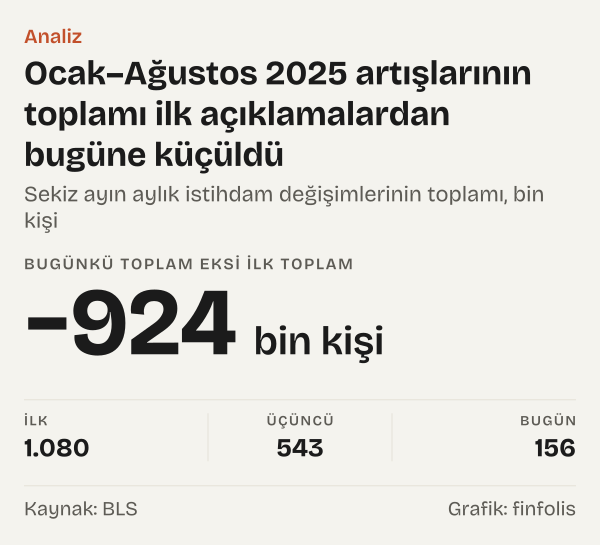

ABD Çalışma İstatistikleri Bürosu (BLS) her ay açıkladığı tarım dışı istihdam artışını sonraki iki ayın raporlarında yeniden yayımlıyor ve yılda bir kez de bütün seriyi idari kayıtlardan gelen sayımlarla hizalıyor. Bu revizyonlar BLS'nin yöntem notunda anlatılan olağan bir pratik. 2026'nın ilk yedi ayında üçüncü tahmin dört ayda ilk açıklamanın üstünde, üç ayda altında kaldı; aylık farklar -109 bin kişi ile 36 bin kişi arasında değişti. Mart 2025 için ilk açıklanan 228 bin kişilik artış ise bugünkü seride 67 bin kişi.

Yazı tek bir ayın değil, 2025–2026 aylarının izini sürüyor: ilk açıklanan rakam, ikinci ve üçüncü tahmin, yıllık benchmark revizyonu ve bugün seride duran değer. Sonuç kısaca şu: aylık istihdam rakamı ilk açıklandığı gün bir tahmindir ve BLS onu kendi takvimiyle, kendi yöntem belgelerinde anlattığı biçimde düzeltir. 2025'in ilk sekiz ayında bu düzeltmelerin hepsi aşağı yönlü oldu; 2026'da ise yönler karışık.

Türkiye'deki okur için konu uzak değil. ABD'nin para politikası kurumu Fed, kendi tanımına göre azami istihdam ve fiyat istikrarı hedefleri için çalışıyor ve karar metinlerinde istihdam verisine yer veriyor.

## Bir rakamın üç hâli

BLS her ay, işyerlerinden toplanan anketin sonuçlarıyla bir önceki ayın tarım dışı istihdam değişimini açıklıyor. Bu ilk açıklama. BLS'nin yöntem notuna göre önceki iki ayın rakamları, sonradan gelen ek anket cevaplarını katmak ve mevsimsellik etkenlerini yeniden hesaplamak için her ay düzenli olarak revize ediliyor; bir aylık tahmin ancak iki revizyondan sonra nihai sayılıyor. Böylece aynı ayın rakamı ertesi ay ikinci tahmin olarak, bir ay sonra da üçüncü tahmin olarak yeniden yayımlanıyor. BLS'nin revizyon tablosu her ay için bu üç rakamı ve aralarındaki farkı yan yana gösteriyor.

Tablo bize iki şey söylüyor. Birincisi, BLS ilk rakamı tek başına bırakmıyor; düzeltmeyi kendisi, açık bir tabloyla yayımlıyor. İkincisi, düzeltmenin yönü önceden belli değil. Bazı aylarda rakam yukarı, bazı aylarda aşağı gidiyor.

*ABD tarım dışı istihdamında aylık değişim, ilk açıklama ve üçüncü tahmin, mevsimsellikten arındırılmış. Kaynak: BLS.*

2026'nın ilk yedi ayında bu dengeyi açıkça görmek mümkün. Ocak 2026 artışı ilk açıklamada 130 bin kişiydi, üçüncü tahminde 160 bin kişi oldu. Mart 2026 rakamı 178 binden 214 bine çıktı. Buna karşılık Mayıs 2026 artışı 172 binden 63 bine indi; ilk ile üçüncü arasındaki fark -109 bin kişi. Şubat 2026'da ilk rakam zaten eksiydi, -92 bin kişi; üçüncü tahmin -156 bin kişi.

Yedi ayın toplamına baktığımızda ilk açıklamalar 537 bin kişi, üçüncü tahminler 450 bin kişi ediyor. Fark -87 bin kişi, ilk toplama göre %-16,2.

## Ocak–Ağustos 2025: sekiz ay, sekiz aşağı yönlü düzeltme

2025'in ilk sekiz ayına gelince tablo tek yönlü. Ocak–Ağustos 2025 arasındaki sekiz ayın her birinde üçüncü tahmin ilk açıklamanın altında kaldı. En büyük düzeltmeler Haziran 2025'te -160 bin kişi, Mayıs 2025'te -120 bin kişi ve Mart 2025'te -108 bin kişi oldu.

Haziran 2025 bu açıdan dikkat çekici bir örnek. İlk açıklamada 147 bin kişilik artış vardı. İkinci tahminde rakam 14 bin kişiye, üçüncü tahminde -13 bin kişiye indi. Yani ilk gün artış olarak okunan ay, üçüncü tahminde küçük bir azalışa döndü.

*Üçüncü tahmin eksi ilk açıklama, aylık istihdam değişimi. Kaynak: BLS.*

Sekiz ayı topladığımızda ilk açıklamaların toplamı 1.080 bin kişi, üçüncü tahminlerin toplamı 543 bin kişi. Aradaki fark -537 bin kişi. Bu, yalnız aylık düzeltmelerin etkisi; yıllık benchmark revizyonu henüz işin içinde değil.

BLS'nin tablosu Eylül ve Ekim 2025 için üç tahminin hepsini vermiyor; bu iki ayı karşılaştırmaya katmadık. Kasım ve Aralık 2025 için tahmin zincirinin içine Şubat 2026'daki yıllık revizyon girdiğinden onları da ayrı tuttuk.

## Bir ayın tam izi: Mayıs 2025 ve Mayıs 2026

İki Mayıs ayını yan yana koymak, düzeltmenin nasıl ilerlediğini adım adım gösteriyor. Mayıs 2025 için ilk açıklanan artış 139 bin kişiydi. Ertesi ay ikinci tahmin 144 bin kişi oldu; rakam bu adımda biraz yukarı gitti. Üçüncü tahminde ise 19 bin kişiye indi. Yıllık benchmark işlendikten sonra bugünkü seride Mayıs 2025 artışı 13 bin kişi. İlk açıklama ile bugün arasındaki fark -126 bin kişi; bunun -120 bin kişisi üçüncü tahmine kadar, kalanı sonrasında oluştu.

Mayıs 2026 için ilk açıklama 172 bin kişiydi. İkinci tahmin 129 bin, üçüncü tahmin 63 bin kişi. Bu ay henüz bir sonraki yıllık benchmark'tan geçmedi; BLS'nin takvimine göre Mart 2026 düzeyindeki nihai benchmark Şubat 2027'de yayımlanacak.

İki örnekte ortak bir nokta var: en büyük düzeltme ikinci ile üçüncü tahmin arasında geldi. Mayıs 2025'te bu adım -125 bin kişi, Mayıs 2026'da -66 bin kişi. Ancak bu bir kural değil. Haziran 2025'te en büyük adım ilk ile ikinci tahmin arasındaydı; Mart 2026'da ise iki adım da rakamı yukarı taşıdı. Revizyonun hangi aşamada ve hangi yönde geleceğini önceden söyleyen bir örüntü bu tabloda görünmüyor.

## Yıllık benchmark revizyonu: anketin sayımla buluşması

Aylık tahminlerin üstüne bir de yılda bir yapılan büyük düzeltme geliyor. BLS'nin benchmark belgesine göre bu düzeltme, anketten çıkan istihdam tahminlerini başlıca işsizlik sigortası kapsamındaki çalışanların idari kayıtlarından türetilen sayımlarla hizalamak için yapılıyor. Ön benchmark belgesi de aynı şeyi söylüyor: tahminler Üç Aylık İstihdam ve Ücret Sayımı'nın (QCEW) kapsamlı istihdam sayılarına göre düzeltiliyor.

Mart 2025 düzeyi için BLS, 9 Eylül 2025'te ön tahminini -911 bin kişi (%-0,6) olarak açıkladı. Nihai revizyon Şubat 2026'da geldi: mevsimsellikten arındırılmış tarım dışı istihdam -898 bin kişi (%-0,6), arındırılmamış seride -862 bin kişi düzeltildi. Nihai rakam ön tahminden 13 bin kişi daha küçük bir düzeltme oldu.

Revizyonun aylık rakamlara etkisi büyük. Ocak–Ağustos 2025 aylarının bugünkü serideki değişimlerini topladığımızda 156 bin kişi buluyoruz. İlk açıklamaların toplamı 1.080 bin kişiydi; aradaki fark -924 bin kişi, ilk toplama göre %-85,6. Üçüncü tahminlerin toplamıyla bugünkü toplam arasındaki fark -387 bin kişi.

*Aylık istihdam değişimi, ilk açıklama ve Ekim 2026 itibarıyla bugünkü değer. Kaynak: BLS.*

Mart 2025 artışı ilk açıklamada 228 bin, bugün 67 bin kişi. Ocak 2025 için ilk açıklama 143 bin kişilik artıştı; bugünkü seride bu ay -48 bin kişilik bir azalış olarak duruyor. Ağustos 2025'in ilk rakamı 22 bin kişiydi; bugün -70 bin kişi.

*Sekiz ayın aylık istihdam değişimlerinin toplamı. Kaynak: BLS.*

## Revizyon bir istisna mı?

Rakamlar ilk bakışta olağandışı görünebilir. BLS'nin kendi benchmark tablosu ise revizyonun her yıl yapıldığını ve iki yöne de gidebildiğini gösteriyor. Mart 2022 düzeyindeki benchmark revizyonu +506 bin kişiydi; istihdam yukarı düzeltilmişti. Mart 2024 düzeyinde revizyon -598 bin kişi, Mart 2019 düzeyinde -489 bin kişi oldu. Mart 2021 düzeyinde ise yalnız -7 bin kişi, Mart 2018 düzeyinde -16 bin kişi.

Tablonun geri kalanı da aynı çeşitliliği taşıyor. Mart 2015 düzeyinde revizyon -172 bin kişi, Mart 2016 düzeyinde -81 bin kişi oldu. Mart 2017 düzeyinde ise istihdam 135 bin kişi yukarı düzeltildi. Mart 2020 düzeyinde -121 bin, Mart 2023 düzeyinde -187 bin kişilik düzeltme var. On bir yılın dokuzunda revizyon eksi yönde, ikisinde artı yönde. Eksi yılların ikisinde, Mart 2018 ve Mart 2021 düzeylerinde, BLS'nin tablosu revizyonu yüzde olarak çok küçük diye ayrıca işaretliyor. Bu dağılım, yönün her yıl yeniden ortaya çıkan bir sonuç olduğunu gösteriyor.

Yani benchmark revizyonunun büyüklüğü yıldan yıla değişiyor. Mart 2025 düzeyindeki -862 bin kişilik arındırılmamış düzeltme, tablodaki 2015–2025 yıllarının en büyüğü. Mart 2026 düzeyi için Ağustos 2026'da açıklanan ön benchmark revizyonu ise -79 bin kişi (%-0,1). BLS'ye göre nihai revizyon Şubat 2027'de, Ocak 2027 istihdam raporuyla birlikte yayımlanacak; bu tarih kurumun kendi takvimi.

Burada karşı okumayı da yazmak gerekiyor. BLS'nin yöntem notu, aylık revizyonları ek anket cevaplarının katılması, benchmark'ı da anket tahminlerinin işsizlik sigortası kayıtlarından gelen sayımlarla hizalanması olarak tanımlıyor. İlk açıklama o güne kadar gelen cevaplarla yapılan tahmin; sonraki tahminler ve benchmark aynı ölçümü daha fazla bilgiyle tamamlıyor. 2026'nın ilk yedi ayında ilk ve üçüncü tahminler arasındaki toplam fark ilk toplamın %-16,2'si kadardı ve aylık farkların yönü karışıktı. 2025'te ise düzeltmelerin aynı yöne yığılması öne çıktı. İki yılın tablosu farklı; tek bir yıldan genel bir kural çıkmıyor.

## Fed'in karar metninde istihdam

Fed'in para politikası sayfası, kurumun Kongre'nin kendisine verdiği azami istihdam, istikrarlı fiyatlar ve ılımlı uzun vadeli faiz hedefleri için çalıştığını yazıyor. Federal Açık Piyasa Komitesi'nin (FOMC) 16 Eylül 2026 tarihli açıklaması da kararı bu çifte görev çerçevesinde anlatıyor. Komite o toplantıda politika faizi hedef aralığını 0,25 puan artırarak %3,75–4'e çıkardı. Açıklamadaki ekonomik değerlendirmede istihdam artışının işgücüyle aynı hızda gittiği ve işsizlik oranının pek değişmediği belirtiliyor.

Yazı Fed'in kararını değerlendirmiyor; kararla istihdam rakamı arasında bir neden-sonuç ilişkisi de kurmuyor. Yalnız bir olguyu not ediyor: Fed'in açıkladığı metinde istihdam koşulları anılıyor.

Türkiye'den bakan okur için pratik sonuç ölçüyle ilgili. Bir istihdam raporunun açıklandığı gün yazılan rakam, o ayın son sözü değil. Aynı ayın ikinci ve üçüncü tahmini sonraki iki raporda geliyor; yıllık benchmark ise ön tahminiyle Ağustos ya da Eylül'de, nihai hâliyle Şubat'ta açıklanıyor. Haberde geçen rakamın hangi tahmin olduğunu bilmek, iki farklı haberdeki iki farklı rakamın neden aynı ayı anlattığını açıklayabiliyor.

## Rakamın oynadığı alanlar

Karşılaştırmanın da sınırları var. Birincisi, bugünkü değer de nihai değil. BLS'nin serisinde Ağustos 2026 ve Eylül 2026 rakamları hâlâ ön veri olarak işaretli: Ağustos 2026 artışı ikinci tahminde 133 bin kişi, Eylül 2026 artışı ilk açıklamada 29 bin kişi. Mart 2026 düzeyindeki benchmark da henüz nihai değil.

İkincisi, ilk açıklama ile bugünkü değer arasındaki fark tek bir nedene bağlı değil. Aylık tahmin güncellemeleri, yıllık benchmark ve olası başka yöntem güncellemeleri aynı rakamın üstünde birlikte iz bırakıyor. Bugünkü değeri ilk açıklamayla karşılaştırırken bu etkileri tek tek ayıramadık; yalnız üçüncü tahmine kadar olan kısmı BLS'nin tablosundan ayrı izleyebildik.

Üçüncüsü, burada yalnız toplam tarım dışı istihdama baktık. Sektör rakamları, işsizlik oranı ya da hane halkı anketi ayrı ölçümler ve kendi revizyon düzenleri var.

## Nasıl hesapladık

İlk açıklama, ikinci ve üçüncü tahminleri BLS'nin aylık tahminler arası revizyon tablosundan, mevsimsellikten arındırılmış toplam tarım dışı istihdam sütunlarından aldık; tabloyu iki ayrı okumayla karşılaştırdık ve 2026'nın ilk yedi ayına ait üçüncü tahminlerin BLS'nin bugünkü serisinden hesaplanan aylık değişimlerle aynı olduğunu doğruladık. Bugünkü değerleri BLS'nin veri arayüzünden CES0000000001 serisinin aylık düzeylerini çekip ardışık iki ayın farkını alarak bulduk. Dönem toplamları aylık değişimlerin toplamıdır. Benchmark rakamları BLS'nin benchmark makalesinden ve ön benchmark duyurularından alındı. Bütün rakamlar bin kişi cinsindendir.

## Kaynaklar

- [BLS: Nonfarm Payroll Employment, Revisions between over-the-month estimates, 2025–2026](https://www.bls.gov/web/empsit/cesnaicsrev.htm)
- [BLS: Total nonfarm employment, CES0000000001, API](https://api.bls.gov/publicAPI/v2/timeseries/data/CES0000000001)
- [BLS: CES National Benchmark Article](https://www.bls.gov/web/empsit/cesbmart.htm)
- [BLS: CES Preliminary Benchmark, 9 Eylül 2025](https://www.bls.gov/news.release/archives/prebmk_09092025.htm)
- [BLS: CES Preliminary Benchmark, Ağustos 2026](https://www.bls.gov/news.release/prebmk.nr0.htm)
- [Fed: FOMC Statement, 16 Eylül 2026](https://www.federalreserve.gov/newsevents/pressreleases/monetary20260916a.htm)
- [Fed: Monetary Policy](https://www.federalreserve.gov/monetarypolicy.htm)
- [BLS: The Employment Situation, Technical Note](https://www.bls.gov/news.release/empsit.tn.htm)
