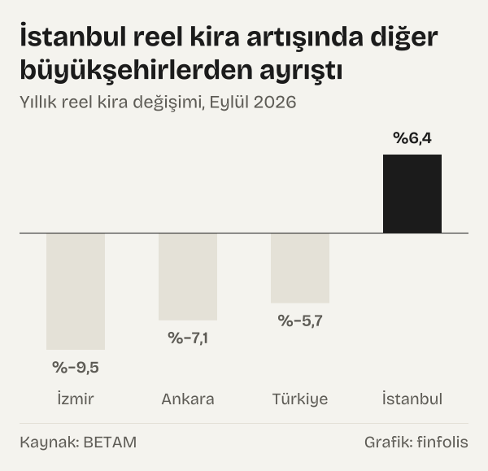
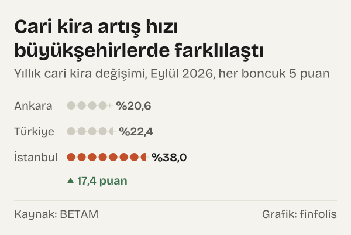
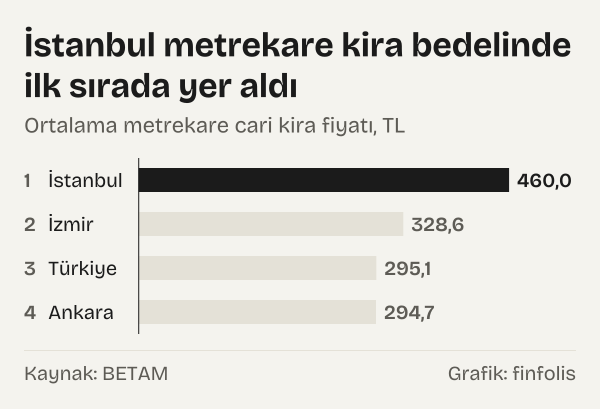
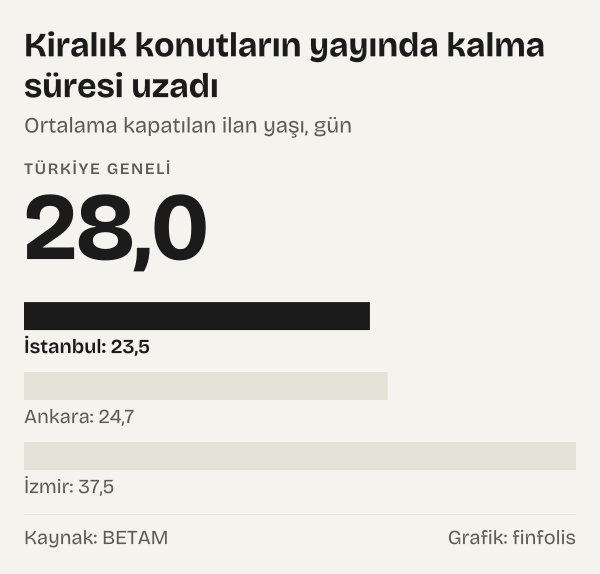

Yurt genelinde kiralık konut piyasasında cari fiyat artışları devam etse de, genel tüketici fiyatları enflasyonundan arındırıldığında kiralar reel olarak gerileme eğilimini sürdürüyor. Bahçeşehir Üniversitesi Ekonomik ve Toplumsal Araştırmalar Merkezi tarafından hazırlanan araştırmaya göre, Eylül 2026 döneminde Türkiye genelindeki yıllık reel kira değişimi yüzde -5,7 seviyesinde gerçekleşti. Bu oran, kiracıların ödediği tutarın nominal olarak artsa bile genel tüketici fiyatlarındaki artışın gerisinde kaldığını gösteriyor.

Buna karşılık, üç büyükşehir arasındaki ayrışma belirgin bir boyuta ulaştı. Ankara ve İzmir'de kiralar reel olarak gerilerken, İstanbul yıllık yüzde 6,4'lük reel artış ile enflasyonu geride bırakan tek büyükşehir oldu. Bu durum megakentte konut talebinin arz kapasitesini zorlamaya devam ettiğini gösteriyor. Diğer metropollerde ise yüksek baz etkisi ve alım gücündeki sınırlılıklar fiyat artışlarının enflasyonun altında kalmasına yol açıyor.

*Yıllık reel kira değişimi, Eylül 2026. Kaynak: BETAM.*

## Enflasyon karşısında reel kiraların seyri

Eylül 2026 döneminde ortalama metrekare cari kira fiyatlarındaki aylık değişim ile aylık enflasyon oranı karşılaştırıldığında, kiraların genel fiyat artış hızına yetişemediği görülüyor. Türkiye genelindeki reel kira fiyat endeksi 165,6 puan seviyesine gerilemiş durumdadır. Bu endeks Eylül 2017 baz dönemine göre hesaplanmaktadır. Reel endeksin seyri, konut piyasasında geçmiş dönemlerde yaşanan hızlı yükselişlerin ardından enflasyon düzeltmesinin devreye girdiğini belgeliyor.

Yıllık reel kira değişiminin negatif bölgede kalması, konut kiralama piyasasında geçmiş yıllarda gözlenen aşırı fiyatlama dalgasının yerini kademeli bir dengelenmeye bıraktığına işaret ediyor. Ülke genelinde yıllık reel kira değişimi yüzde -5,7 olurken, Ankara'da bu gerileme yüzde -7,1 ve İzmir'de yüzde -9,5 seviyesine ulaştı. Böylece İzmir, üç büyükşehir arasında reel kira kaybının en yüksek gerçekleştiği kent konumuna yerleşti. İzmir'deki bu sert reel düşüş, yerel pazarda talep esnekliğinin zayıfladığını ve kiralama sürelerinin uzadığını gösteren önemli bir veridir.

Nominal olarak kira bedelleri artmaya devam etse de, enflasyon karşısında reel gerileme süreci özellikle büyükşehirlerde yaşayan sabit gelirliler açısından önemli bir gösterge sunuyor. Reel kiraların gerilemesi, hanehalkı bütçelerinde kira harcamalarının payının oransal olarak sınırlanmasına zemin hazırlıyor. Ancak bu tablo İstanbul'da tam tersi bir seyir izliyor. İstanbul'da kiraların enflasyonun yüzde 6,4 üzerinde artması, hane gelirlerinin barınma maliyetleri karşısında daha fazla baskı altına girdiğini ortaya koyuyor.

Piyasadaki bu genel eğilim, konut arzının sınırlı olduğu bölgeler ile alternatif kiralık konut stokunun nispeten rahat olduğu kentler arasındaki makasın açılmasına neden oluyor. Enflasyonun yüksek seyrettiği bir ortamda kiraların reel olarak düşmesi, mülk sahiplerinin kira gelirlerinin satın alma gücünü koruyamadığı anlamına da geliyor. Makroekonomik dengelerde [politika faizi ile enflasyon farkı](/haber/politika-faizi-ile-enflasyon-farki-eylul-2026/) gibi göstergeler tasarruf tercihlerini etkilerken, konut piyasasında kira getirileri de bu faiz ortamından payını almaktadır. Bu durum, gayrimenkul yatırımı yapanların getiri hesaplarını doğrudan etkileyen bir parametredir.

## Büyükşehirlerde kira artışlarının ayrışması

Türkiye genelinde cari kira artış oranı bir önceki yılın aynı ayına kıyasla yüzde 22,4 olarak gerçekleşti. Ancak bu artış ülke sathına eşit dağılmadı. İstanbul'da yıllık cari kira artışı yüzde 38,0 gibi yüksek bir seviyede gerçekleşirken, Ankara'da yüzde 20,6 ve İzmir'de yüzde 17,3 olarak kaydedildi. Bu üç büyük ilin ortalamaları arasındaki fark, bölgesel ekonomik dinamiklerin ve kentsel dönüşüm süreçlerinin konut fiyatlamasına nasıl yansıdığını açıkça gösteriyor.

*Yıllık cari kira değişimi, Eylül 2026. Kaynak: BETAM.*

İstanbul'daki yüzde 38,0 oranındaki artış, megakentte hem kentsel dönüşüm kaynaklı geçici konut talebinin hem de merkezi alanlardaki arsa kıtlığının piyasayı canlı tuttuğunu gösteriyor. Buna karşın İzmir'de yıllık cari kira artışının yüzde 17,3 seviyesinde kalması, bu ildeki konut arzı ile talebi arasındaki dengenin kiralayanlar lehine zayıfladığına işaret ediyor. Ankara ise yüzde 20,6'lık artış oranıyla Türkiye ortalamasına en yakın büyükşehir profilini koruyor.

Ülke genelindeki diğer büyük şehirlere bakıldığında da bölgesel ayrışmanın derinleştiği izleniyor. Yıllık cari kira artışının en yüksek gerçekleştiği iller Mardin'de yüzde 36,4, Şanlıurfa'da yüzde 32,2 ve Kayseri'de yüzde 29,9 oldu. Bu illerdeki yüksek oranlar, yerel pazarlarda kiralık daire arzının yetersizliğini ve yeni konut üretim maliyetlerindeki artışın kiralara yansıtıldığını gösteriyor.

Buna karşılık en düşük yıllık kira artışları Eskişehir'de yüzde 13,6, Tekirdağ'da yüzde 13,6, Manisa'da yüzde 13,3, Hatay'da yüzde 7,9 ve Malatya'da yüzde 1,8 olarak ölçüldü. Deprem bölgesinde yer alan Hatay ve Malatya'da kira artış hızının tek hanelerde kalması, afet sonrası bölgedeki sosyoekonomik toparlanma dinamikleri ve geçici barınma çözümlerinin etkisiyle doğrudan ilişkilidir.

Büyükşehirlerdeki bu fiyat hareketleri, Türkiye'de tek bir kira piyasasından bahsetmenin mümkün olmadığını, her kentin kendi iç dengelerine göre şekillendiğini belgeliyor. Sanayi yoğun kentler ile turizm odaklı kentler arasındaki kira farkları, iç talebin yöneldiği adresleri de haritalandırmaktadır.

## Metrekare fiyatları ve hane bütçesine yansıması

Konut piyasasında ilan edilen birim fiyatlar incelendiğinde, Türkiye genelinde ortalama kiralık konut metrekare cari fiyatı 295,1 TL oldu. Bu birim fiyat düzeyi, ülke genelinde yüz metrekare büyüklüğündeki standart bir konut için talep edilen ortalama kiranın yaklaşık otuz bin lira seviyesine ulaştığını gösteriyor.

Büyükşehirler arasında en yüksek birim fiyat İstanbul'da kaydedildi. İstanbul'da ortalama metrekare kiralık fiyatı 460,0 TL seviyesine yükseldi. Dolayısıyla İstanbul'da yüz metrekare bir dairenin ortalama kiralama bedeli kırk altı bin lira düzeyindedir. İzmir'de ortalama metrekare kira bedeli 328,6 TL, Ankara'da ise 294,7 TL olarak belirlendi.

*Ortalama metrekare cari kira fiyatı, TL. Kaynak: BETAM.*

Ankara'daki metrekare fiyatının Türkiye ortalaması olan 295,1 TL düzeyine oldukça yakın olması, başkentteki kira seviyesinin genel ülke ortalamasını yansıttığını teyit ediyor. İzmir'deki 328,6 TL seviyesindeki ortalama metrekare fiyatı ise cari artış hızı yavaşlamış olsa dahi geçmiş yıllardaki birikimli artışların etkisiyle birim fiyatın yüksek kalmayı sürdürdüğünü gösteriyor.

Metrekare başına talep edilen kira bedelleri, hane bütçesi üzerinde barınma harcamalarının belirleyici ağırlığını koruduğunu belgeliyor. Özellikle asgari ücret ve ortalama memur maaşları ile karşılaştırıldığında, büyükşehirlerde konut kiralama maliyetinin çalışan gelirleri üzerindeki payı oldukça yüksek seviyelerde seyrediyor. İki çalışanlı bir hanede bile tek bir maaşın tamamen barınmaya ayrılması zorunluluğu, kentsel yaşam maliyeti tartışmalarını canlı tutuyor.

Fiyatların ulaştığı bu mutlak seviyeler, kiracıların konut tercihlerinde belirgin değişikliklere gitmesine yol açıyor. Merkezi semtlerden çeper ilçelere doğru yaşanan kayma, ulaşım maliyetleri ile kira tasarrufu arasındaki dengenin yeniden hesaplanmasını zorunlu kılıyor. Küçük metrekareli dairelere yöneliş ve ortak konut paylaşımı gibi eğilimler de bu yüksek metrekare fiyatlarının doğal bir sonucu olarak yaygınlaşıyor.

## İlan yaşları ve piyasadaki talep yavaşlaması

Sektördeki canlılığın bir diğer kritik göstergesi ilanların yayında kalma süresidir. Kapatılan ilan yaşı, ilgili ayda kullanıcılar tarafından kapatılan kiralık ilanların ortalama kaç gün boyunca yayında kaldığını ölçmektedir. Türkiye genelinde kiralık konut kapatılan ilan yaşı bir önceki aya göre 0,8 gün uzayarak 28,0 gün seviyesine çıkmıştır.

*Ortalama kapatılan ilan yaşı, gün. Kaynak: BETAM.*

Söz konusu sürenin uzaması, ev sahiplerinin belirlediği fiyatlara kiracı bulma sürecinin yavaşladığına işaret etmektedir. Büyükşehirler bazında kapatılan ilan yaşı İstanbul'da 23,5 gün, Ankara'da 24,7 gün ve İzmir'de 37,5 gün olarak gerçekleşti. İstanbul ve Ankara'da konutlar ortalama üç haftayı biraz aşan sürede kiralanırken, İzmir'de bir ilanın kapanması beş haftadan uzun sürmektedir.

Kiralık konut talep endeksindeki gelişmeler de bu yavaşlama tablosunu desteklemektedir. Kiralık konut talep göstergesi bir önceki aya kıyasla yüzde -15,1 azaldı. Talepteki bu aylık gerilemede, yaz aylarında üniversite öğrencilerinin ve kamu çalışanlarının taşınma hareketliliğiyle zirve yapan mevsimsel etkinin sonbaharla birlikte yerini sakinliğe bırakması etkili oldu. Bununla birlikte talep endeksi bir önceki yılın aynı ayına göre yüzde 5,5 artış kaydetti.

Kapanma süresinin uzaması ve aylık talebin gerilemesi, kiralık konut piyasasında ev sahiplerinin fiyat artırma gücünün belirli sınırlarla karşılaştığını göstermektedir. İlanların daha uzun süre yayında kalması, yüksek fiyat belirleyen mülk sahiplerini zaman içinde fiyat revizyonu yapmaya yönelten temel piyasa dinamiklerinden biridir. Kiracıların piyasada daha seçici davranması, ilan süresini uzatarak fiyat direncini kıran bir baskı unsuru oluşturuyor.

Talep endeksindeki dönemsel dalgalanmalar, gayrimenkul sektöründe arz ve talep dengesinin anlık değil gecikmeli çalıştığını hatırlatıyor. Kiralama sezonunun kapanmasıyla birlikte kış aylarına girerken ilan yaşlarının daha da uzaması ve fiyat artış hızının ivme kaybetmesi geçmiş yıllardaki piyasa döngüleriyle uyumlu bir seyir sunmaktadır.

## Ölçüm sınırları ve verinin gösterdikleri

Bu analizde yer alan göstergeler, sahibinden.com platformunda kullanıcılara sunulan ilan fiyatlarına dayanmaktadır. İlan edilen fiyatlar ev sahiplerinin talep ettiği tutarları yansıtır; gerçekte kiralamanın hangi nihai bedel üzerinden tamamlandığı ilan verisinden doğrudan takip edilemez. Bu nedenle ilan fiyatları fiili piyasa eğilimlerini ve piyasanın yönünü yansıtmakla birlikte, gerçekleşen kira kontratlarıyla arasında pazarlık marjı bulunabilir.

Ayrıca bu veriler yeni kiraya verilen boş konutların fiyatlarını ölçer. Türkiye İstatistik Kurumu tarafından tüketici enflasyonu sepetinde izlenen kira endeksi ise mevcut evinde oturmaya devam eden milyonlarca kiracının ödediği sözleşme yenileme artışlarını da kapsar. Bu metodolojik fark nedeniyle, ilan verilerine dayalı kira endeksleri ile resmi enflasyon sepetindeki kira kalemi farklı dinamikleri ve farklı oranları gösterir.

Çevrim içi platform verilerinin sağladığı en büyük avantaj, piyasanın anlık nabzını ve marjinal fiyat eğilimlerini gecikmesiz olarak yansıtmasıdır. Tüketici fiyatlarındaki genel katılık ve [çekirdek enflasyon göstergeleri](/haber/cekirdek-enflasyon-nedir-b-ve-c-endeksleri/) incelendiğinde, hizmetler sektöründeki fiyatlama davranışlarının kira üzerinde belirleyici olduğu görülmektedir. Yeni bir konut kiralamak isteyen bir bireyin karşılaşacağı gerçek piyasa fiyatı, geçmiş sözleşmelerin ağırlıklı ortalamasını içeren resmi anketlerden ziyade aktif ilanların sunduğu ortanca değerlerle daha yakından örtüşür. Bu ayrımın doğru yapılması, piyasa analizlerinin sıhhati açısından kritik önemdedir.

## Nasıl hesapladık

Veriler, Bahçeşehir Üniversitesi Ekonomik ve Toplumsal Araştırmalar Merkezi tarafından yayımlanan sahibindex Kiralık Konut Piyasası Görünümü Ekim 2026 raporundan alınmıştır. Ortalama metrekare fiyatları, sahibinden.com üzerindeki ilanların temizlenmesi ve tabakalanmış ortanca fiyat yöntemi uygulanmasıyla türetilmiştir.

Yıllık reel kira değişimleri, ilan fiyatı endeksinin Türkiye İstatistik Kurumu Tüketici Fiyat Endeksi ile enflasyondan arındırılması yoluyla hesaplanmıştır. Talep endeksi; görüntüleme, favori, mesaj, arama ve platform ziyaret verilerinin Şubat 2020 dönemi baz alınarak ağırlıklandırılmasıyla oluşturulmuştur. Kapatılan ilan yaşı ise yayından kaldırılan kiralık konut ilanlarının yayında kaldığı gün sayısının toplam kapatılan ilan adedine bölünmesiyle elde edilmiştir.

## Kaynaklar

- [BETAM: sahibindex Kiralık Konut Piyasası Görünümü, Ekim 2026](https://betam.bahcesehir.edu.tr/2026/10/sahibindex-kiralik-konut-piyasasi-gorunumu-ekim-2026/)
- [TÜİK: Tüketici Fiyat Endeksi Bülteni, Eylül 2026](https://www.tuik.gov.tr)
