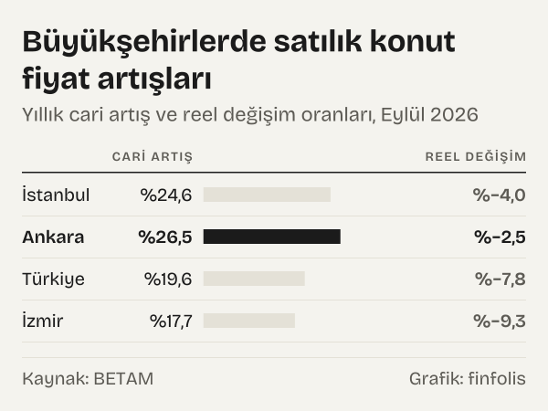
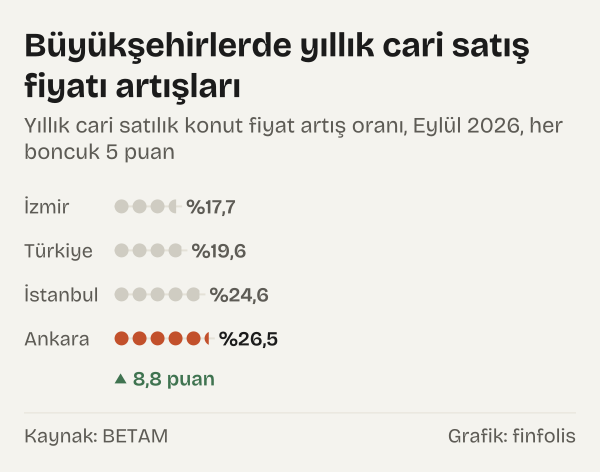
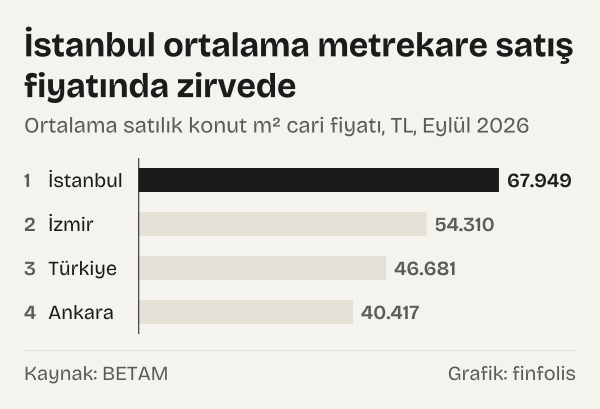
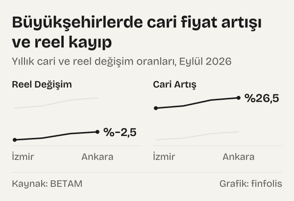

Yurt genelinde konut piyasasında etiket fiyatları yukarı yönlü hareketini sürdürse de, genel tüketici fiyatlarındaki artıştan arındırıldığında gayrimenkul fiyatlarının reel olarak gerilediği görülüyor. Bahçeşehir Üniversitesi Ekonomik ve Toplumsal Araştırmalar Merkezi tarafından hazırlanan araştırmaya göre, Eylül 2026 döneminde Türkiye genelindeki yıllık reel fiyat değişimi yüzde -7,8 seviyesinde gerçekleşti. Bu gösterge, nominal olarak yükselen konut değerlerinin enflasyon sepeti karşısında satın alma gücünü koruyamadığını belgeliyor.

Buna karşın, cari fiyat artışları ile genel enflasyon arasındaki makasın açılması konutun yatırım aracı olarak sunduğu getiriyi doğrudan etkiliyor. Ülke genelinde yıllık cari fiyat artışı yüzde 19,6 seviyesinde gerçekleşirken, bu oranın genel fiyat düzeyindeki yıllık artış hızının oldukça gerisinde kalması mülk sahiplerinin reel bir sermaye kaybı yaşamasına yol açıyor. Geçmiş dönemlerdeki yüksek fiyatlama ortamının ardından başlayan bu düzeltme hareketi, konut edinimini planlayan hanehalkları açısından farklı piyasa şartları oluşturuyor.

*Yıllık cari artış ve reel değişim oranları, Eylül 2026. Kaynak: BETAM.*

## Enflasyon karşısında eriyen reel konut fiyatları

Eylül 2026 döneminde satılık konut reel fiyat endeksi aylık bazda sınırlı bir artış gösterse de, yıllık bazda negatif bölgedeki seyrini korudu. Türkiye genelinde satılık konut reel fiyat endeksi 141,9 puan seviyesinde gerçekleşti. Eylül 2017 baz dönemine göre takip edilen bu endeks, gayrimenkul piyasasında yaşanan uzun dönemli fiyat dalgalanmalarının enflasyon süzgecinden geçirildiğinde nereye oturduğunu gösteren en temel göstergelerden biridir.

Büyükşehirler ölçeğindeki reel fiyat hareketleri incelendiğinde, gerileme eğiliminin genele yayıldığı ancak iller arasında hız farkları bulunduğu görülüyor. Yıllık reel fiyat değişimi İstanbul'da yüzde -4,0, Ankara'da yüzde -2,5, İzmir'de ise yüzde -9,3 olmuştur. Üç büyük il arasında reel kaybın en derin yaşandığı kent İzmir olurken, başkent Ankara yüzde -2,5 ile reel değerini en güçlü savunan şehir olarak öne çıktı. İstanbul ise yüzde -4,0'lük reel gerilemeyle ülke ortalamasından daha sınırlı bir kayıp yaşadı.

Reel fiyat endekslerinin ulaştığı düzeyler de metropoller arasındaki tarihsel birikimi yansıtıyor. Eylül 2026 döneminde satılık konut reel fiyat endeksi İstanbul'da 146,5 puan, Ankara'da 182,5 puan ve İzmir'de 148,7 puan seviyesinde gerçekleşti. Ankara'daki endeksin diğer büyükşehirlerin belirgin biçimde üzerinde seyretmesi, başkentin son yıllarda aldığı nitelikli kamu yatırımları ve artan kentsel yoğunlaşmanın birikimli etkisini belgeliyor. Buna karşılık İzmir ve İstanbul endekslerinin birbirine yakın düzeylerde dengelenmesi, büyük metropollerdeki fiyatlama eşiklerinin ortak bir doygunluk noktasına yaklaştığını gösteriyor.

Piyasa katılımcıları açısından bu reel gerileme süreci, makroekonomik finansman koşullarıyla yakından ilişkilidir. Konut kredisi faiz oranlarının yüksekliği ve piyasadaki likidite sıkılığı, alıcıların nakit birikimlerini alternatif enstrümanlarda değerlendirmesine yol açarken konut talebini baskılamaktadır. Makro dengeler içinde [politika faizi ile enflasyon farkı](/haber/politika-faizi-ile-enflasyon-farki-eylul-2026/) seviyesinin sunduğu yüksek faiz getirisi, tasarruf sahiplerinin gayrimenkul alım kararlarını ertelemesinde belirleyici bir rol oynamaktadır. Bu erteleme davranışı, konut satıcılarının fiyat artırma hızını sınırlandırmakta ve reel fiyatların düşüş trendini beslemektedir.

## Büyükşehirlerde cari fiyat artışları ve bölgesel ayrışma

Ülke genelindeki konut etiketlerinde gözlenen nominal hareketler, enflasyonun gerisinde kalsa dahi çift haneli artış hızını koruyor. Türkiye genelinde yıllık cari fiyat artışı yüzde 19,6 seviyesinde ölçüldü. Bu oran, konut arzının maliyet artışları ile karşı karşıya olduğunu ancak talep yetersizliği sebebiyle bu maliyetlerin fiyatlara tam olarak yansıtılamadığını ortaya koymaktadır.

Metropollerdeki cari artış oranları karşılaştırıldığında, yerel piyasaların farklı dinamiklerle hareket ettiği görülüyor. Yıllık cari fiyat artışı İstanbul'da yüzde 24,6, Ankara'da yüzde 26,5 ve İzmir'de yüzde 17,7 oldu. Ankara yüzde 26,5 ile en yüksek nominal artışı yakalayan büyükşehir olurken, İzmir yüzde 17,7 ile Türkiye ortalamasının da gerisinde kaldı. Başkent Ankara ile İzmir arasındaki cari artış oranları kıyaslandığında 8,8 puanlık bir fark ortaya çıkmaktadır.

*Yıllık cari satılık konut fiyat artış oranı, Eylül 2026. Kaynak: BETAM.*

Ankara'daki cari artışın yüzde 26,5 seviyesine ulaşması, başkente yönelik hem kentsel gelişim akslarındaki yeni konut projelerinin hem de bürokrasi ve üniversite nüfusunun oluşturduğu sürekli barınma gereksiniminin piyasayı canlı tuttuğunu gösteriyor. İstanbul'da ise kentsel dönüşüm alanlarının yaygınlığı ve yüksek inşaat girdi maliyetleri, nominal fiyatların yüzde 24,6 oranında yükselmesini destekliyor. İzmir'de yüzde 17,7'de kalan artış ise kentin geçmiş yıllarda yaşadığı yoğun fiyat tırmanışının ardından bir soluklanma evresine girdiğini teyit ediyor.

Sanayi havzaları ve büyük kentler genelinde ölçülen en yüksek cari artışlar belirli merkezlerde yoğunlaşıyor. Satılık konut ilan fiyatlarında yıllık bazda en hızlı artışın görüldüğü iller Kocaeli'de yüzde 26,3 ve Trabzon'da yüzde 23,8 olarak kaydedildi. Sanayi havzası Kocaeli'deki yüksek oran, kentin üretim merkezlerine yakınlığı ve İstanbul'dan taşınan lojistik ve endüstriyel tesislerin çalışan nüfusu çekmesiyle doğrudan bağlantılıdır. Karadeniz sahil şeridinin merkezi Trabzon'da ise yerel arzın sınırlı kalması fiyatları desteklemektedir.

Diğer yandan yıllık bazda en düşük cari artışların kaydedildiği iller Hatay'da yüzde 15,4, Erzurum'da yüzde 15,2, Balıkesir'de yüzde 15,0, Tekirdağ'da yüzde 14,7 ve Aydın'da yüzde 11,9 olarak gerçekleşti. Ege ve Marmara havzasında yer alan Aydın, Tekirdağ ve Balıkesir'deki bu yavaşlama, önceki yıllarda yazlık konut ve sahil şeridine yönelen talep dalgasıyla şişen fiyatlamanın normalleşme sürecine işaret ediyor. Deprem sonrası toparlanma sürecindeki Hatay'da ise piyasanın yeniden yapılanma dinamikleri fiyat artış hızını sınırlamaktadır.

## Metrekare fiyatları ve konut ediniminde birikim sınırı

Konut piyasasında birim maliyetleri temsil eden ortalama metrekare fiyatları, hanehalklarının konut edinim gücünü ölçmek için temel bir parametredir. Türkiye genelinde ortalama satılık konut ilan metrekare cari fiyatı 46.681 TL seviyesine yükselmiştir. Bu birim fiyat düzeyi, ülke genelinde yüz metrekarelik standart bir apartman dairesi satın almak isteyen bir bireyin yaklaşık dört milyon yedi yüz bin lira tutarında bir bütçeyi gözden çıkarması gerektiğini gösteriyor.

Kentler arasında birim fiyat farkları belirgin bir makasa işaret ediyor. İstanbul'da ortalama satılık konut metrekare fiyatı 67.949 TL seviyesine ulaşarak Türkiye ortalamasını çok geride bıraktı. İstanbul'da yüz metrekarelik bir dairenin ortalama piyasa değeri yaklaşık altı milyon sekiz yüz bin lirayı bulmaktadır. İzmir'de ortalama metrekare fiyatı 54.310 TL, Ankara'da ise 40.417 TL olarak gerçekleşti.

*Ortalama satılık konut m² cari fiyatı, TL, Eylül 2026. Kaynak: BETAM.*

İstanbul'un 67.949 TL düzeyindeki metrekare fiyatı, metropolde arsa arzının tükenme noktasına gelmesi ve kentsel dönüşüm maliyetlerinin birim fiyatlara doğrudan eklenmesiyle şekilleniyor. İzmir'deki 54.310 TL'lik birim değer ise kentin yaşam kalitesi algısı ve sahil hattındaki yüksek arsa değerleriyle destekleniyor. Ankara'daki ortalama birim fiyatın 40.417 TL seviyesinde kalarak Türkiye ortalamasının altında seyretmesi, başkentin topografik genişleme olanaklarının arsa maliyetlerini göreceli olarak makul tutmasından kaynaklanmaktadır.

Fiyatların ulaştığı bu mutlak seviyeler, hane gelirleri ile konut fiyatları arasındaki çarpanın tarihsel yüksek düzeylerde kalmasına yol açıyor. Kredi imkanlarının sınırlı olduğu bir piyasada, tasarruflarla konut peşinatı oluşturmak giderek daha uzun yıllar süren bir birikim çabasını gerektirmektedir. Bu finansal kısıt, orta gelir grubundaki hanehalklarını konut piyasasından kiralık konut piyasasına yönlendirerek mülk sahipliği oranının gerilemesine zemin hazırlamaktadır.

Yatırım amaçlı konut alımlarında da metrekare başına istenen bedeller ile kira getirileri arasındaki amortisman süreleri yeniden hesaplanıyor. Kira çarpanlarının uzaması ve mevduat faizlerinin sunduğu risksiz getiri alternatifi, gayrimenkulün geleneksel getiri cazibesini sorgulatıyor. Bu eğilim, konut piyasasında spekülatif talep dalgasının kesilmesinde ve işlemlerin reel alıcılara indirgenmesinde önemli bir dönüm noktası oluşturuyor.

## Satılık konut talebinde sert daralma ve piyasa dengesi

Tüketici iştahının nabzını tutan talep göstergeleri, konut alım niyetlerinde kayda değer bir geri çekilmeye işaret ediyor. Satılık konut talep endeksi bir önceki aya kıyasla yüzde -6,4 geriledi. Aylık bazdaki bu düşüş, yaz aylarının sona ermesi ve finansman koşullarındaki sıkılığın devam etmesiyle konut piyasasındaki mevsimsel ivmenin zayıfladığını göstermektedir.

Yıllık bazdaki göstergeler ise talepteki daralmanın yapısal ve derin boyutlarını çok daha net sergilemektedir. Satılık konut talep endeksi bir önceki yılın aynı ayına kıyasla yüzde -10,2 azaldı. Talep endeksinde kaydedilen bu çift haneli daralma, alıcıların yüksek faizler ve yüksek fiyatlar karşısında piyasadan çekildiğini veya alım kararlarını belirsiz bir geleceğe ertelediğini açıkça kanıtlamaktadır.

Alıcıların piyasadan çekilmesi, satılık konut piyasasında arz ve talep dengesini alıcılar lehine yeniden biçimlendiriyor. Konut ilanlarına yönelik kullanıcı aramaları, favoriye eklemeler ve mesaj etkileşimlerinden türetilen bu göstergedeki düşüş, satıcıların fiyat belirleme gücünü aşındıran temel mekanizmayı oluşturuyor. Tüketici fiyatlarındaki genel katılık ve [çekirdek enflasyon göstergeleri](/haber/cekirdek-enflasyon-nedir-b-ve-c-endeksleri/) temel mal piyasalarında etkisini sürdürürken, gayrimenkul sektöründe talebin yüzde -10,2 oranında küçülmesi piyasanın yönünü tayin ediyor.

Talep daralmasının sürdüğü bir konjonktürde, konut üreticileri ve bireysel satıcılar için satış stratejileri köklü biçimde değişmektedir. Peşin alımlarda yapılan indirim oranları genişlemekte, takas ve vadeli ödeme gibi alternatif yöntemler pazarda yeniden öne çıkmaktadır. Talebin yetersiz kalması, ilan sitelerindeki aktif stokun erime hızını düşürerek piyasa dengesini yeni bir fiyat eşiğine doğru zorlamaktadır.

## İlan yaşlarının uzaması ve satış sürelerindeki gecikme

Gayrimenkul piyasasında alım-satım süreçlerinin ne ölçüde akıcı işlediğini gösteren en kritik göstergelerden biri kapatılan ilan yaşlarıdır. Kapatılan ilan yaşı, ilgili ayda kullanıcılar tarafından yayından kaldırılan satılık konut ilanlarının ortalama kaç gün boyunca yayında kaldığını ölçmektedir. Türkiye genelinde satılık konut kapatılan ilan yaşı bir önceki aya kıyasla 3,5 gün uzayarak 57,6 gün seviyesine yükselmiştir.

*Yıllık cari ve reel değişim oranları, Eylül 2026. Kaynak: BETAM.*

Söz konusu sürenin 57,6 güne çıkması, Türkiye genelinde bir konutun satış sürecinin neredeyse iki ayı bulduğunu gösteriyor. Kapatılan ilan yaşının aylık bazda 3,5 gün uzaması ise satış hızındaki yavaşlamanın sonbahar döneminde belirginleştiğini belgeliyor. İlanların daha uzun süre yayında kalması, satıcıların belirledikleri fiyatlar ile alıcıların ödemeye hazır oldukları bütçeler arasındaki uyuşmazlığın sürdüğüne işaret etmektedir.

Bölgesel ölçekteki kapatılan ilan yaşları, yerel piyasaların likidite seviyelerini ortaya koyuyor. Kapatılan ilan yaşı İstanbul'da 56,0 gün, Ankara'da 47,7 gün ve İzmir'de 66,8 gün olmuştur. Başkent Ankara, 47,7 gün ile üç büyükşehir arasında en hızlı satışın gerçekleştiği pazar olma konumunu sürdürdü. İstanbul'da bir konutun satışı ortalama sekiz haftayı bulurken, İzmir'de bu süre dokuz buçuk haftayı aşarak 66,8 güne ulaştı.

İzmir'deki ilan yaşının 66,8 gün gibi yüksek bir seviyede bulunması, bu ildeki konut arzının fiyat esnekliğinin zayıfladığını ve alıcı bulmanın ciddi biçimde güçleştiğini gösteriyor. Ankara'da ise 47,7 günlük süre, kentin uygun birim fiyat düzeyi ve canlı talebi sayesinde büyükşehirler arasında likiditesi en yüksek gayrimenkul piyasası olduğunu belgeliyor.

Kapanma sürelerinin uzaması süreci, evini satmak isteyen mülk sahipleri üzerinde fiyat revizyonu baskısını artırıyor. Piyasada uzun süre ilanda kalan konutların zaman içinde değer kaybetme algısı yaratması, satıcıları başlangıçta belirledikleri yüksek fiyatları aşağı yönlü güncellemeye yöneltiyor. Bu dinamik, reel fiyatlardaki gerilemenin mekanik zeminini oluşturan temel piyasa tepkilerinden biri olarak işlev görmektedir.

## Ölçüm sınırları ve ilan verisinin dinamikleri

Bu araştırmada paylaşılan bulgular, sahibinden.com platformunda yayımlanan çevrim içi satılık konut ilanlarından derlenen verileri temel almaktadır. İlan verileri, mülk sahiplerinin ve gayrimenkul danışmanlarının talep ettiği teklif fiyatlarını yansıtır. Gerçekleşen nihai tapu devirlerinde taraflar arasında yapılan pazarlık payları ve nakit ödeme iskontoları ilan fiyatlarına tam olarak yansımayabilir.

Ayrıca ilan verileri piyasaya yeni çıkan veya aktif olarak satışta bulunan bağımsız birimlerin marjinal fiyatlamasını ölçer. Tapu ve Kadastro Genel Müdürlüğü kayıtlarına dayanan resmi satış istatistikleri ise geçmişte ipoteği bağlanmış veya inşaat aşamasında satışı yapılmış konutların tapu devirlerini de kapsayabilir. Bu nedenle ilan endeksleri gerçekleşen işlem hacimlerinden ziyade piyasanın yönünü ve satıcıların beklentilerini yansıtan öncü bir gösterge niteliğindedir.

Çevrim içi platform verilerinin sağladığı en önemli katkı, piyasadaki eğilimlerin gecikmesiz olarak izlenebilmesine olanak tanımasıdır. Talep endeksi ve ilan süreleri gibi davranışsal göstergeler, makroekonomik kararların ve faiz politikalarının gayrimenkul sahasına nasıl yansıdığını eşzamanlı olarak haritalandırmaktadır. Verinin sunduğu bu detaylı kırılımlar, sektörün geleceğine yönelik sağlıklı çıkarımlar yapılabilmesi için vazgeçilmez bir analitik zemin sunmaktadır.

## Nasıl hesapladık

Bu analizde yer alan veriler, Bahçeşehir Üniversitesi Ekonomik ve Toplumsal Araştırmalar Merkezi tarafından hazırlanan sahibindex Satılık Konut Piyasası Görünümü Ekim 2026 raporundan derlenmiştir. Ortalama metrekare fiyatları hesaplanırken ilanlar uç değerlerden arındırılmış ve tabakalanmış ortanca fiyat yöntemi uygulanmıştır.

Hesaplamada yıllık reel satış fiyatı değişimleri, sahibinden.com satış fiyatı endeksinin Türkiye İstatistik Kurumu Tüketici Fiyat Endeksi ile arındırılması yoluyla hesaplanmıştır. Talep endeksi; görüntüleme sayıları, favoriye eklemeler, mesajlar, telefon aramaları ve web ile mobil platform ziyaretlerinden oluşan altı farklı göstergenin Nisan 2020 baz dönemi ağırlıkları üzerinden birleştirilmesiyle elde edilmiştir. Kapatılan ilan yaşı ise ilgili ayda kullanıcılar tarafından yayından kaldırılan konut ilanlarının toplam yayında kalma gün sayısının tekil kapatılan ilan sayısına bölünmesiyle türetilmiştir.

## Kaynaklar

- [BETAM: sahibindex Satılık Konut Piyasası Görünümü, Ekim 2026](https://betam.bahcesehir.edu.tr/2026/10/sahibindex-satilik-konut-piyasasi-gorunumu-ekim-2026/)
- [TÜİK: Tüketici Fiyat Endeksi Bülteni, Eylül 2026](https://www.tuik.gov.tr)
