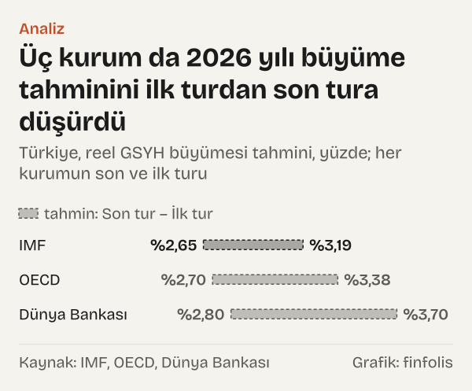
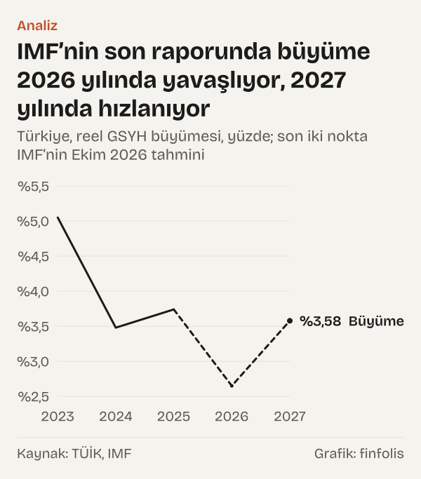
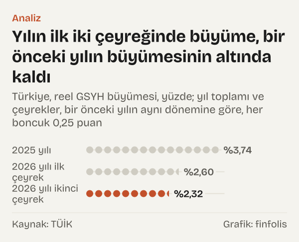
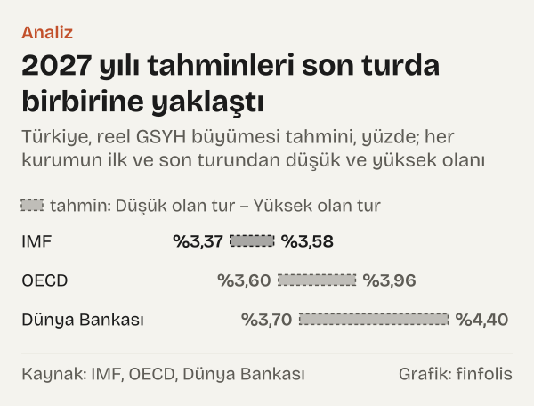
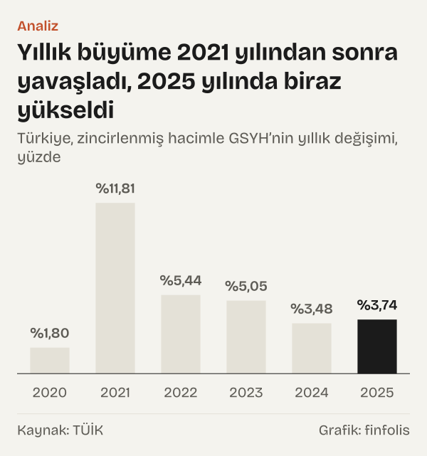

Uluslararası Para Fonu (IMF) Nisan 2025'te yayımladığı Dünya Ekonomik Görünüm raporunda Türkiye ekonomisinin 2025 yılında %2,7 büyüyeceğini tahmin etmişti. Türkiye İstatistik Kurumu'nun (TÜİK) zincirlenmiş hacim verisine göre gerçekleşen büyüme %3,74 oldu. Tahmin, gerçekleşenin 1,03 puan altında kaldı.

Tek bir örnek, bir büyüme tahmininin ne olduğunu da ne olmadığını da gösteriyor. Tahmin, yayımlandığı gün eldeki bilgiyle kurulmuş bir hesap. Ekonomi yol aldıkça kurumlar tahminlerini yeniliyor ve aynı yıl için birkaç farklı rakam ortaya çıkıyor. Okur için asıl bilgi çoğu zaman tek bir rakamda değil, rakamların hangi aralıkta durduğunda ve zaman içinde nasıl kaydığında.

Yazı, Türkiye'nin 2026 yılı ve 2027 yılı büyümesi için üç uluslararası kurumun, IMF, Ekonomik İşbirliği ve Kalkınma Örgütü (OECD) ve Dünya Bankası'nın yayımladığı tahminleri yan yana koyuyor. Kendi tahminimizi yapmıyoruz, hangi kurumun rakamının daha yakın çıkacağını da söylemiyoruz. Sorduğumuz şu: tahminler turdan tura nasıl değişti ve son turda birbirinden ne kadar uzaklar?

Üç kurumun yayım takvimi farklı. IMF Dünya Ekonomik Görünüm raporunu nisan ve ekim aylarında, OECD Ekonomik Görünüm raporunu haziran ve aralık aylarında, ara dönem raporlarını mart ve eylül aylarında yayımlıyor. Dünya Bankası Küresel Ekonomik Beklentiler raporunu ocak ve haziran aylarında çıkarıyor. Bu yüzden bir yıl için yapılan tahminler aynı günde değil, birkaç ay arayla birbirini izleyen turlar hâlinde geliyor. Bu yazıda her kurumun elimizdeki ilk ve son turunu, arada bulunanları da yayım sırasıyla kullanıyoruz.

Kısa cevap: 2026 yılı için tahminler ilk turlardan bu yana aşağı kaydı ve birbirine yaklaştı. Son turda üç kurumun 2026 yılı tahminleri arasındaki fark yalnız 0,15 puan.

## Geride kalan yılın sınaması

2025 yılı artık geride kaldığı için o yılın tahminleri gerçekleşenle karşılaştırılabiliyor. IMF'nin Nisan 2025 tahmini %2,7'ydi. Yılın sonuna yaklaşırken yayımlanan tahminler gerçekleşene çok daha yakındı: OECD Aralık 2025'te %3,65, Dünya Bankası Ocak 2026'da %3,5 tahmin etti.

*Türkiye, reel GSYH büyümesi tahmini, yüzde; her kurumun son ve ilk turu. Kaynak: IMF, OECD, Dünya Bankası.*

Gerçekleşen %3,74 ile karşılaştırıldığında OECD'nin Aralık 2025 tahmini 0,09 puan, Dünya Bankası'nın Ocak 2026 tahmini 0,24 puan geride kaldı. IMF'nin Nisan 2025'te yaptığı tahmin ise 1,03 puan aşağıdaydı.

Karşılaştırma, kurumlar arasında bir sıralama değil. Tahminler farklı tarihlerde yapıldı. Aralık 2025'te yılın büyük kısmının verisi biliniyordu; Nisan 2025'te ise yılın ilk çeyreğinin verisi de henüz açıklanmamıştı. Tahmin tarihi gerçekleşmeye yaklaştıkça farkın küçülmesi şaşırtıcı değil; burada gördüğümüz de bu.

Yine de bu sınama bir şeyi açıkça gösteriyor: yılın ilk aylarında yapılan bir tahmin ile gerçekleşen arasında bir puanı aşan fark olabiliyor. Bu, aşağıda ele aldığımız 2026 yılı ve 2027 yılı tahminlerine bakarken akılda tutulacak bir ölçü.

## Turdan tura 2026 yılı

2026 yılı için ilk tahminlerin tarihi kurumdan kuruma değişiyor. Elimizdeki en eski tahmin IMF'nin Nisan 2025 raporundaki %3,2. OECD Aralık 2025'te %3,4, Dünya Bankası Ocak 2026'da %3,7 tahmin etti. Bu üç rakam %3,19 ile %3,7 arasında, 0,51 puanlık bir yelpaze oluşturuyordu.

Sonraki turlarda üç kurum da tahminini aşağı çekti. OECD Haziran 2026'daki Ekonomik Görünüm raporunda %3,1'e, Eylül 2026'daki ara dönem raporunda %2,7'ye indi. Dünya Bankası Haziran 2026'da %2,8 verdi. IMF Ekim 2026'da %2,7 açıkladı; veri tabanındaki değer %2,65.

*Türkiye, reel GSYH büyümesi, yüzde; son iki nokta IMF’nin Ekim 2026 tahmini. Kaynak: TÜİK, IMF.*

İlk ve son tur arasındaki düşüş üç kurumda farklı büyüklükte. Dünya Bankası 2026 yılı tahminini 0,9 puan düşürdü. OECD tahmini 0,68 puan düştü. IMF tahmini 0,54 puan düştü. En büyük düşüşün Dünya Bankası'nda görülmesi, onun ilk tahmininin en yüksek olmasıyla da ilgili.

Aynı dönemde açıklanan büyüme verileri de var. TÜİK verisine göre 2026'nın ilk çeyreğinde büyüme bir önceki yılın aynı çeyreğine göre %2,6, ikinci çeyreğinde %2,32 oldu. Kurumların son turdaki tahminleri, yılın ilk yarısında açıklanan bu oranlara sayıca yakın; kurumların bu verileri tahminlerinde nasıl kullandığını burada incelemedik.

*Türkiye, reel GSYH büyümesi, yüzde; yıl toplamı ve çeyrekler, bir önceki yılın aynı dönemine göre. Kaynak: TÜİK.*

## Dünya için tahminlerle yan yana

Türkiye için tahminlerin düşmesi, kurumların bütün dünya için tahminlerini düşürmesinin bir parçası mı? Aynı turlarda aynı kurumların dünya ve gelişmekte olan ekonomiler için verdiği rakamlara bakınca cevap kısmen olumsuz.

IMF'nin dünya ekonomisi için 2026 yılı tahmini Nisan 2025'te %2,96, Ekim 2026'da %3,06 oldu. Yani dünya tahmini 0,1 puan yükseldi. Gelişmekte olan piyasa ve gelişen ekonomiler grubunun tahmini ise %3,89'dan %3,69'a, 0,2 puan geriledi. Türkiye için aynı iki tur arasındaki düşüş 0,54 puan.

Dünya Bankası'nda da benzer bir tablo var. Dünya büyümesi için 2026 yılı tahmini Ocak 2026'da %2,6, Haziran 2026'da %2,5 oldu; 0,1 puan düştü. Gelişmekte olan piyasa ve gelişen ekonomiler için tahmin %4'ten %3,6'ya, 0,4 puan geriledi. Aynı turlarda Türkiye tahmini 0,9 puan düştü.

Yani iki kurumda da Türkiye için yapılan aşağı yönlü düzeltme, hem dünya hem gelişmekte olan ekonomiler için yapılan düzeltmeden büyük. Düzeltmenin gerekçesini bu yazı değil, kurumların kendi raporları anlatıyor. OECD'nin Haziran 2026 Ekonomik Görünüm raporundaki Türkiye notu, iç talebin durumunu şu cümleyle özetliyor: "Higher energy and commodity prices are depressing domestic demand amid tight financial conditions." Yani OECD'ye göre yüksek enerji ve emtia fiyatları, sıkı finansal koşullar altında iç talebi baskılıyor. Öteki iki kurumun gerekçelerini bu yazıda aktarmadık.

## 2027 yılında daralan yelpaze

2027 yılı için tablo biraz farklı. Kurumların tahminleri 2026 yılı tahminleri kadar aşağı kaymadı, ama birbirine yine yaklaştı.

*Türkiye, reel GSYH büyümesi tahmini, yüzde; her kurumun ilk ve son turundan düşük ve yüksek olanı. Kaynak: IMF, OECD, Dünya Bankası.*

İlk turlarda en düşük 2027 yılı tahmini %3,4 ile IMF'nin Nisan 2025 raporunda, en yüksek tahmin %4,4 ile Dünya Bankası'nın Ocak 2026 raporundaydı. Aradaki fark 1,03 puan. Son turda IMF %3,58, OECD %3,6, Dünya Bankası %3,7 veriyor; aradaki fark 0,12 puana indi.

Kurumların 2027 yılı tahminlerini değiştirme yönü de aynı değil. Dünya Bankası tahminini 0,7 puan düşürdü, OECD tahmini 0,36 puan düştü. IMF ise Nisan 2025'teki %3,37'den Ekim 2026'daki %3,58'e, yani 0,21 puan yukarı çekti. IMF'nin ilk tahmini üç kurumun en düşüğüydü; son turda öteki ikisine yaklaştı.

2027 yılı yelpazesinin daralması bu yüzden iki yönden geldi: üstteki tahminler aşağı, alttaki tahmin yukarı kaydı. 2026 yılında ise yakınlaşma tek yönlüydü; üç kurumun tahmini de aşağı indi. Bu ayrım, yakınlaşmanın her zaman aynı anlama gelmediğini gösteriyor. Bir yıl için kurumlar ortak bir aşağı yönlü düzeltmede buluşurken, bir sonraki yıl için farklı başlangıç noktalarından ortaya doğru hareket etmiş olabiliyor. Kurumların kendi raporları bu hareketlerin gerekçelerini ayrı ayrı anlatıyor; burada yalnız rakamların yönünü kaydediyoruz.

## Son turun gösterdiği

Son turdaki rakamları tek yerde topladığımızda yelpaze dar: 2026 yılı için %2,65 ile %2,8 arası, 2027 yılı için %3,58 ile %3,7 arası.

Tahminler ortak bir yöntemle değil, her kurumun kendi modeliyle ve kendi tarihindeki bilgiyle hazırlanıyor. Son turda ayrışmanın bu kadar az olmasının bir açıklaması zamanlama olabilir: yıl ilerledikçe kurumlar aynı gerçekleşme verilerini görüyor.

Resmî tahminden mekanik bir okuma da yapılabilir. IMF'nin Ekim 2026 tahmini tutarsa, 2026 yılı büyümesi, 2025 yılında gerçekleşen %3,74'ten 1,09 puan düşük olur. Bu bizim tahminimiz değil; yalnız IMF'nin kendi rakamıyla 2025 yılı gerçekleşmesi arasındaki farkın hesabı.

Geçmiş yıllar bu farkı bağlama oturtuyor. TÜİK verisiyle hesapladığımız yıllık büyüme 2021 yılında %11,81, 2022 yılında %5,44, 2023 yılında %5,05, 2024 yılında %3,48 oldu. 2025 yılında oran %3,74'e çıktı.

*Türkiye, zincirlenmiş hacimle GSYH’nin yıllık değişimi, yüzde. Kaynak: TÜİK.*

## Yakınlaşmanın göstermedikleri

Tahminlerin birbirine yaklaşması, doğru çıkacakları anlamına gelmiyor. İki rakamı yan yana koymak bunu somutlaştırıyor. Son turda 2026 yılı tahminleri arasındaki fark 0,15 puan. Oysa geride kalan yılın sınamasında, IMF'nin Nisan 2025 tahmini ile gerçekleşen arasındaki fark 1,03 puandı. Kurumlar arasındaki ayrışma, bir tahminin gerçekleşenden ne kadar uzak düşebileceğinin ölçüsü değil. Belirsizliğin büyüklüğünü kurumların kendi risk değerlendirmeleri ve geçmiş tahmin hataları daha iyi anlatıyor; bu yazı bunlardan yalnız birini, 2025 yılı örneğini ele aldı.

Bunun birkaç nedeni daha var.

İlki ortak bilgi. Üç kurum da aynı resmî verileri, aynı piyasa fiyatlarını ve büyük ölçüde benzer küresel varsayımları kullanıyor. Bu ortak girdiler değiştiğinde tahminler birlikte kayabiliyor. Geride kalan yılın örneği bunu gösteriyor: Nisan 2025'te IMF'nin tahmini gerçekleşenin altında kaldı, sonraki aylarda yayımlanan tahminler gerçekleşene daha yakın, daha yüksek rakamlar verdi.

İkincisi zamanlama. Burada karşılaştırdığımız son turlar Haziran 2026 ile Ekim 2026 arasında yayımlandı. Ekim 2026'daki bir tahmin, Haziran 2026'daki bir tahminden daha fazla veriyi görmüş oluyor. Aynı turdaymış gibi yan yana durmaları bu farkı gizleyebilir.

Üçüncüsü tanım. Dünya Bankası kendi tablolarında büyümeyi 2010–2019 ortalama fiyat ve kurlarıyla sabit fiyatlı seriden, IMF ve OECD ise ulusal hesaplardan türeyen kendi serilerinden hesaplıyor. Tek bir ülkenin büyümesi için bu fark genellikle küçük, ama sıfır değil.

Dördüncüsü turların hangileri olduğu. IMF için yalnız Nisan 2025 ve Ekim 2026 raporlarının rakamlarını kullandık; aradaki turların verisine bu yazıda kullandığımız resmî veri hizmetinden ulaşamadık. OECD için Aralık 2025, Haziran 2026 ve Eylül 2026, Dünya Bankası için Ocak 2026 ve Haziran 2026 raporları var. Başka turlar eklendiğinde ilk tur yelpazesi farklı çıkabilir.

Beşincisi gerçekleşmenin kendisi. TÜİK'in büyüme verileri sonradan güncellenebiliyor. 2025 yılı için kullandığımız %3,74, Ekim 2026'da EVDS'den çektiğimiz son veriye dayanıyor. Gelecekteki bir güncelleme, sınamadaki farkları değiştirebilir.

Son olarak kaynakların kapsamı. Hükümetin Orta Vadeli Programı'ndaki büyüme tahmini bu karşılaştırmaya alınmadı; burada yalnız üç uluslararası kurumun tahmini var.

## Nasıl hesapladık

IMF tahminlerini IMF'nin veri portalındaki Dünya Ekonomik Görünüm veri setinin Nisan 2025 ve Ekim 2026 sürümlerinden, OECD tahminlerini OECD Ekonomik Görünüm veri tabanının Aralık 2025 ve Haziran 2026 sürümlerinden ve Eylül 2026 ara dönem raporunun birinci tablosundan, Dünya Bankası tahminlerini Küresel Ekonomik Beklentiler raporunun Ocak 2026 ve Haziran 2026 sayılarının birinci tablosundan ve veri servisinden aldık. Her tahmini kurumun yayım tarihiyle kaydettik. Gerçekleşen büyümeyi TÜİK'in harcama yöntemiyle zincirlenmiş hacim GSYH serisinin dört çeyrek toplamlarından yıllık yüzde değişim olarak, çeyreklik büyümeyi aynı serinin bir önceki yılın aynı çeyreğine göre değişimi olarak EVDS'den hesapladık. Turlar arası farkları ve yelpaze genişliğini kurumların veri tabanlarındaki ondalıklarla yüzde puanı farkı olarak hesapladık; bu yüzden bazı farklar, yuvarlanmış tahminlerin farkından birkaç yüzde birlik puan ayrılabilir.

## Kaynaklar

- [IMF: World Economic Outlook veri seti, Nisan 2025 ve Ekim 2026 sürümleri](https://data.imf.org/en/datasets/IMF.RES:WEO)
- [OECD: Economic Outlook veri tabanı, Aralık 2025 sürümü, Türkiye reel GSYH büyümesi](https://sdmx.oecd.org/public/rest/data/OECD.ECO.MAD,DSD_EO_118@DF_EO_118,/TUR.GDPV_ANNPCT.A)
- [OECD: Economic Outlook veri tabanı, Haziran 2026 sürümü, Türkiye reel GSYH büyümesi](https://sdmx.oecd.org/public/rest/data/OECD.ECO.MAD,DSD_EO@DF_EO,/TUR.GDPV_ANNPCT.A)
- [OECD: Economic Outlook ara dönem raporu, Eylül 2026](https://www.oecd.org/content/dam/oecd/en/publications/reports/2026/09/oecd-economic-outlook-interim-report-september-2026_8312492f/f751d02b-en.pdf)
- [Dünya Bankası: Global Economic Prospects, Ocak 2026](https://thedocs.worldbank.org/en/doc/7ce50b5aa95bef66048680bba9926ec8-0050012026/original/GEP-Jan-2026.pdf)
- [Dünya Bankası: Global Economic Prospects, Haziran 2026](https://thedocs.worldbank.org/en/doc/2b672b3b0415d6b66c45b66579db4ef5-0050012026/original/GEP-Jun-2026.pdf)
- [Dünya Bankası: Global Economic Prospects veri servisi, Türkiye](https://api.worldbank.org/v2/sources/27/country/TUR/series/NYGDPMKTPKDZ/time/all?format=json)
- [TÜİK (EVDS): GSYH, harcama yöntemiyle, zincirlenmiş hacim](https://evds3.tcmb.gov.tr/igmevdsms-dis/series=TP.GSYIH20.CY.B1GQ)
