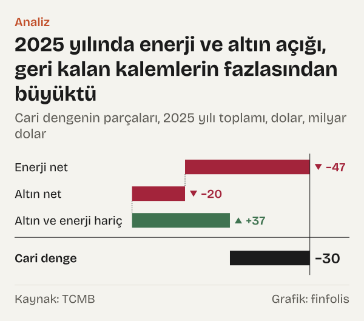

2019 yılı kapandığında Türkiye'nin cari işlemler hesabı, yani ülkenin yurt dışıyla mal, hizmet ve gelir alışverişinin net sonucu, 15 milyar dolar fazla vermişti. 2003–2025 yıllık serisinde bu, toplam dengenin artıya geçtiği tek yıl. Öteki yirmi iki yılın hepsinde denge eksideydi.

Ama aynı seriyi iki kalemden ayırınca başka bir tarih çıkıyor. Türkiye Cumhuriyet Merkez Bankası (TCMB), ödemeler dengesi istatistikleri içinde cari dengeyi enerji ticareti ve parasal olmayan altın ticareti hariç olarak da yayımlıyor. Bu iki kalem dışarıda bırakıldığında kalan denge 2012 yılından bu yana her yıl fazla verdi; 2025 yılında bu fazla 37,1 milyar dolardı. Aynı yıl toplam cari denge eksi 30,3 milyar dolardı.

Okur için bu ayrım şunu söylüyor: manşette okunan cari açık, tek bir bütün değil. İçinde petrol, doğal gaz ve kömür gibi enerji ürünlerinin dış ticareti, altın ticareti ve geri kalan bütün mal ve hizmet alışverişi var. Bu yazıda yirmi üç yıllık seride bu parçaların hangi yıllarda yön ya da büyüklük değiştirdiğini, yalnız rakamların kendisinden giderek izledik. Kırılmanın nedenini değil, nerede olduğunu arıyoruz.

## Üç kalem, bir denge

Önce terimler. Enerji kalemi, dış ticaret sınıflamasının 27. fasılıdır: mineral yakıtlar, mineral yağlar ve bunların ürünleri. Parasal olmayan altın, merkez bankasının rezerv varlığı olarak tutmadığı altının dış ticaretidir. Her iki kalemde de ihracat eksi ithalat net değeri verir. TCMB'nin yayımladığı altın ve enerji hariç cari işlemler hesabı, toplam cari dengeden bu iki net değerin çıkarılmasıyla elde edilen dengedir.

Üç parçanın toplamı, her yıl toplam cari dengeyi verir. 2025 yılında enerjinin net değeri eksi 47,3 milyar dolar, altının net değeri eksi 20,1 milyar dolar, geri kalan kalemlerin dengesi 37,1 milyar dolardı. Toplamları eksi 30,3 milyar dolarlık cari dengeye eşit.

*Altın ve enerji hariç cari işlemler dengesinin bir önceki yıla göre değişimi, kırılma yılları, dolar. Kaynak: TCMB.*

Bu yazıda kırılmayı iki ölçütle tanımladık. Birincisi işaret: altın ve enerji hariç denge eksiden artıya ya da artıdan eksiye geçtiyse ve yeni işaret en az üç yıl sürdüyse. İkincisi büyüklük: aynı denge bir yılda önceki yıla göre yirmi milyar dolardan fazla değiştiyse. İki ölçüt de yalnız seriye bakar; o yıl ne olduğunu sormaz. Bu tanımla altı kırılma yılı çıkıyor: 2010 yılı, 2012 yılı ve 2018–2021 arasındaki dört yıl.

## 2003–2011: açık büyürken çekirdek sıfır çevresinde

Yolculuğa 2003 yılından başlayalım. O yıl toplam cari denge eksi 7,6 milyar dolardı. Enerji ticaretinin net açığı eksi 10,6 milyar dolar, altının net değeri eksi 2,5 milyar dolardı. Bu iki kalem dışarıda bırakıldığında kalan denge 5,6 milyar dolar fazla veriyordu.

Sonraki yıllarda toplam açık hızla büyüdü. 2007 yılında eksi 36,9 milyar dolar, 2008 yılında eksi 39,4 milyar dolar oldu. Aynı dönemde altın ve enerji hariç denge küçük artı ve eksi değerler arasında gidip geldi: 2004 yılında 2,2 milyar dolar, 2006 yılında eksi 2,5 milyar dolar, 2007 yılında eksi 3,9 milyar dolar, 2008 yılında 2,7 milyar dolar. Bu yıllarda yön birkaç kez değişti, ama hiçbir değişim üç yıl sürmedi. Bu yıllarda çekirdek denge sıfır çevresinde kalırken toplam açık genişledi; aradaki fark hesap olarak enerji ve altın kalemlerinde görülüyor. Bu bir muhasebe ayrımıdır, bir neden açıklaması değildir.

2009 yılı seride ayrı duruyor. Toplam cari açık bir önceki yıla göre 28,1 milyar dolar daraldı ve denge eksi 11,4 milyar dolara geldi. Altın ve enerji hariç denge 11,6 milyar dolar fazlaya çıktı. Ama bu çıkış bir yıl sürdü: 2010 yılında çekirdek denge eksi 10,1 milyar dolara döndü, yani bir yılda 21,8 milyar dolar geriledi. Büyüklük ölçütümüze göre 2010 yılı bir kırılma yılı.

2011 yılında iki seri de 2003–2025 arasındaki en düşük değerini aldı. Toplam cari denge eksi 74,4 milyar dolar, altın ve enerji hariç denge eksi 22 milyar dolar oldu. Enerjinin net açığı eksi 47,6 milyar dolara ulaşmıştı.

## 2012 yılı: işaretin döndüğü yıl

![Çizgi grafik: Toplam cari denge yalnız 2019 yılında artıya geçti, altın ve enerji hariç denge 2012 yılından bu yana artıda: Toplam: 2003 yılında −7,55 milyar dolar, 2004 yılında −14,20 milyar dolar, 2005 yılında −20,98 milyar dolar, 2006 yılında −31,16 milyar dolar, 2007 yılında −36,95 milyar dolar, 2008 yılında −39,43 milyar dolar, 2009 yılında −11,36 milyar dolar, 2010 yılında −44,63 milyar dolar, 2011 yılında −74,40 milyar dolar, 2012 yılında −41,80 milyar dolar, 2013 yılında −49,33 milyar dolar, 2014 yılında −32,11 milyar dolar, 2015 yılında −21,35 milyar dolar, 2016 yılında −22,17 milyar dolar, 2017 yılında −35,14 milyar dolar, 2018 yılında −14,61 milyar dolar, 2019 yılında 15,01 milyar dolar, 2020 yılında −31,02 milyar dolar, 2021 yılında −7,07 milyar dolar, 2022 yılında −46,67 milyar dolar, 2023 yılında −41,82 milyar dolar, 2024 yılında −13,59 milyar dolar, 2025 yılında −30,28 milyar dolar; Altın ve enerji hariç: 2003 yılında 5,56 milyar dolar, 2004 yılında 2,19 milyar dolar, 2005 yılında 1,39 milyar dolar, 2006 yılında −2,53 milyar dolar, 2007 yılında −3,86 milyar dolar, 2008 yılında 2,69 milyar dolar, 2009 yılında 11,62 milyar dolar, 2010 yılında −10,14 milyar dolar, 2011 yılında −22,05 milyar dolar, 2012 yılında 4,90 milyar dolar, 2013 yılında 10,08 milyar dolar, 2014 yılında 20,46 milyar dolar, 2015 yılında 8,20 milyar dolar, 2016 yılında 0,13 milyar dolar, 2017 yılında 7,69 milyar dolar, 2018 yılında 31,92 milyar dolar, 2019 yılında 57,57 milyar dolar, 2020 yılında 15,59 milyar dolar, 2021 yılında 37,13 milyar dolar, 2022 yılında 52,85 milyar dolar, 2023 yılında 36,55 milyar dolar, 2024 yılında 49,11 milyar dolar, 2025 yılında 37,08 milyar dolar.](./graf-2.svg)
*Yıllık cari işlemler dengesi, dolar. Kaynak: TCMB.*

2012 yılı, iki ölçütümüzün birlikte işaret ettiği tek yıl. Altın ve enerji hariç denge bir önceki yıla göre 27 milyar dolar iyileşerek 4,9 milyar dolar fazlaya geçti. Bu, yirmi üç yıllık serideki en büyük yıllık iyileşme. Daha önemlisi, işaret o yıldan sonra bir daha eksiye dönmedi: 2012–2025 arasındaki on dört yılın hepsinde bu denge artıda kaldı.

Toplam cari denge aynı yıl eksi 41,8 milyar dolara iyileşti, ama eksi kalmaya devam etti. Aradaki farkı enerji açığı tutuyordu: 2012 yılında enerjinin net değeri eksi 52,4 milyar dolardı. Altının net değeri ise o yıl 5,7 milyar dolar artıdaydı. Ertesi yıl, 2013 yılında, altın kalemi eksi 11,8 milyar dolara döndü.

Dönemin bir başka özelliği, çekirdek fazlanın dalgalı seyri. 2014 yılında 20,5 milyar dolara çıkan fazla, 2016 yılında 130 milyon dolara kadar daraldı; yine de eksiye geçmedi.

Aynı yıllarda iki dengenin arası açık kaldı. 2017 yılında altın ve enerji hariç denge 7,7 milyar dolar fazla verirken toplam cari denge eksi 35,1 milyar dolardı. O yıl enerjinin net değeri eksi 32,9 milyar dolar, altının net değeri eksi 10 milyar dolardı. Enerji açığı bir yıl önce, 2016 yılında, eksi 24,1 milyar dolara inmişti; bu, 2005 yılından sonraki en dar enerji açığı.

## 2018–2021: dört yıllık salınım

Büyüklük ölçütümüze göre ikinci kırılma kümesi 2018–2021 arasında. 2018 yılında altın ve enerji hariç denge bir önceki yıla göre 24,2 milyar dolar artarak 31,9 milyar dolara çıktı. 2019 yılında 25,6 milyar dolar daha artıp 57,6 milyar dolara ulaştı. Toplam cari denge de bu yıl 15 milyar dolar fazla verdi.

*Cari dengenin parçaları, 2011 yılı ve 2019 yılı toplamları, dolar. Kaynak: TCMB.*

2011 yılı ile 2019 yılı yan yana konduğunda değişimin nereden geldiği açık. Toplam cari denge iki yıl arasında 89,4 milyar dolar iyileşti. Bunun 79,6 milyar doları altın ve enerji hariç dengedeki iyileşmeden geldi. Enerjinin net açığı 14,3 milyar dolar daraldı. Altın kaleminin net değeri ise ters yönde, 4,5 milyar dolar geriledi.

2020 yılında seri bu kez aşağı kırıldı. Altın ve enerji hariç denge bir önceki yıla göre 42 milyar dolar geriledi ve 15,6 milyar dolara indi. Bu, serideki en büyük yıllık daralma. Yine de işaret artıda kaldı. Aynı yıl altının net değeri eksi 22,4 milyar dolar oldu; toplam cari denge eksi 31 milyar dolara döndü. 2021 yılında çekirdek denge 21,5 milyar dolar artarak 37,1 milyar dolara çıktı, toplam denge eksi 7,1 milyar dolara iyileşti.

## 2022 yılı ve sonrası: enerji ve altının ağırlığı

2022 yılında enerjinin net açığı eksi 80,1 milyar dolara yükseldi; bu, 2003 yılı açığının 7,6 katı. Enerji ithalatı ise 2003 yılında 11,6 milyar dolardı, 2022 yılında 96,5 milyar dolara çıktı. Altının net değeri eksi 19,4 milyar dolardı. İki kalemin birlikte açığı eksi 99,5 milyar dolara ulaştı. Aynı yıl altın ve enerji hariç denge 52,8 milyar dolar fazla verdi, toplam cari denge eksi 46,7 milyar dolar oldu.

*Cari dengenin parçaları, 2025 yılı toplamı, dolar. Kaynak: TCMB.*

Sonraki yıllarda enerji açığı daraldı, altın kalemi geniş kaldı. Altının net değeri 2023 yılında eksi 25,6 milyar dolar ile serinin en geniş açığını verdi. 2025 yılında altın ithalatı 23,1 milyar dolardı; 2003 yılında 2,6 milyar dolardı, aradaki oran 8,9 kat. 2024 yılında toplam cari denge eksi 13,6 milyar dolara indi, 2025 yılında eksi 30,3 milyar dolara genişledi.

Son veri Ağustos 2026. Son on iki ayın toplamında cari denge eksi 42,1 milyar dolar, altın ve enerji hariç denge 26 milyar dolar. Enerji ve altının birlikte net değeri eksi 68,1 milyar dolar.

*Enerji ithalatı ve altın ile enerji hariç cari denge, yıllık, dolar. Kaynak: TCMB.*

## Ayrıştırmanın başka okumaları

Bu ayrıştırmanın kolay bir yanlış okuması var: altın ve enerji hariç denge fazla verdiği için açığın yalnız bu iki kalemden geldiği sonucuna varmak. Rakamlar bunu söylemiyor. Enerji ve altın ticareti de ekonominin bir parçası; onları hesaptan çıkarmak bir muhasebe ayrımıdır, bir açıklama değil. 2025 yılında enerjinin net açığı eksi 47,3 milyar dolardı ve bu açık, toplam dengenin içinde gerçek bir dış ödemedir.

İkinci karşı okuma kırılma tanımıyla ilgili. Ölçütü çekirdek dengeye değil toplam cari dengeye uygulasaydık, liste değişirdi. Yirmi milyar dolarlık eşiği toplam dengenin yıllık değişimine uyguladığımızda, çekirdek dengedeki altı kırılma yılının yerine on yıl çıkıyor: 2009–2012 arasındaki dört yıl, 2018–2022 arasındaki beş yıl ve 2024 yılı. Örneğin toplam denge 2010 yılında bir önceki yıla göre 33,3 milyar dolar geriledi, 2022 yılında 39,6 milyar dolar geriledi; 2024 yılında 28,2 milyar dolar iyileşti. Bu yılların bir kısmında çekirdek denge çok daha az değişti. Hangi serinin ve hangi eşiğin seçildiği, hangi yılın kırılma diye öne çıkacağını belirliyor.

Üçüncüsü, çekirdek dengenin sürekli fazla vermesi, o dengenin içindeki kalemlerin hep aynı kaldığı anlamına gelmiyor. Bu denge mal ticaretinin enerji ve altın dışındaki kısmını, turizm dahil hizmetleri, yatırım gelirlerini ve faiz ödemelerini birlikte topluyor. 2016 yılında 130 milyon dolara inen fazla ile 2019 yılında ulaşılan 57,6 milyar dolar, aynı adı taşısa da çok farklı bileşimlerden oluşmuş olabilir.

## Dolar cinsinden bir serinin sınırları

Serinin okunmasında akılda tutulacak birkaç ölçüm sınırı var. Rakamlar cari ABD doları cinsinden. 2003 yılında bir milyar dolar ile 2025 yılında bir milyar dolar, ne ekonominin büyüklüğüne göre ne de dolar fiyatlarındaki değişime göre aynı ağırlığı taşır. Bu yazıda dengeyi milli gelire oranlamadık; oranlamak bazı yılların sırasını değiştirebilir.

Yıllık toplam, takvim yılının on iki ayının toplamıdır. Bu, yıl içindeki hareketleri düzleştirir: bir yılın ilk yarısında açık, ikinci yarısında fazla veren bir seri yıllık toplamda sıfıra yakın görünebilir. Son on iki ayın toplamı olarak verdiğimiz Ağustos 2026 değeri de bir takvim yılı değildir.

Enerji kalemi dış ticaret sınıflamasındaki 27. fasıla dayanıyor; bu fasıl ham petrol ve doğal gazın yanında kömürü ve rafine ürünleri de kapsar; kalemin içindeki ürünlerin payı yıldan yıla değişebilir. Son olarak ödemeler dengesi istatistikleri sonradan güncellenebilir; buradaki rakamlar 23 Ekim 2026 tarihinde EVDS'den çekilen değerlerdir.

## Nasıl hesapladık

TCMB'nin Elektronik Veri Dağıtım Sistemi'nden (EVDS) cari işlemler hesabı, parasal olmayan altın ve enerji dış ticareti veri grubundaki dört seriyi aldık: cari işlemler hesabı, parasal olmayan altın net, enerji (27. fasıl) net, altın ve enerji hariç cari işlemler hesabı. Aylık serileri EVDS'nin on iki aylık toplam formülüyle çektik; her yılın aralık değeri o takvim yılının toplamıdır. Ağustos 2026 değeri son on iki ayın toplamıdır. Yıllık değişimi bir yılın değerinden önceki yılın değerini çıkararak hesapladık. Kırılma için iki ölçüt kullandık: altın ve enerji hariç dengenin işareti değişip en az üç yıl sürdüyse ya da denge bir yılda yirmi milyar dolardan fazla değiştiyse o yılı kırılma saydık. 2011 yılı ile 2019 yılı karşılaştırmasında her parçanın iki yıl arasındaki farkını aldık. Rakamlar milyon dolardan milyar dolara yuvarlanarak yazıldı.

## Kaynaklar

- [TCMB EVDS: Cari İşlemler Hesabı, yıllık toplam, 2003–2026](https://evds3.tcmb.gov.tr/igmevdsms-dis/series=TP.HARICCARIACIK.K1)
- [TCMB EVDS: Parasal Olmayan Altın Net, yıllık toplam, 2003–2026](https://evds3.tcmb.gov.tr/igmevdsms-dis/series=TP.HARICCARIACIK.K4)
- [TCMB EVDS: Parasal Olmayan Altın İthalat, yıllık toplam](https://evds3.tcmb.gov.tr/igmevdsms-dis/series=TP.HARICCARIACIK.K3)
- [TCMB EVDS: Enerji (27. fasıl) Net, yıllık toplam, 2003–2026](https://evds3.tcmb.gov.tr/igmevdsms-dis/series=TP.HARICCARIACIK.K7)
- [TCMB EVDS: Enerji (27. fasıl) İthalat, yıllık toplam](https://evds3.tcmb.gov.tr/igmevdsms-dis/series=TP.HARICCARIACIK.K6)
- [TCMB EVDS: Altın ve Enerji Hariç Cari İşlemler Hesabı, yıllık toplam, 2003–2026](https://evds3.tcmb.gov.tr/igmevdsms-dis/series=TP.HARICCARIACIK.K10)
