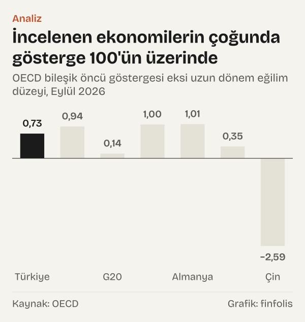
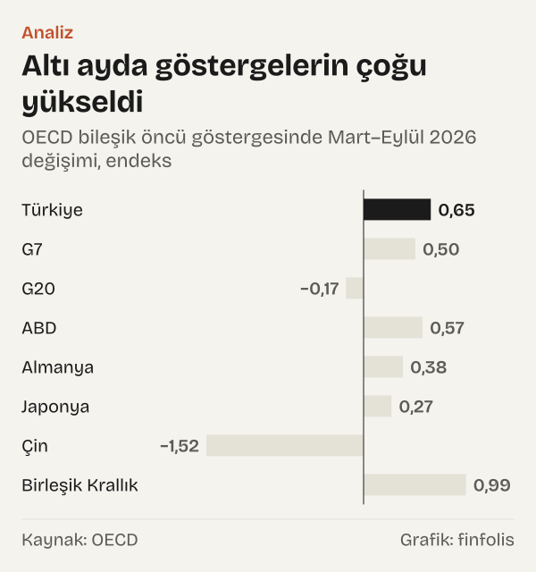

100,73 ve 100,21. Türkiye ekonomisi için Eylül 2026'ya ait iki bileşik öncü gösterge bu değerleri aldı. İlki Ekonomik Kalkınma ve İşbirliği Örgütü'nün (OECD) bileşik öncü göstergesi (CLI), ikincisi Türkiye Cumhuriyet Merkez Bankası'nın (TCMB) Bileşik Öncü Göstergeler Endeksi. İkisi de 100'ün üzerinde. Ama son ayda ayrıştılar: OECD'nin göstergesi Ağustos'tan Eylül'e 0,27 yükseldi, TCMB'nin endeksi aynı ayda 0,11 geriledi.

İki gösterge farklı tanımlarla hesaplanıyor. Aynı yöntem ailesinden geliyorlar, ama farklı veri setleri ve farklı referans serileri kullanıyorlar. Aralarındaki küçük fark, öncü göstergelerin nasıl okunması gerektiğine dair iyi bir başlangıç noktası.

Okur için bunun anlamı şu: öncü gösterge bir büyüme rakamı değil, bir yön işaretidir. 100,73 bir büyüme oranı değildir. Gösterge, ekonomik faaliyetin uzun dönem eğilimine göre nerede durduğuna ve bu konumun hangi yöne değiştiğine dair bir işaret verir. Bu yazıda iki göstergeyi yalnız kurumların kendi okuma kurallarıyla yorumluyoruz ve büyük ekonomilerle karşılaştırıyoruz. Gelecek için kendi çıkarımımızı eklemiyoruz.

*OECD bileşik öncü göstergesi eksi uzun dönem eğilim düzeyi, Eylül 2026. Kaynak: OECD.*

## Göstergenin kendi okunuş kuralı

OECD'nin yöntem belgesinde göstergenin sunumu açık: grafiklerde uzun dönem eğilim 100'e eşitlenir. 100'ün üzerindeki değerler ekonomik faaliyetin uzun dönem eğiliminin üzerinde, altındaki değerler eğilimin altında olduğu dönemlere karşılık gelir. OECD bu sunum için “This form allows for "output-gap" type interpretations.” diyor; yani gösterge, üretimin potansiyel düzeyinden ne kadar saptığına, iktisatta çıktı açığı denen kavrama benzer bir okuma sağlıyor.

İkinci kural yönle ilgili. OECD'nin veri tabanındaki açıklamaya göre: “Therefore, the main message of CLI movements over time is the increase or decrease, rather than the amplitude of the changes.” Kurum burada göstergenin ana mesajının değişimin büyüklüğü değil, artışı ya da azalışı olduğunu söylüyor. Aynı açıklamada OECD, referans serideki dönüş noktalarının, göstergede sinyal görüldükten ortalama 4 ila 8 ay sonra ortaya çıktığını belirtiyor. Bu bir ortalama; tek bir dönem için bir takvim değil.

İki kural birlikte dört durum tanımlıyor: 100'ün üzerinde ve yükselen, 100'ün üzerinde ve düşen, 100'ün altında ve düşen, 100'ün altında ve yükselen. Göstergenin bir dönemdeki konumunu bu iki soruyla okuyoruz: 100'ün neresinde ve hangi yöne gidiyor?

TCMB'nin endeksi aynı sistemle hesaplanıyor. TCMB'nin Ekonomi Notları dizisindeki yöntem notuna göre endeks, OECD ile ortak çalışmayla oluşturuldu ve OECD sistemine uyumlu biçimde yeniden düzenlendi. Notta genlik ayarlı gösterim için şu ifade yer alıyor: “Bu çerçevede, genlik ayarı yapılmış bileşik öncü gösterge gösterimi, ekonominin mevcut durumda hangi evrede olduğuna dair bilgiler sunmaktadır.” Bu yazıda TCMB'nin bu genlik ayarlı devreler serisini kullanıyoruz.

## Türkiye döngünün neresinde

Türkiye için OECD göstergesi Eylül 2026'da 100,73 oldu; 100'ün 0,73 üzerinde. Gösterge Mayıs 2026'da 99,87 ile 100'ün altına inmişti. O aydan bu yana her ay yükseldi ve toplamda 0,86 arttı. OECD'nin kuralıyla okunduğunda Türkiye'nin göstergesi Eylül 2026 itibarıyla 100'ün üzerinde ve yükselen bölgede.

![Çizgi grafik: İki öncü gösterge son iki yılda 100 çevresinde birlikte dalgalandı: OECD: Oca 2024: 98,56, Şub 2024: 98,51, Mar 2024: 98,49, Nis 2024: 98,49, May 2024: 98,54, Haz 2024: 98,62, Tem 2024: 98,74, Ağu 2024: 98,92, Eyl 2024: 99,22, Eki 2024: 99,59, Kas 2024: 99,94, Ara 2024: 100,18, Oca 2025: 100,23, Şub 2025: 100,08, Mar 2025: 99,77, Nis 2025: 99,43, May 2025: 99,16, Haz 2025: 99,07, Tem 2025: 99,15, Ağu 2025: 99,34, Eyl 2025: 99,59, Eki 2025: 99,86, Kas 2025: 100,11, Ara 2025: 100,30, Oca 2026: 100,35, Şub 2026: 100,26, Mar 2026: 100,08, Nis 2026: 99,92, May 2026: 99,87, Haz 2026: 99,97, Tem 2026: 100,18, Ağu 2026: 100,46, Eyl 2026: 100,73; TCMB: Oca 2024: 99,49, Şub 2024: 99,36, Mar 2024: 99,11, Nis 2024: 98,55, May 2024: 98,88, Haz 2024: 99,24, Tem 2024: 99,10, Ağu 2024: 98,56, Eyl 2024: 98,89, Eki 2024: 99,60, Kas 2024: 100,22, Ara 2024: 100,68, Oca 2025: 100,29, Şub 2025: 100,47, Mar 2025: 99,91, Nis 2025: 99,53, May 2025: 98,86, Haz 2025: 99,26, Tem 2025: 99,56, Ağu 2025: 99,82, Eyl 2025: 99,45, Eki 2025: 99,79, Kas 2025: 99,85, Ara 2025: 100,71, Oca 2026: 100,32, Şub 2026: 100,22, Mar 2026: 99,92, Nis 2026: 99,69, May 2026: 99,61, Haz 2026: 99,89, Tem 2026: 99,51, Ağu 2026: 100,32, Eyl 2026: 100,21.](./graf-2.svg)
*Türkiye, genlik ayarlı bileşik öncü gösterge, endeks. Kaynak: OECD, TCMB.*

Merkez Bankası'nın endeksi de 100'ün üzerinde, ama yön daha karışık. Endeks Temmuz 2026'da 99,51'di, Ağustos'ta 100,32'ye çıktı, Eylül'de 100,21'e indi. İki aylık değişim 0,70 artış, son bir aylık değişim 0,11 azalış. Mart 2026'dan bu yana bakıldığında endeks 0,29 yükseldi. Aynı kuralla okunduğunda TCMB endeksi 100'ün üzerinde, ama son ayda düşen bir görünümde.

Eylül 2026'da iki gösterge arasındaki fark 0,52. OECD'nin değeri daha yüksek. Bu büyüklükte bir farkın yorumu sınırlı: OECD'nin kendi uyarısına göre değişimin büyüklüğü değil yönü önemli. İki göstergenin yönüne bakınca da Mart–Eylül 2026 arasında ikisi de yukarı gitti; ayrışma yalnız son ayda.

Daha geniş bir zaman diliminde Türkiye'nin göstergesi 100 etrafında dalgalandı. OECD göstergesi Ocak 2024'te 98,56'ydı; 2024 yılı boyunca 100'ün altında kaldı, Aralık 2024'te 100,18 ile yeniden üzerine çıktı. Haziran 2025'te 99,07'ye indi, Aralık 2025'te 100,30 oldu. Son iki yıldaki hareket, yön değişimlerinin birkaç ay içinde gerçekleşebildiğini gösteriyor. Uzun serideki en düşük değer ise Nisan 2020'deki 74,69; pandemi dönemindeki bu düşüş, son yıllardaki dalgalanmayı ölçek olarak yerine koymaya yardım ediyor.

## Yakın geçmişte benzer bir konum

OECD göstergesi Ekim 2025'te 99,86'ydı; Kasım 2025'te 100,11 ile 100'ün üzerine çıktı ve Ocak 2026'da 100,35'e kadar yükseldi. Yani Kasım 2025 ile Ocak 2026 arasında gösterge, bugün olduğu gibi 100'ün üzerinde ve yükselen bölgedeydi.

Ardından yön değişti. Gösterge Şubat 2026'da 100,26'ya, Nisan 2026'da 99,92'ye indi ve yeniden 100'ün altına geçti. Mayıs 2026'daki 99,87, bu düşüşün en alt noktası oldu. Toplamda 100'ün üzerinde ve yükselen bölgede geçen süre birkaç ayla sınırlı kaldı. Merkez Bankası endeksinde de benzer bir hareket var: endeks Aralık 2025'te 100,71'e çıktı, Mayıs 2026'da 99,61'e indi.

Bu bir tahmin değil, bir olgu: göstergenin bölgeler arasında birkaç ay içinde yer değiştirebildiğini gösteriyor. OECD'nin değişimin büyüklüğü yerine yönüne bakılmasını önermesi ve dönüş noktalarını ortalama bir gecikmeyle tarif etmesi, bu tür kısa salınımlar düşünüldüğünde daha anlaşılır hâle geliyor.

## Büyük ekonomilerle karşılaştırma

Büyük ekonomilerle yan yana konunca Türkiye'nin konumu daha anlamlı hâle geliyor. OECD, ülkelerin yanında G7 ve G20 gibi bölge toplamları için de gösterge yayımlıyor.

G7'nin göstergesi Eylül 2026'da 100,94 oldu; Mart 2026'ya göre 0,50 arttı. ABD'de gösterge 101,00, Almanya'da 101,01. İkisi de Mart'tan bu yana yükseldi: ABD'de 0,57, Almanya'da 0,38. Birleşik Krallık'ta gösterge 101,38 ile incelediğimiz ekonomiler arasında 100'ün en üzerindeydi ve altı ayda 0,99 arttı. Japonya'nın göstergesi 100,35; 100'e yakın ama yükselen.

*OECD bileşik öncü göstergesinde Mart–Eylül 2026 değişimi, endeks. Kaynak: OECD.*

Çin'in göstergesi Eylül 2026'da 97,41 oldu ve Mart 2026'dan bu yana 1,52 azaldı. OECD'nin kuralıyla Çin, incelediğimiz ekonomiler arasında 100'ün altında ve düşen bölgedeki tek ekonomi.

Veri setinde bölge toplamı olarak G7 ve G20 gibi gruplar yer alıyor; karşılaştırma için bu ikisini kullandık. G20 göstergesi Eylül 2026'da 100,14; 100'ün hemen üzerinde. Ama Mart 2026'dan bu yana 0,17 azaldı.

*OECD bileşik öncü göstergesi, Eylül 2026 değeri ve bir önceki aya göre değişim. Kaynak: OECD.*

Karşılaştırmada Türkiye, G7 ile aynı bölgede: 100'ün üzerinde ve yükselen. Türkiye'nin altı aylık artışı olan 0,65, G7'nin 0,50'lik artışından biraz fazla, Birleşik Krallık'ın 0,99'luk artışından az.

## Karşı okuma: iki gösterge neden ayrışabilir

Son ayda iki göstergenin ayrışması, birinin hatalı olduğu anlamına gelmiyor. OECD'nin veri seti açıklamasına göre referans seri Mart 2012'ye kadar sanayi üretimiydi; açıklamada ardından gelen ifade “since then the reference series is GDP”, yani o tarihten sonra referans seri gayrisafi yurt içi hasıla. TCMB'nin yöntem notu ise endeksi sanayi üretim endeksinin devreleriyle karşılaştırarak anlatıyor. Farklı referans seriler, farklı bileşenler ve farklı yayım gecikmeleri, aynı ayda biraz farklı değerler üretebilir.

Bir başka karşı okuma, 100'ün üzerinde olmayı tek başına iyi bir işaret saymak olurdu. OECD'nin kuralı iki boyutlu: konum ve yön. Bir gösterge 100'ün üzerinde ama düşüyorsa, bu, faaliyetin eğilimin üzerinde olduğu ama farkın daraldığı bir dönemi tarif eder. G20 bugün böyle bir görünümde. Türkiye için TCMB endeksinin son ayı da tek başına bakılırsa aynı bölgeye düşüyor; OECD göstergesi ise düşmüyor. Tek bir aylık hareketten bir dönüş noktası çıkarmak, OECD'nin kendi uyarısıyla çelişir.

Merkez Bankası endeksinin yıllık değişim serisi de benzer bir sakinlik gösteriyor. Eğilim kapsayan endeksin on iki aylık değişimi Eylül 2025'te %2,79, Eylül 2026'da %2,77 oldu. TCMB ayrıca endeksin eğilim kapsayan düzey serisini de yayımlıyor; bu yazıda o seriyi kullanmadık, çünkü OECD'nin 100 düzeyine göre okunan genlik ayarlı gösterimle doğrudan karşılaştırılamıyor. Yıllık değişim serisi doğrudan bir büyüme rakamı değil; TCMB'nin notuna göre referans serinin büyüme oranlarıyla karşılaştırma yapmaya yarıyor.

## Öncü göstergenin söylemedikleri

İlk sınır revizyon. Öncü göstergeler her ay yeni verilerle yeniden hesaplanır ve son aylara ait değerler sonraki yayımlarda değişebilir. Bu yazıdaki OECD değerleri 23 Ekim 2026'da çekildi; bir sonraki yayımda Eylül 2026 değeri farklı olabilir. Bu özellikle son birkaç ayın yönü için önemli, çünkü yazıdaki yön okumalarının çoğu son ayların değerlerine dayanıyor.

Göstergenin niteliği de bir sınır çiziyor. OECD'nin veri seti açıklamasına göre gösterge, nicel ölçüler yerine “designed to provide qualitative information on short-term economic movements”, yani kısa dönemli ekonomik hareketler hakkında nitel bilgi vermek üzere tasarlandı. Bu yüzden göstergenin 100'den uzaklığını büyüme oranına çevirmek mümkün değil; 0,73 bir yüzde değil, normalleştirilmiş bir endeks değeri.

Ülkeler arası karşılaştırmanın da bir sınırı var. Her ülkenin göstergesi kendi uzun dönem eğilimine göre hesaplanıyor. OECD'nin yöntem belgesine göre bileşen serileri ortalamalarından arındırılıp ortalama mutlak sapmalarına bölünerek normalleştiriliyor ve gösterge, referans serinin kendi dalgalanma genliğine göre ayarlanıyor. Bu yüzden Birleşik Krallık'ın 101,38'i ile Türkiye'nin 100,73'ü iki ekonominin büyüklüğünü ya da büyüme hızını karşılaştırmaz. Yalnız her birinin kendi eğilimine göre konumunu ve bu konumun yönünü gösterir. Aynı nedenle G7 ya da G20 gibi bir toplamın değeri, içindeki ülkelerin göstergelerinin basit bir ortalaması olarak da okunamaz; toplamın nasıl hesaplandığı OECD'nin kendi yöntemine bağlı.

Üçüncü sınır bileşenler. Hem OECD'nin hem TCMB'nin göstergesi birçok kısa dönemli seriden oluşuyor ve bu serilerin ağırlıkları zamanla gözden geçiriliyor. Bileşenlerdeki bir değişiklik geçmiş değerleri de etkileyebiliyor. Son olarak, OECD'nin dönüş noktası ile referans seri arasında verdiği 4 ila 8 aylık ortalama gecikme geçmiş dönemlerin ortalamasıdır; herhangi bir ülkenin bugünkü göstergesine uygulanacak bir takvim değildir.

## Nasıl hesapladık

Göstergeleri OECD'nin veri tabanından (genlik ayarlı seri, OECD'nin uyumlaştırılmış yöntemi) 23 Ekim 2026'da çektik. TCMB endeksi için Elektronik Veri Dağıtım Sistemi'ndeki (EVDS) devreler ve on iki aylık yüzde değişim serilerini kullandık. 100'den uzaklık, göstergenin değerinden 100'ün çıkarılmasıyla; altı aylık ve aylık değişim, iki ayın değerleri arasındaki farkla bulundu. OECD değerlerini, veri setinin kendi yayım hassasiyeti olan iki ondalık basamağa yuvarlayarak kullandık; farkları da bu yuvarlanmış değerler üzerinden hesapladık. Bu yüzden OECD'nin sitesinde daha fazla basamakla görülen değerlerden son basamakta küçük farklar çıkabilir. Bütün ülke değerleri OECD'nin aynı veri setinden ve aynı aya ait. Karşılaştırmaya G7 ve G20 toplamlarını ve bu gruplardaki birkaç büyük ekonomiyi aldık; ülkeleri göstergelerinin değerine bakarak seçmedik. Değerleri kendi tanımladığımız bir eşikle değil, yalnız OECD'nin 100 düzeyi ve artış ya da azalış ölçütüyle sınıflandırdık.

## Kaynaklar

- [OECD: Composite leading indicators, Türkiye, Ocak 2024–Eylül 2026](https://sdmx.oecd.org/public/rest/data/OECD.SDD.STES,DSD_STES@DF_CLI,/TUR.M.LI...AA...H?startPeriod=2000-01)
- [OECD: Composite leading indicators, G7](https://sdmx.oecd.org/public/rest/data/OECD.SDD.STES,DSD_STES@DF_CLI,/G7.M.LI...AA...H?startPeriod=2000-01)
- [OECD: Composite leading indicators, G20](https://sdmx.oecd.org/public/rest/data/OECD.SDD.STES,DSD_STES@DF_CLI,/G20.M.LI...AA...H?startPeriod=2000-01)
- [OECD: Composite leading indicators, ABD](https://sdmx.oecd.org/public/rest/data/OECD.SDD.STES,DSD_STES@DF_CLI,/USA.M.LI...AA...H?startPeriod=2000-01)
- [OECD: Composite leading indicators, Almanya](https://sdmx.oecd.org/public/rest/data/OECD.SDD.STES,DSD_STES@DF_CLI,/DEU.M.LI...AA...H?startPeriod=2000-01)
- [OECD: Composite leading indicators, Japonya](https://sdmx.oecd.org/public/rest/data/OECD.SDD.STES,DSD_STES@DF_CLI,/JPN.M.LI...AA...H?startPeriod=2000-01)
- [OECD: Composite leading indicators, Çin](https://sdmx.oecd.org/public/rest/data/OECD.SDD.STES,DSD_STES@DF_CLI,/CHN.M.LI...AA...H?startPeriod=2000-01)
- [OECD: Composite leading indicators, Birleşik Krallık](https://sdmx.oecd.org/public/rest/data/OECD.SDD.STES,DSD_STES@DF_CLI,/GBR.M.LI...AA...H?startPeriod=2000-01)
- [OECD: Composite leading indicators veri seti açıklaması](https://sdmx.oecd.org/public/rest/dataflow/OECD.SDD.STES/DSD_STES@DF_CLI/latest)
- [OECD: OECD System of Composite Leading Indicators, yöntem belgesi](https://www.oecd.org/content/dam/oecd/en/data/methods/OECD-System-of-Composite-Leading-Indicators.pdf)
- [TCMB: Bileşik Öncü Göstergeler Endeksi, devreler (EVDS)](https://evds3.tcmb.gov.tr/igmevdsms-dis/series=TP.CLI2.A02)
- [TCMB: Bileşik Öncü Göstergeler Endeksi, on iki aylık yüzde değişim (EVDS)](https://evds3.tcmb.gov.tr/igmevdsms-dis/series=TP.CLI2.A03)
- [TCMB: Ekonomi Notları, Mart 2014, MBÖNCÜ-SÜE yöntem notu](https://www.tcmb.gov.tr/wps/wcm/connect/37037bb7-ca79-4835-a649-03ccc9ee00a1/EN1404eng.pdf?MOD=AJPERES&CACHEID=ROOTWORKSPACE-37037bb7-ca79-4835-a649-03ccc9ee00a1-m3fw5jO)
