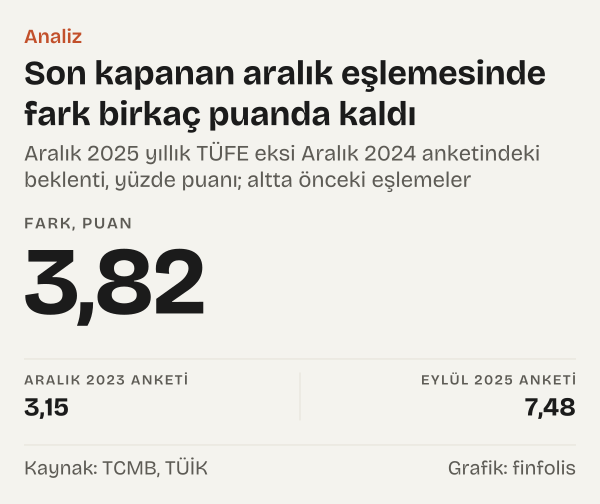

Aralık 2024'te Türkiye Cumhuriyet Merkez Bankası (TCMB), her ay yaptığı Piyasa Katılımcıları Anketi'nin sonuçlarını yayımladığında, finans ve reel kesimden yanıt veren uzmanların bir yıl sonrası için yıllık tüketici enflasyonu beklentisi %27,07'ydi. Bir yıl sonra, Aralık 2025'te Türkiye İstatistik Kurumu'nun (TÜİK) açıkladığı yıllık tüketici fiyat endeksi (TÜFE) değişimi %30,89 oldu. Aradaki fark 3,82 puan.

Tek bir eşleme tek başına bir şey söylemez. Asıl soru şu: farkın büyüklüğü ve yönü yıllar içinde nasıl dağılıyor? Bunu sınamak için anketin her aralık ayındaki beklentisini, bir yıl sonraki aralığın gerçekleşen yıllık TÜFE'siyle yan yana koyduk. Aralık 2003'ten Aralık 2024'e uzanan yirmi iki eşleme çıktı.

Yirmi iki eşlemenin on altısında gerçekleşen yıllık TÜFE beklentinin üstünde, altısında altında kaldı. Farkları küçükten büyüğe dizdiğimizde ortadaki iki fark 1,6 puan ve 3,15 puan. On sekiz eşlemede fark artı ya da eksi beş puanın içinde kaldı; dört eşlemede on puanı aştı ve bu dördü art arda gelen anketlere ait. Burada sınanan, ankete katılan kişilerin beklentisidir; TCMB'nin kendi tahmini değildir. Sınama yalnız sonucu bilinen eşlemeleri kapsıyor ve bugünkü anket hakkında bir çıkarım içermiyor.

## Kimin beklentisi, hangi rakam

Önce sınadığımız şeyin ne olduğunu netleştirmek gerekiyor, çünkü yanlış okumaya açık bir nokta var. Anketin adı Haziran 2021 düzenlemesine kadar Beklenti Anketi idi. TCMB'nin anketteki uygulama değişikliklerini anlatan belgesine göre ad, sonuçların “TCMB'nin kurumsal beklenti ve tahminlerini yansıttığı yönündeki yanlış anlaşılmanın önüne geçilmesi” amacıyla değiştirildi. Yani bu yazı bir kurumun tahminini sınamıyor; anketi yanıtlayan uzmanların ortak beklentisini, sonradan gerçekleşen rakamla karşılaştırıyor.

Kullandığımız rakam anketin uygun ortalama adını verdiği değer. TCMB'nin anket metaverisindeki tanım şöyle: Veri analizi sonucunda, “verinin merkezi eğilimini en uygun şekilde özetleyen istatistiktir.” Yani rakam tek bir kişinin yanıtı değil, yanıtların merkezini özetleyen bir istatistik.

Yanıt veren kişi sayısı da yıllar içinde değişti. Aralık 2013 anketinde bu soruya 70 katılımcı yanıt vermişti, Aralık 2021'de 44 katılımcı. Ekim 2023'te katılımcı listesi yenilendi ve sayı, 49'u yeni olmak üzere 72 katılımcıya çıkarıldı. Aralık 2024 anketinde soruyu 66 katılımcı yanıtladı.

## Sakin yıllar: farkın birkaç puanda kaldığı dönem

![Çizgi grafik: Gerçekleşen yıllık enflasyon çoğu yılda bir önceki aralığın beklentisinin üstünde kaldı: Beklenti: 2004 yılında %13,9, 2005 yılında %8,7, 2006 yılında %5,8, 2007 yılında %7,1, 2008 yılında %6,1, 2009 yılında %8,5, 2010 yılında %6,6, 2011 yılında %7,0, 2012 yılında %7,1, 2013 yılında %6,3, 2014 yılında %6,7, 2015 yılında %7,2, 2016 yılında %7,6, 2017 yılında %8,0, 2018 yılında %9,3, 2019 yılında %16,5, 2020 yılında %10,1, 2021 yılında %10,8, 2022 yılında %21,4, 2023 yılında %34,9, 2024 yılında %41,2, 2025 yılında %27,1; Gerçekleşen: 2004 yılında %9,4, 2005 yılında %7,7, 2006 yılında %9,7, 2007 yılında %8,4, 2008 yılında %10,1, 2009 yılında %6,5, 2010 yılında %6,4, 2011 yılında %10,4, 2012 yılında %6,2, 2013 yılında %7,4, 2014 yılında %8,2, 2015 yılında %8,8, 2016 yılında %8,5, 2017 yılında %11,9, 2018 yılında %20,3, 2019 yılında %11,8, 2020 yılında %14,6, 2021 yılında %36,1, 2022 yılında %64,3, 2023 yılında %64,8, 2024 yılında %44,4, 2025 yılında %30,9.](./graf-1.svg)
*Bir önceki aralık anketindeki bir yıl sonrası TÜFE beklentisi ve aralık ayı yıllık TÜFE, yüzde; hedef yıla göre. Kaynak: TCMB, TÜİK.*

İlk on üç eşlemeye, yani Aralık 2003 ile Aralık 2015 arasında yapılan anketlere baktığımızda tablo dikkat çekici ölçüde sakin. Fark en geniş hâlinde eksi 4,55 puan, en geniş artı hâlinde 3,92 puan. Aralık 2003 anketinde beklenti %13,9'du, Aralık 2004'te gerçekleşen yıllık TÜFE %9,35 oldu: bu yıl katılımcılar enflasyonu olduğundan yüksek beklemişti. Aralık 2007 anketinde beklenti %6,14'tü, Aralık 2008'de yıllık TÜFE %10,06 oldu: bu kez beklenti 3,92 puan altta kaldı.

Bu dönemde farkın yönü de karışık. On üç eşlemenin sekizinde gerçekleşen beklentinin üstünde, beşinde altında kaldı. Bazı yıllarda fark neredeyse sıfıra iniyor: Aralık 2009 anketindeki %6,56'lık beklentiye karşılık Aralık 2010'da yıllık TÜFE %6,4 oldu, fark eksi 0,16 puan. Aralık 2015 anketinde beklenti %7,56'ydı, Aralık 2016'da gerçekleşen %8,53; fark 0,97 puan.

Aynı tablo bir şeyi daha gösteriyor: enflasyonun tek haneli ya da ona yakın seyrettiği yıllarda beklenti ile sonuç arasındaki mesafe de birkaç puanla sınırlı kalmış. Bu dönemde farkın yönü yıldan yıla değişti.

## Aralık 2016 anketinden sonra farklar büyüdü

![Çubuk grafik: Beklenti ile gerçekleşen arasındaki en geniş fark 2022 yılında oluştu: Fark: 2004 yılında −4,55, 2005 yılında −0,98, 2006 yılında 3,81, 2007 yılında 1,28, 2008 yılında 3,92, 2009 yılında −1,92, 2010 yılında −0,16, 2011 yılında 3,50, 2012 yılında −0,94, 2013 yılında 1,06, 2014 yılında 1,43, 2015 yılında 1,60, 2016 yılında 0,97, 2017 yılında 3,88, 2018 yılında 11,00, 2019 yılında −4,62, 2020 yılında 4,53, 2021 yılında 25,24, 2022 yılında 42,88, 2023 yılında 29,85, 2024 yılında 3,15, 2025 yılında 3,82.](./graf-2.svg)
*Aralık ayı yıllık TÜFE eksi bir önceki aralık anketindeki beklenti, yüzde puanı; hedef yıla göre. Kaynak: TCMB, TÜİK.*

Tablo Aralık 2016 anketinden itibaren değişiyor. O anketteki %8,04'lük beklentiye karşılık Aralık 2017'de yıllık TÜFE %11,92 oldu, fark 3,88 puan. Aralık 2017 anketinde beklenti %9,3'tü; Aralık 2018'de gerçekleşen %20,3 oldu ve fark ilk kez on puanı aşarak 11 puana çıktı.

Asıl açılma ise Aralık 2020 anketinden sonra geliyor. O anketteki beklenti %10,84'tü; Aralık 2021'de yıllık TÜFE %36,08 oldu, fark 25,24 puan. Aralık 2021 anketinde beklenti %21,39'du, Aralık 2022'de yıllık TÜFE %64,27 oldu; fark 42,88 puan. Aralık 2022 anketinde beklenti %34,92'ye yükselmişti, ama Aralık 2023'te yıllık TÜFE %64,77 oldu; fark yine 29,85 puan.

Son iki eşlemede fark yeniden tek haneye indi. Aralık 2023 anketinde beklenti %41,23'tü, Aralık 2024'te gerçekleşen %44,38; fark 3,15 puan. Aralık 2024 anketindeki %27,07'lik beklentiye karşılık Aralık 2025'te yıllık TÜFE %30,89 oldu, fark 3,82 puan. Bu iki fark, puan olarak Aralık 2003–Aralık 2015 anketlerindeki en geniş farklarla aynı büyüklükte; ancak o dönemde enflasyonun kendisi tek haneli ya da ona yakındı.

Girişte verdiğimiz on altıya altı dağılımının zamana göre de bir düzeni var. Beklentinin üstte kaldığı altı eşlemenin beşi 2012 yılı ve öncesindeki anketlere ait.

## Gerçekleşen rakam ve yanıtların aralığı

Uygun ortalama yanıtların merkezidir. Merkezin yanında yanıtların bir yelpazesi de var: en düşük beklentiyi veren katılımcı ile en yüksek beklentiyi veren katılımcı. Sıradaki soru şu: gerçekleşen rakam bu yelpazenin içine mi düştü, dışına mı?

![Halter grafik: On iki aralık anketinin sekizinde gerçekleşen enflasyon yanıtların dışında kaldı: En düşük yanıt: Ara 2013: %5,4, Ara 2014: %5,8, Ara 2015: %6,5, Ara 2016: %6,5, Ara 2017: %7,0, Ara 2018: %13,8, Ara 2019: %8,4, Ara 2020: %9,1, Ara 2021: %11,5, Ara 2022: %20,3, Ara 2023: %32,0, Ara 2024: %21,0; En yüksek yanıt: Ara 2013: %8,0, Ara 2014: %9,5, Ara 2015: %8,8, Ara 2016: %10,0, Ara 2017: %12,9, Ara 2018: %23,4, Ara 2019: %12,4, Ara 2020: %14,7, Ara 2021: %40,0, Ara 2022: %55,9, Ara 2023: %50,0, Ara 2024: %33,8; Bir yıl sonra gerçekleşen: Ara 2013: %8,2, Ara 2014: %8,8, Ara 2015: %8,5, Ara 2016: %11,9, Ara 2017: %20,3, Ara 2018: %11,8, Ara 2019: %14,6, Ara 2020: %36,1, Ara 2021: %64,3, Ara 2022: %64,8, Ara 2023: %44,4, Ara 2024: %30,9.](./graf-3.svg)
*En düşük ve en yüksek katılımcı yanıtı ile bir yıl sonraki aralık ayı yıllık TÜFE, yüzde. Kaynak: TCMB, TÜİK.*

Anketin en düşük ve en yüksek yanıtları EVDS'de 2013'ten bu yana yayımlanıyor. Aralık 2013 ile Aralık 2024 arasındaki on iki aralık anketinin sekizinde, bir yıl sonra gerçekleşen yıllık TÜFE yelpazenin dışında kaldı. Aralık 2017 anketinde en yüksek yanıt %12,86'ydı; Aralık 2018'deki %20,3 bu yanıtın 7,44 puan üstündeydi. Aralık 2020 anketinde en yüksek yanıt %14,7'ydi, bir yıl sonraki %36,08 bunun 21,38 puan üstünde kaldı. Aralık 2021 anketinde en yüksek yanıt %40'tı; Aralık 2022'deki %64,27 bu yanıtı 24,27 puan aştı.

Merkez ile sonuç arasındaki fark, yanıtların bir kısmının sonuca daha yakın olmasıyla birlikte görülebilir. Gerçekleşen rakam en uçtaki yanıtın da ötesine düştüğünde ise o yıl yanıtların hiçbiri sonucu kapsamamış olur.

Yelpazenin içinde kalan dört yıl da var. Aralık 2014, Aralık 2015, Aralık 2023 ve Aralık 2024 anketlerinde gerçekleşen rakam en düşük ve en yüksek yanıt arasına düştü. Aralık 2024 anketinde yanıtlar %21 ile %33,77 arasındaydı, Aralık 2025'teki %30,89 bu aralıkta kaldı.

## Ters yöndeki ipucu

Bir sınamada yalnız tek yöndeki örnekleri toplamak yanıltıcı olur. Bu yüzden beklentinin gerçekleşenden yüksek kaldığı yıllara ayrıca baktık.

En açık örnek Aralık 2018 anketi. Beklenti %16,46'ydı; Aralık 2019'da yıllık TÜFE %11,84 oldu, fark eksi 4,62 puan. O ankette en düşük yanıt bile %13,8'di, yani gerçekleşen rakam en düşük yanıtın da 1,96 puan altında kaldı. Yelpazenin dışına düşen sekiz anketten biri, yukarıda değil aşağıda kalan bu anket.

Aylık anketlere inince ters yönde bir fark aynı dönemde yeniden görülüyor. Ekim 2018 anketinde beklenti %17,03'tü; Ekim 2019'da yıllık TÜFE %8,55 oldu, fark eksi 8,48 puan.

Ters örnekler dağılımı değiştirmiyor, ama okumayı inceltiyor. Fark yalnız tek yönde oluşmadı. Aralık 2017 anketinde beklenti, enflasyonun yükseldiği bir sonraki yılın altında kaldı; Aralık 2018 anketinde ise enflasyonun gerilediği bir sonraki yılın üstünde. Bu yazıdaki veri yalnız iki rakamın farkını gösteriyor; yanıt verenlerin beklentilerini neye dayandırdığını göstermiyor.

## Ölçüyü değiştiren ayrıntılar

Sınamanın sonucu birkaç yöntem tercihine duyarlı. Okurun bunları bilmesi gerekiyor, çünkü her biri rakamları bir miktar oynatabilir.

İlki eşleme ayı. Anketin on iki ay sonrası sorusunun hangi aya denk geldiğini biz, anket ayından bir yıl sonraki aynı ay olarak kabul ettik. Eşlemeyi bir ay öne çekip kasım ayına bağladığımızda, farkı sıfıra yakın olan iki yılda yön değişiyor. Aralık 2009 anketinin farkı eksi 0,16 puandan 0,73 puana, Aralık 2015 anketinin farkı 0,97 puandan eksi 0,56 puana dönüyor. Büyük farkların yönü değişmiyor.

İkincisi anket zamanı. 2012 yılı sonuna kadar anket ayda iki kez yapılıyordu; biz aralık ayının ikinci anketini aldık. 2013'ten bu yana anket ayda bir kez, ayın ikinci ya da üçüncü haftasında yapılıyor. Bu, iki dönemdeki aralık anketlerinin ay içinde aynı güne denk gelmediği anlamına geliyor.

Üçüncüsü katılımcı kümesi. Panel Ekim 2023'te yenilendi; Aralık 2021'deki 44 katılımcıya göre Aralık 2013'teki yanıt sayısı 26 katılımcı daha fazlaydı. Farklı yıllarda farklı kişilerin yanıt verdiği bir ankette, yıllar arası karşılaştırma bir panelin değil, bir kurumun sorusunun izini sürer.

Dördüncüsü ölçünün kendisi. Uygun ortalama, yanıtların merkezini özetleyen bir istatistik; merkezi ölçmenin tek yolu bu değil. Başka bir merkez ölçüsünün sonucu ne kadar değiştirdiğini görmek için üç aralık anketinde uygun ortalamayı medyanla karşılaştırdık. Aralık 2021'de uygun ortalama %21,39, medyan %21,65'ti; Aralık 2018'de %16,46'ya karşılık %16,2; Aralık 2024'te %27,07'ye karşılık %27. Fark bu üç ankette yarım puanın altında kaldı; yani büyük sapmalar, merkezi ölçen istatistiğin tercihinden kaynaklanmıyor. En düşük ve en yüksek yanıt ise tek bir katılımcının yanıtı ve bir sonraki ayda başka bir katılımcıya ait olabilir.

Son olarak açık kalan eşlemeler var. Ekim 2025 ve sonrasındaki anketlerin eşleşeceği yıllık TÜFE rakamları henüz açıklanmadı. Kapanan en son eşleme Eylül 2025 anketi: beklenti %22,25'ti, Eylül 2026'da yıllık TÜFE %29,73 oldu, fark 7,48 puan. O ankette en yüksek yanıt %27,82'ydi, gerçekleşen rakam bunun 1,91 puan üstünde kaldı. Açık eşlemeler için bu yazı bir şey söylemiyor; sınama yalnız sonucu bilinen yıllar için yapılabilir.

## Bulgunun sınırları içinde ne kalıyor

*Aralık 2025 yıllık TÜFE eksi Aralık 2024 anketindeki beklenti, yüzde puanı; altta önceki eşlemeler. Kaynak: TCMB, TÜİK.*

Geriye, aralık eşlemelerinden üç olgu kalıyor. Birincisi, Aralık 2016 anketinden önce beklenti ile sonuç arasındaki fark birkaç puanda kaldı ve yönü yıldan yıla değişti. İkincisi, Aralık 2016 ile Aralık 2022 arasındaki anketlerde fark büyüdü ve Aralık 2018 anketi dışında hep aynı yönde, beklentinin altta kaldığı yönde oluştu. Üçüncüsü, son iki kapanan aralık eşlemesinde fark yeniden birkaç puana indi.

Dağılımın kendisi de bir bulgu. Yirmi iki farkın ortadaki iki değeri 1,6 puan ve 3,15 puan; on sekiz eşlemede fark beş puanın içinde kaldı. On puanı aşan dört fark ise Aralık 2017, Aralık 2020, Aralık 2021 ve Aralık 2022 anketlerine ait. Bu sınama yanıt verenlerin beklentilerini nasıl oluşturduğunu ölçmüyor ve açık eşlemeler ya da bugünkü anket hakkında bir şey söylemiyor; yalnız sonucu bilinen yılları yan yana koyuyor.

## Nasıl hesapladık

Beklenti olarak TCMB Piyasa Katılımcıları Anketi'ndeki on iki ay sonrasının yıllık TÜFE beklentisi sorusunun uygun ortalamasını kullandık. 2013 yılından önce anket ayda iki kez yapıldığı için arşiv serisinde aralık ayının ikinci anketini, 2013 yılı ve sonrasında aylık anketin aralık değerini aldık. Eşleme kuralı şu: bir yılın aralık anketindeki beklenti, bir sonraki yılın aralık ayında TÜİK'in açıkladığı yıllık TÜFE değişimiyle eşlendi. Aylık örneklerde (Ekim 2018, Ekim 2021, Eylül 2025) aynı kural, anket ayından bir yıl sonraki aynı ay olarak uygulandı. Gerçekleşen enflasyon olarak 2003 yılı temelli TÜFE genel endeksinin yıllık yüzde değişimini EVDS'den çektik. Fark, gerçekleşen eksi beklenti olarak yüzde puanı cinsinden hesaplandı; artı fark gerçekleşenin beklentinin üstünde kaldığını gösterir. En düşük ve en yüksek yanıt EVDS'nin tanımsal istatistikler grubundan alındı. Duyarlılık için eşlemeyi bir ay öne, kasım ayına kaydırıp iki yakın yılı yeniden hesapladık.

## Kaynaklar

- [TCMB EVDS: Piyasa Katılımcıları Anketi, on iki ay sonrasının yıllık TÜFE beklentisi (uygun ortalama), 2013–2025](https://evds3.tcmb.gov.tr/igmevdsms-dis/series=TP.PKAUO.S01.E.U)
- [TCMB EVDS: Piyasa Katılımcıları Anketi arşivi, on iki ay sonrasının yıllık TÜFE beklentisi, 2003–2012](https://evds3.tcmb.gov.tr/igmevdsms-dis/series=TP.BEKA.S01.E.U)
- [TCMB EVDS: on iki ay sonrasının yıllık TÜFE beklentisi, en küçük yanıt](https://evds3.tcmb.gov.tr/igmevdsms-dis/series=TP.BEK.S01.E.K)
- [TCMB EVDS: on iki ay sonrasının yıllık TÜFE beklentisi, en büyük yanıt](https://evds3.tcmb.gov.tr/igmevdsms-dis/series=TP.BEK.S01.E.B)
- [TCMB EVDS: on iki ay sonrasının yıllık TÜFE beklentisi, gözlem sayısı](https://evds3.tcmb.gov.tr/igmevdsms-dis/series=TP.BEK.S01.E.X)
- [TÜİK (TCMB EVDS): TÜFE genel endeks, yıllık değişim, 2004–2026](https://evds3.tcmb.gov.tr/igmevdsms-dis/series=TP.GENENDEKS.T1)
- [TCMB: Piyasa Katılımcıları Anketi'ne ilişkin uygulama değişiklikleri](https://www.tcmb.gov.tr/wps/wcm/connect/bdac8ce3-24a6-4f30-a2e9-3ff5b9fa5719/PKA-Uygulama+De%C4%9Fi%C5%9Fiklikleri.pdf?MOD=AJPERES)
- [TCMB: Piyasa Katılımcıları Anketi metaverisi](https://www.tcmb.gov.tr/wps/wcm/connect/f7471426-8864-4850-809f-426de2266e03/PKA-Metaveri.pdf?MOD=AJPERES)
