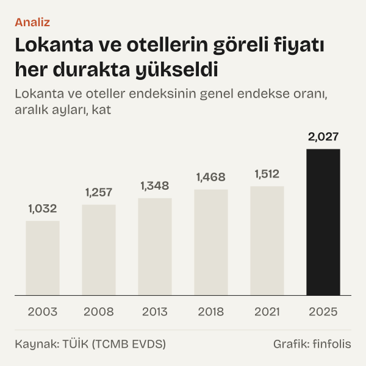
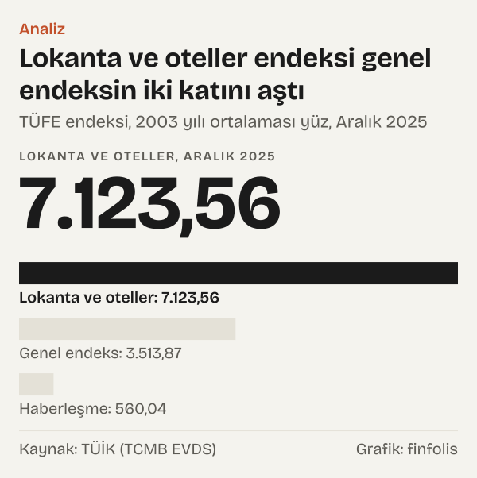

7.123,56. Türkiye İstatistik Kurumu (TÜİK) tüketici fiyat endeksinde (TÜFE) lokanta ve oteller grubunun Aralık 2025'teki değeri bu. Endeks, 2003'ün ortalama fiyatlarını yüze eşitleyerek kuruluyor. Aynı ayda bütün harcamaları kapsayan genel endeks 3.513,87'deydi. İkisini birbirine böldüğümüzde 2,03 çıkıyor: yemek dışarıda yenen, oda kiralanan hizmetlerin fiyatı, 2003'ten bu yana, ortalama bir mal ya da hizmetin fiyatının iki katından fazla yükselmiş.

Yazının sorusu tek: TÜFE'nin on iki ana harcama grubu, Aralık 2003'ten Aralık 2025'e kadar genel endekse göre ne kadar farklı yol aldı? Her grubun endeksini aynı aydaki genel endekse böldük. Çıkan sayıya göreli fiyat adını veriyoruz. Bir ise grup genel fiyat düzeyiyle aynı hızda pahalanmış demektir. Birin üstü daha hızlı, altı daha yavaş.

Okur için anlamı şu: genel endeks, bütün harcama gruplarının ağırlıklı ortalamasıdır ve tek tek gruplar uzun dönemde bu ortalamadan belirgin biçimde uzaklaşabiliyor. Hangi grubun ortalamanın üstünde, hangisinin altında kaldığını bilmek, fiyat rakamlarını grup düzeyinde okumayı mümkün kılıyor. Aşağıda bu yolculuğu aralık aylarında izliyoruz: Aralık 2003, Aralık 2008, Aralık 2013, Aralık 2018, Aralık 2021 ve Aralık 2025.

*Grup endeksinin aynı aydaki genel endekse oranı, kat; kesik çizgi genel endeks. Kaynak: TÜİK (TCMB EVDS).*

## Başlangıç çizgisi: Aralık 2003

Yolculuğun ilk karesi neredeyse düz bir çizgi. Endeksin temel yılı 2003 olduğu için Aralık 2003'te bütün gruplar yüzün biraz üstünde. Genel endeks 104,12'ydi; grupların göreli fiyatları dar bir bantta toplanıyordu. Eğitim 1,07 ile bandın tepesinde, alkollü içecekler ve tütün 1,05 ile hemen arkasındaydı. Sağlık 0,96 ile en alttaydı.

Küçük farklar yılın içinden geliyor. Endeks 2003'ün on iki ayının ortalamasını yüz kabul ediyor; aralık ayına kadar fiyatını yıl ortalamasından daha çok artıran grup birin biraz üstünde başlıyor. Yani başlangıçta herkes aynı çizgide değil, ama farklar sonraki yıllarla karşılaştırınca çok küçüktü.

Başlangıçtaki düzlük, sonraki yirmi iki yılın ne kadar dağıldığını görmek için iyi bir ölçü. Aralık 2025'e gelindiğinde aynı on iki grubun göreli fiyatı 0,16 ile 2,03 arasına yayılmış durumda.

## İlk durak: Aralık 2008

Beş yıl sonra çizgi kırılmaya başlamıştı. Aralık 2008'de genel endeks 160,44'e çıkmıştı. Lokanta ve oteller 1,26'ya, konut grubu (kira, su, elektrik, gaz ve diğer yakıtlar) 1,23'e yükselmişti. Alkollü içecekler ve tütün 1,20'deydi.

Öbür uçta iki grup şimdiden ayrışıyordu. Giyim ve ayakkabının göreli fiyatı 0,76'ya, haberleşmenin göreli fiyatı 0,69'a inmişti. Sağlık da 0,77 ile genel endeksin gerisine düşmüştü. Gıda ise 1,01 ile hâlâ tam ortadaydı: beş yılda gıda fiyatları genel fiyat düzeyiyle neredeyse aynı hızda artmıştı.

Bu durakta görülen ayrışma, sonraki yıllarda yönünü pek değiştirmedi. Haberleşme ve giyim her durakta biraz daha geriye düştü; lokanta ve oteller her durakta biraz daha öne geçti. Konut ise farklı bir yol izledi; ona aşağıda döneceğiz.

## Aralık 2013 ve Aralık 2018 arası

Aralık 2013'te genel endeks 229,01'deydi. Bu durağın en dikkat çeken grubu alkollü içecekler ve tütündü: göreli fiyatı 1,68'e ulaşmıştı ve o tarihte bütün grupların en üstündeydi. Lokanta ve oteller 1,35 ile ikinciydi. Haberleşme 0,53'e, sağlık 0,60'a inmişti.

Aralık 2018'de tablo yeniden değişti. Genel endeks 393,88'e yükselmişti. Alkollü içecekler ve tütün 1,54'e gerilerken lokanta ve oteller 1,47'ye çıktı. Bu dönemde iki grup sessizce yukarı tırmandı: gıda 1,15'e, çeşitli mal ve hizmetler 1,29'a ulaştı. Gıdanın göreli fiyatı Aralık 2008'deki 1,01'den Aralık 2018'deki 1,15'e on yılda adım adım yükseldi.

Aynı dönemde haberleşmenin göreli fiyatı 0,38'e, giyiminki 0,645'e indi. Eğitim ilk kez birin altına düştü: Aralık 2018'de 0,91'di.

Daha sessiz iki grup da bu aralıkta yön değiştirdi. Sağlık Aralık 2013'te 0,60'a inmiş, Aralık 2018'de 0,58'de yatay kalmıştı; uzun düşüşü bu dönemde neredeyse durdu. Mobilya ve ev eşyası ise Aralık 2013'teki 0,79'dan Aralık 2018'de 0,86'ya çıktı. Eğlence ve kültür grubu aynı aralıkta 0,72'den 0,685'e geriledi. Yani gerileyen grupların hepsi aynı hızda gerilemedi; bazıları bir dönem durakladı, bazıları kısa bir süre geri döndü.

*Lokanta ve oteller endeksinin genel endekse oranı, aralık ayları, kat. Kaynak: TÜİK (TCMB EVDS).*

## Aralık 2021'den Aralık 2025'e

Son dört yıl, iki grup için yolculuğun en hareketli bölümü oldu. Önce durağın kendisi: Aralık 2021'de genel endeks 686,95'ti, Aralık 2025'te 3.513,87'ye ulaştı.

Eğitim bu dönemin en büyük dönüşünü yaptı. Aralık 2021'de göreli fiyatı 0,75'ti; Aralık 2013'e kadar birin üstünde kalmış, sonra genel endeksin gerisine düşmüş bir gruptu. Aralık 2025'te 1,16'ya çıktı. Yani dört yılda eğitim hizmetlerinin fiyatı, genel fiyat düzeyinin gerisinden onun önüne geçti.

Konut grubu da benzer bir dönüş yaptı. Aralık 2008'deki 1,23'ten sonra yavaşça gerilemiş, Aralık 2021'de 1,00'e, yani tam genel endeks düzeyine inmişti. Aralık 2025'te 1,25'e yükseldi. Lokanta ve oteller ise aynı dönemde 1,51'den 2,03'e çıkarak aradaki farkı açtı.

Ters yönde de hareket var. Çeşitli mal ve hizmetler grubu Aralık 2021'deki 1,455'ten Aralık 2025'te 1,29'a indi; Aralık 2018'e kadar süren tırmanışı bu dönemde tersine döndü. Sağlık ise 0,53'ten 0,60'a çıktı. Ulaştırma Aralık 2021'de 1,15'e çıkmıştı; Aralık 2025'te 1,00'e döndü. Giyim ve ayakkabının göreli fiyatı 0,46'dan 0,23'e, haberleşmeninki 0,26'dan 0,16'ya indi.

İki grup daha bu dört yılda geriye çekildi. Mobilya ve ev eşyası Aralık 2021'de 0,90'dı, Aralık 2025'te 0,84'e indi. Eğlence ve kültür 0,58'den 0,47'ye geriledi. Böylece Aralık 2025'te genel endeksin gerisinde kalan grupların çoğu, Aralık 2021'dekinden de geride duruyordu; sağlık bu kümede yönünü yukarı çeviren tek grup oldu.

![Eğim grafiği: Aralık 2013–Aralık 2025 arasında lokanta, konut ve eğitimin göreli fiyatı yükseldi, haberleşmeninki düştü: Aralık 2013: Lokanta ve oteller: 1,348, Alkollü içecekler ve tütün: 1,677, Gıda ve alkolsüz içecekler: 1,056, Konut, su, elektrik, gaz: 1,177, Eğitim: 1,016, Ulaştırma: 0,989, Sağlık: 0,597, Haberleşme: 0,535; Aralık 2025: Lokanta ve oteller: 2,027, Alkollü içecekler ve tütün: 1,535, Gıda ve alkolsüz içecekler: 1,403, Konut, su, elektrik, gaz: 1,247, Eğitim: 1,161, Ulaştırma: 0,996, Sağlık: 0,600, Haberleşme: 0,159.](./graf-3.svg)
*Grup endeksinin genel endekse oranı, kat. Kaynak: TÜİK (TCMB EVDS).*

## Uzun yolun iki ucu

Bütün yolu tek bir tabloda topladığımızda iki küme beliriyor. Genel endeksin önüne geçenler: lokanta ve oteller (2,03), alkollü içecekler ve tütün (1,535), gıda (1,40), çeşitli mal ve hizmetler (1,29), konut (1,25) ve eğitim (1,16). Genel endeksin gerisinde kalanlar: mobilya ve ev eşyası (0,84), sağlık (0,60), eğlence ve kültür (0,47), giyim (0,23) ve haberleşme (0,16). Ulaştırma 1,00 ile çizginin hemen yanında duruyor.

Gıdanın yolu ayrıca ilginç. Aralık 2025'te gıda endeksi 4.928,95 ile genel endeksin 1,40 katıydı. Gıdanın göreli fiyatı bütün duraklarda ya sabit kaldı ya yükseldi: 1,00, 1,01, 1,06, 1,15, 1,27 ve 1,40. Seride hiçbir durakta geriye dönüş yok.

En uçtaki iki grubu yan yana koyduğumuzda fark daha somut hale geliyor. Aralık 2025'te lokanta ve oteller endeksi 7.123,56, haberleşme endeksi 560,04'tü. İkisi de 2003'ün ortalamasını yüz kabul ediyor.

Tepedeki grubun değişmesi de yolculuğun bir parçası. Aralık 2003'te en yüksek göreli fiyat 1,07 ile eğitimdeydi. Aralık 2008'de lokanta ve oteller 1,26 ile öne geçti. Aralık 2013'te ve Aralık 2018'de tepede alkollü içecekler ve tütün vardı. Aralık 2021'de bu grup 1,52 ile lokanta ve otellerin 1,51'inin yalnız biraz önündeydi. Aralık 2025'te lokanta ve oteller 2,03 ile açık farkla öndeydi. Dipte ise değişiklik yok: Aralık 2008'den bu yana bütün aralık duraklarında en düşük göreli fiyat haberleşmede.

*TÜFE endeksi, 2003 yılı ortalaması yüz, Aralık 2025. Kaynak: TÜİK (TCMB EVDS).*

## Aynı tablonun öbür yüzü

Tablo kolayca yanlış okunabilir; bu yüzden onu başka bir açıdan da sınamak gerekiyor.

İlk itiraz: göreli fiyatı düşen bir grup "ucuzlamış" değildir. Haberleşme endeksi Aralık 2003'ten Aralık 2025'e 102,36'dan 560,04'e çıktı; bu grupta da fiyatlar belirgin biçimde arttı. Göreli fiyatın 0,16'ya inmesi, bu artışın genel fiyat düzeyindeki artışın çok gerisinde kaldığını söylüyor, fiyatın düştüğünü değil.

İkinci itiraz: göreli fiyatı yükselen grup, hanenin bütçesinde otomatik olarak büyümüş değildir. Bir grubun bütçedeki payı fiyatla birlikte tüketilen miktara da bağlıdır. Fiyatı hızlı artan bir hizmetten daha az alınıyorsa harcama payı aynı kalabilir, hatta küçülebilir. Bu yazıdaki oranlar fiyatların yolunu gösteriyor; hanelerin parayı nasıl böldüğü ayrı bir sorudur ve TÜİK'in her yıl güncellediği sepet ağırlıklarıyla ölçülür.

Üçüncü itiraz zamanlamayla ilgili. Tek tek duraklara bakınca bir grup bir dönemde öne, sonra geriye geçebiliyor. Alkollü içecekler ve tütün Aralık 2013'te 1,68 ile tepedeydi; Aralık 2025'te 1,535'e inmişti. Ulaştırma Aralık 2021'de 1,15'e çıkmış, sonra 1,00'e dönmüştü. Hangi yılın başlangıç alındığı sonucu değiştirebilir. Bu yüzden tek bir durağı değil, bütün durakları gösterdik.

Dördüncü itiraz nedenle ilgili. Veri, bir grubun neden öne geçtiğini söylemiyor. Maliyetler, teknoloji ya da talep değişiklikleri birer olası açıklamadır; ama bu yazıdaki seriler bunlardan hiçbirini tek başına kanıtlamıyor. Burada yalnız fiyatların hangi yolu izlediğini ve bunun aynı dönemde olduğunu yazıyoruz.

## Endeksin göremedikleri

Her uzun seri gibi bu da bazı sınırlar taşıyor ve sonuçlar bu sınırlar içinde okunmalı.

Birincisi sepetin değişmesi. TÜFE zincirleme bir endekstir: sepetin içeriği ve grupların ağırlıkları her yıl yenilenir, yıllar birbirine bağlanır. Bu yüzden Aralık 2025'teki grup endeksi, 2003 yılında kullanılan sepetin bugünkü fiyatı değildir; her yılın kendi sepetiyle ölçülmüş değişimlerin birikimidir. Göreli fiyat oranını da sabit bir sepetin parçası olarak değil, iki birikimli fiyat değişiminin oranı diye okumak gerekir.

İkincisi seri sonu. Bu yazıdaki grup serileri TÜİK'in 2003 yılını temel alan TÜFE'sinin arşiv serileridir ve EVDS'de Aralık 2025'te bitiyor. 2003 yılı temelli genel endeks EVDS'de ayrı bir seri olarak Eylül 2026'ya kadar yayımlanmaya devam ediyor; ama ana grupların 2003 yılı temelli serileri Aralık 2025'ten sonra yok. Bu yüzden karşılaştırmayı Aralık 2025'te bitirdik. Ocak 2026'dan itibaren TÜİK, 2025 yılını temel alan yeni bir endeks ve on üç gruplu yeni bir sınıflama yayımlıyor. Yeni sınıflamada grupların sınırları değişti; örneğin eski haberleşme grubunun yerini bilgi ve iletişim grubu aldı. İki seriyi birbirine bağlayan kendi hesabımızı yapmadık; bu yazı 2025'in sonunda duruyor.

Üçüncüsü mevsim. Bütün duraklarda aralık ayını kullandık. Giyim gibi fiyatı mevsimle dalgalanan gruplarda başka bir ay seçmek oranı biraz değiştirebilir. Aynı ayı her yıl kullanmak bu etkiyi duraklar arasında eşitliyor, ama tamamen silmiyor.

Dördüncüsü kalite. Bir telefonun ya da bir arabanın on yıl arayla aynı ürün olmadığı açık. Fiyat endeksleri bu farkları ele almak için yöntemler kullanır; bu yöntemlerin bir grubun göreli fiyatını ne kadar etkilediğini bu seriler tek başına göstermiyor.

## Nasıl hesapladık

TÜİK'in 2003 yılını temel alan TÜFE'sinin genel endeksini ve on iki ana harcama grubu endeksini Türkiye Cumhuriyet Merkez Bankası (TCMB) Elektronik Veri Dağıtım Sistemi (EVDS) üzerinden çektik. Her grup için aralık aylarını aldık: Aralık 2003, Aralık 2008, Aralık 2013, Aralık 2018, Aralık 2021 ve Aralık 2025. Her durakta grup endeksini aynı aydaki genel endekse böldük ve iki ondalığa yuvarladık; bu orana göreli fiyat adını verdik. Endekslerin hepsi aynı temeli, 2003'ün ortalamasını yüz kabul eden ölçeği kullandığı için bu bölme anlamlıdır. Ocak 2026'dan sonra yayımlanan ve 2025'in ortalamasını temel alan seriyi bu hesaba katmadık ve iki temel yılı birbirine bağlamadık.

## Kaynaklar

- [TCMB EVDS: TÜFE genel endeksi (2003 yılı temelli, arşiv), seri TP.FG.J0, Aralık 2003–Aralık 2025](https://evds3.tcmb.gov.tr/igmevdsms-dis/series=TP.FG.J0)
- [TCMB EVDS: Gıda ve alkolsüz içecekler, seri TP.FG.J01](https://evds3.tcmb.gov.tr/igmevdsms-dis/series=TP.FG.J01)
- [TCMB EVDS: Alkollü içecekler ve tütün, seri TP.FG.J02](https://evds3.tcmb.gov.tr/igmevdsms-dis/series=TP.FG.J02)
- [TCMB EVDS: Giyim ve ayakkabı, seri TP.FG.J03](https://evds3.tcmb.gov.tr/igmevdsms-dis/series=TP.FG.J03)
- [TCMB EVDS: Konut, su, elektrik, gaz ve diğer yakıtlar, seri TP.FG.J04](https://evds3.tcmb.gov.tr/igmevdsms-dis/series=TP.FG.J04)
- [TCMB EVDS: Mobilya, ev aletleri ve ev bakım hizmetleri, seri TP.FG.J05](https://evds3.tcmb.gov.tr/igmevdsms-dis/series=TP.FG.J05)
- [TCMB EVDS: Sağlık, seri TP.FG.J06](https://evds3.tcmb.gov.tr/igmevdsms-dis/series=TP.FG.J06)
- [TCMB EVDS: Ulaştırma, seri TP.FG.J07](https://evds3.tcmb.gov.tr/igmevdsms-dis/series=TP.FG.J07)
- [TCMB EVDS: Haberleşme, seri TP.FG.J08](https://evds3.tcmb.gov.tr/igmevdsms-dis/series=TP.FG.J08)
- [TCMB EVDS: Eğlence ve kültür, seri TP.FG.J09](https://evds3.tcmb.gov.tr/igmevdsms-dis/series=TP.FG.J09)
- [TCMB EVDS: Eğitim, seri TP.FG.J10](https://evds3.tcmb.gov.tr/igmevdsms-dis/series=TP.FG.J10)
- [TCMB EVDS: Lokanta ve oteller, seri TP.FG.J11](https://evds3.tcmb.gov.tr/igmevdsms-dis/series=TP.FG.J11)
- [TCMB EVDS: Çeşitli mal ve hizmetler, seri TP.FG.J12](https://evds3.tcmb.gov.tr/igmevdsms-dis/series=TP.FG.J12)
