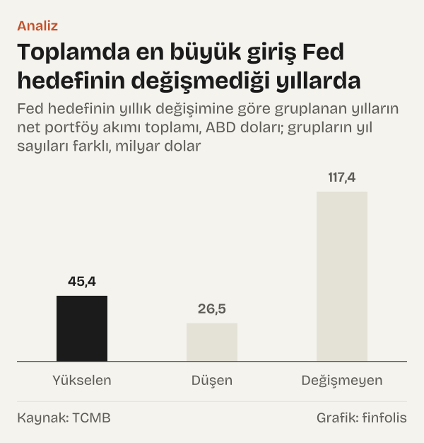
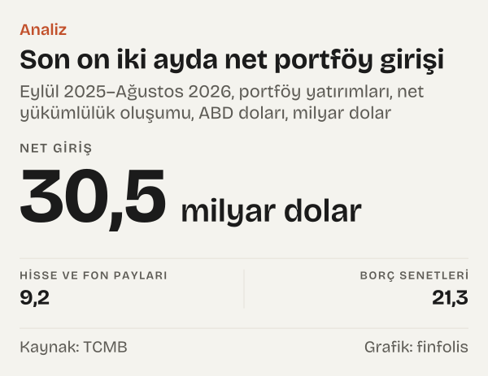

ABD Merkez Bankası (Fed) faiz artırdığında Türkiye'ye gelen portföy yatırımları azalır mı? Bu soruyu iki resmî seriyi aynı yıllar için yan yana koyarak sorduk. Çıkan cevap düz bir evet ya da hayır değil.

Fed'in politika faizi hedefini yıl sonuna göre yükselttiği dokuz yıl var: 2004–2006, 2015–2018 ve 2022–2023 yılları. Bu yılların altısında Türkiye'ye net portföy girişi oldu, üçünde net akım eksiye döndü. Dokuz yılın toplamı 45,41 milyar dolar. Fed'in hedefi düşürdüğü altı yılda toplam 26,48 milyar dolar, hedefin değişmediği yedi yılda ise 117,37 milyar dolar.

Portföy yatırımı burada Türkiye Cumhuriyet Merkez Bankası'nın (TCMB) ödemeler dengesi istatistiklerindeki portföy yatırımları başlığındaki net yükümlülük oluşumu kalemi. Kabaca, yurt dışında yerleşik olanların Türkiye'de ihraç edilmiş hisse senedi, yatırım fonu payı ve borç senedine yaptığı net yatırımı ve Türkiye'deki kurumların yurt dışında ihraç ettiği borç senetlerini kapsıyor. Artı değer net giriş, eksi değer net çıkış demek.

Bu yazı iki serinin aynı dönemlerde ne gösterdiğini anlatıyor. Bir serinin öbürüne yol açtığını söylemiyor. Fed'in kendi araştırma notlarından birinin bu konuda ne dediğini ise aşağıda ayrıca aktarıyoruz.

## Yirmi iki yılın iki çizgisi

Politika faizi hedefi 2003 yılı sonunda %1'di. Hedef 2006 yılı sonuna kadar adım adım %5,25'e çıktı, 2008 yılı sonunda ise hedef aralığının üst sınırı %0,25'e indi. Üst sınır Aralık 2015'e kadar orada kaldı.

![Çizgi grafik: Fed hedefi iki kez sıfıra yakın düzeye indi, üç dönemde yükseldi: Fed hedefi: 2003 yılında %1,00, 2004 yılında %2,25, 2005 yılında %4,25, 2006 yılında %5,25, 2007 yılında %4,25, 2008 yılında %0,25, 2009 yılında %0,25, 2010 yılında %0,25, 2011 yılında %0,25, 2012 yılında %0,25, 2013 yılında %0,25, 2014 yılında %0,25, 2015 yılında %0,50, 2016 yılında %0,75, 2017 yılında %1,50, 2018 yılında %2,50, 2019 yılında %1,75, 2020 yılında %0,25, 2021 yılında %0,25, 2022 yılında %4,50, 2023 yılında %5,50, 2024 yılında %4,50, 2025 yılında %3,75, Ağu 2026: %3,75.](./graf-1.svg)
*Yıl sonu politika faizi hedefi, 2008 yılından itibaren hedef aralığının üst sınırı, yüzde. Kaynak: Fed (FRED).*

Sonraki yıllarda iki artış dönemi daha var. Üst sınır 2018 yılı sonunda %2,5'e çıktı, 2020 yılı sonunda yeniden %0,25'e indi. 2022 yılında tek yılda 4,25 puan yükselip %4,5'e, 2023 yılı sonunda %5,5'e ulaştı. 2024 yılı sonunda %4,5, 2025 yılı sonunda %3,75 oldu. Ağustos 2026 sonunda üst sınır %3,75'teydi; 22 Ekim 2026 itibarıyla %4.

Aynı yıllarda Türkiye'nin ödemeler dengesindeki net portföy akımı çok daha dalgalı bir yol izledi. En büyük yıllık giriş 38,97 milyar dolarla 2012 yılında. En büyük çıkış ise eksi 17,04 milyar dolarla 2022 yılında görüldü. İkinci en büyük çıkış eksi 13,5 milyar dolarla 2015 yılında.

![Çubuk grafik: Türkiye’ye net portföy akımı yıldan yıla yön değiştirdi: Net akım: 2003 yılında 3.851 milyon dolar, 2004 yılında 9.411 milyon dolar, 2005 yılında 14.670 milyon dolar, 2006 yılında 10.098 milyon dolar, 2007 yılında −86 milyon dolar, 2008 yılında −4.051 milyon dolar, 2009 yılında 464 milyon dolar, 2010 yılında 18.737 milyon dolar, 2011 yılında 22.325 milyon dolar, 2012 yılında 38.968 milyon dolar, 2013 yılında 23.238 milyon dolar, 2014 yılında 20.265 milyon dolar, 2015 yılında −13.502 milyon dolar, 2016 yılında 8.161 milyon dolar, 2017 yılında 25.540 milyon dolar, 2018 yılında −288 milyon dolar, 2019 yılında −1.330 milyon dolar, 2020 yılında −8.971 milyon dolar, 2021 yılında −6.631 milyon dolar, 2022 yılında −17.039 milyon dolar, 2023 yılında 8.363 milyon dolar, 2024 yılında 23.386 milyon dolar, 2025 yılında 17.528 milyon dolar.](./graf-2.svg)
*Portföy yatırımları, net yükümlülük oluşumu, yıllık toplam, ABD doları. Kaynak: TCMB.*

İki çizgiyi üst üste koyduğumuzda ilk göze çarpan şey, en büyük girişlerin Fed hedefinin en düşük olduğu yıllara denk gelmesi. 2010–2014 yıllarında üst sınır her yıl sonunda %0,25'ti; bu beş yılın toplam girişi 123,53 milyar dolar. Ama aynı düşük düzey 2021 yılında da vardı ve o yıl net akım eksi 6,63 milyar dolar oldu.

## Artış yılları: tek bir yön yok

Hedefin yükseldiği dokuz yıla tek tek bakınca tablo daha da karışıyor.

2004–2006 yıllarında hedef her yıl yükseldi: 2004 yılında 1,25 puan, 2005 yılında 2 puan, 2006 yılında 1 puan. Aynı üç yılda Türkiye'ye net portföy girişi sırasıyla 9,41 milyar dolar, 14,67 milyar dolar ve 10,1 milyar dolar oldu. Üç yılın üçünde de akım artıdaydı.

2015–2018 artış döneminin başı ve sonu farklı. 2015 yılında hedef yalnız 0,25 puan yükseldi ve net akım eksi 13,5 milyar dolar oldu. 2016 yılında yine 0,25 puanlık artışla 8,16 milyar dolarlık giriş görüldü. 2017 yılında hedef 0,75 puan yükseldi, giriş 25,54 milyar dolara çıktı. 2018 yılında 1 puanlık artışla akım eksi 0,29 milyar dolara indi.

Son artış dönemi en hızlısıydı. 2022 yılında hedef 4,25 puan yükseldi; bu, incelediğimiz yılların en büyük artışı. Aynı yıl Türkiye'den eksi 17,04 milyar dolarlık net akım, yani dönemin en büyük çıkışı görüldü. 2023 yılında hedef 1 puan daha yükseldi, ama net akım 8,36 milyar dolarla artıya döndü.

Dokuz yıldan çıkan sonuç şu: Fed'in faiz artırdığı yılların çoğunda Türkiye'ye net giriş oldu, ama artışın en büyük olduğu yıl en büyük çıkışla aynı yıla denk geldi. Artışın büyüklüğü ile akımın yönü arasında düzenli bir sıra da yok. 2015 yılında küçük bir artışla büyük bir çıkış, 2017 yılında daha büyük bir artışla büyük bir giriş aynı dönemin içinde yer alıyor.

## İndirim yılları ve sıfıra yakın faiz

Hedefin düşürüldüğü altı yılda da tablo tek yönlü değil. 2007–2008 yıllarında hedef toplam 5 puan indi; Türkiye'de net akım 2007 yılında eksi 0,09 milyar dolar, 2008 yılında eksi 4,05 milyar dolar oldu. 2019–2020 yıllarındaki indirimlerle aynı dönemde de akım eksideydi: 2019 yılında eksi 1,33 milyar dolar, 2020 yılında eksi 8,97 milyar dolar.

*Fed hedefinin yıllık değişimine göre gruplanan yılların net portföy akımı toplamı, ABD doları; grupların yıl sayıları farklı. Kaynak: TCMB.*

En yeni indirim dönemi ise ters yönde. 2024 yılında hedef 1 puan, 2025 yılında 0,75 puan indi ve aynı iki yılda Türkiye'ye sırasıyla 23,39 milyar dolar ve 17,53 milyar dolar net giriş oldu. İndirim yıllarının altı yıllık toplamındaki 26,48 milyar doların tamamı bu iki yıldan geliyor; öbür dört yılın hepsi eksi.

Değişmeyen hedefle geçen yedi yıl ise toplamda en yüksek grubu oluşturuyor. Ama grubun ağırlığı neredeyse tamamen 2010–2014 yıllarından geliyor. Bu da iki seri arasında yalnız Fed faizinin yönüne ya da düzeyine bakarak kurulabilecek düzenli bir eşleşme görülmediğinin bir başka örneği: aynı düşük faiz düzeyinde, 2012 yılında 38,97 milyar dolarlık giriş, 2021 yılında eksi 6,63 milyar dolarlık akım var.

Grupların yıl sayıları farklı olduğu için toplamları doğrudan karşılaştırmak da yanıltıcı olabilir. Dokuz yıllık bir toplam ile altı yıllık bir toplam aynı ölçüde değil. Bu yüzden yukarıda yalnız toplamlara değil, yılların kaçında akımın artı ya da eksi olduğuna da baktık.

## Akımın içinde ne var

Portföy yatırımlarının iki ana parçası var: hisse senedi ve yatırım fonu payları ile borç senetleri. Türkiye'de akımın büyük kısmını yıllar boyunca borç senetleri taşıdı.

![Küçük çoklu grafik: Akımın büyük kısmını borç senetleri taşıdı: Hisse senedi ve fon payları: 2003 yılında 0,91 milyar dolar, 2004 yılında 1,43 milyar dolar, 2005 yılında 5,67 milyar dolar, 2006 yılında 1,94 milyar dolar, 2007 yılında 5,14 milyar dolar, 2008 yılında 0,72 milyar dolar, 2009 yılında 2,83 milyar dolar, 2010 yılında 3,47 milyar dolar, 2011 yılında −0,99 milyar dolar, 2012 yılında 6,28 milyar dolar, 2013 yılında 0,84 milyar dolar, 2014 yılında 2,56 milyar dolar, 2015 yılında −2,40 milyar dolar, 2016 yılında 0,82 milyar dolar, 2017 yılında 2,97 milyar dolar, 2018 yılında −1,13 milyar dolar, 2019 yılında 0,41 milyar dolar, 2020 yılında −4,26 milyar dolar, 2021 yılında −1,43 milyar dolar, 2022 yılında −3,49 milyar dolar, 2023 yılında 2,22 milyar dolar, 2024 yılında −0,60 milyar dolar, 2025 yılında 7,30 milyar dolar; Borç senetleri: 2003 yılında 2,95 milyar dolar, 2004 yılında 7,98 milyar dolar, 2005 yılında 9,00 milyar dolar, 2006 yılında 8,16 milyar dolar, 2007 yılında −5,22 milyar dolar, 2008 yılında −4,77 milyar dolar, 2009 yılında −2,36 milyar dolar, 2010 yılında 15,27 milyar dolar, 2011 yılında 23,31 milyar dolar, 2012 yılında 32,69 milyar dolar, 2013 yılında 22,40 milyar dolar, 2014 yılında 17,71 milyar dolar, 2015 yılında −11,11 milyar dolar, 2016 yılında 7,34 milyar dolar, 2017 yılında 22,57 milyar dolar, 2018 yılında 0,84 milyar dolar, 2019 yılında −1,74 milyar dolar, 2020 yılında −4,72 milyar dolar, 2021 yılında −5,20 milyar dolar, 2022 yılında −13,55 milyar dolar, 2023 yılında 6,15 milyar dolar, 2024 yılında 23,99 milyar dolar, 2025 yılında 10,23 milyar dolar.](./graf-4.svg)
*Portföy yatırımları, net yükümlülük oluşumu, yıllık toplam, ABD doları. Kaynak: TCMB.*

En büyük giriş yılı olan 2012 yılında 38,97 milyar dolarlık toplamın 32,69 milyar doları, yani %83,9'u borç senetlerinden geldi. Eksi 17,04 milyar dolarlık 2022 yılı akımında da borç senetleri ağırlıktaydı: eksi 13,55 milyar dolar, hisse senetlerinde ise eksi 3,49 milyar dolar. Hisse senedi tarafındaki yıllık akımlar genellikle daha küçük. En büyük yıllık hisse girişi 7,3 milyar dolarla 2025 yılında.

Eylül 2025–Ağustos 2026 döneminde, yani son on iki ayda, Türkiye'ye 30,53 milyar dolarlık net portföy girişi oldu. Bunun 9,18 milyar doları, yani %30,1'i hisse senedi ve fon payları; 21,35 milyar doları borç senetleri.

*Eylül 2025–Ağustos 2026, portföy yatırımları, net yükümlülük oluşumu, ABD doları. Kaynak: TCMB.*

Borç senetlerinin içi de ayrışıyor. Genel hükümetin yurt içinde ihraç ettiği borç senetlerine net 4,32 milyar dolar, yurt dışında ihraç ettiği borç senetlerine 4,73 milyar dolar akım var. Bankaların borç senetlerinde 5,2 milyar dolar, diğer sektörlerde 7,11 milyar dolar görülüyor.

*Eylül 2025–Ağustos 2026, net yükümlülük oluşumu, ABD doları; merkez bankası kalemi çok küçük olduğu için gösterilmedi. Kaynak: TCMB.*

Ayrım önemli, çünkü yurt dışında ihraç edilen borç senetleri yurt dışında yerleşik bir yatırımcının yurt içi piyasaya doğrudan girişi değil, Türkiye'deki bir kurumun dış piyasadan borçlanması. Ödemeler dengesi ikisini de aynı başlıkta topluyor.

## Fed'in araştırma notu ne diyor

Fed Guvernörler Kurulu'nun yayımladığı FEDS Notes dizisindeki bir araştırma notu (görüşler yazarlarına ait) bu konudaki yaygın düşünceyi şöyle özetliyor: "Rising U.S. interest rates are often thought to be bad news for emerging market economies". Yani ABD faizlerinin yükselmesi genellikle gelişmekte olan ekonomiler için kötü haber olarak görülür.

Notun devamı ise tek yönlü bir ilişki kurmuyor. Notta, başka bazı dönemlerde gelişmekte olan ekonomilerin artan ABD faizlerini az sorunla atlattığı belirtiliyor ve buna örnek olarak iki binli yılların ortası veriliyor: "EMEs weathered rising U.S. rates with few difficulties". Notun ana bulgusu da iki etkenle ilgili: "financial spillovers to EMEs of U.S. monetary policy depend on two key factors". Notta birinci etken şöyle tanımlanıyor: "The first of these is the reason for the change in U.S. interest rates." Yani ABD'de faizin neden değiştiği. İkinci etken için notun ifadesi şu: "The second key factor influencing the spillovers from U.S. monetary policy is the domestic conditions in the EMEs themselves". Yani gelişmekte olan ekonominin kendi iç koşulları.

Not Türkiye'ye özel değil ve portföy akımlarını tek başına ölçmüyor. Bizim tablomuz da notun bulgusunu sınamıyor. Yalnız şunu söyleyebiliriz: 2004–2006 yıllarındaki artışlarla aynı dönemde Türkiye'ye net giriş olması, notun iki binli yılların ortası için yaptığı genel gözlemle çelişmiyor.

## Yıllık toplamların sakladıkları

Karşılaştırmanın birkaç sınırı var.

Birincisi zaman birimi. Fed'in kararları yılın herhangi bir ayında alınıyor; biz ise takvim yılı toplamlarına ve yıl sonu hedeflerine baktık. Yılın son günlerinde alınan bir karar ile yılın başında alınan bir karar, bu yöntemde aynı yılın değişimi olarak görünüyor. Yıllık toplam, yıl içindeki aylık dalgalanmayı da gizliyor.

İkincisi seri tanımı. Fed, Aralık 2008'den bu yana tek bir oran değil bir hedef aralığı açıklıyor. Bu yazıda 2007 yılına kadar hedef oranı, sonrasında hedef aralığının üst sınırını kullandık. Yıllık değişim hesabında bu geçiş 2008 yılına düşüyor.

Üçüncüsü kalemin kapsamı. Net yükümlülük oluşumu, yurt dışında yerleşik yatırımcıların alım ve satımları ile Türkiye'deki kurumların yurt dışı borç senedi ihraçlarını ve geri ödemelerini bir arada içeriyor. Bir yıllık eksi değer, yatırımcıların alım satım dengesinden de, borç senedi ihraçları ile geri ödemeler arasındaki dengeden de gelebilir; bu toplam kalem ikisini ayırmıyor.

Dördüncüsü tek değişkenle bakmanın kendisi. Bu yazı yalnız Fed'in hedefini ele aldı. Oysa aynı yıllarda başka merkez bankalarının kararları, küresel piyasalardaki genel eğilimler ve Türkiye'nin kendi ekonomik göstergeleri de değişiyordu. Tabloda bunların hiçbiri ayrıştırılmadı. İki seri arasında görülen ya da görülmeyen her eşleşme, bu öbür değişkenlerin de içinde olduğu bir ortamda oluştu.

Beşincisi net akımın kendisi. Yıllık net rakam brüt alım ve satımları birbirinden düşüyor. Aynı net giriş, çok büyük ama birbirini götüren alım satımlarla da, küçük ve tek yönlü akımlarla da oluşabilir.

Son olarak ödemeler dengesi verileri sonradan güncellenebiliyor. Burada kullanılan rakamlar Ekim 2026'da EVDS'den çekilen son hâlleri. Ayrıca Eylül 2026'daki Fed kararından sonraki ayların ödemeler dengesi verisi henüz yayımlanmadı; o dönem bu tabloda yok.

## Nasıl hesapladık

Politika faizi hedefini FRED'deki iki seriden aldık: 2007 yılına kadar federal fon hedef oranı (DFEDTAR), sonrasında hedef aralığının üst sınırı (DFEDTARU). Her yıl için yılın son günündeki değeri kullandık ve bir önceki yıl sonuna göre farkı yüzde puanı olarak hesapladık. Farkı artı olan yılları artış, eksi olanları indirim, sıfır olanları değişmeyen yıl olarak grupladık. Portföy akımlarını TCMB ödemeler dengesi ayrıntılı sunumundaki portföy yatırımları başlığındaki net yükümlülük oluşumu kalemiyle, alt kalemlerini aynı tablonun hisse senedi, borç senedi ve sektör satırlarıyla EVDS'den çektik. Yıllık toplam için EVDS'nin on iki aylık toplam formülünün aralık değerini, son on iki ay için ağustos değerini kullandık. Grup toplamlarını yıllık toplamların toplamı, payları alt kalemin toplama oranı olarak hesapladık.

## Kaynaklar

- [FRED: Federal Funds Target Range, Upper Limit (DFEDTARU)](https://fred.stlouisfed.org/series/DFEDTARU)
- [FRED: Federal Funds Target Rate (DFEDTAR)](https://fred.stlouisfed.org/series/DFEDTAR)
- [TCMB (EVDS): Ödemeler dengesi ayrıntılı sunum, portföy yatırımları, net yükümlülük oluşumu](https://evds3.tcmb.gov.tr/igmevdsms-dis/series=TP.ODEAYRSUNUM6.Q119)
- [TCMB (EVDS): Portföy yatırımları, hisse senetleri ve yatırım fonu payları](https://evds3.tcmb.gov.tr/igmevdsms-dis/series=TP.ODEAYRSUNUM6.Q212)
- [TCMB (EVDS): Portföy yatırımları, borç senetleri](https://evds3.tcmb.gov.tr/igmevdsms-dis/series=TP.ODEAYRSUNUM6.Q123)
- [TCMB (EVDS): Borç senetleri, genel hükümet, yurt içi](https://evds3.tcmb.gov.tr/igmevdsms-dis/series=TP.ODEAYRSUNUM6.Q129)
- [TCMB (EVDS): Borç senetleri, genel hükümet, yurt dışı](https://evds3.tcmb.gov.tr/igmevdsms-dis/series=TP.ODEAYRSUNUM6.Q130)
- [TCMB (EVDS): Borç senetleri, bankalar](https://evds3.tcmb.gov.tr/igmevdsms-dis/series=TP.ODEAYRSUNUM6.Q125)
- [TCMB (EVDS): Borç senetleri, diğer sektörler](https://evds3.tcmb.gov.tr/igmevdsms-dis/series=TP.ODEAYRSUNUM6.Q133)
- [Fed Guvernörler Kurulu: FEDS Notes, Are Rising U.S. Interest Rates Destabilizing for Emerging Market Economies?, 23 Haziran 2021](https://www.federalreserve.gov/econres/notes/feds-notes/are-rising-u-s-interest-rates-destabilizing-for-emerging-market-economies-20210623.html)
