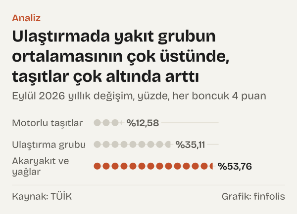

Eylül 2026'da pazara uğrayan biri meyve tezgâhında, fiyatları bir yıl öncesinin biraz altında buldu: Türkiye İstatistik Kurumu'nun (TÜİK) tüketici fiyat endeksinde (TÜFE) meyveler ve sert kabuklu meyveler alt sınıfının yıllık değişimi %-0,99 oldu, yani fiyatlar biraz geriledi. Aynı kişi akaryakıt istasyonunda başka bir tabloyla karşılaştı. Kişisel ulaşım araçları için yakıtlar ve yağlar %53,76 pahalandı. Bir sağlık merkezinde ayakta tedavi hizmeti alan biri için rakam daha da yüksekti: diğer ayakta tedavi hizmetleri %116,41 arttı.

Genel rakam ise %29,73'tü. Eylül 2026'da TÜFE bir yıl önceye göre bu kadar arttı. Genel endeks, bütün kalemlerin ağırlıklı ortalamasıdır; tek tek kalemler bu ortalamadan uzaklaşabilir. Ortalamanın altında, bir yıl içinde fiyatı düşen kalemlerle fiyatı iki katından fazla artan kalemler yan yana durur.

Yazının odağı ortalama değil, uçlar. TÜİK'in 2025 yılını temel alan yeni TÜFE serisinde, ana grupların altında yayımlanan alt sınıfların Eylül 2026'daki yıllık değişimlerini sıraladık. Sonra aynı kalemlerin bir yıl önceki, Eylül 2025'teki yıllık değişimine geri döndük. Soru şu: uçlarda hep aynı kalemler mi duruyor, yoksa uçlar yıldan yıla yer mi değiştiriyor?

Kısa cevap: yer değiştiriyor. Eylül 2025'te genel TÜFE'nin iki katından fazla artan meyveler, Eylül 2026'da listenin en altına indi.

*Bir önceki yılın aynı ayına göre değişim, yüzde; kesik çizgi genel TÜFE. Kaynak: TÜİK.*

## Üst uç: iki katı aşan artışlar

Eylül 2026'da listenin tepesinde tek bir kalem açık farkla ayrılıyor. Diğer ayakta tedavi hizmetleri %116,41 arttı. Bu, genel TÜFE'nin 86,68 puan üstünde. Bu kalemin bir yıl önceki yıllık artışı da düşük değildi: Eylül 2025'te %51,48'di. Yani artış bu yıl hızlandı; iki dönem arasındaki fark 64,93 puan.

Tepedeki kalemi diğerleri epey geriden izliyor. Yükseköğretim %57,71, gaz %55,73, kişisel ulaşım araçları için yakıtlar ve yağlar %53,76 arttı. Konutun bakım ve onarım hizmetleri %48,86, mobil iletişim hizmetleri %46,37 yükseldi.

Tepedeki kalemlerin ortak bir yanı var: çoğu hizmet ya da enerji. Mal olarak listede yalnız gaz ve yakıt bulunuyor; ikisi de enerji ürünü. Tepedeki kalemler arasında gıda, giyim ya da ev eşyası yok.

## Alt uç: neredeyse durgun fiyatlar

Listenin altında tablo tam tersine dönüyor. Meyveler ve sert kabuklu meyvelerin yıllık değişimi %-0,99 oldu; verisi yayımlanan alt sınıflar arasında Eylül 2026'da fiyatı düşen tek kalem bu oldu. Mobil telefon ekipmanları %2,49, balıklar ve diğer su ürünleri %4,84 arttı. Sağlık sigortası %4,89, spor, kamp ve açık hava eğlence ekipmanları %4,93, ayakkabılar %5,36 yükseldi.

Alt uçtaki kalemlerin çoğu mal. Telefon cihazı, spor ekipmanı, ayakkabı gibi dayanıklı ya da yarı dayanıklı mallar burada toplanıyor. Gıdadan da iki kalem var: meyveler ve balık.

İki uç arasındaki açıklığı hesapladık: en hızlı artan kalem ile en yavaş artan kalem arasında 117,40 puan var. Aynı ayda, aynı ülkede ve aynı endeksin içinde, bir kalemin fiyatı iki katından fazla artarken bir başkasınınki düşmüş.

*Bir önceki yılın aynı ayına göre değişim, yüzde. Kaynak: TÜİK.*

## Bir yıl geriye: uçlar nerede duruyordu

Şimdi bir yıl geriye, Eylül 2025'e gidelim. O ay genel TÜFE'nin yıllık artışı %33,29'du. Bir yıl sonra bu oran 3,56 puan gerileyerek %29,73'e indi. Genel rakamdaki bu küçük gerileme, alt kalemlerdeki çok daha büyük hareketleri saklıyor.

Meyveler bunun en çarpıcı örneği. Eylül 2025'te meyvelerin yıllık artışı %67,26'ydı ve genel TÜFE'nin iki katını aşıyordu. Eylül 2026'da aynı alt sınıfın yıllık değişimi %-0,99'du. Bir yılda yıllık değişim 68,25 puan geriledi. Bir yıl önce genel rakamın çok üstünde duran bir kalem, bir yıl sonra alt ucun en dibine indi.

Kira da benzer bir yön değiştirdi, ama daha yumuşak. Kiracıların ödediği gerçek kiralar Eylül 2025'te yıllık %69,09 artmıştı; Eylül 2026'da artış %41,34'e indi. Kira hâlâ genel TÜFE'nin üstünde, ama bir yılda 27,75 puan geriledi.

Ters yönde hareket edenler de var. Akaryakıtın yıllık artışı Eylül 2025'te %22,80 ile genel TÜFE'nin altındaydı. Eylül 2026'da %53,76'ya çıktı; bir yılda 30,96 puanlık bir yükseliş. Gazda artış %35,45'ten %55,73'e çıktı. Sebzelerde %28,37'den %39,47'ye yükseldi. Böylece gıdanın içinde iki komşu kalem bir yıl içinde yer değiştirdi: Eylül 2025'te meyveler sebzelerden çok daha hızlı artıyordu, Eylül 2026'da sebzeler öne geçti ve meyvelerin fiyatı geriledi.

Bazı kalemler ise iki yıl üst üste aynı uçta kaldı. Yükseköğretim Eylül 2025'te %64,59, Eylül 2026'da %57,71 arttı; iki yıl da genel TÜFE'nin çok üstünde kaldı. Mobil telefon ekipmanları Eylül 2025'te %22,50, Eylül 2026'da %2,49 arttı; iki yıl da genel TÜFE'nin altında kaldı. Motorlu taşıtlarda da yön aynıydı: %20,45'ten %12,58'e.

## Aynı grubun içindeki açıklıklar

Uçlar yalnız bütün endeks düzeyinde değil, tek bir ana grubun içinde de var. Ana grubun yıllık değişimi, içindeki kalemlerin çok farklı hareketlerini tek bir sayıya indiriyor.

Ulaştırmayı ele alalım. Grubun tamamı Eylül 2026'da %35,11 arttı. Ama içinde yakıt %53,76, motorlu taşıtlar %12,58 yükseldi. Aynı grubun iki kalemi arasında 41,18 puan var. Aynı ulaştırma rakamının içinde araç fiyatlarıyla yakıt fiyatları çok farklı yollar izledi.

Gıda grubunda da benzer bir ayrışma var. Gıda ve alkolsüz içecekler grubu %27,62 arttı. Sebzeler %39,47 yükselirken meyvelerin yıllık değişimi %-0,99 oldu; iki kalem arasındaki fark 40,46 puan. Et %37,80, süt ürünleri ve yumurta %32,01 arttı; ekmek ve tahıllar ise %23,79 ile grubun altında kaldı.

Bilgi ve iletişim grubu %26,52 arttı. İçinde mobil iletişim hizmetleri %46,37, mobil telefon ekipmanları %2,49 yükseldi: 43,88 puanlık bir açıklık. Telefonun kendisiyle telefonla alınan hizmet bambaşka yollar izledi. Aynı desen başka gruplarda da tekrar ediyor: cihaz, araç ya da eşya gibi mallar grubun alt tarafında, o malla birlikte alınan hizmet ya da enerji üst tarafında duruyor. Bu desen Eylül 2026'nın tablosu için geçerli; bir yıl önceki tabloda meyveler gibi bir gıda malı genel rakamın çok üstündeydi.

Konut grubunda gaz %55,73, elektrik %27,86 arttı; fark 27,87 puan. Grubun tamamı %39,99 yükseldi. Sağlık grubu %43,27 artarken ilaçlar %40,25, ağız ve diş tedavisi hizmetleri %19,32 yükseldi. Eğitim hizmetleri grubunda artış %48,63'tü; yükseköğretim %57,71, okul öncesi ve ilkokul eğitimi %39,03 arttı.

*Eylül 2026 yıllık değişim, yüzde; her grupta en hızlı ve en yavaş artan seçili iki alt sınıf. Kaynak: TÜİK.*

*Eylül 2026 yıllık değişim, yüzde. Kaynak: TÜİK.*

## Ortada kalanlar

Uçlara bakarken ortayı unutmamak gerekiyor, çünkü harcamaların önemli bir kısmı genel rakama yakın artan kalemlerden oluşuyor. Eylül 2026'da sıvı ve katı yağlar %27,72, yemeye hazır gıdalar %27,79, elektrik %27,86 arttı. Üçü de genel TÜFE'nin %29,73'lük artışının iki puan kadar altında kaldı. Gıda ve alkolsüz içecekler grubunun tamamı da %27,62 ile aynı bölgedeydi.

Ortadaki bu kalabalık, uçların neden ayrıca incelenmeye değer olduğunu da gösteriyor. Genel endeks ortalamayı verir; alt sınıflar ise ortalamanın etrafındaki dağılımı. Dağılımın genişliği, aynı genel rakamın arkasında ne kadar farklı fiyat hareketlerinin bulunabileceğini ölçer. Bu yazıda ağırlıkları kullanmadığımız için uçların genel rakama katkısını değil, yalnız dağılımın kendisini gösteriyoruz.

## Uçlar başka nasıl okunabilir

Tabloyu okumanın tek yolu hangi kalemin pahalandığını sormak değil. İki farklı okuma daha mümkün.

İlki baz etkisi. Yıllık değişim, bir yıl önceki fiyata göre hesaplanır. Bir kalemin fiyatı geçen yıl çok yükseldiyse, bu yıl aynı düzeyde kalması bile yıllık artışı sıfıra yaklaştırır. Meyvelerin Eylül 2025'teki %67,26'lık artıştan Eylül 2026'daki %-0,99'a inmesi bu okumayla uyumludur: geçen yılın yüksek fiyatı bu yılın karşılaştırma noktası oldu. Ama veri bize bu yüksek fiyatın neden oluştuğunu söylemiyor. Hasat, hava koşulları ya da talep birer olası açıklamadır; bu yazıdaki rakamlar bunlardan birini seçmemize izin vermiyor.

İkincisi ağırlık. Uçtaki bir kalem genel enflasyonu ancak sepetteki payı kadar etkiler. Diğer ayakta tedavi hizmetleri gibi çok hızlı artan bir kalem, hanelerin harcamalarında küçük bir yer tutuyorsa genel rakamı az değiştirir. Bu yazı alt sınıfların ağırlıklarını kullanmadı; bu yüzden hangi ucun genel TÜFE'ye ne kadar katkı yaptığını söylemiyoruz. Yalnız fiyatların dağılımını gösteriyoruz.

Üçüncü bir nokta harcama bileşimiyle ilgili. Genel endeks, bütün harcamanın ağırlıklı ortalamasını ölçer; uçlardaki kalemlerin harcama içindeki payı ise kalemden kaleme değişir. Bu yazı alt sınıfların ağırlıklarını kullanmadığı için, uçlardaki hareketlerin genel endeksi ne ölçüde etkilediği konusunda bir şey söylemiyor.

## Bu sıralamanın sınırları

Birincisi tek bir ay. Yıllık değişim, Eylül 2026'yı Eylül 2025 ile karşılaştırıyor. Mevsime duyarlı kalemlerde başka bir ay seçmek sıralamayı değiştirebilir. Meyve ve sebze gibi taze ürünler bu açıdan en hassas kalemler. Eylül, hasat döneminin içinde bir ay; aynı karşılaştırmayı kış aylarından biriyle yapmak taze ürünlerin sırasını değiştirebilir. Bu yüzden meyvelerin dipte, sebzelerin üst sıralarda olmasını Eylül 2026'nın fotoğrafı olarak okumak, bütün yıla genellememek gerekir.

İkincisi alt sınıfların içi. Her alt sınıf, kendi içinde birçok maddeyi topluyor. Diğer ayakta tedavi hizmetleri gibi bir başlık, içinde tek tek hizmetlerin farklı hareketlerini saklayabilir. Bu yazıda EVDS'de yayımlanan alt sınıf düzeyinde kaldık; daha ince kırılıma inmedik.

Üçüncüsü yeni seri. TÜİK, Ocak 2026'dan itibaren TÜFE'yi 2025 yılını temel alan yeni bir endeks ve yeni bir sınıflamayla yayımlıyor. Bu yazıdaki alt sınıfların hepsi bu yeni seriden. Eylül 2025 karşılaştırması da aynı serinin geriye doğru yayımlanmış değerlerine dayanıyor. Eski seriyle doğrudan karşılaştırma yapmadık, çünkü kalemlerin sınırları değişti.

Dördüncüsü EVDS'de bazı alt sınıflar için Eylül 2026 değeri bulunmuyor. Bu kalemleri sıralamaya katmadık; dolayısıyla uçlarda yer alabilecek ama verisi yayımlanmamış bir kalem olabilir.

Beşincisi değişim ile düzey arasındaki fark. Bu yazı yalnız yıllık yüzde değişimlere bakıyor; kalemlerin fiyat düzeyleri hakkında bir şey söylemiyor. Bir yılda az artan bir kalem uzun dönemde çok pahalanmış olabilir, çok artan bir kalem ise önceki yıllarda geride kalmış olabilir. Uçlardaki bir kalemin yerini yorumlarken bu yüzden tek bir yılın değişimiyle yetinmemek gerekiyor.

## Nasıl hesapladık

Türkiye Cumhuriyet Merkez Bankası (TCMB) Elektronik Veri Dağıtım Sistemi'nden (EVDS) TÜİK'in 2025 yılı temelli TÜFE serisini çektik. Ana grupların altındaki alt sınıfların (dört haneli kodlar) Eylül 2026 yıllık yüzde değişimlerini EVDS'nin kendi yıllık değişim formülüyle aldık ve büyükten küçüğe sıraladık. Seçtiğimiz kalemler için aynı formülle Eylül 2025 değerlerini de aldık. İki yıllık değişim arasındaki farkı ve aynı grup içindeki iki kalem arasındaki farkı puan olarak hesapladık. Alt sınıfların sepetteki ağırlıklarını kullanmadık.

## Kaynaklar

- [TCMB EVDS: TÜFE genel endeks (2025 yılı temelli), seri TP.TUKFIY2025.GENEL, Eylül 2025 ve Eylül 2026](https://evds3.tcmb.gov.tr/igmevdsms-dis/series=TP.TUKFIY2025.GENEL)
- [TCMB EVDS: Diğer ayakta tedavi hizmetleri](https://evds3.tcmb.gov.tr/igmevdsms-dis/series=TP.TUKFIY2025.0623)
- [TCMB EVDS: Meyveler ve sert kabuklu meyveler](https://evds3.tcmb.gov.tr/igmevdsms-dis/series=TP.TUKFIY2025.0116)
- [TCMB EVDS: Kişisel ulaşım araçları için yakıtlar ve yağlar](https://evds3.tcmb.gov.tr/igmevdsms-dis/series=TP.TUKFIY2025.0722)
- [TCMB EVDS: Motorlu taşıtlar](https://evds3.tcmb.gov.tr/igmevdsms-dis/series=TP.TUKFIY2025.0711)
- [TCMB EVDS: Yükseköğretim eğitimi](https://evds3.tcmb.gov.tr/igmevdsms-dis/series=TP.TUKFIY2025.1040)
- [TCMB EVDS: Gaz](https://evds3.tcmb.gov.tr/igmevdsms-dis/series=TP.TUKFIY2025.0452)
- [TCMB EVDS: Mobil telefon ekipmanları](https://evds3.tcmb.gov.tr/igmevdsms-dis/series=TP.TUKFIY2025.0812)
- [TCMB EVDS: Kiracıların ödediği gerçek kiralar](https://evds3.tcmb.gov.tr/igmevdsms-dis/series=TP.TUKFIY2025.0411)
- [TCMB EVDS: Sebzeler](https://evds3.tcmb.gov.tr/igmevdsms-dis/series=TP.TUKFIY2025.0117)
- [TCMB EVDS: TÜFE ana harcama grupları ve diğer alt sınıflar (2025 yılı temelli), veri grubu bie_tukfiy2025](https://evds3.tcmb.gov.tr/igmevdsms-dis/series=TP.TUKFIY2025.07)
