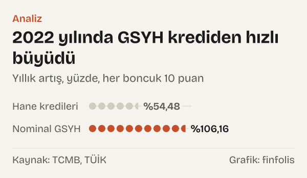
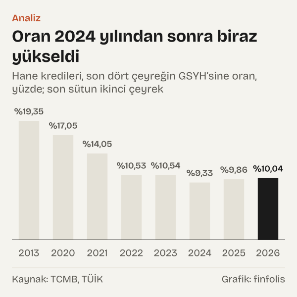
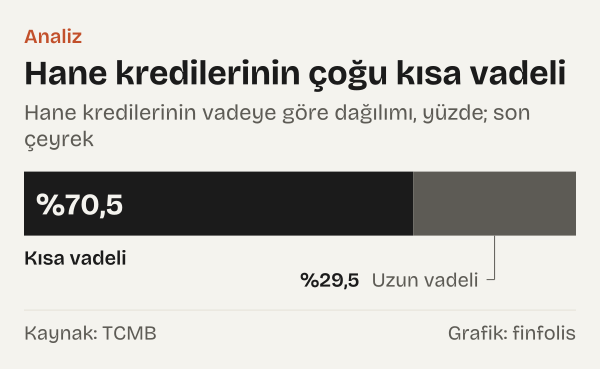

IMF'nin Küresel Borç Veritabanında 2024 yılı verisi bulunan 71 ülke ve bölge ekonomisini hane borcunun gayrisafi yurt içi hasılaya (GSYH) oranına göre büyükten küçüğe dizdiğimizde Türkiye 64. sırada çıkıyor: %9,64. Listenin başında %125,43 ile İsviçre, ardından %112,15 ile Avustralya ve %100,07 ile Kanada var.

Türkiye'de hanelerin çok borçlu olup olmadığı sorusunun cevabı, "çok borçlu" sözüyle neyin kastedildiğine bağlı. Bu yazıda soruyu tek bir ölçüyle, hanelerin toplam borcunun ekonominin bir yıllık üretimine oranıyla sınıyoruz ve bu ölçünün neyi gösterip neyi göstermediğini ayrıca konuşuyoruz.

Seçtiğimiz ölçüye göre tablo açık: Türkiye'de hanelerin toplam borcu, ekonominin büyüklüğüne göre dünyadaki örneklerin çoğundan küçük. Oran 2013 yılından 2024 yılına yarıya indi; arada 2020 yılında ve 2024 yılından sonra yükseldiği dönemler de oldu. Ama aynı veri, borcun büyük kısmının kısa vadeli olduğunu ve oranın düşüşünde paydanın, yani nominal GSYH'nin borçtan hızlı büyümesinin belirleyici olduğunu da gösteriyor. Okur için anlamı şu: toplam borç küçük görünse de bu, tek tek hanelerin borç yükünün hafif olduğu anlamına gelmiyor.

*Hane borcu (kredi ve borç senetleri), GSYH’ye oran, yüzde; IMF verisinin son yılı. Kaynak: IMF (Global Debt Database).*

## Soru ve ölçü

Hane borcu dendiğinde burada bireylerin ve ailelerin finansal kuruluşlara olan kredi borcu kastediliyor: konut kredisi, taşıt kredisi, ihtiyaç kredisi, kredi kartı borcu gibi kalemlerin toplamı. Uluslararası Para Fonu'nun (IMF) veritabanı ülkelerin kendi istatistiklerinden bu toplamı derliyor ve GSYH'ye bölüyor.

Oran iki nedenle kullanılıyor. Birincisi, farklı para birimlerindeki borçları karşılaştırılabilir kılıyor. İkincisi, borcun ekonominin ürettiği gelire göre ne kadar büyük olduğunu tek sayıda özetliyor. Ölçünün zayıf yanı da tam burada: GSYH bütün ekonominin üretimidir, hanelerin harcanabilir geliri değildir. Bu konuya yazının sonunda döneceğiz.

Veritabanı her ülke için aynı kaynağı kullanmıyor; ülkelerin merkez bankası ve istatistik kurumlarının yayımladığı finansal hesaplar ile kredi istatistiklerinden derleniyor. IMF bu verileri ortak bir tanıma, hane sektörünün kredi ve borç senedi yükümlülüklerine getirmeye çalışıyor. Yine de kimi ülkede hanelere hizmet veren kâr amacı gütmeyen kuruluşlar haneyle birlikte, kimi ülkede ayrı sayılıyor. Bu yüzden sıralamada birbirine çok yakın değerleri olan ülkelerin yerini kesin sıra olarak değil, yaklaşık konum olarak okumak gerekiyor. Türkiye'nin değeri ise listenin üst ve orta sıralarındaki ülkelerden onlarca puan aşağıda.

Seçilmiş ekonomilerin tablosu soruya başka bir açıdan da bakıyor. 2024 yılında oran ABD'de %69,35, Japonya'da %65,07, Çin'de %61,4, Almanya'da %49,93. Gelişmekte olan ekonomilerde de Türkiye'nin üstünde değerler var: Brezilya %36,35, Güney Afrika %33,72, Polonya %22,89, Meksika %16,71, Endonezya %16,16. Seçtiğimiz ekonomiler arasında Türkiye'nin altında yalnız %4,69 ile Arjantin kalıyor.

## Zirveye tırmanan ilk yıllar

Veritabanındaki Türkiye serisi 2010 yılında %15,96 ile başlıyor. Oran sonraki üç yılda her yıl yükseldi: 2011 yılında %17,01, 2012 yılında %18,05, 2013 yılında %19,45. Bu, serinin en yüksek değeri.

*Türkiye, hane borcunun GSYH’ye oranı, yüzde. Kaynak: IMF (Global Debt Database).*

2013 yılından sonra eğilim tersine döndü. Oran 2014 yılında %18,56'ya, 2015 yılında %17,73'e, 2017 yılında %16,88'e indi. 2018 yılında %14,57'ye geriledi ve 2019 yılında %14,6 ile hemen hemen aynı yerde kaldı.

Dönemi okurken bir noktayı akılda tutmak gerekiyor. Oranın düşmesi, borcun azaldığı anlamına gelmiyor. Payda olan GSYH cari fiyatlarla ölçülüyor ve fiyatlar yükseldikçe nominal GSYH de büyüyor. Borç, nominal GSYH'den yavaş artarsa oran düşer.

## Pandemi yılındaki sıçrama

2020 yılında oran bir yılda %14,6'dan %17,41'e çıktı. Seri içinde tek yıllık en büyük yükseliş bu. Aynı yıl TCMB'nin finansal hesaplarına göre hane kredilerinin GSYH'ye oranı da %17,05'e yükseldi.

Bir yıl sonra oran yeniden indi: IMF verisinde 2021 yılında %14,43, finansal hesaplarda %14,05. 2020'deki yükseliş, pandemi döneminde hem kredi tarafında hem GSYH tarafında yaşanan değişimlerle aynı yıla denk geliyor. Bu yazı o yılın kredi gelişmelerinin nedenlerini incelemiyor; yalnız iki serinin o yıl birlikte yükselip ertesi yıl birlikte indiğini kaydediyor.

## Paydanın öne geçtiği yıl

2022 yılı, oranın en hızlı indiği yıl. IMF verisinde oran %14,43'ten %10,79'a geriledi. Finansal hesaplarda %14,05'ten %10,53'e indi.

*Yıllık artış, yüzde. Kaynak: TCMB, TÜİK.*

Düşüş, borcun azalmasından gelmiyor. TCMB finansal hesaplarına göre hanelerin kredi borcu 2022 yılında %54,48 arttı. Aynı yıl son dört çeyreğin toplamı olarak nominal GSYH %106,16 büyüdü. Payda payın neredeyse iki katı hızla büyüdüğü için oran düştü.

Daha uzun bir dönemde de aynı tablo görülüyor. 2013–2025 yıllarında hane kredileri %1.659,8 artarken nominal GSYH %3.352,5 büyüdü. İkisi de çok büyük artışlar; aradaki fark, oranın neden yarıya indiğini açıklıyor. Yani oranın düşüşünü borcun küçülmesi değil, ekonominin TL cinsinden büyüklüğünün borçtan çok daha hızlı artması belirledi.

TL tutarlarla oran arasındaki farkı burada görmek mümkün. Hanelerin kredi borcunun TL tutarı 2013–2025 yıllarında on yedi katından fazlasına çıktı. Aynı dönemde nominal GSYH ise %3.352,5 büyüdü. Oran, bu iki büyümeyi aynı terazide tartıyor ve sonuç, borcun ekonomiye göre küçüldüğü yönünde.

## Son iki yılın verisi

IMF verisi 2024 yılında bitiyor. Sonrası için TCMB'nin finansal hesaplarına ve Türkiye İstatistik Kurumu'nun (TÜİK) GSYH verisine bakmak mümkün. Hesapladığımız oran 2023 yılında %10,54, 2024 yılında %9,33, 2025 yılında %9,86. 2026'nın ikinci çeyreğinde, son dört çeyreğin GSYH'sine göre %10,04.

*Hane kredileri, son dört çeyreğin GSYH’sine oran, yüzde; son sütun ikinci çeyrek. Kaynak: TCMB, TÜİK.*

Yani oran 2024 yılından sonra biraz yükseldi, ama 2013 yılında görülen düzeyin yarısının çevresinde kalıyor. 2024 yılı için iki kaynak arasında küçük bir fark da var: IMF %9,64, bizim finansal hesaplardan yaptığımız hesap %9,33. Fark kapsamdan geliyor olabilir; IMF'nin göstergesi krediler yanında hanelerin borç senedi yükümlülüklerini de içeriyor ve ülkenin farklı bir veri sürümüne dayanabiliyor.

Aynı finansal hesaplar borcun yapısı hakkında da bilgi veriyor. 2026'nın ikinci çeyreğinde hane kredilerinin %70,5'i kısa vadeli, %29,5'i uzun vadeli. Kısa vade burada kredinin ilk verildiği andaki vadesinin bir yıl ya da daha kısa olması demek; kredi kartı borcu ve kısa vadeli tüketici kredileri genellikle bu gruba giriyor. Krediler hanelerin toplam finansal yükümlülüklerinin %93,5'ini oluşturuyor. Aynı dönemde hanelerin toplam finansal varlıkları, toplam finansal yükümlülüklerinin 3,95 katı.

*Hane kredilerinin vadeye göre dağılımı, yüzde; son çeyrek. Kaynak: TCMB.*

## Dünyada başka yollar

Türkiye'de oran düşerken başka ülkelerde farklı yollar izlendi. 2013–2024 yıllarında oran Çin'de 28,64 puan, Güney Kore'de 15,23 puan, Brezilya'da 10,65 puan, Şili'de 7,53 puan yükseldi.

*Hane borcunun GSYH’ye oranı, yüzde. Kaynak: IMF (Global Debt Database).*

Yükselişin en büyüğü Çin'de: 2013 yılında %32,77 olan oran 2024 yılında %61,4'e çıktı ve Almanya'nın üstüne geçti. Güney Kore'de oran %74,91'den %90,14'e yükseldi; Kore 2024 yılında listenin ilk on ekonomisi arasında. Brezilya'da oran %25,71'den %36,35'e çıktı. Bu ülkelerde hane borcu ekonomiden hızlı büyürken Türkiye'de tersi oldu.

Aynı dönemde bazı ülkelerde oran Türkiye'deki gibi geriledi. ABD'de oran 12,2 puan düştü, Birleşik Krallık'ta 13,52 puan düştü, Polonya'da 12,58 puan geriledi, Macaristan'da 11,47 puan indi. Türkiye'deki düşüş 9,81 puan. Ancak düşüşten sonra bile ABD'deki oran Türkiye'nin 59,71 puan, Birleşik Krallık'taki oran 66,54 puan üstünde.

Karşılaştırma soruya bir kez daha cevap arıyor. Hane borcunun ekonomiye oranı açısından Türkiye, yüksek gelirli ekonomilerin çok altında ve gelişmekte olan ekonomilerin de çoğunun gerisinde. Oranın yönü de yukarı değil, aşağı oldu.

Düşük oranlı grupta Türkiye yalnız da değil. Seçtiğimiz ekonomiler arasında Meksika %16,71, Endonezya %16,16 ve Arjantin %4,69 ile listenin alt ucunu Türkiye'yle paylaşıyor. Bu ekonomilerin ortak yanı, hane kredisinin ekonominin büyüklüğüne göre sınırlı kalması. Borcun türlere ve vadelere göre dağılımını ülke ülke karşılaştırmadık; bu yüzden düşük oranın arkasındaki yapının ülkeden ülkeye aynı olup olmadığını bu tablodan söyleyemiyoruz. Türkiye için elimizdeki tek ayrıntı, uzun vadeli kredilerin toplam içindeki %29,5'lik payı.

## Oranın göstermedikleri

Hanelerin borç yükünün hafif olduğunu söylemek için bu oran yetmiyor. Oran yalnız bir şeyi ölçüyor: toplam borcun toplam üretime göre büyüklüğünü. Bir hanenin borç yükünü belirleyen başka unsurlar var ve bunlar bu sayıda görünmüyor.

İlki faiz ve vade. Aynı büyüklükteki borç, faiz yüksekken ve vade kısayken çok daha ağır bir aylık ödeme demek. Kredilerin %70,5'inin kısa vadeli olması, borcun toplamda küçük olsa da daha kısa sürede geri ödenmesi ya da yenilenmesi gerektiği anlamına geliyor. Borç servis yükünü, yani gelirin ne kadarının faiz ve anapara ödemesine gittiğini bu yazıda hesaplamadık; bunun için ayrı bir veri gerekiyor.

İkincisi payda. GSYH, hanelerin harcanabilir geliri değil. Ekonomide üretilen gelirin hanelere düşen payı ülkeden ülkeye değişiyor. Harcanabilir gelire göre bir oran, aynı ülkeleri farklı bir sıraya koyabilir.

Üçüncüsü dağılım. Toplam rakam, borcun kimde toplandığını göstermiyor. Haneler arasında borçsuz olanlar da çok borçlu olanlar da var; ortalama bir oran ikisini birbirine karıştırıyor.

Dördüncüsü kapsam. Kayıt dışı borçlanma, örneğin aile içindeki borçlar, bu istatistiklerde yer almıyor. Varlık tarafındaki 3,95 katlık oran da toplam bir rakam. Mevduatı, fonu ya da başka finansal varlığı olan haneler ile kredi kullanan haneler aynı haneler olmayabilir; toplamdaki varlık, tek tek hanelerin borcunu karşılayan bir tampon olarak okunamaz.

Beşincisi kaynak farkı. IMF'nin derlediği oran ile TCMB finansal hesaplarından bizim hesapladığımız oran aynı yıl için birebir tutmuyor. İki rakam aynı yönü gösteriyor, ama puanın kesirleri düzeyindeki farklar üzerinden kesin bir sıralama yapmak doğru olmaz. Türkiye'nin 71 ülke ve bölge arasındaki yeri bu yüzden bir aralık olarak, alt sıralar olarak okunmalı.

Bu sınırlarla birlikte söylenebilecek olan şu: hanelerin toplam borcu ekonominin büyüklüğüne göre uluslararası ölçüde küçük ve 2013 yılına göre küçüldü. Borcu olan hanelerin yükü ise bu oranla ölçülemiyor.

## Nasıl hesapladık

Ülkeler arası karşılaştırmayı IMF'nin Küresel Borç Veritabanındaki hane borcu göstergesiyle (HH_LS, kredi ve borç senetleri, GSYH'ye oran) yaptık; 2024 yılı verisi olan bütün ekonomileri büyükten küçüğe dizip Türkiye'nin sırasını saydık. 2025 yılı ve 2026 yılı için TCMB finansal hesaplarında hanehalkı sektörünün kredi yükümlülüğünü (konsolide olmayan, stok, dönem sonu) TÜİK'in cari fiyatlarla GSYH'sinin son dört çeyrek toplamına böldük; aynı hesabı karşılaştırma için önceki yıllarda da yaptık. Kredi ve GSYH artışlarını yıllık yüzde değişim olarak, vade yapısını kısa ve uzun vadeli kredilerin toplam krediye oranı olarak hesapladık. Varlık ve yükümlülük karşılaştırması aynı tablonun toplam satırlarından geliyor.

## Kaynaklar

- [IMF: Global Debt Database, Household debt, loans and debt securities (HH_LS)](https://www.imf.org/external/datamapper/HH_LS@GDD)
- [TCMB (EVDS): Finansal hesaplar, hanehalkı, krediler (yükümlülük)](https://evds3.tcmb.gov.tr/igmevdsms-dis/series=TP.FINHESTNKS14.ZP34)
- [TCMB (EVDS): Finansal hesaplar, hanehalkı, kısa vadeli krediler](https://evds3.tcmb.gov.tr/igmevdsms-dis/series=TP.FINHESTNKS14.ZP35)
- [TCMB (EVDS): Finansal hesaplar, hanehalkı, uzun vadeli krediler](https://evds3.tcmb.gov.tr/igmevdsms-dis/series=TP.FINHESTNKS14.ZP36)
- [TCMB (EVDS): Finansal hesaplar, hanehalkı, toplam yükümlülükler](https://evds3.tcmb.gov.tr/igmevdsms-dis/series=TP.FINHESTNKS14.ZP45)
- [TCMB (EVDS): Finansal hesaplar, hanehalkı, toplam finansal varlıklar](https://evds3.tcmb.gov.tr/igmevdsms-dis/series=TP.FINHESTNKS14.ZP23)
- [TÜİK (EVDS): Gayrisafi yurt içi hasıla, harcama yöntemiyle, cari fiyatlarla](https://evds3.tcmb.gov.tr/igmevdsms-dis/series=TP.GSYIH20.BY.B1GQ)
