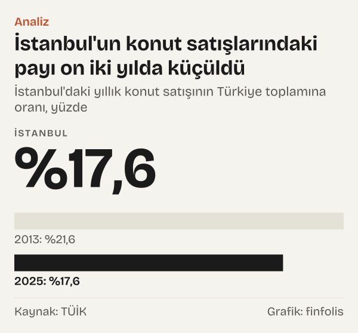
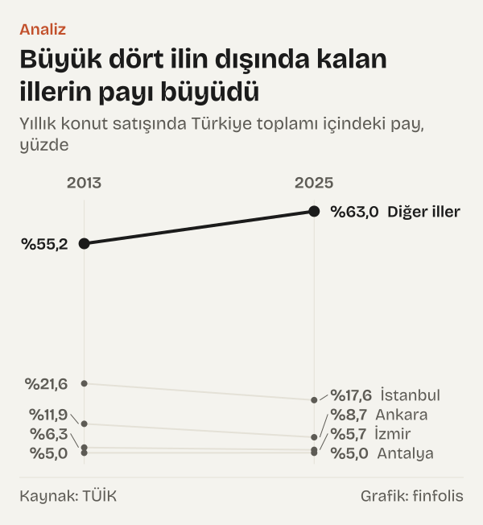
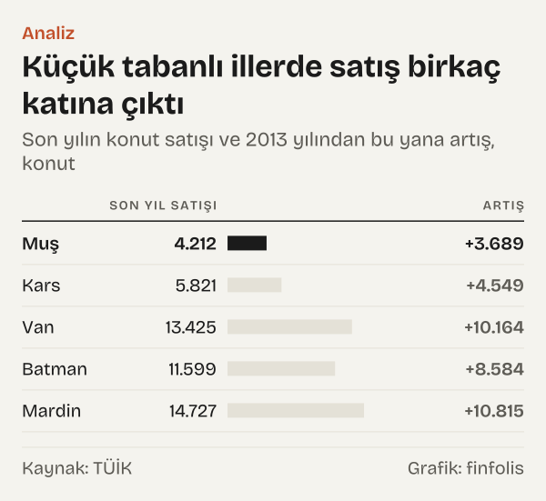
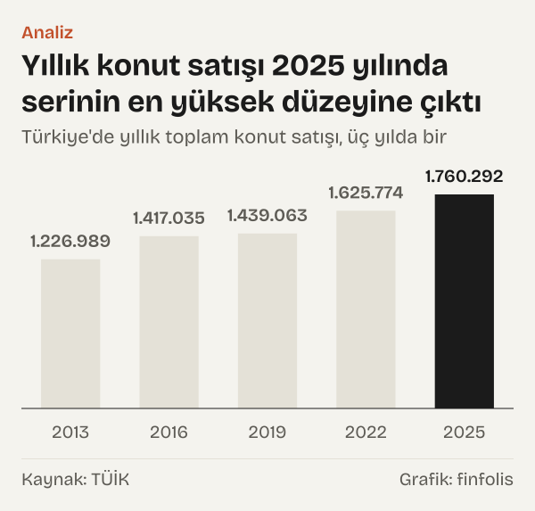

Muş'ta 2013 yılında yalnız 523 konut el değiştirdi. On iki yıl sonra, 2025 yılında aynı sayı 4.212'ydi. Artış %705,4. Bu satır tek başına çarpıcı, ama asıl soru onun arkasında duruyor: Türkiye'de konut satışlarının coğrafyası değişti mi, yoksa küçük bir tabanın büyümesine mi bakıyoruz?

Türkiye İstatistik Kurumu'nun (TÜİK) il bazında yayımladığı konut satış istatistikleri bu soruyu sınamaya imkân veriyor. Ülke genelinde yıllık konut satışı 2013 yılında 1.226.989, 2025 yılında 1.760.292 oldu; artış %43,5. Aynı dönemde İstanbul'un bu toplamdaki payı %21,6'dan %17,6'ya indi. Ankara'nın payı da %11,9'dan %8,7'ye geriledi.

Okur için bunun anlamı şu: konut satışı denince akla gelen iki büyük şehir, ülke toplamında eskisinden daha küçük bir yer tutuyor. Bu, o şehirlerde satışın azaldığı anlamına gelmiyor; İstanbul'da da satış arttı. Değişen, artışın nerede yoğunlaştığı. Bu yazıda büyük illerin payını, küçük tabanlı illerdeki hızlı artışı ve satışı nüfusa oranladığımızda ortaya çıkan tabloyu yan yana koyuyoruz. Bir konut ya da il için değer, fiyat ya da yön yorumu yapmıyoruz; yalnız satış adedinin dağılımına bakıyoruz.

*İstanbul'daki yıllık konut satışının Türkiye toplamına oranı, yüzde. Kaynak: TÜİK.*

## Büyük iki şehrin ağırlığı nereye gitti

İlk ipucu iki şehrin birlikte payında. İstanbul ve Ankara 2013 yılında ülkedeki konut satışlarının %33,6'sını oluşturuyordu. 2025'te bu oran %26,4'tü. Yani 2013 yılında satılan her üç konuttan biri bu iki şehirdeydi; 2025'te bu ağırlık dörtte bire yaklaştı.

Rakamları mutlak düzeyde okumak tabloyu tamamlıyor. İstanbul'da yıllık konut satışı 265.318'den 310.453'e çıktı, artış %17,0. Ankara'da 146.513 olan sayı 153.470'e ulaştı, artış %4,7. İki şehir de büyüdü, ama ülke ortalamasının belirgin biçimde altında kaldı. Payın düşmesinin sebebi bu hız farkı.

Hesabı bir adım öteye taşıdığımızda fark daha net görünüyor. 2013–2025 arasında ülke genelinde yıllık satış 533.303 konut arttı. Bu artışın 45.135'i İstanbul'dan geldi. Başka bir deyişle, on iki yıllık artışın yalnız %8,5'i İstanbul'da gerçekleşti; oysa şehir 2013 yılında toplam satışların %21,6'sını tek başına oluşturuyordu.

*Yıllık konut satışında Türkiye toplamı içindeki pay, yüzde. Kaynak: TÜİK.*

En büyük dört ili, yani İstanbul, Ankara, İzmir ve Antalya'yı dışarıda bıraktığımızda kalan illerin payı %55,2'den %63,0'a çıktı. İzmir'in payı %6,3'ten %5,7'ye indi; satış %30,5 arttı ama yine ülke ortalamasının gerisinde kaldı. Antalya ise payını korudu: 2013'te de 2025'te de ülke toplamının %5,0'ı bu ildeydi, çünkü ildeki %43,8'lik artış ülke geneliyle neredeyse aynıydı.

## Satışı en çok olan on ilde hız farkı

2025'te en çok konut satılan on ile tek tek baktığımızda, büyüklükle artış hızı arasında ters yönlü bir eğilim göze çarpıyor. Listenin başındaki İstanbul ve Ankara en yavaş artan iki il. Listenin alt yarısındaki beş ilin dördü ise ülke ortalamasının üzerinde büyümüş; yalnız Kocaeli ortalamanın biraz altında kaldı.

Gaziantep'te yıllık satış %109,1 arttı; ilde satış 2013–2025 arasında iki katın üzerine çıktı. Mersin'de artış %75,2, Konya'da %62,7 oldu. Tekirdağ (%45,9) ve Antalya (%43,8) ülke ortalamasına yakın seyretti. Kocaeli'de artış %39,9, Bursa'da %37,9 olarak hesaplandı.

*Yıllık konut satışında 2013–2025 değişimi, yüzde; dikey çizgi Türkiye. Kaynak: TÜİK.*

Sıralama, artışın büyük şehirlerin çevresindeki ya da Anadolu'nun büyük merkezlerindeki illere yayıldığını düşündürüyor. Yine de bu bir yorum değil, bir gözlem: veri satışın nerede kaydedildiğini söylüyor, satışın nedenini söylemiyor.

## Küçük tabanlı illerdeki hızlı artış

Yazının başındaki Muş satırı tek örnek değil. Doğu ve Güneydoğu Anadolu'daki birçok ilde artış oranları yüzlerle ifade ediliyor. Kars'ta yıllık satış %357,6 arttı ve 2025 yılında 5.821'e ulaştı. Van'da artış %311,7; ilde 2025 yılında 13.425 konut satıldı. Hakkari'de %299,0, Batman'da %284,7, Mardin'de %276,5 artış hesapladık. Mardin'de 2025 yılında 14.727, Batman'da 11.599 konut satıldı.

*Son yılın konut satışı ve 2013 yılından bu yana artış, konut. Kaynak: TÜİK.*

Oranlar etkileyici görünse de bir yüzde ancak tabanıyla birlikte anlam taşır. Muş'taki %705,4'lük artış, 2025 yılında ülke genelinde satılan konutların küçük bir kesrine karşılık geliyor: 4.212 konut, ülke toplamı olan 1.760.292'nin yanında oldukça küçük. Aynı yüzde İstanbul'da gerçekleşseydi ülke toplamı başka bir düzeye çıkardı; Muş'ta ise toplamı pek kıpırdatmıyor.

Peki küçük tabanlı illerin büyümesi, büyük şehirlerin pay kaybını açıklıyor mu? Kısmen. Mutlak artışa baktığımızda ağırlık başka yerde. Muş'ta yıllık satış 2013–2025 arasında 3.689 konut, Van'da 10.164, Mardin'de 10.815 arttı. Aynı dönemde Mersin'de artış 25.718, Gaziantep'te 23.922, Konya'da 17.475 konut oldu. Yüzdeyle en hızlı büyüyen küçük iller manşeti oluşturuyor; ama ülke toplamındaki kaymanın daha büyük kısmını orta büyüklükteki merkezler taşıyor.

## Satışı nüfusa oranlayınca

Ham satış sayısı büyük şehirleri doğal olarak öne çıkarır; çok insanın yaşadığı yerde çok konut el değiştirir. Daha adil bir karşılaştırma için TÜİK'in Adrese Dayalı Nüfus Kayıt Sistemi (ADNKS) il nüfuslarını kullandık ve her ilde bir konut satışına kaç kişi düştüğünü hesapladık. Sayı küçüldükçe nüfusa göre satış yoğunluğu artıyor.

Türkiye genelinde 2013 yılında her konut satışına 62,5 kişi düşüyordu; 2025'te bu sayı 48,9'a indi. Aynı dönemde ülke nüfusu %12,3 arttı. Satışlar nüfustan hızlı büyüdüğü için kişi başına satış yoğunluğu yükseldi.

İstanbul'da tablo farklı. Şehirde 2013 yılında her satışa 53,4 kişi düşüyordu, 2025'te 50,7. İstanbul 2013 yılında ülke ortalamasından daha yoğun satış yapılan bir ildi; 2025 yılında ülke ortalamasının biraz gerisine düştü. Ankara'da ise sayı 34,4'ten 38,5'e çıktı: başkentte nüfusa göre satış yoğunluğu azaldı, ama Ankara 2025'te de ülke ortalamasından daha yoğun bir il olarak kaldı.

*İl nüfusunun yıllık konut satışına bölümü, kişi. Kaynak: TÜİK.*

Asıl değişim küçük tabanlı illerde. Muş'ta 2013 yılında her konut satışına 788,8 kişi düşüyordu; 2025 yılında 92,4. Van'da sayı 328,2'den 82,8'e, Hakkari'de 700,1'den 179,7'ye indi. Bu illerde nüfus çok değişmedi; Muş'un nüfusu 2013–2025 arasında %5,7 azaldı. Oranı değiştiren satış sayısındaki artış. Yine de bu iller 2025'te de ülke ortalamasından belirgin biçimde daha az yoğun.

Ölçeğin öbür ucunda Yalova var. İlde 2013 yılında her konut satışına 21,3 kişi düşüyordu, 2025'te 18,6. Bu ölçüye göre İstanbul'da bir satışa düşen kişi sayısı, Yalova'dakinin 2,7 katı. Bu bir değerlendirme değil, iki oranın karşılaştırması; satışın sebebi ya da niteliği hakkında bir şey söylemiyor.

## Karşı okuma: iller yakınlaştı mı, yoksa yıl mı farklı

Buraya kadar anlatılan, iller arasında bir yakınsama hikâyesi gibi okunabilir: büyük şehirlerin payı düştü, küçük illerin kişi başına satışı arttı. Bu okumayı sınamanın iki yolu var.

Birincisi, karşılaştırdığımız iki yılın kendisi. 2013–2025 arasında yıllık satış düz bir çizgide artmadı. Satış 2018 yılında %1,7 azaldı, 2019 yılında da %2,0 azaldı. 2023'te ise düşüş %18,2'ye ulaştı. Ardından 2024'te %16,5, 2025'te %13,6 artış geldi. 2025'in yıllık toplamı, 2013'ten bu yana serideki en yüksek düzey. Başlangıç ya da bitiş yılı olarak başka bir yıl seçseydik oranlar değişirdi. Bu yüzden İstanbul'un payını ara yıllarda da hesapladık. Pay 2014'te %21,0, 2016'da %18,3 oldu; 2021'de %19,4'e çıktı, 2023'te %16,8 ile serinin en düşük düzeyine indi ve 2024'te %17,2'ye döndü. Yani pay düz bir çizgide düşmedi, ama 2014 yılından sonraki hiçbir yılda 2013'teki %21,6'ya ulaşmadı.

*Türkiye'de yıllık toplam konut satışı, üç yılda bir. Kaynak: TÜİK.*

İkincisi, her il aynı yönde hareket etmedi. Hatay'da yıllık satış 2013–2025 arasında %1,2 azaldı; Malatya'da ise %13,2 azaldı. Hatay'ın serisinde 2022–2023 arasında %52,7'lik bir düşüş var: satış 25.886'dan 12.250'ye indi. Düşüş, Şubat 2023'ü içine alan yılda gerçekleşti. Bu iki il, artışın ülkenin her yerine eşit yayıldığı varsayımına karşı bir uyarı.

Bir başka karşı okuma, payın düşmesini bir zayıflık işareti saymak olurdu. Veri bunu desteklemiyor: İstanbul'da yıllık satış sayısı 2013–2025 arasında arttı. Pay, bir ilin kendi geçmişine göre değil, ötekilere göre ne kadar hızlı büyüdüğünü ölçer.

## Satış istatistiğinin sınırları

Bu rakamların neyi saydığını bilmek, ne söylediğini anlamak kadar önemli. TÜİK'in metaverisine göre istatistik, Tapu ve Kadastro Genel Müdürlüğü kayıtlarından derleniyor. Kurumun ifadesiyle, “Tapu kayıtlarına satış olarak yansıyan konut ve iş yeri satışları dikkate alınmaktadır.” Kat irtifakı ya da kat mülkiyeti almamış birimler ve tapuda konut olarak görünmeyen taşınmazlar kapsam dışında kalıyor.

Tanımın üç sonucu var. İlki, sayı bir adettir; satışın değerini, fiyatını ya da konutun büyüklüğünü söylemez. Küçük bir dairenin satışı da büyük bir evin satışı da tek satış sayılır. İkincisi, istatistik satılan konutu sayar, alıcıyı değil. Bir ilde satışın artması, o ilde yaşayanların daha çok konut aldığı anlamına gelmeyebilir; başka ilde yaşayan biri de o ilden konut alabilir. Üçüncüsü, kapsam tapu kaydına bağlı olduğu için, tapu işlemlerinin zamanlaması yıllık toplamı etkileyebilir.

Nüfusa oranlarken de bir sınır var. ADNKS nüfusu yıl sonundaki kayıtlı nüfustur; yıl boyunca satılan konutları yıl sonu nüfusuna bölüyoruz. Küçük illerde birkaç bin satıştaki oynama oranı belirgin biçimde değiştirebilir. Toplam satışın içinde iki farklı işlem var ve bu ayrım il karşılaştırmasını değiştirebiliyor. TÜİK'in tanımına göre ilk el satış, kat irtifakı ya da kat mülkiyeti almış bir konutun sahibi firma ya da kişi tarafından ilk kez satılmasıdır; ikinci el satış ise o konutun daha sonra başka birine yeniden satılmasıdır.

Ülke genelinde ilk el satışların toplam içindeki payı 2013 yılında %47,6 iken 2025 yılında %32,4'e indi. İstanbul'da düşüş daha belirgin: pay %47,9'dan %26,4'e geriledi. Muş'ta ise yön ters; ilk el payı %20,8'den %44,0'a çıktı. Bu da iki ilin artış rakamlarının aynı türden bir hareketi ölçmediğini gösteriyor. İstanbul'daki satışın giderek daha büyük kısmı mevcut konutların el değiştirmesinden oluşurken, Muş'taki artışta ilk kez satılan konutların ağırlığı arttı. Toplam satış sayısı bu farkı tek başına göstermez; il karşılaştırmasını okurken bu ayrımı akılda tutmak gerekiyor.

## Nasıl hesapladık

Her il için yıllık konut satış sayısını, TÜİK'in aylık il serilerinin Türkiye Cumhuriyet Merkez Bankası (TCMB) Elektronik Veri Dağıtım Sistemi'ndeki (EVDS) karşılığından aldık. EVDS'nin on iki aylık hareketli toplam formülünün aralık değeri o yılın toplamını veriyor; ülke toplamı için bu değeri aylık verilerin toplamıyla ayrıca karşılaştırdık. Bir ilin payını, il satışını ülke toplamına bölerek hesapladık. Bir satışa düşen kişi sayısı, ilin ADNKS nüfusunun o yılki satış sayısına bölümüdür. Değişim oranları 2013–2025 dönemindeki iki uç yılın toplamları arasındadır. İlk el payı için TÜİK'in ilk el satış serisini aynı yöntemle yıllığa çevirip toplam satışa böldük. Bunun dışında hiçbir alt kırılım kullanmadık.

## Kaynaklar

- [TÜİK: Konut ve İş Yeri Satış İstatistikleri, Türkiye toplam konut satışı, 2013–2025 (TCMB EVDS)](https://evds3.tcmb.gov.tr/igmevdsms-dis/series=TP.AKONUTSAT1.KTRTOPLAM)
- [TÜİK: Konut satışı, İstanbul (TCMB EVDS)](https://evds3.tcmb.gov.tr/igmevdsms-dis/series=TP.AKONUTSAT1.KTR100)
- [TÜİK: Konut satışı, Ankara (TCMB EVDS)](https://evds3.tcmb.gov.tr/igmevdsms-dis/series=TP.AKONUTSAT1.KTR510)
- [TÜİK: Konut satışı, İzmir (TCMB EVDS)](https://evds3.tcmb.gov.tr/igmevdsms-dis/series=TP.AKONUTSAT1.KTR310)
- [TÜİK: Konut satışı, Antalya (TCMB EVDS)](https://evds3.tcmb.gov.tr/igmevdsms-dis/series=TP.AKONUTSAT1.KTR611)
- [TÜİK: Konut satışı, Bursa (TCMB EVDS)](https://evds3.tcmb.gov.tr/igmevdsms-dis/series=TP.AKONUTSAT1.KTR411)
- [TÜİK: Konut satışı, Mersin (TCMB EVDS)](https://evds3.tcmb.gov.tr/igmevdsms-dis/series=TP.AKONUTSAT1.KTR622)
- [TÜİK: Konut satışı, Kocaeli (TCMB EVDS)](https://evds3.tcmb.gov.tr/igmevdsms-dis/series=TP.AKONUTSAT1.KTR421)
- [TÜİK: Konut satışı, Gaziantep (TCMB EVDS)](https://evds3.tcmb.gov.tr/igmevdsms-dis/series=TP.AKONUTSAT1.KTRC11)
- [TÜİK: Konut satışı, Konya (TCMB EVDS)](https://evds3.tcmb.gov.tr/igmevdsms-dis/series=TP.AKONUTSAT1.KTR521)
- [TÜİK: Konut satışı, Tekirdağ (TCMB EVDS)](https://evds3.tcmb.gov.tr/igmevdsms-dis/series=TP.AKONUTSAT1.KTR211)
- [TÜİK: Konut satışı, Muş (TCMB EVDS)](https://evds3.tcmb.gov.tr/igmevdsms-dis/series=TP.AKONUTSAT1.KTRB22)
- [TÜİK: Konut satışı, Van (TCMB EVDS)](https://evds3.tcmb.gov.tr/igmevdsms-dis/series=TP.AKONUTSAT1.KTRB21)
- [TÜİK: Konut satışı, Kars (TCMB EVDS)](https://evds3.tcmb.gov.tr/igmevdsms-dis/series=TP.AKONUTSAT1.KTRA22)
- [TÜİK: Konut satışı, Batman (TCMB EVDS)](https://evds3.tcmb.gov.tr/igmevdsms-dis/series=TP.AKONUTSAT1.KTRC32)
- [TÜİK: Konut satışı, Mardin (TCMB EVDS)](https://evds3.tcmb.gov.tr/igmevdsms-dis/series=TP.AKONUTSAT1.KTRC31)
- [TÜİK: Konut satışı, Hakkari (TCMB EVDS)](https://evds3.tcmb.gov.tr/igmevdsms-dis/series=TP.AKONUTSAT1.KTRB24)
- [TÜİK: Konut satışı, Hatay (TCMB EVDS)](https://evds3.tcmb.gov.tr/igmevdsms-dis/series=TP.AKONUTSAT1.KTR631)
- [TÜİK: Konut satışı, Malatya (TCMB EVDS)](https://evds3.tcmb.gov.tr/igmevdsms-dis/series=TP.AKONUTSAT1.KTRB11)
- [TÜİK: Konut satışı, Yalova (TCMB EVDS)](https://evds3.tcmb.gov.tr/igmevdsms-dis/series=TP.AKONUTSAT1.KTR425)
- [TÜİK: Adrese Dayalı Nüfus Kayıt Sistemi, yıllara göre il nüfusları, 2013–2025](https://veriportali.tuik.gov.tr/tr/databrowser/tuik/TR,DF_ADNKS_T30,1.1)
- [TÜİK: Konut ve İş Yeri Satış İstatistikleri, metaveri (kapsam ve tanımlar)](https://veriportali.tuik.gov.tr/tr/databrowser/tuik/TR,DF_SATIS_SEKLI_DURUMU_ILILCE_V3,1.0)
