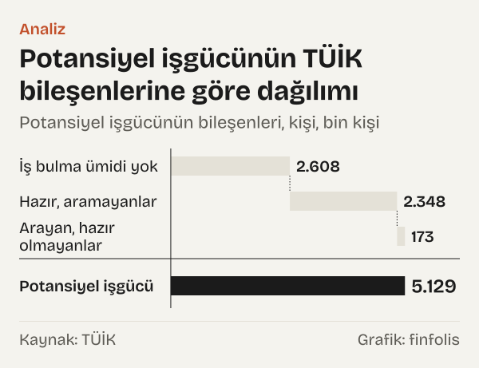
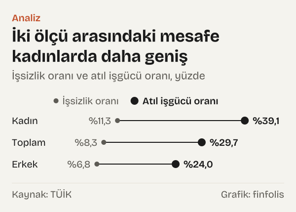

%29,7. Türkiye İstatistik Kurumu'nun (TÜİK) 2025 yılı için açıkladığı atıl işgücü oranı bu. Aynı yıl için açıklanan işsizlik oranı ise %8,3. İki rakam da resmî, ikisi de aynı araştırmadan, Hanehalkı İşgücü Araştırması'ndan geliyor. Aralarında 21,4 puan var.

Bu fark ilk bakışta kafa karıştırabilir: işgücü piyasasının durumunu gösteren iki resmî rakam neden bu kadar ayrışıyor? Yanıt, iki oranın farklı soruları yanıtlamasında. İşsizlik oranı, iş arayan ve hemen başlayabilecek durumdaki işsizlerin işgücüne oranıdır. Atıl işgücü oranı ise bu kişilere iki grup daha ekler: istediğinden az saat çalışanlar ve çalışmak isteyip de işsizlik tanımına girmeyenler.

Okur için bunun anlamı şu: işsizlik oranı iş arayıp bulamayanları ölçer. Atıl işgücü oranı ise çalışma kapasitesinin ne kadarının kullanılmadığına daha geniş bir açıdan bakar. İkisi birbirinin yerine geçmez; biri ötekini düzeltmez. TÜİK ikisini de yayımlıyor ve bu yazıda ikisini yan yana koyup aradaki farkın nereden geldiğini sınıyoruz.

*TÜİK'in temel ve tamamlayıcı işgücü göstergeleri, yüzde. Kaynak: TÜİK.*

## İki oran neyi sayıyor

İşsizlik oranının tanımı TÜİK'in metaverisinde açık. İşsiz, kurumun ifadesiyle, “Referans haftasında istihdamda olmayan, son dört hafta içerisinde aktif olarak iş arayan, iş bulduğu takdirde 2 hafta içinde işbaşı yapabilecek durumda olan kişilerden oluşmaktadır.” Üç koşul birlikte aranıyor: çalışmıyor olmak, iş aramak ve kısa sürede başlayabilecek durumda olmak.

Atıl işgücü oranı bu tanımın dışında kalan iki grubu da hesaba katıyor. Birincisi zamana bağlı eksik istihdam. TÜİK'e göre “Zamana bağlı eksik istihdam: Referans haftasında istihdamda olan, esas işinde ve diğer işinde/işlerinde toplam olarak 40 saatten daha az süre çalışmış olup, daha fazla gelir elde etmek amacıyla daha fazla süre çalışmak istediğini belirten ve mümkün olduğu durumda daha fazla çalışmaya başlayabilecek olan kişilerdir.” Bu kişiler istihdamda sayılır; işsizlik oranına girmezler.

İkincisi potansiyel işgücü. Metaveriye göre bu grup, “Referans haftasında ne istihdamda ne de işsiz olan çalışma çağındaki kişilerden; iş arayan fakat kısa süre içerisinde işbaşı yapabilecek durumda olmayanlarla, iş aramadığı halde çalışma isteği olan ve kısa süre içerisinde işbaşı yapabilecek durumda olan kişilerden oluşmaktadır.” Bu kişiler işgücünün dışında sayılır; işsizlik oranının ne payında ne paydasında yer alırlar.

Atıl işgücü oranı bu üç grubu bir araya getiriyor. TÜİK'in tablosundaki tanıma göre oran, “Zamana bağlı eksik istihdam, işsizler ve potansiyel işgücünün toplamının işgücü ve potansiyel işgücünün toplamına oranıdır.” Yani yalnız pay değil, payda da değişiyor: potansiyel işgücü paydaya da ekleniyor.

TÜİK bu iki grubu ayrı ayrı gösteren iki ara ölçü de yayımlıyor. Zamana bağlı eksik istihdam ve işsizlerin bütünleşik oranı 2025 yılında %19,6, işsiz ve potansiyel işgücünün bütünleşik oranı %19,9 oldu.

## Fark yıllar içinde nasıl değişti

İki ölçünün arasındaki mesafe sabit değil. 2014 yılında işsizlik oranı %9,9, atıl işgücü oranı %17,4'tü; fark 7,5 puan. 2018 yılında fark 5,6 puana kadar daraldı. 2020 yılında ise 12,3 puana sıçradı. 2025 yılında fark 21,4 puan oldu.

![Küçük çoklu grafik: Dört ölçünün üçü yükseldi, işsizlik oranı düştü: İşsizlik oranı: 2014 yılında %9,9, 2015 yılında %10,3, 2016 yılında %10,9, 2017 yılında %10,9, 2018 yılında %10,9, 2019 yılında %13,7, 2020 yılında %13,1, 2021 yılında %12,0, 2022 yılında %10,4, 2023 yılında %9,4, 2024 yılında %8,7, 2025 yılında %8,3; Eksik istihdam ve işsizler: 2014 yılında %11,9, 2015 yılında %11,9, 2016 yılında %12,4, 2017 yılında %12,1, 2018 yılında %12,1, 2019 yılında %14,8, 2020 yılında %17,0, 2021 yılında %16,8, 2022 yılında %14,6, 2023 yılında %15,4, 2024 yılında %18,1, 2025 yılında %19,6; İşsizler ve potansiyel işgücü: 2014 yılında %15,5, 2015 yılında %15,7, 2016 yılında %16,2, 2017 yılında %15,7, 2018 yılında %15,3, 2019 yılında %18,1, 2020 yılında %21,9, 2021 yılında %20,0, 2022 yılında %17,4, 2023 yılında %17,3, 2024 yılında %18,4, 2025 yılında %19,9; Atıl işgücü oranı: 2014 yılında %17,4, 2015 yılında %17,1, 2016 yılında %17,6, 2017 yılında %16,8, 2018 yılında %16,5, 2019 yılında %19,1, 2020 yılında %25,4, 2021 yılında %24,4, 2022 yılında %21,3, 2023 yılında %22,8, 2024 yılında %26,7, 2025 yılında %29,7.](./graf-2.svg)
*TÜİK işgücü göstergeleri, yıllık, yüzde. Kaynak: TÜİK.*

İlginç olan, farkın en dar olduğu yılın işsizlik oranının en yüksek olduğu yıllardan birine denk gelmesi. 2019 yılında işsizlik oranı %13,7'ye çıktı ve serinin en yüksek düzeyine ulaştı; aynı yıl atıl işgücü oranı %19,1 oldu ve iki ölçü arasındaki fark 5,4 puana indi. 2025 yılında ise işsizlik oranı serinin en düşük düzeyindeydi, fark en geniş düzeyindeydi. Bu, iki ölçünün birbirinin aynası olmadığını gösteren basit bir sınama: işsizlik oranı yükseldiğinde atıl işgücü oranının içindeki öteki gruplar küçülebilir, işsizlik oranı düştüğünde büyüyebilir. İki oranın birlikte hareket edeceğini varsaymak için veride bir dayanak görmüyoruz.

En dikkat çekici dönem 2021–2025. Bu dört yılda işsizlik oranı %12,0'dan %8,3'e indi; düşüş 3,7 puan. Aynı dönemde atıl işgücü oranı %24,4'ten %29,7'ye çıktı; artış 5,3 puan. İşsiz sayısı da %24,3 azaldı. İki resmî ölçü bu dönemde ters yönde hareket etti.

Yükseliş 2022 yılından sonra hızlandı. Oran 2022 yılında %21,3 iken 2025 yılına kadar 8,4 puan arttı. Bu artışın kaynağını bulmak için oranın bileşenlerine tek tek bakmak gerekiyor.

## Farkı ne büyüttü

İlk bileşen zamana bağlı eksik istihdam. TÜİK'in iki oranı aynı paydayı, yani işgücünü kullanıyor: işsizlik oranı ve zamana bağlı eksik istihdam ile işsizlerin bütünleşik oranı. Bu yüzden ikisinin farkı, doğrudan zamana bağlı eksik istihdamın işgücüne oranını veriyor. Hesapladığımız bu oran 2014 yılında 2,0 puandı. 2019 yılında 1,1 puana indi. 2020 yılında 3,9 puana, 2023 yılında 6,0 puana, 2025 yılında 11,3 puana çıktı.

*Zamana bağlı eksik istihdamın işgücüne oranı ve atıl işgücü oranı ile işsizlik oranı arasındaki fark, puan. Kaynak: TÜİK.*

Başka bir deyişle, 2014–2025 arasında bu payda 9,3 puanlık bir artış var. İşsizlik oranı aynı dönemde 1,6 puan azaldı. Atıl işgücü oranındaki 12,3 puanlık artışın önemli bir kısmı, istihdamda olup daha fazla çalışmak isteyenlerin artmasından geliyor.

İkinci bileşen potansiyel işgücü. TÜİK'in işgücüne dahil olmama nedenleri tablosuna göre potansiyel işgücü 2021 yılında 3,28 milyon kişiydi; 2025 yılında 5,13 milyon kişiye çıktı. Artış %56,6. Potansiyel işgücü 2021 yılında işsiz sayısının 0,84 katıydı; 2025 yılında 1,73 katına ulaştı. Yani 2025 yılında, çalışmak isteyip işsizlik tanımına girmeyenler, işsizlerden daha kalabalıktı.

*Potansiyel işgücünün bileşenleri, kişi. Kaynak: TÜİK.*

Potansiyel işgücünün içinde en büyük grup iş bulma ümidi olmayanlar. TÜİK bu grubu “İşbaşı yapabilecek olup iş bulacağına inanmadığı için iş aramayan kişilerdir.” diye tanımlıyor. Bu grup 2021 yılında 1,63 milyon kişiydi, 2025 yılında 2,61 milyon kişi oldu; artış %60,1. 2025 yılında potansiyel işgücünün %50,9'u bu gruptaydı. İşbaşı yapabilecek olup iş aramayanlar 2,35 milyon, iş arayıp işbaşı yapamayacak olanlar 173 bin kişi.

Potansiyel işgücü atıl işgücü oranının paydasına da girdiği için etkisi iki yönlü. İşgücü ile potansiyel işgücünün toplamı içinde potansiyel işgücünün payı 2021 yılında %9,1 iken 2025 yılında %12,6 oldu.

## Kadın ve erkek arasındaki mesafe

İki ölçü arasındaki fark kadınlarda çok daha geniş. 2025 yılında kadınlarda işsizlik oranı %11,3, atıl işgücü oranı %39,1 oldu; fark 27,8 puan. Erkeklerde işsizlik oranı %6,8, atıl işgücü oranı %24,0; fark 17,2 puan.

*İşsizlik oranı ve atıl işgücü oranı, yüzde. Kaynak: TÜİK.*

Fark iki grupta da 2014 yılından bu yana büyüdü. Kadınlarda 2014 yılında 12,1 puan, 2021 yılında 16,9 puan iken 2025 yılında 27,8 puana çıktı. Erkeklerde aynı yıllarda fark 5,3 puandan 9,9 puana, oradan 17,2 puana yükseldi.

Kadınlarda farkın büyük olmasının bir nedeni potansiyel işgücü. İşsiz ve potansiyel işgücünün bütünleşik oranı kadınlarda 2025 yılında %29,7, erkeklerde %14,0 oldu. Zamana bağlı eksik istihdam ve işsizlerin bütünleşik oranı ise kadınlarda %23,1, erkeklerde %17,7. Kadınlarda iki ara ölçü arasındaki açıklık, potansiyel işgücünün bu grupta daha belirleyici olduğunu gösteriyor.

## Karşı okuma: hangisi doğru sorusu yanlış bir soru

Bu tür karşılaştırmalar kolayca "asıl oran hangisi" tartışmasına dönüşebilir. Veri bu tartışmayı desteklemiyor. İki oran da TÜİK'in resmî istatistiğidir ve aynı araştırmadan, aynı tanım setiyle üretilir. İşsizlik oranı araştırmanın temel göstergesidir. Tamamlayıcı göstergeler ise TÜİK'in metaverisine göre ILO'nun Çalışma İstatistikçileri Konferansı kararları kapsamında tanımlanmış ve 2021 yılından itibaren yayımlanmaya başlanmıştır. Kurum bu göstergelerin işlevini şöyle tarif ediyor: “Temel işgücü göstergelerine ek olarak işgücü piyasasındaki gelişmelerin daha iyi takip edilebilmesini sağlamaktadır.”

Ocak 2021 bülteninde TÜİK, “AB İstatistik Ofisi (Eurostat) tarafından yayımlanmakta olan bu tamamlayıcı göstergelere bültende yer verilmeye başlanmıştır.” açıklamasını yaptı. Yani bu ölçüler Türkiye'ye özgü bir alternatif değil, Avrupa İstatistik Sistemi'nde de kullanılan tamamlayıcı ölçülerdir.

İşsizlik oranının düşerken atıl işgücü oranının yükselmesi bir çelişki de değildir. İki oran farklı grupları sayıyor. Bir kişi işsizken kısa süreli bir işe başlar ve daha fazla çalışmak isterse, işsiz sayısından çıkar, zamana bağlı eksik istihdama girer: işsizlik oranı düşer, atıl işgücü oranı değişmeyebilir. Bir kişi iş aramaktan vazgeçerse işsiz sayısından çıkar, potansiyel işgücüne geçebilir. Rakamlar bu tür geçişlerin toplam etkisini gösterir; tek tek kişilerin hangi yoldan geçtiğini göstermez.

En güncel aylık veriler de aynı tabloyu veriyor. TÜİK'in Ağustos 2026 bülteninde mevsim etkisinden arındırılmış işsizlik oranı %7,8, mevsim ve takvim etkilerinden arındırılmış atıl işgücü oranı %31,0 oldu. Aylık rakamlar yıllık rakamlarla doğrudan karşılaştırılamaz; ama iki ölçü arasındaki mesafe aylık veride de 23,2 puan.

## Ölçümün sınırları

İlk sınır zaman serisinin kendisi. Tamamlayıcı göstergeler 2021 yılından bu yana yayımlanıyor. TÜİK'in tablosundaki nota göre “2014-2020 dönem sonuçları model ile tahmin edilmiştir.” Yani 2014–2020 rakamları o yıllarda sahada bu tanımlarla ölçülmüş değerler değil, sonradan yeni tanımlara göre geriye doğru tahmin edilmiş değerler. 2020 yılı sıçramasını ve 2014 yılı ile yapılan karşılaştırmaları bu yüzden temkinle okumak gerekiyor.

İkinci sınır tanımların doğası. Zamana bağlı eksik istihdam, kişinin daha fazla çalışmak istediğini belirtmesine ve mümkün olduğunda başlayabilecek olmasına dayanıyor. Potansiyel işgücü de çalışma isteğine ve hazır olma durumuna bakıyor. Bu, kişilerin kendi beyanına dayalı bir ölçüm; tanımın sınırları, örneğin haftalık 40 saat eşiği, kimin bu gruplara girdiğini doğrudan belirliyor.

Üçüncüsü, rakamlar bir örneklem araştırmasından gelen tahminlerdir. Küçük gruplarda, örneğin iş arayıp işbaşı yapamayacak olanlarda, tahminin belirsizliği görece büyüktür. Son olarak yıllık rakamlar mevsimsellik içerir; aylık bültenlerdeki mevsim etkisinden arındırılmış rakamlar ise her ay yeniden hesaplanabilir. Bu yazıdaki karşılaştırmaların çoğu yıllık rakamlara dayanıyor.

Kendi hesaplarımızın da sınırları var. Potansiyel işgücünün bileşenlerine ait sayıları yalnız 2021–2025 için kullandık; bu yüzden potansiyel işgücündeki artışı daha önceki yıllarla karşılaştırmadık. Zamana bağlı eksik istihdamdaki kişi sayısını doğrudan veren bir tablo da kullanmadık; bu grubun büyüklüğünü yalnız işgücüne oranı olarak, iki TÜİK oranının farkından okuduk. Bu fark, bir ondalık basamağa yuvarlanmış iki oranın farkı olduğu için küçük bir yuvarlama payı taşıyor.

## Nasıl hesapladık

Yıllık oranları TÜİK'in 2025 yılı İşgücü İstatistikleri bülteni ekindeki tamamlayıcı göstergeler tablosundan, işgücü ve işsiz sayılarını temel işgücü göstergeleri tablosundan, potansiyel işgücü bileşenlerini işgücüne dahil olmama nedenleri tablosundan aldık. Zamana bağlı eksik istihdamın işgücüne oranını, aynı paydayı kullanan iki TÜİK oranının farkı olarak hesapladık: zamana bağlı eksik istihdam ve işsizlerin bütünleşik oranı eksi işsizlik oranı. Potansiyel işgücünü üç bileşeninin toplamı olarak, payını da işgücü ile potansiyel işgücünün toplamına bölerek bulduk. Aylık rakamlar Ağustos 2026 bülteninin metninden. Hiçbir oranı yeniden tanımlamadık ya da düzeltmedik.

## Kaynaklar

- [TÜİK: İşgücü İstatistikleri, 2025 yılı (tamamlayıcı göstergeler, temel göstergeler ve işgücüne dahil olmama nedenleri tabloları)](https://veriportali.tuik.gov.tr/tr/press/57996)
- [TÜİK: İşgücü İstatistikleri, Ağustos 2026](https://veriportali.tuik.gov.tr/tr/press/57987)
- [TÜİK: İşgücü İstatistikleri, Ocak 2021](https://veriportali.tuik.gov.tr/tr/press/37486)
- [TÜİK: İşgücüne ilişkin tamamlayıcı göstergeler, metaveri (tanımlar)](https://veriportali.tuik.gov.tr/tr/databrowser/tuik/TR,DF_ISGUCU_AYLIK_TAMAMLAYICI_GOSTERGE_C,1.0)
