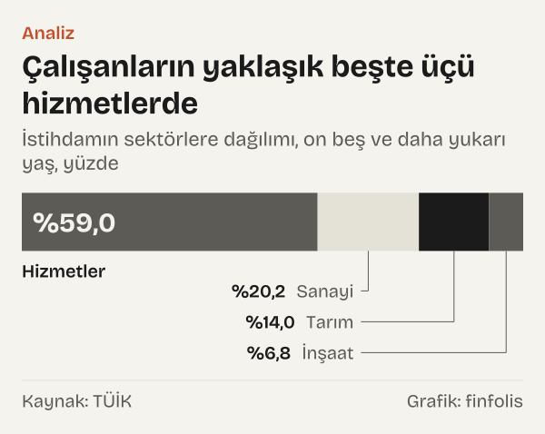
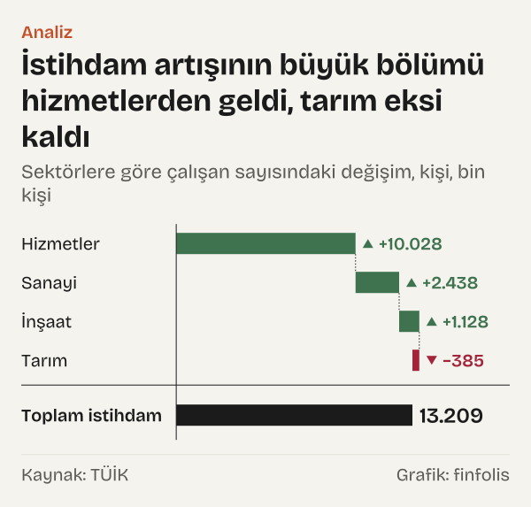
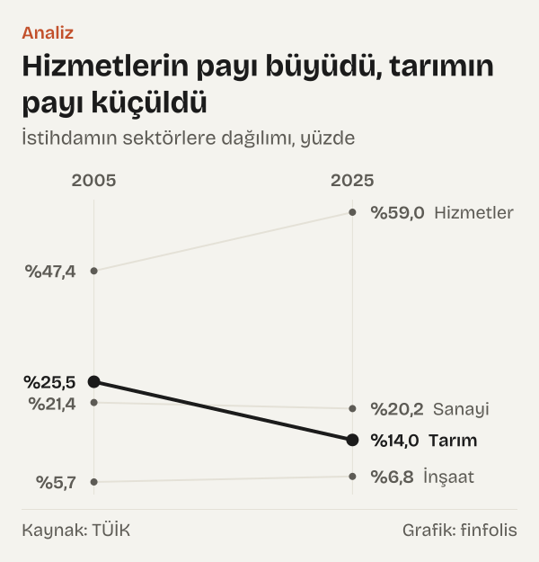
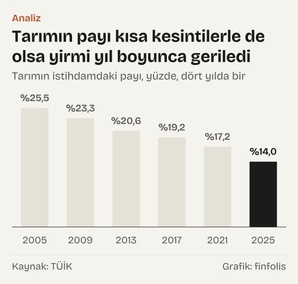
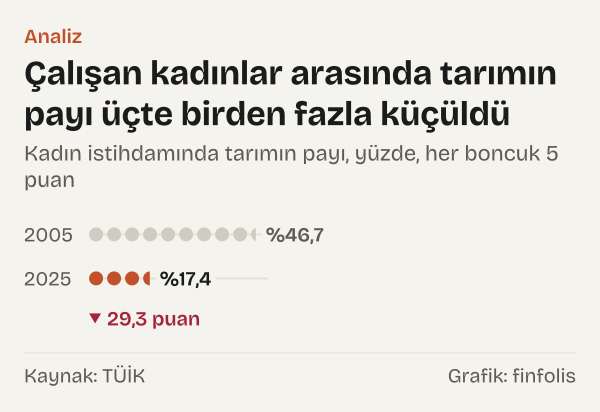

2005 yılında Türkiye'de çalışan dört kişiden biri tarımdaydı. Türkiye İstatistik Kurumu'nun (TÜİK) bugün yayımladığı seriye göre o yıl istihdamın %25,5'i tarım sektöründeydi. Yirmi yıl sonra, 2025 yılında bu oran %14,0'a inmişti. Aynı dönemde hizmetlerin payı %47,4'ten %59,0'a çıktı.

İlk bakışta tablo açık görünüyor: insanlar tarladan ayrılıp hizmet işlerine geçti. Ama bir payın düşmesi, o sektörde çalışan sayısının da aynı ölçüde düştüğü anlamına gelmez. Pay, bir bölmenin sonucudur; hem pay hem payda değişebilir. Bu yazıda sorulacak soru şu: tarımın payı neden düştü, kim kazandı ve bu yirmi yıllık değişimin ne kadarı ölçümün kendisiyle ilgili?

Okur için bu değişimin anlamı, ülkede gelirin kazanıldığı işlerin bileşiminin değişmesidir. Tarımda çalışanların payı küçüldükçe, istihdamdaki dalgalanmalar daha çok hizmetlerdeki gelişmelere bağlı hâle geliyor. Bu yazı bir sektör için değerlendirme yapmıyor; yalnız TÜİK'in Hanehalkı İşgücü Araştırması'ndan gelen rakamları yan yana koyuyor.

*İstihdamın sektörlere dağılımı, on beş ve daha yukarı yaş, yüzde. Kaynak: TÜİK.*

## İlk ipucu: payda büyüdü

Toplam istihdam 2005 yılında 19,36 milyon kişiydi. 2025 yılında 32,57 milyon kişiye ulaştı. Yirmi yılda 13,21 milyon kişilik bir artış, oransal olarak %68,2. Böyle bir büyümede bir sektörün payının korunması için o sektörün de aynı hızda büyümesi gerekir.

Tarım bunu yapmadı. Tarımda çalışan sayısı 2005 yılında 4,95 milyon kişiydi, 2025 yılında 4,56 milyon. Tarımda çalışan sayısı 385 bin kişi azaldı; oransal azalış %7,8 oldu. Yani tarımdaki kişi sayısı yirmi yılda onda birden az düştü, ama payı neredeyse yarıya indi. Pay 11,5 puan geriledi.

İki rakam arasındaki farkı sınamak için basit bir hesap yaptık. Tarımda çalışan sayısı 2005 yılı düzeyinde kalsaydı ve öteki her şey gerçekleştiği gibi olsaydı, 2025 yılında tarımın payı ne olurdu? 2005 yılı tarım istihdamını 2025 yılı toplam istihdamına böldüğümüzde %15,2 buluyoruz. Gerçekleşen pay %14,0. Başka bir deyişle, tarımın payındaki 11,5 puanlık azalışın çoğu tarımdaki kişi sayısının azalmasından değil, toplam istihdamın büyümesinden geliyor.

Tarımdaki kişi sayısı bu yirmi yılda düz bir çizgide de hareket etmedi. Sayı 2007 yılında 4,41 milyon kişiye indi, 2017 yılında 5,4 milyon kişiyle dönemin en yüksek düzeyine çıktı, sonra yeniden azaldı. Son yılda, 2024–2025 arasında, tarım istihdamı %5,5 azaldı.

## Artışı kim üstlendi

İstihdamdaki 13,21 milyon kişilik artışın nereden geldiğine baktığımızda ağırlık tek bir sektörde toplanıyor. Hizmetlerde çalışanların sayısı 9,18 milyondan 19,2 milyona çıktı; artış 10,03 milyon kişi, oransal olarak %109,3. Toplam artışın %75,9'u hizmetlerden geldi.

*Sektörlere göre çalışan sayısındaki değişim, kişi. Kaynak: TÜİK.*

Sanayi 2,44 milyon kişi ekledi, toplam artışın %18,5'i. İnşaat 1,13 milyon kişi ekledi, %8,5. Tarım ise eksi tarafta kaldı: tarımdaki azalış, toplam artışın %2,9'u kadar. Dört kalemin toplamı, toplam istihdamdaki artışa eşit.

Sanayinin durumu ilginç. Sanayide çalışan sayısı 4,14 milyondan 6,58 milyona çıktı, %58,9 artış. Bu güçlü bir büyüme, ama toplam istihdamın büyümesinden yavaş. Sonuçta sanayinin payı %21,4'ten %20,2'ye indi; 1,2 puanlık bir düşüş. Yani sanayi de mutlak olarak büyürken pay kaybedenler arasında. İnşaatta ise tersi oldu: çalışan sayısı %102,9 arttı, payı %5,7'den %6,8'e çıktı.

## Payların yirmi yıllık yolu

Dört sektörün 2005 yılı ve 2025 yılı paylarını yan yana koyduğumuzda tek kazanan büyük sektör hizmetler. Hizmetlerin payı 11,6 puan, inşaatın payı 1,1 puan arttı. Tarımın payı 11,5 puan azaldı, sanayinin payı da 1,2 puan azaldı.

*İstihdamın sektörlere dağılımı, yüzde. Kaynak: TÜİK.*

Peki bu kayma her yıl aynı hızla mı yaşandı? Seriyi yıl yıl izlediğimizde birkaç kırılma görülüyor. 2008–2009 arasında tarımın payı 1,5 puan arttı. Aynı yıllarda sanayi istihdamı %8,2 azaldı. Toplam istihdam dalgalanınca tarımın payı geçici olarak yükseldi.

İkinci kırılma inşaatta. İnşaatta çalışan sayısı 2018–2019 arasında %22,2 azaldı; sektörün payı 2017 yılında %7,5 iken 2019 yılında %5,6'ya indi. Üçüncüsü 2020 yılında geldi: toplam istihdam bir önceki yıla göre %4,8 azaldı. Bu dönem pandemi dönemine denk geliyor.

*Tarımın istihdamdaki payı, yüzde, dört yılda bir. Kaynak: TÜİK.*

Kırılmalara rağmen tarımın payındaki genel yön yirmi yıl boyunca değişmedi. Tarımın payı 2005 yılında %25,5, 2014 yılında %20,3, 2021 yılında %17,2, 2025 yılında %14,0 oldu.

Hizmetlerin payındaki yükseliş de düz değildi. Hizmetlerin payı 2008 yılında %50,0'a ulaştı ve istihdamın yarısı ilk kez bu sektörde toplandı. 2010 yılında %49,0'a geriledi, 2011 yılında da aynı düzeyde kaldı. 2012 yılında %50,5'e yükseldi ve o yıldan sonra yarının altına inmedi. 2019 yılında %56,4'e çıkan pay, 2020 yılında %55,9'a, 2021 yılında %55,3'e düştü; ardından yeniden yükselerek 2025 yılında %59,0 oldu. Yani pandemi döneminde hizmetlerin payı kısa bir süre geriledi, sanayinin payı ise aynı yıllarda yükseldi: sanayinin payı 2019 yılında %19,9 iken 2021 yılında %21,3'e çıktı.

Bu ara dönem dalgalanmaları, yirmi yıllık karşılaştırmanın uç yıllarına ne kadar duyarlı olduğunu da gösteriyor. 2021 yılını bitiş noktası alsaydık sanayinin payı 2005 yılına göre neredeyse aynı görünürdü; 2025 yılını aldığımızda 1,2 puanlık bir düşüş görüyoruz. Uzun dönemli yön için iki ucun yanında ara yılları da izlemek bu yüzden gerekiyor.

## Kadın ve erkek istihdamında ayrı hikâyeler

Toplam rakamlar iki farklı değişimi bir arada gösteriyor. Kadınların istihdamı 2005 yılında 4,77 milyon kişiydi, 2025 yılında 10,76 milyon kişi. Artış %125,5. Erkeklerin istihdamı aynı dönemde %49,5 arttı. Sonuçta kadınların toplam istihdamdaki payı %24,7'den %33,1'e çıktı.

Sektörel dönüşüm de en belirgin biçimde kadınlarda yaşandı. 2005 yılında çalışan kadınların %46,7'si tarımdaydı; 2025 yılında bu oran %17,4. Düşüş 29,3 puan. Aynı dönemde kadın istihdamında hizmetlerin payı %36,3'ten %66,0'a çıktı. Erkeklerde ise tarımın payı %18,6'dan %12,3'e indi, düşüş 6,3 puan.

Erkeklerde tablo farklı bir mekanizmayla oluştu. Tarımda çalışan erkek sayısı 2005 yılında 2,72 milyon, 2025 yılında 2,69 milyon kişiydi; yirmi yılda neredeyse aynı kaldı. Erkek istihdamında tarımın payını düşüren, tarımdan ayrılma değil, öteki sektörlerde çalışan erkeklerin artmasıydı. Hizmetlerde çalışan erkek sayısı 7,44 milyondan 12,1 milyona çıktı ve hizmetlerin erkek istihdamındaki payı %51,0'dan %55,5'e yükseldi. Kadınlarda ise iki hareket birlikte görülüyor: tarımda çalışan kadın sayısı azaldı, hizmetlerde çalışan kadın sayısı dört katın üzerine çıktı.

*Kadın istihdamında tarımın payı, yüzde. Kaynak: TÜİK.*

Aradaki fark, toplam tablodaki kaymanın önemli bir kısmının kadın istihdamının yapısındaki değişimden kaynaklandığını gösteriyor. Tarımda çalışan kadın sayısı 2,23 milyondan 1,87 milyona, yani %16,0 azaldı. Hizmetlerde çalışan kadın sayısı ise 1,73 milyondan 7,11 milyona çıktı.

## Karşı okuma: iş değiştirme mi, büyüme mi

Tarımın payındaki düşüş çoğu zaman insanların tarımı bırakıp başka işlere geçtiği biçiminde anlatılır. Veri bu anlatıyı tümüyle desteklemiyor. Tarımda çalışan sayısı yirmi yılda 385 bin kişi azaldı; bu, toplam istihdamdaki 13,21 milyonluk artışın yanında küçük bir hareket. Payın düşüşünün büyük kısmı, tarıma ek olarak öteki sektörlerde açılan işlerden geliyor.

Öte yandan bu hesap, tek tek kişilerin hareketini göstermez. Hanehalkı İşgücü Araştırması her dönem bir kesit alır; aynı kişinin tarımdan hizmetlere geçip geçmediğini izlemez. Tarımdan ayrılanlar ile hizmetlere yeni girenler farklı kişiler olabilir: emekli olan bir çiftçi ile ilk işine başlayan bir genç, toplamda aynı yöne itiyor. Rakamlar yapının değiştiğini söylüyor, değişimin hangi kişisel kararlardan oluştuğunu söylemiyor.

Bir başka karşı okuma da sanayi için geçerli. Sanayinin payının düşmesi bir küçülme olarak okunabilir; oysa sanayide çalışan sayısı %58,9 arttı. Pay, bir sektörün kendi büyümesini değil, ötekilere göre hızını ölçer.

## Serinin kırılma noktaları ve ölçüm sınırları

Yirmi yıllık bir karşılaştırma, ölçümün yirmi yıl boyunca aynı kaldığını varsayar. TÜİK'in işgücü istatistiklerinde bu dönemde iki önemli düzenleme yapıldı ve ikisi de karşılaştırmayı etkiliyor.

İlki 2014 yılında. TÜİK'in Şubat 2014 bültenine göre araştırmada o dönemden başlayarak Avrupa Birliği'ne tam uyum için yeni düzenlemelere geçildi. Kurum aynı bültende değişikliğin içeriğini de anlatıyor: “Bu düzenlemelere göre anketin referans haftası ve işsizlik kriterinde iş arama süresi değişti, yeni nüfus projeksiyonu ve idari bölünüş temel alındı.”

İkincisi 2021 yılında. Ocak 2021 bülteninde TÜİK, araştırmada o aydan başlayarak, Avrupa Birliği ülkeleriyle eş zamanlı olarak, Uluslararası Çalışma Örgütü'nün (ILO) Çalışma İstatistikçileri Konferansı kararlarına ve ilgili AB tüzüğüne uyum için yeni düzenlemelere geçildiğini açıkladı.

Yazıda kullandığımız seri, bu düzenlemelerden sonra geriye doğru yeniden hesaplanmış seridir. TÜİK'in metaverisine göre “2021 yılında gerçekleştirilen düzenlemeler doğrultusunda zaman serileri 2005 yılına kadar yeniden hesaplanmıştır.” Ama bunun iki sınırı var. Birincisi, kurumun metaverisine göre yeniden hesaplanan seri, daha önceki yıllara ait serilerle karşılaştırılabilir değil. Karşılaştırmayı bu yüzden 2005 yılından başlattık. İkincisi, tablonun notuna göre “2005-2020 dönem sonuçları model ile tahmin edilmiştir.” TÜİK bu dönemin rakamlarını, kendi notunda belirttiği gibi, model ile tahmin edilmiş sonuçlar olarak yayımlıyor.

Farkın büyüklüğüne bir örnek verelim. TÜİK'in 2020 yılı bülteni, eski tanımlarla, tarımda 4,72 milyon kişinin çalıştığını ve tarımın payının %17,6 olduğunu açıklamıştı. Bugünkü seride aynı yıl için tarım istihdamı 4,74 milyon kişi, pay %17,7. Fark 21 bin kişi ve 0,1 puan. Tarım için bu fark küçük; öteki sektörler ve yıllar için aynı karşılaştırmayı yapmadık. Seriyi kendimiz düzeltmedik; TÜİK'in yayımladığı yeniden hesaplanmış rakamları olduğu gibi kullandık.

Yeniden hesaplanmış seride düzenleme yıllarının sınırında belirgin bir sıçrama görünmüyor. Tarımın payı 2013 yılında %20,6, 2014 yılında %20,3; 2020 yılında %17,7, 2021 yılında %17,2. Kurumun metaverisine göre seri, 2021 yılında yapılan düzenlemeler doğrultusunda 2005 yılına kadar yeniden hesaplandı; bu yıllar için kullandığımız rakamlar o hesaplamanın sonucudur. O yıllarda eski tanımlarla yayımlanmış rakamlarla bugünkü seri arasındaki farkı yalnız 2020 yılı tarım için sınadık; öteki yıllar ve sektörler için aynı karşılaştırmayı bu yazıda yapmadık.

Son olarak araştırma bir örneklem araştırmasıdır. Rakamlar tahmindir ve her tahminin bir örneklem hatası vardır. Yıldan yıla küçük değişimleri, özellikle bir puanın altındaki pay hareketlerini, bu nedenle temkinle okumak gerekiyor.

## Nasıl hesapladık

Bütün rakamları TÜİK'in 2025 yılı İşgücü İstatistikleri bülteni ekindeki sektörlere göre istihdam tablosundan aldık (on beş ve daha yukarı yaş, yıllık). Sektör payları TÜİK'in tablodaki kendi oranlarıdır. Kişi sayısındaki değişimleri ve artışa katkıları kendimiz hesapladık: bir sektörün katkısı, o sektördeki kişi sayısı değişiminin toplam istihdam değişimine bölümüdür. Tarım 2005 yılı düzeyinde kalsaydı hesabı, 2005 yılı tarım istihdamının 2025 yılı toplam istihdamına bölünmesiyle bulunur. 2020 yılı için eski tanımlı rakamları TÜİK'in o yıla ait bülteninden aldık.

## Kaynaklar

- [TÜİK: İşgücü İstatistikleri, 2025 yılı (sektörlere göre istihdam edilenler tablosu, 2005–2025)](https://veriportali.tuik.gov.tr/tr/press/57996)
- [TÜİK: İşgücü İstatistikleri, 2020 yılı (eski tanımlarla yıllık sonuçlar)](https://veriportali.tuik.gov.tr/tr/press/37484)
- [TÜİK: Hanehalkı İşgücü İstatistikleri, Şubat 2014](https://veriportali.tuik.gov.tr/tr/press/16007)
- [TÜİK: İşgücü İstatistikleri, Ocak 2021](https://veriportali.tuik.gov.tr/tr/press/37486)
- [TÜİK: Sektöre göre istihdam edilenler, metaveri](https://veriportali.tuik.gov.tr/tr/databrowser/tuik/TR,DF_ISGUCU_CEYREK_SEKTOR_ISTIHDAM_C,1.0)
