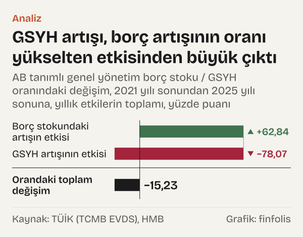
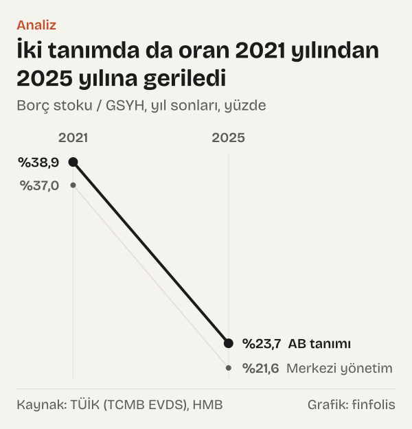

Türkiye'nin AB tanımlı genel yönetim borç stoku 2021 yılı sonunda 2,89 trilyon TL'ydi. Dört yıl sonra, 2025 yılı sonunda 14,97 trilyon TL'ye ulaştı; yani 5,2 katına çıktı. Aynı dört yılda bu borcun gayrisafi yurt içi hasılaya (GSYH) oranı %38,91'den %23,68'e indi.

İlk bakışta iki rakam çelişiyor gibi duruyor. Borç bu kadar büyürken oran nasıl küçülür? Cevap oranın öbür ucunda, paydada. Borç/GSYH bir kesir; payı da paydası da aynı anda değişir. Paydadaki nominal GSYH 2021 yılında 7,43 trilyon TL'ydi, 2025 yılında 63,24 trilyon TL oldu: 8,5 kat. Borç hızlı büyüdü, milli gelir daha hızlı büyüdü.

Yazı, oranın değişimini iki parçaya ayırıyor: borç stokundaki değişimin etkisi (pay etkisi) ve GSYH'deki değişimin etkisi (payda etkisi). Hesabı Hazine ve Maliye Bakanlığı (HMB) ile Türkiye İstatistik Kurumu (TÜİK) verileriyle 2001 yılından 2025 yılına kadar her yıl için yaptık ve dönemlere göre topladık. Okur için anlamı basit: oran düştüğünde borcun azaldığı, yükseldiğinde borcun arttığı sonucu tek başına çıkmaz; iki ucun hızına bakmak gerekir.

## Bir oranın iki ucu

Hesabın mantığı şöyle. Her yıl için önce şu soruyu sorduk: GSYH bir önceki yılın düzeyinde kalsaydı ve yalnız borç değişseydi oran ne olurdu? Bu varsayımsal oran ile bir önceki yılın gerçek oranı arasındaki fark pay etkisi. Ardından varsayımsal orandan o yılın gerçek oranına geçişi hesapladık; bu da payda etkisi. İkisinin toplamı, orandaki gerçek yıllık değişime birebir eşit.

Küçük bir örnek mantığı gösteriyor. Borcun yüz lira, milli gelirin dört yüz lira olduğu bir yıl düşünelim; oran yüzde yirmi beş. Ertesi yıl borç yüz elli liraya, milli gelir sekiz yüz liraya çıksın. Milli gelir yerinde dursaydı oran yüzde otuz yedi buçuğa çıkacaktı: pay etkisi on iki buçuk puan. Gerçekte milli gelir de iki katına çıktığı için oran yüzde on sekiz virgül yetmiş beşe iner: payda etkisi eksi on sekiz virgül yetmiş beş puan. Net sonuç altı virgül yirmi beş puanlık düşüş. Borç yarı yarıya artmışken oran düşmüş olur.

2021–2025 dönemi için dört yılın etkilerini topladığımızda tablo netleşiyor. Borç stokundaki artış oranı 62,84 puan yukarı itti. GSYH'deki artışın etkisi ise -78,07 puan oldu. Net sonuç -15,23 puan; oran %38,91'den %23,68'e indi.

*AB tanımlı genel yönetim borç stoku / GSYH oranındaki değişim, 2021 yılı sonundan 2025 yılı sonuna, yıllık etkilerin toplamı, yüzde puanı. Kaynak: TÜİK (TCMB EVDS), HMB.*

İki büyük rakamın birbirine yakınlığı önemli. Oranın düşmesi borcun yavaşlamasından çok paydanın daha da hızlanmasından geldi. Dört yılın her birinde borç stoku büyüdü; 2022 yılında %56, 2023 yılında %69,7, 2024 yılında %37,5, 2025 yılında %42,3. GSYH de aynı yıllarda %106,2, %76,8, %64,9 ve %41,6 büyüdü.

## 2001–2015

Zamanda geri gidelim. HMB'nin serisinin başladığı 2001 yılında AB tanımlı genel yönetim borcu 187,27 milyar TL'ydi ve GSYH'nin %75,57'sine denk geliyordu. 2015 yılı sonunda oran %26,46'ya inmişti.

On dört yılda borç stoku 3,3 katına çıktı, GSYH ise 9,5 katına. Yıllık etkileri topladığımızda borç artışı oranı 70,78 puan yükseltti. GSYH artışının etkisi -119,9 puan oldu. Orandaki net değişim -49,12 puan.

![Çizgi grafik: Borcun GSYH'ye oranı çeyrek asırda üçte birin altına indi: Borç / GSYH: 2001 yılında %75,6, 2002 yılında %71,2, 2003 yılında %63,6, 2004 yılında %57,0, 2005 yılında %50,2, 2006 yılında %44,2, 2007 yılında %37,1, 2008 yılında %37,0, 2009 yılında %42,4, 2010 yılında %38,6, 2011 yılında %34,8, 2012 yılında %30,8, 2013 yılında %29,5, 2014 yılında %27,4, 2015 yılında %26,5, 2016 yılında %27,0, 2017 yılında %26,9, 2018 yılında %28,8, 2019 yılında %31,2, 2020 yılında %38,3, 2021 yılında %38,9, 2022 yılında %29,4, 2023 yılında %28,3, 2024 yılında %23,6, 2025 yılında %23,7, Haz 2026: %22,3.](./graf-2.svg)
*AB tanımlı genel yönetim borç stoku / GSYH, yıl sonları ve son çeyrek, yüzde. Kaynak: HMB.*

Dönemin içinde ters yönlü bir yıl da var. 2009 yılında nominal GSYH yalnız %0,4 büyüdü; borç stoku ise %14,9 arttı. Payda neredeyse durunca oran tek yılda 5,35 puan yükseldi. Sonraki yıllarda GSYH yeniden borçtan hızlı büyüdü ve düşüş devam etti. 2007 yılında ise borç stokunun yıllık değişimi %−6,2 oldu. Seride borcun TL olarak gerilediği iki yıldan biri bu; öteki 2012 yılı, o yıl borç %0,3 azaldı.

## 2015–2021

2015 yılından sonraki altı yılda rakamlar farklı bir tablo veriyor. Oran 2015 yılında %26,46'dan 2021 yılında %38,91'e çıktı: 12,45 puanlık artış. Altı yılda borç stoku 4,6 katına, GSYH 3,2 katına yükseldi. Yıllık etkilerin toplamı bu kez pay tarafında daha ağır: borç artışı oranı 55,61 puan yükseltti, GSYH artışının etkisi ise -43,16 puanda kaldı.

En büyük tek yıllık artış 2020 yılında görüldü. Borç stoku %43,4 büyürken GSYH %16,8 büyüdü ve oran 7,1 puan yükseldi. 2018 yılında ve 2019 yılında da borç stoku GSYH'den hızlı büyüdü; oran bu iki yılda 1,9 ve 2,37 puan arttı.

*AB tanımlı genel yönetim borç stoku / GSYH oranında bir önceki yıl sonuna göre değişim, yüzde puanı. Kaynak: TÜİK (TCMB EVDS), HMB.*

2021 yılı ilginç bir ara durak. Borç stoku %46,9, GSYH %44,6 büyüdü. İki uç neredeyse aynı hızla koştuğu için oran yalnız 0,61 puan arttı. Hemen ardından gelen 2022 yılında GSYH %106,2 büyüdü. Oranın o yılki değişimi -9,48 puan; serinin son on yılındaki en büyük düşüş bu.

## 2021–2025

Son dört yılın hikâyesi ilk bölümde anlatıldı; burada yıl yıl bakalım. 2022–2024 arasında her yıl GSYH borç stokundan hızlı büyüdü ve oran her yıl geriledi. 2023 yılında fark küçüktü: borç %69,7, GSYH %76,8 büyüdü. Oranın değişimi -1,18 puan. 2024 yılında borç %37,5, GSYH %64,9 büyüdü; düşüş 4,69 puan oldu.

Yıllık etkilere tek tek bakıldığında dört yılın en büyük iki etkisi 2022 yılına ait: pay etkisi 21,77 puan, payda etkisi -31,25 puan. 2023 yılında bu etkiler 20,51 puan ve -21,69 puan, 2024 yılında 10,61 puan ve -15,29 puan oldu. 2025 yılında ise iki hız yeniden birbirine yaklaştı. Borç stoku %42,3, GSYH %41,6 büyüdü. Bu kez pay biraz önde kaldı ve oran 0,12 puan yükseldi: %23,56'dan %23,68'e.

*AB tanımlı genel yönetim borç stoku ve nominal GSYH, bir önceki yıla göre değişim, yüzde. Kaynak: HMB, TÜİK (TCMB EVDS).*

2026 yılı için yalnız çeyreklik veri var. HMB'nin tablosuna göre borç stoku 2026'nın ikinci çeyreği sonunda 16,27 trilyon TL'ye çıktı, oran ise %22,28'e indi. Yani 2025 yılı sonundan bu yana borç TL olarak büyümeyi sürdürürken oran yine payda tarafından aşağı çekildi. Bakanlığın dipnotu bu rakamın nasıl hesaplandığını açıklıyor: “Çeyreklik dönemlere ilişkin oranlar, son dört çeyrekteki TL cinsinden GSYH verileri kullanılarak hesaplanmıştır.” Yıl sonu rakamlarıyla birebir karşılaştırılabilir değil; yıl tamamlanmadan dönem hesabına katmadık. Bir önceki çeyrekte, 2026'nın ilk çeyreğinde, oran %23,07 ve borç stoku 15,64 trilyon TL'ydi.

## Oranın düşmesi borcun küçülmesi değil

Hesabın verdiği ilk ders, oranın yönü ile borcun yönünün ayrı şeyler olduğu. 2001–2025 arasında oran 51,89 puan düştü. Aynı çeyrek asırda borç stoku TL olarak 80 katına çıktı. GSYH ise 255,2 katına. Yıllık etkilerin toplamında borç artışının etkisi +189,24 puan, GSYH artışının etkisi -241,13 puan.

Bir başka okuma da hesabın kendisiyle ilgili. Pay ve payda etkisini ayırırken önce payı, sonra paydayı değiştirdik. Sırayı tersine çevirmek, yani önce GSYH'yi sonra borcu değiştirmek, yıllık etkilerin büyüklüğünü değiştirir; toplam değişim ise aynı kalır. Bu tür ayrıştırmalarda tek doğru sıra yoktur. Yazıdaki rakamlar bu tercihe bağlı, oranın kendisi ise değil.

Üçüncü bir nokta, borç stokunun TL karşılığı. HMB'nin metaverisine göre döviz cinsi borçlar dönem sonundaki gösterge döviz satış kuruyla TL'ye çevriliyor. Pay etkisi bu yüzden yeni borçlanmayı da, mevcut borcun TL karşılığındaki değişimi de içeriyor. Tablo bu iki parçayı ayırmadığı için bu yazı da ayırmıyor.

## Hangi borç, hangi tanım?

Kamu borcu için tek bir rakam yok. Bu yazının ana serisi AB tanımlı genel yönetim borç stoku. HMB'nin metaverisine göre bu seri, Avrupa Birliği Antlaşması'nda (Maastricht) belirlenen kurallar, AB Konseyi'nin bu alandaki yönetmeliği ve Eurostat'ın Devlet Açığı ve Borcu Kılavuzu temel alınarak hesaplanıyor. Kapsamda merkezi yönetimin yanında yerel yönetimler ve sosyal güvenlik kurumları var; alt sektörlerin birbirine olan borçları düşülerek konsolide ediliyor. Metaveride değerleme şöyle tanımlanıyor: “Borç stokunun temel değerleme yöntemi yazılı değerdir.”

HMB ayrıca merkezi yönetim borç stokunu ayrı bir seri olarak yayımlıyor. Bu seride 2025 yılı sonu stoku 13,67 trilyon TL ve GSYH'ye oranı %21,61. Aynı yıl AB tanımlı seride merkezi yönetime ait kalem 15,35 trilyon TL; aradaki fark 1,68 trilyon TL. Metaveri, AB tanımlı seride TÜFE'ye endeksli borçlanma senetlerinin anapara enflasyon değerlemesinin stoka eklendiğini ve para ve mevduat yükümlülüklerinin de kapsandığını söylüyor. Farkın kalem kalem dökümü ise yayımlanan tablolarda yok; bu yüzden farkın ne kadarının hangi kalemden geldiğini söyleyemiyoruz.

*Borç stoku / GSYH, yıl sonları, yüzde. Kaynak: TÜİK (TCMB EVDS), HMB.*

İki tanım farklı düzeyler verse de yön aynı. Merkezi yönetim serisinde oran 2021 yılında %36,96'ydı ve 2025 yılında %21,61'e indi; stok aynı dönemde 5 katına çıktı. Yerel yönetimlerin AB tanımlı borcu ise 2025 yılında 425,27 milyar TL ile GSYH'nin %0,67'si kadardı; 2021 yılında bu oran %1,73'tü. Sosyal güvenlik kurumlarının borcu tabloda çok küçük bir kalem olarak görünüyor. Genel yönetim toplamının ağırlığı, iki tanımda da merkezi yönetimde.

## Rakamların oynayabileceği yerler

Hem pay hem payda revize edilebilen veriler. HMB'nin tablosunda AB tanımlı borç stoku geçici olarak işaretli ve dipnot, dış borç verilerinde geriye dönük güncellemeler olabileceğini belirtiyor. GSYH tarafında TÜİK'in ulusal hesapları da yeni verilerle güncellenir. Bizim hesabımız EVDS'deki güncel GSYH serisiyle yapıldı; bulduğumuz oranlar HMB'nin tablosundaki oranlarla bütün yıllarda dördüncü ondalığa kadar aynı çıktı.

Oran nominal bir orandır: pay da payda da cari fiyatlarla, TL olarak ölçülüyor. GSYH'deki büyümenin hangi kısmının reel büyümeden, hangisinin fiyat değişiminden geldiğine bu yazıda girmedik; ayrıştırma yalnız iki nominal büyüklük arasında yapıldı.

Son olarak, borç stoku brüt bir büyüklüktür; kamunun elindeki varlıklar düşülmez. HMB net borç için ayrı bir seri yayımlıyor; bu yazı brüt AB tanımlı borçla sınırlı.

## Nasıl hesapladık

Borç stokunu HMB'nin Avrupa Birliği Tanımlı Genel Yönetim Borç Stoku tablosundan, her yılın dördüncü çeyrek sütunundan aldık. Nominal GSYH için TÜİK'in harcama yöntemiyle cari fiyatlarla GSYH serisini EVDS'den çektik; dördüncü çeyrek gözleminde dört çeyreklik toplam, yıllık GSYH'yi verir. Tabloda milyon TL olan borç rakamlarını, GSYH ile aynı birimde olsun diye bin TL'ye çevirdik. Her yıl için oranı, bir önceki yılın GSYH'siyle hesaplanan varsayımsal oranı, pay etkisini ve payda etkisini ayrı kayıtlar olarak tuttuk; dönem toplamları bu yıllık etkilerin toplamıdır. Pay etkisi önce, payda etkisi sonra hesaplandı. Yıllık etkileri toplarken her dönemin başlangıç yılını dışarıda, bitiş yılını içeride tuttuk; örneğin 2021–2025 toplamı 2022–2025 arasındaki dört yılın etkilerinden oluşuyor. Bu yüzden ardışık dönemlerin toplamları birbirine eklenebiliyor ve 2001–2025 toplamına eşit oluyor. Hesabın her adımı kanıt dosyasında ayrı bir kayıt; okur aynı tabloları indirerek her rakamı yeniden bulabilir.

## Kaynaklar

- [HMB: Avrupa Birliği Tanımlı Genel Yönetim Borç Stoku, 2001–2026](https://ms.hmb.gov.tr/uploads/2026/09/Avrupa_Birligi_Tanimli_Genel_Yonetim_Borc_Stoku-0349c2fdc2bbdac0.xls)
- [HMB: AB Tanımlı Genel Yönetim Borç Stoku İstatistikleri metaverisi](https://ms.hmb.gov.tr/uploads/2025/09/ABTGYBS-Metaveri-75f7047e2f47ec2e.pdf)
- [HMB: Merkezi Yönetim Borç Stoku Döviz-Faiz Yapısı, 2003–2025](https://ms.hmb.gov.tr/uploads/2026/10/Merkezi_Yonetim_Borc_Stoku_Doviz-Faiz_Yapisi-14339727f1a6eba9.xls)
- [TÜİK (TCMB EVDS): GSYH harcama yöntemiyle, cari fiyatlarla, TP.GSYIH20.BY.B1GQ](https://evds3.tcmb.gov.tr/igmevdsms-dis/series=TP.GSYIH20.BY.B1GQ)
