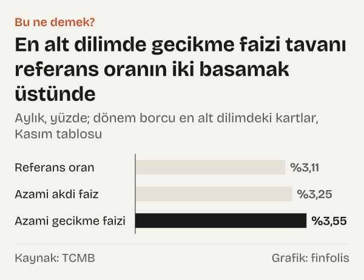

Kredi kartı borcuna uygulanabilecek faizin üst sınırını Türkiye Cumhuriyet Merkez Bankası (TCMB) ilan ediyor. 1 Kasım 2026'dan geçerli tabloda dönem borcu 30.000 TL'nin altında olan kartlarda azami akdi faiz aylık %3,25, azami gecikme faizi aylık %3,55. Dönem borcu 180.000 TL'yi aşınca azami akdi faiz %4,25'e çıkıyor.

Bu oranların hepsi aynı yerden başlıyor: aylık %3,11'lik referans oran. Üzerine, kartın dönem borcunun girdiği dilime göre sabit bir ek konuyor ve azami akdi faiz çıkıyor. Azami gecikme faizi de bu akdi faizin üstüne sabit bir ekle bulunuyor.

Tablodaki rakamlar bir tavandır. TCMB'nin sayfasındaki ifadeyle “bankalar söz konusu oranları aşmamak koşuluyla kredi kartı işlemlerinde uygulayacakları faiz oranlarını serbestçe belirlemektedir”.

## Oranları kim, ne zaman ilan ediyor?

Azami oranları TCMB, kredi kartı işlemlerine ilişkin Tebliğde yazılı yöntemle hesaplıyor ve her ayın sondan beşinci iş günü kendi sayfasında ilan ediyor. Tebliğe göre ilan edilen oranlar “takip eden ayın ilk gününden geçerli olmak üzere uygulanır”. Kasım 2026 için tablodaki satır bu yüzden 1 Kasım 2026 tarihini taşıyor.

Hesabın çıkış noktası olan referans oranı da TCMB ilan ediyor. TCMB sayfasına göre bu oran, bankaların ticari müşterilerden alabileceği ücretleri düzenleyen ayrı bir tebliğdeki yöntemle hesaplanıyor. TCMB'nin para politikasında kullandığı faizler başka yazıların konusu: [TCMB'nin faiz kararı ve fonlama maliyeti](/haber/tcmb-faiz-karari-ekim-2026-fonlama-maliyeti/) ve [politika faizi ile enflasyon arasındaki fark](/haber/politika-faizi-ile-enflasyon-farki-eylul-2026/).

## Referans orandan azami faize üç adım

Birinci adım referans oran: Kasım 2026'da aylık %3,11.

İkinci adım dilim eki. Tebliğ referans orana dönem borcu 30.000 TL'nin altındaki kartlar için en küçük eki, 30.000 TL ile 180.000 TL arasındakiler için daha büyüğünü, 180.000 TL'nin üzerindekiler için en büyüğünü koyuyor. Kurumsal kartlar ve nakit çekim de en büyük ekle hesaplanıyor. Nakit çekim için Tebliğdeki cümle şöyle: oran “aylık referans orana 114 baz puan eklenerek belirlenir”.

Üçüncü adım gecikme eki. Tebliğe göre azami gecikme faiz oranları, azami akdi faiz oranlarına “30 baz puan eklenerek belirlenir”.

En alt dilim bu adımları Kasım 2026 rakamlarıyla gösteriyor. %3,11'lik referans orana 0,14 puan eklenince azami akdi faiz %3,25 oluyor. Buna 0,3 puan eklenince azami gecikme faizi %3,55'e çıkıyor. Orta dilimde referans orandan fark 0,64 puan, azami akdi faiz %3,75. En üst dilimde fark 1,14 puan, azami akdi faiz %4,25.

*Aylık, yüzde; dönem borcu en alt dilimdeki kartlar, Kasım tablosu. Kaynak: TCMB.*

## Dönem borcu tavanı nasıl değiştiriyor?

Hangi oranın tavan olacağını kartın dönem borcunun girdiği aralık belirliyor. Kasım 2026'da en alt dilimden orta dilime geçişte azami akdi faiz 0,5 puan yükseliyor; en üst dilimde tavan en alt dilime göre 1 puan yüksek.

| İşlem ya da dönem borcu | Azami akdi faiz | Azami gecikme faizi |
|---|---|---|
| ₺30.000 altında | %3,25 | %3,55 |
| ₺30.000–₺180.000 arasında | %3,75 | %4,05 |
| ₺180.000 üzerinde (kurumsal kartlar dâhil) | %4,25 | %4,55 |
| Nakit çekim ve kullanım (kredili mevduat hesapları dâhil) | %4,25 | %4,55 |
| Döviz cinsinden kart işlemleri | %2,98 | %3,28 |

*Aylık, yüzde. 1 Kasım 2026'dan geçerli. Kaynak: TCMB.*

Nakit çekimde tavan dönem borcuna bakmıyor; ek her zaman en üst dilimin eki. TCMB sayfası, kredili mevduat hesaplarında uygulanacak azami akdi ve gecikme faizinin de TCMB'nin belirlediği azami oranları geçemeyeceğini hatırlatıyor.

Döviz cinsinden kart işlemlerinin tavanı Türk lirası oranlarına bağlı. Tebliğe göre bu işlemlerde oran, Türk lirası nakit çekim azami akdi faizinin %70'i. Kasım 2026'da döviz cinsinden işlemlerde azami akdi faiz %2,98, azami gecikme faizi %3,28.

Tebliğ katılım bankalarını da kapsıyor: bu bankaların kart işlemlerindeki akdi kâr payı oranları azami akdi faiz oranlarını, gecikme cezası oranları da azami gecikme faiz oranlarını geçemiyor.

## Borç yapılandırılırsa tavan ne oluyor?

Kart borcu yapılandırıldığında ayrı bir sınır geçerli. TCMB sayfası, Bankacılık Düzenleme ve Denetleme Kurumu (BDDK) kararlarını aktararak yapılandırmada uygulanacak aylık akdi faizin “aylık referans oranı (%3,11) aşamaz” olduğunu yazıyor. Yani yapılandırılan borçta akdi faiz tavanı, en alt dilimin %3,25'lik tavanının da altında, referans oranın kendisi.

Yapılandırmada gecikme faizinin tavanı ise TCMB sayfasına göre Tebliğde belirlenen en yüksek gecikme faiz oranı. Kasım 2026 tablosunda Türk lirası işlemler için en yüksek azami gecikme faizi %4,55.

## Kasım 2020'den bu yana oranlar nasıl değişti?

TCMB'nin geçmiş oranlar tablosu Kasım 2020'den başlıyor. Tablodaki en eski satırda, Kasım 2020'de, referans oran %0,91, kart işlemlerinde azami akdi faiz %1,46, azami gecikme faizi %1,76'ydı. Kasım 2021'de bu üç oran %1,43, %1,98 ve %2,28; Kasım 2022'de %0,95, %1,5 ve %1,8 oldu.

Referans oran Kasım 2023'te %3,11'e, azami akdi faiz %3,66'ya, azami gecikme faizi %3,96'ya çıkmıştı. Tabloda Nisan 2024 için iki satır var; ikincisi olan 6 Nisan 2024 satırında referans oran yine %3,11, azami akdi faiz %4,25, azami gecikme faizi %4,55, nakit çekimde azami akdi faiz %5.

Tablonun Kasım 2020–Nisan 2024 satırlarında kart işlemleri için tek bir azami akdi faiz sütunu var. Kasım 2024 satırında ise dönem borcuna göre üç sütun görünüyor; sınırlar o zaman 25.000 TL ve 150.000 TL'ydi. Kasım 2024'te bu üç dilimde azami akdi faiz %3,5, %4,25 ve %4,75, nakit çekimde %5'ti. Kasım 2025'te dilimler aynı sınırlarla %3,5, %4 ve %4,5, nakit çekim %4,5 oldu. Ocak 2026 satırında alt dilim sınırı 30.000 TL ve bu dilimde azami akdi faiz %3,25.

*Aylık, yüzde; dilimli dönemde dönem borcu en alt dilimdeki kartlar. Kaynak: TCMB.*

Uzun dönemde referans oran Kasım 2020'deki %0,91'den Kasım 2026'daki %3,11'e 2,2 puan yükseldi. Aynı dönemde kart işlemlerinde azami akdi faiz %1,46'dan en alt dilimdeki %3,25'e 1,79 puan arttı. Kasım 2023'ten Kasım 2026'ya referans oran değişmedi.

Son bir yılda Kasım 2025'ten Kasım 2026'ya üç dilimin azami akdi faizi de 0,25 puan geriledi. Bu karşılaştırmada dilim sınırları birebir aynı değil: Kasım 2025'te 25.000 TL ve 150.000 TL, Kasım 2026'da 30.000 TL ve 180.000 TL. Nakit çekimde azami akdi faiz Kasım 2024'teki %5'ten Kasım 2026'daki %4,25'e 0,75 puan indi.

TCMB tablosu oranların ve dilim sınırlarının neden değiştiğini açıklamıyor.

## Bu ne demek?

Tablodaki oranlar bankaların aşamayacağı üst sınırlar. Bir kart sahibine uygulanan faiz bu sınırın altında olabilir; bankalar sınırın altında oranı kendileri belirliyor.

Oranlar aylık. Kart borcunun hangi tavana tabi olduğunu dönem borcunun girdiği aralık belirliyor; nakit çekim ve kredili mevduat hesabı ise borç tutarından bağımsız olarak en üst eke bağlı. Gecikme faizi her dilimde akdi faizin 0,3 puan üstünde.

Tablo yıllık maliyeti ya da faizin faize eklenmesiyle oluşan toplam borcu göstermiyor; yalnız aylık tavanları veriyor.

Bu yazı TCMB tablosunun Kasım 2020'den bu yana yalnız seçilmiş satırlarını kapsar; referans oranın hesaplanma yöntemi ve önceki dönemlerde referans orana eklenen paylar yazının kaynaklarında yer almıyor.

## Kaynaklar

- [TCMB: Kredi Kartı İşlemlerinde Uygulanacak Azami Faiz Oranları](https://www.tcmb.gov.tr/wps/wcm/connect/TR/TCMB+TR/Main+Menu/Istatistikler/Bankacilik+Verileri/Kredi_Karti_Islemlerinde_Uygulanacak_Azami_Faiz_Oranlari)
- [TCMB: Kredi Kartı İşlemlerinde Uygulanacak Azami Faiz Oranları Hakkında Tebliğ](https://www.tcmb.gov.tr/wps/wcm/connect/d7fa7df5-3c46-4c73-b554-9117f64f5f8a/Kredi+Kart%C4%B1+%C4%B0%C5%9Flemlerinde+Uygulanacak+Azami+Faiz+Oranlar%C4%B1+Hakk%C4%B1nda+2020-16+Say%C4%B1l%C4%B1+Tebli%C4%9F.pdf?MOD=AJPERES)
- [TCMB: Kasım 2020–Aralık 2025 arasında uygulanan azami faiz oranları](https://www.tcmb.gov.tr/wps/wcm/connect/307c5b42-67ec-4047-ae36-1ae452a97cf7/01.11.2020-31.12.2025+Aras%C4%B1nda+Kredi+Kart%C4%B1+%C4%B0%C5%9Flemlerinde+Uygulanan+Azami+Faiz+Oranlar%C4%B1.pdf?MOD=AJPERES)
