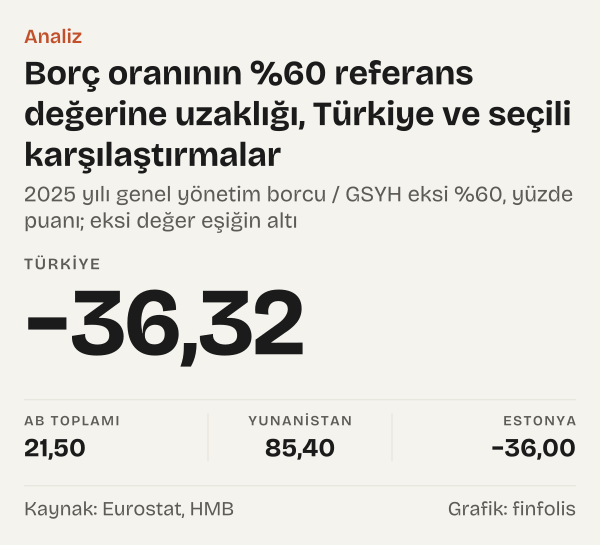

Avrupa Birliği'nin kamu maliyesi için koyduğu iki eşik, borç için GSYH'nin %60'ı ve bütçe açığı için GSYH'nin %3'ü, Türkiye'nin rakamlarına uygulandığında ne çıkar? Soru basit görünüyor, ama cevabın yarısı rakamda, yarısı rakamın nasıl ölçüldüğünde.

Borç tarafında cevap net: Hazine ve Maliye Bakanlığı'nın (HMB) AB tanımlı genel yönetim borç stokuna göre Türkiye'nin borcu 2025 yılı sonunda GSYH'nin %23,68'i. Oranla %60 referans değeri arasındaki fark -36,32 puan. Aynı yıl Eurostat'ın verisinde AB toplamında borç oranı %81,5 ve üyelerin on ikisi eşiğin üstünde.

Açık tarafında cevap daha az net. Eurostat'ın açık ölçüsü genel yönetimin ulusal hesaplardaki net borç verme ya da borçlanma rakamı. Türkiye için aynı tanımla yayımlanmış bir seriyi bu yazıda kullanamadık; elimizdeki en yakın resmî rakam merkezi yönetim bütçe dengesi. O rakam 2025 yılında GSYH'nin %-2,87'si. Bu rakam %3 eşiğiyle aynı ölçüde değil. Bu yazı iki ipucunu ayrı ayrı izliyor ve hangisinin ne kadar karşılaştırılabilir olduğunu gösteriyor. Ölçütler burada yalnız bir istatistik karşılaştırma ölçüsü olarak kullanılıyor.

## İki eşik nereden geliyor?

Eurostat'ın açıklamasına göre ölçütler, Maastricht Antlaşması'na ekli aşırı açık prosedürü protokolünden geliyor. Protokolde bütçe açığı için GSYH'nin %3'ü, kamu borcu için GSYH'nin %60'ı referans değer olarak yer alıyor. AB'deki ülkeler bu rakamları yılda iki kez, Nisan ve Ekim aylarında, Eurostat'a bildiriyor.

Ölçünün tanımı da aynı açıklamada var. Açık, ulusal hesaplardaki net borç verme ya da net borçlanma rakamı. Borç ise genel yönetimin para ve mevduat, borçlanma senetleri ve krediler cinsinden yükümlülüklerinin yazılı (nominal) değerle ölçülen brüt toplamı.

Bu tanım Türkiye'nin borç rakamı için önemli bir ipucu. HMB'nin AB tanımlı genel yönetim borç stoku, Bakanlığın metaverisine göre tam da bu çerçeveye, AB Antlaşması'ndaki kurallara, AB Konseyi yönetmeliğine ve Eurostat'ın Devlet Açığı ve Borcu Kılavuzu'na göre hesaplanıyor. Değerleme yöntemi yazılı değer, kapsam merkezi yönetim, yerel yönetimler ve sosyal güvenlik kurumları. Yani borç tarafında aynı cetvelle ölçülmüş iki rakamı yan yana koyabiliyoruz.

Rakamın içi de tabloda görünüyor. 2025 yılı sonunda AB tanımlı genel yönetim borcu 14,97 trilyon TL. Merkezi yönetimin kalemi 15,35 trilyon TL, yerel yönetimlerinki 425,27 milyar TL; sosyal güvenlik kurumlarının borcu çok küçük. Alt sektörlerin birbirine olan borçları düşüldüğünde, yani sektörler arası konsolidasyonda, bu kalem -798,11 milyar TL. Kamunun bir biriminin başka bir kamu biriminden alacağı, genel yönetimin dışarıya olan borcu sayılmadığı için bu düzeltme yapılıyor. Böylece aynı lira iki kez sayılmamış oluyor. Eurostat'ın üye ülke rakamları da aynı mantıkla konsolide ediliyor.

Açık tarafındaki ölçünün mantığı ise şu: net borç verme ya da borçlanma, genel yönetimin bir yıl içindeki bütün gelirleri ile bütün giderleri, yatırım harcamaları dahil, arasındaki farktır. Rakam eksiyse genel yönetim o yıl borçlanmak zorunda kalmış, artıysa başka sektörlere borç verebilecek durumda olmuştur. Bu yüzden Eurostat tablosunda açık eksi işaretle görünür; yazıda da bütçe dengesini bu işaretle aktarıyoruz.

## Borç tarafı: kim eşiğin neresinde?

Eurostat'ın 2026 yılı Ekim güncellemesine göre 2025 yılında borç oranı en yüksek beş üye Yunanistan (%145,4), İtalya (%136,7), Fransa (%115,7), Belçika (%108,1) ve İspanya (%100,5). En düşük dört üye ise Estonya (%24), Lüksemburg (%26), Danimarka (%27,2) ve Bulgaristan (%29,9).

Türkiye'nin %23,68'lik oranı bu listedeki en düşük değerlerin düzeyinde; Estonya'nın oranı %24. AB toplamı %81,5. Türkiye'nin oranı 2019 yılında %31,2'ydi; altı yılda 7,52 puan geriledi.

![Halter grafik: Türkiye'nin borç oranı %60 referans değerinin ve AB toplamının altında: 2019 yılında: Türkiye: %31,2, AB toplamı: %77,4, Yunanistan: %183,2, İtalya: %134,2, Fransa: %98,2, Belçika: %97,7, İspanya: %97,7, Almanya: %58,3, Polonya: %45,2, Romanya: %35,4, Danimarka: %38,3, Estonya: %9,0; 2025 yılında: Türkiye: %23,7, AB toplamı: %81,5, Yunanistan: %145,4, İtalya: %136,7, Fransa: %115,7, Belçika: %108,1, İspanya: %100,5, Almanya: %62,8, Polonya: %59,6, Romanya: %58,9, Danimarka: %27,2, Estonya: %24,0; Referans değer: Türkiye: %60,0, AB toplamı: %60,0, Yunanistan: %60,0, İtalya: %60,0, Fransa: %60,0, Belçika: %60,0, İspanya: %60,0, Almanya: %60,0, Polonya: %60,0, Romanya: %60,0, Danimarka: %60,0, Estonya: %60,0.](./graf-1.svg)
*Genel yönetim borcu / GSYH, yüzde; kesik çizgi Maastricht referans değeri; Türkiye için AB tanımlı seri. Kaynak: HMB, Eurostat.*

Eşiğe uzaklığı hesapladığımızda tablo daha da belirginleşiyor. AB toplamı eşiğin 21,5 puan üstünde. Yunanistan 85,4 puan, İtalya 76,7 puan, Fransa 55,7 puan üstte. Türkiye'de bu fark -36,32 puan, Estonya'da -36 puan.

Eşiği aşan on iki üye şunlar: Yunanistan, İtalya, Fransa, Belçika, İspanya, Portekiz, Finlandiya, Avusturya, Macaristan, Slovenya, Almanya ve Slovakya. Bazı üyeler eşiğin hemen kıyısında duruyor. Polonya'nın oranı %59,6, Romanya'nınki %58,9; ikisi de eşiğin bir puandan az altında. Slovakya %60,5 ve Almanya %62,8 ile eşiğin biraz üstünde. Slovenya %65,1.

Türkiye için yıl içindeki son veri 2026'nın ikinci çeyreğine ait. HMB'nin tablosunda oran o çeyrekte %22,28. Çeyreklik oranlar son dört çeyreğin GSYH'siyle hesaplandığı için yıl sonu rakamıyla birebir aynı ölçü değil; yine de eşiğe göre konumu değiştirmiyor.

*2025 yılı genel yönetim borcu / GSYH eksi %60, yüzde puanı; eksi değer eşiğin altı. Kaynak: Eurostat, HMB.*

## Açık tarafı: ipucu güçlü, ölçü farklı

2025 yılı genel yönetim bütçe dengesi AB toplamında GSYH'nin %-3,1'i. Açığı %3'ü aşan on üye var. En büyük açıklar Romanya'da ve Polonya'da: bütçe dengesi Romanya'da %-7,8, Polonya'da %-7,2. Belçika'da denge %-5,2, Fransa'da %-5,1, Macaristan'da %-4,7. Listenin geri kalanı Slovakya (%-4,4), Avusturya (%-4,1), Bulgaristan (%-4), Finlandiya (%-3,8) ve İtalya (%-3,1). Hırvatistan %-3 ile tam eşikte kaldı; eşiği aşmıyor. Eşiğin içinde kalan üyelerin bir kısmında da açıklar eşiğe yakın: Almanya'da denge %-2,9, İspanya'da %-2,4, Slovenya'da ve Letonya'da %-2,5. Hollanda'da ve İsveç'te denge %-1,6 ile daha küçük bir açığı gösteriyor. Öte yanda beş üye fazla verdi: Kıbrıs %3,6, Danimarka %2,9, Yunanistan %2, İrlanda %1,8, Portekiz %0,7.

*Genel yönetim bütçe dengesi (net borç verme ya da borçlanma) / GSYH, 2025 yılı, yüzde; eksi değer açık. Kaynak: Eurostat.*

İki ölçütü birlikte okuduğumuzda yedi üye ikisini de aştı: Belçika, Fransa, İtalya, Macaristan, Avusturya, Slovakya ve Finlandiya. On iki üye ise iki eşiğin de içinde kaldı.

Elimizdeki Türkiye rakamı farklı bir ölçü. HMB'nin merkezi yönetim bütçe gerçekleşmelerine göre 2025 yılında gelirler giderlerin gerisinde kaldı ve bütçe dengesi GSYH'nin %-2,87'si oldu. 2019 yılında bu oran %-2,81'di.

## Türkiye'nin açık rakamı neden aynı cetvel değil?

Burada dedektifin dikkatli olması gereken yer geliyor. Merkezi yönetim bütçesi, merkezi yönetimin bütçe kanunu çerçevesindeki gelir ve giderlerini izler. Eurostat'ın açık ölçüsü ise bütün genel yönetimi, yani yerel yönetimleri ve sosyal güvenlik kurumlarını da kapsar ve ulusal hesaplar kurallarıyla kaydedilir.

Kapsam farkı tek başına sonucu değiştirebilir. Genel yönetimin iki büyük parçası daha var: belediyeler ve il özel idareleri gibi yerel yönetimler ile emeklilik ve sağlık harcamalarını yürüten sosyal güvenlik kurumları. Bunların her birinin kendi geliri, gideri ve dengesi var. Merkezi yönetim bütçesinin dengesi, bu kurumların dengesinin toplamı değildir. Merkezi yönetimin yerel yönetimlere ve sosyal güvenlik kurumlarına yaptığı aktarımlar merkezi bütçede gider olarak görünür; genel yönetim konsolide edildiğinde bu aktarımlar alt sektörler arasında birbirini götürür ve yerine o kurumların kendi gelir ve giderleri girer. Kayıt anı ve kalemlerin sınıflandırılması da farklı olabilir.

Bu yüzden %-2,87'yi doğrudan %3 eşiğiyle karşılaştırmak, iki farklı cetvelle ölçülmüş iki uzunluğu yan yana koymak olur. Söylenebilecek olan şu: merkezi yönetim bütçesi 2025 yılında GSYH'nin yaklaşık üç puanına yakın bir açık verdi. Genel yönetim açığının aynı tanımla hesaplanmış hâli bu rakamdan büyük ya da küçük olabilir; hangisi olduğunu bu yazıdaki verilerle bilemiyoruz.

*Bütçe dengesi / GSYH, yüzde; AB ülkeleri genel yönetim (Eurostat), Türkiye merkezi yönetim bütçesi (HMB), tanımlar farklı. Kaynak: Eurostat, TÜİK (TCMB EVDS), HMB (TCMB EVDS).*

## 2019'dan bu yana ne değişti?

Altı yıl öncesine bakınca AB tarafında açık rakamlarında belirgin bir kayma görünüyor. 2019 yılında yalnız iki üyenin, İspanya ve Romanya'nın, açığı %3'ün üstündeydi; AB toplamında açık %0,5'ti. 2025 yılında eşiği aşan üye sayısı ona çıktı ve AB toplamında denge %-3,1 oldu. Almanya 2019 yılında %1,3 fazla vermişken 2025 yılında %2,9 açık verdi. Bütçe dengesi Fransa'da %-2,4'ten %-5,1'e, Polonya'da %-0,7'den %-7,2'ye, Romanya'da %-4,4'ten %-7,8'e geriledi.

Borç tarafında hareket iki yönlü. 2019 yılında da eşiği aşan on iki üye vardı, ama liste aynı değil. Hırvatistan ve Kıbrıs eşiğin altına indi; Kıbrıs'ın oranı altı yılda 40 puan geriledi. Almanya ve Slovakya eşiğin üstüne çıktı. Yunanistan'ın oranı 37,8 puan azaldı; Portekiz'in oranı da 26,9 puan geriledi. Buna karşılık Romanya'nın oranı 23,5 puan, Finlandiya'nınki 23,1 puan, Fransa'nınki 17,5 puan arttı. AB toplamında oran 4,1 puan yükseldi.

AB tanımlı Türkiye borç oranı aynı dönemde 7,52 puan düştü. Bu düşüşün nasıl oluştuğunu, yani borç stokundaki ve GSYH'deki değişimin payını, bu yazı ayrıca hesaplamadı.

## Eşiğin altında olmak neyi söylemez?

Eşiğe uzaklık yalnız bir ölçüdür; borcun maliyetini, vadesini, para birimi bileşimini ya da kimin elinde tutulduğunu göstermez. Bu yazı bu konulara girmiyor; ülkeleri eşiğe uzaklıklarına göre sıralamak, onlar hakkında bir yargı kurmak anlamına gelmiyor.

Hangi ülkenin AB içindeki prosedürlerde hangi aşamada olduğu da bu yazının konusu değil; yazı rakamları yalnız istatistik karşılaştırma amacıyla yan yana koyuyor.

Karşılaştırmanın bir başka sınırı da hangi yıla bakıldığı. 2019 yılında da Türkiye'nin AB tanımlı borç oranı %31,2 ile eşiğin altındaydı ve AB toplamı %77,4 ile eşiğin üstündeydi; iki uç yıl arasında konumlar değişmedi. Ama tek tek üyelerde değişti: aynı altı yılda bir grup üye eşiğin altına inerken başka bir grup üstüne çıktı. Tek bir yılın fotoğrafı, eşiğe yaklaşan ve uzaklaşan ülkeleri ayırt etmeye yetmiyor; bu yüzden iki yılı birlikte verdik.

## Rakamların değişebileceği yerler

Avrupa verisi her Nisan ve Ekim bildiriminde güncellenebilir; bu yazı 2026 yılı Ekim güncellemesini kullandı. HMB'nin AB tanımlı borç tablosu geçici olarak işaretli; dipnot dış borç verilerinde geriye dönük güncelleme olabileceğini belirtiyor. Türkiye'nin merkezi yönetim bütçe dengesi oranı için kullandığımız GSYH, TÜİK'in EVDS'deki güncel serisi; GSYH revize edildikçe oran da değişir.

Ülke rakamları ulusal istatistik kurumlarının Eurostat'a yaptığı bildirimlere dayanıyor. Türkiye'nin borç rakamı aynı tanımla HMB tarafından derleniyor, ama Eurostat'ın üye ülke tablosunda yer almıyor. İki kaynağın birebir aynı uygulama ayrıntılarına sahip olduğunu bu yazıdaki belgelerle doğrulayamadık; yalnız ikisinin aynı kılavuza dayandığını biliyoruz.

## Nasıl hesapladık

AB üyelerinin borç ve bütçe dengesi oranlarını Eurostat'ın aşırı açık prosedürü bildirim tablosundan, genel yönetim sektörü ve GSYH'ye oran birimiyle aldık. Türkiye'nin borç oranı HMB'nin AB tanımlı genel yönetim borç stoku tablosundaki yıl sonu oranıdır. Türkiye'nin bütçe dengesini, merkezi yönetim bütçe gelirlerinden giderlerini çıkarıp yıllık nominal GSYH'ye bölerek hesapladık; gelir ve gider için Aralık ayındaki on iki aylık toplamı, GSYH için dördüncü çeyrekteki dört çeyreklik toplamı kullandık. Eşiğe uzaklık, 2025 yılı borç oranından %60'ın çıkarılmasıdır. Üye sayıları Eurostat'ın yirmi yedi üyelik tablosundan tek tek sayıldı.

## Kaynaklar

- [Eurostat: Government deficit/surplus, debt and associated data, 2015–2025](https://ec.europa.eu/eurostat/api/dissemination/statistics/1.0/data/gov_10dd_edpt1?format=JSON&lang=en&unit=PC_GDP&sector=S13&na_item=B9&na_item=GD&sinceTimePeriod=2015)
- [Eurostat: Glossary, Excessive deficit procedure (EDP)](https://ec.europa.eu/eurostat/statistics-explained/index.php?title=Glossary:Excessive_deficit_procedure_(EDP))
- [HMB: AB Tanımlı Genel Yönetim Borç Stoku İstatistikleri metaverisi](https://ms.hmb.gov.tr/uploads/2025/09/ABTGYBS-Metaveri-75f7047e2f47ec2e.pdf)
- [HMB: Avrupa Birliği Tanımlı Genel Yönetim Borç Stoku](https://ms.hmb.gov.tr/uploads/2026/09/Avrupa_Birligi_Tanimli_Genel_Yonetim_Borc_Stoku-0349c2fdc2bbdac0.xls)
- [HMB (TCMB EVDS): Merkezi Yönetim Bütçe Gelirleri, TP.KB.GEL001](https://evds3.tcmb.gov.tr/igmevdsms-dis/series=TP.KB.GEL001)
- [HMB (TCMB EVDS): Merkezi Yönetim Bütçe Giderleri, TP.KB.GID001](https://evds3.tcmb.gov.tr/igmevdsms-dis/series=TP.KB.GID001)
- [TÜİK (TCMB EVDS): GSYH cari fiyatlarla, TP.GSYIH20.BY.B1GQ](https://evds3.tcmb.gov.tr/igmevdsms-dis/series=TP.GSYIH20.BY.B1GQ)
