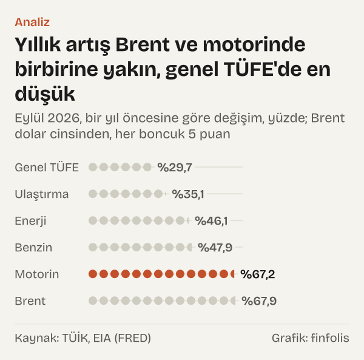

Mart 2026'da Brent petrolün aylık ortalama fiyatı varil başına 103,13 dolar oldu. Bir ay önce, Şubat 2026'da ortalama 70,89 dolardı; artış %45,5. Aynı ay Türkiye İstatistik Kurumu'nun (TÜİK) tüketici fiyat endeksinde (TÜFE) motorin fiyatı %14,39, benzin %7,95 arttı. Genel TÜFE'nin aylık artışı ise %1,94'te kaldı.

Üç rakam, dünya piyasasında belirlenen bir fiyatın evdeki faturaya nasıl ulaştığı sorusunun ilk ipuçları. Petrolün fiyatı pompada, pompadaki fiyat enerji kaleminde, enerji kalemi de ulaşım ücretlerinde görülüyor mu? Görülüyorsa hangi aylarda?

Zinciri halka halka kurduk, ama bir kuralla. İki halka arasındaki bağı yalnız Türkiye Cumhuriyet Merkez Bankası (TCMB) kendi Enflasyon Raporu'nda ya da Para Politikası Kurulu (PPK) metninde kurmuşsa, o bağı kurumun cümlesine atfederek aktardık. Bağın kurulmadığı yerde yalnız aynı dönemde ne görüldüğünü yazdık ve bunu her seferinde söyledik. Okur için anlamı şu: akaryakıttaki aylık değişim, enerji grubunda, ulaştırma hizmetlerinde ve genel endekste aynı büyüklükte görülmüyor; kalemler farklı aylarda ve farklı ölçüde hareket ediyor.

## Zincirin ilk halkası: varilden pompaya

Brent petrol, uluslararası fiyatlamada referans alınan ham petrol türlerinden biri. Fiyatı ABD doları ile ve varil başına verilir. Pompadaki fiyat ise litre başına ve Türk lirası ile belirlenir. İki fiyat arasında birim, para birimi, rafinaj, taşıma ve vergi gibi aşamalar var; bu yazı bu aşamaları tek tek hesaplamıyor, yalnız iki ucun aynı aylardaki değişimine bakıyor. Bu yazıdaki Brent rakamları ABD Enerji Bilgi İdaresi'nin (EIA) yayımladığı günlük spot fiyatın, St. Louis Fed'in FRED veri tabanındaki aylık ortalamaları.

*Europe Brent spot fiyatı, aylık ortalama, varil başına dolar. Kaynak: EIA (FRED).*

Eylül 2025'te ortalama 67,99 dolar olan Brent, Aralık 2025'te 62,54 dolara geriledi. Ocak 2026'da 66,6 dolar, Şubat 2026'da 70,89 dolar oldu. Mart 2026'da 103,13 dolara, Nisan 2026'da 117,29 dolara çıktı. Şubat'tan Nisan'a iki aylık artış %65,5.

TCMB, Mayıs 2026'da yayımladığı Enflasyon Raporu'nda bu dönem için ilk halkayı kendisi kuruyor: enerji fiyatları “ham petrol fiyatlarındaki gelişmelere istinaden akaryakıt fiyatları öncülüğünde artmış” diyor. TÜFE verisi bu cümleyle aynı yönde. Motorin Mart 2026'da %14,39, Nisan 2026'da %12,05 arttı. Benzinde artış Mart'ta %7,95, Nisan'da %3,08 oldu.

İki yakıt arasındaki fark belirgin: aynı aylarda motorin benzinden çok daha hızlı yükseldi. Bu farkın nedenini Mart ve Nisan için açıklayan bir TCMB cümlesine alıntıladığımız belgelerde rastlamadık; bu yüzden farkı yalnız rakam olarak veriyoruz.

Bir önceki ay da bir karşılaştırma noktası veriyor. Şubat 2026'da Brent'in aylık ortalaması %6,4 arttı; aynı ay motorin %4,77, benzin %4,84, enerji grubu %1,98 yükseldi. Mart'taki hareket, büyüklük olarak bunun birkaç katı.

## Eşel mobil: TCMB'nin tanımıyla

Akaryakıt fiyatlarıyla ilgili bir vergi mekanizması da Mart 2026'dan itibaren devredeydi. TCMB'nin Mayıs 2026 Raporu'na göre akaryakıtta eşel mobil mekanizması 5 Mart 2026'da yürürlüğe girdi. TCMB'nin Ağustos 2026 Raporu'ndaki tanıma göre bu uygulama “uluslararası petrol fiyatlarındaki artışların belirli bir kısmını maktu özel tüketim vergisi (ÖTV) üzerinden” karşılıyor. Aynı Rapor'a göre rafineri fiyatındaki artışın ÖTV üzerinden karşılanma oranı, uygulamanın başlangıcında %75'ti.

Yazıda mekanizmanın pompa fiyatlarına etkisini kendimiz hesaplamıyoruz ve tek tek aylardaki pompa artışlarını bu mekanizmaya bağlamıyoruz. Mekanizmayı, aylık rakamların okunduğu dönemin bir olgusu olarak, TCMB'nin tanımı ve tarihiyle aktarıyoruz.

## İkinci halka: pompadan enerji kalemine

TÜFE'deki enerji grubu yalnız akaryakıtı değil, elektriği, doğal gazı, tüp gazı ve katı yakıtları da kapsıyor. Mart 2026'da motorin %14,39 artarken enerji grubu %4,75 arttı.

Nisan 2026'da ise enerji grubu %14,4 arttı. Aynı ay motorin %12,05 artarken elektrik, gaz ve diğer yakıtlar alt grubu %23,35 yükseldi. Alıntıladığımız TCMB belgelerinde bu alt gruptaki artışı Brent'e bağlayan bir cümle yok. Bu yüzden Nisan ayındaki elektrik ve gaz artışını zincirin bir halkası olarak değil, aynı dönemde görülen ayrı bir hareket olarak okuyoruz.

Geri dönüş yolunda bağ yeniden kuruluyor. Brent'in aylık ortalaması Nisan'dan Haziran'a %27,2 geriledi. Ağustos 2026 Raporu'na göre “Enerji fiyatları mayıs ve haziran aylarında uluslararası petrol fiyatlarındaki gerilemeye bağlı olarak” düştü. TÜFE'de enerji grubunun aylık değişimi Mayıs 2026'da %-0,17, Haziran 2026'da %-0,91 oldu. Motorinde aynı iki ayın değişimi %-7,7 ve %-4,4'tü.

Ağustos için bağı PPK toplantı özeti kuruyor: “uluslararası petrol fiyatlarındaki gelişmelerin etkisiyle yükselen akaryakıt fiyatları belirleyici olmuştur.” O ay Brent'in aylık ortalaması %8,7 arttı, motorin %14,07, benzin %9,14, enerji grubu %5,45.

![Küçük çoklu grafik: Aylık değişim Brent ve motorinde en geniş, genel TÜFE'de en dar: Brent: Şub 2026: %6,441, Mar 2026: %45,479, Nis 2026: %13,730, May 2026: %−8,654, Haz 2026: %−20,291, Tem 2026: %−1,920, Ağu 2026: %8,739, Eyl 2026: %25,340; Motorin: Şub 2026: %4,768, Mar 2026: %14,390, Nis 2026: %12,048, May 2026: %−7,697, Haz 2026: %−4,404, Tem 2026: %7,157, Ağu 2026: %14,074, Eyl 2026: %12,934; Benzin: Şub 2026: %4,837, Mar 2026: %7,950, Nis 2026: %3,082, May 2026: %2,707, Haz 2026: %−2,451, Tem 2026: %2,379, Ağu 2026: %9,143, Eyl 2026: %11,547; Enerji: Şub 2026: %1,977, Mar 2026: %4,746, Nis 2026: %14,397, May 2026: %−0,174, Haz 2026: %−0,908, Tem 2026: %2,310, Ağu 2026: %5,454, Eyl 2026: %6,253; Ulaştırma hizmetleri: Şub 2026: %1,427, Mar 2026: %6,074, Nis 2026: %6,176, May 2026: %5,612, Haz 2026: %0,581, Tem 2026: %3,405, Ağu 2026: %4,983, Eyl 2026: %0,247; Genel TÜFE: Şub 2026: %2,964, Mar 2026: %1,939, Nis 2026: %4,182, May 2026: %1,715, Haz 2026: %0,987, Tem 2026: %1,785, Ağu 2026: %1,844, Eyl 2026: %1,840.](./graf-2.svg)
*Bir önceki aya göre değişim, yüzde; Brent dolar cinsinden. Kaynak: EIA (FRED), TÜİK.*

## Üçüncü halka: ulaştırma hizmetleri

Ulaştırma ana harcama grubu TÜFE'de üç parçadan oluşuyor: araç satın alımı, kişisel ulaşım araçlarının kullanımı (yakıt, bakım, parça) ve yolcu taşıma hizmetleri. Ulaştırma hizmetleri göstergesi bunlardan yalnız hizmet kısmını izliyor. Bu yüzden yıllık rakamlarda ulaştırma ana grubu ile ulaştırma hizmetleri ayrı değerler veriyor.

Akaryakıt yalnız kendi aracını kullananların bütçesine girmiyor. Otobüs, taksi, servis ve uçak bileti gibi yolcu taşımacılığı hizmetlerinin maliyetinde de yakıt var. TCMB bu halkayı Mayıs 2026 Raporu'nda kuruyor: “akaryakıt ve dolayısıyla ulaştırma hizmetleri fiyatları üzerindeki baskılar kısa vadede tüketici enflasyonuna yansımaktadır.”

Ulaştırma hizmetleri göstergesi Mart 2026'da %6,07, Nisan 2026'da %6,18, Mayıs 2026'da %5,61 arttı. Mayıs ayında motorin gerilerken ulaştırma hizmetleri artmaya devam etti. Haziran 2026'da Brent'in aylık ortalaması %20,3 geriledi; ulaştırma hizmetleri o ay %0,58, Temmuz 2026'da %3,41, Ağustos 2026'da %4,98 arttı. Bu aylık sıralamayı tek tek bir neden-sonuç zinciri olarak okumuyoruz; TCMB'nin cümlesi bağın yönünü kuruyor, hangi ayda ne kadar görüleceğini değil.

## Son halka: genel TÜFE

Zincirin son halkası genel tüketici fiyatları. TCMB'nin Mayıs 2026 Raporu'ndaki model çalışmasına göre ham petrol fiyatlarında yaklaşık %11'lik bir aylık artış, tüketici enflasyonunu aynı ayda ağırlıklı olarak akaryakıt fiyatları üzerinden yaklaşık 0,2 puan artırıyor. Bu, Ocak 2018–Şubat 2026 dönemi verisiyle tahmin edilmiş bir ortalama tepki; belirli bir ayın sonucu değil.

Genel TÜFE'nin aylık artışı Mart 2026'da %1,94, Nisan 2026'da %4,18, Mayıs 2026'da %1,71 oldu. Ağustos 2026'da enerji grubu %5,45 artarken genel TÜFE %1,84 arttı; Eylül 2026'da da genel TÜFE'nin aylık artışı %1,84 oldu. Akaryakıttaki iki haneli aylık artışlar, genel endekste çok daha küçük bir değişim olarak görülüyor; genel endeks, akaryakıtın yanında gıdadan kiraya yüzlerce kalemi kapsıyor. Nisan'daki artışın içinde elektrik ve gaz kalemindeki yükseliş de var. Genel TÜFE'deki aylık değişimi Brent'e bağlamak, TCMB'nin kendi hesabının ötesine geçmek olur; biz bunu yapmadık.

## Zincirin zayıf yerleri

Önce dalgalanmanın büyüklüğüne bakmak işe yarıyor. Şubat–Eylül 2026 arasındaki sekiz ayda Brent'in aylık değişimi %-20,3 ile %45,5 arasında oynadı. Motorinin aylık değişimi %-7,7 ile %14,39, enerji grubununki %-0,91 ile %14,4, genel TÜFE'ninki %0,99 ile %4,18 arasında kaldı. Elektrik, gaz ve diğer yakıtlar alt grubu ise aynı sekiz ayda %-0,63 ile %23,35 arasında hareket etti. Zincirin her halkasında dalgalanma daralıyor; ama bu daralma aynı ayın rakamları arasında birebir bir oran kurmaya yetmiyor.

Zinciri halka halka kurmak, bazı yerlerde rakamların aynı yönde gitmediğini de gösteriyor. Birinci örnek Mayıs 2026. Brent'in aylık ortalaması %8,7 geriledi, motorinin aylık değişimi %-7,7 oldu, ama benzin %2,71 arttı. Bu ayrışmayı açıklayan bir TCMB cümlesine alıntıladığımız belgelerde rastlamadık; iki yakıtın aynı ay ters yönde hareket ettiğini yalnız olgu olarak kaydediyoruz.

İkinci örnek Eylül 2026. O ay Brent'in aylık ortalaması %25,3 arttı. Motorin %12,93, benzin %11,55, enerji grubu %6,25 yükseldi. Ulaştırma hizmetleri ise %0,25 arttı. Bu yazının hazırlandığı tarihte eylül ayını değerlendiren bir TCMB PPK toplantı özeti ya da Enflasyon Raporu yayımlanmamıştı. Bu yüzden eylül için zincirin hiçbir halkasını kurmuyoruz; rakamları yalnız aynı ayın verisi olarak yan yana veriyoruz.

*Eylül 2026, bir yıl öncesine göre değişim, yüzde; Brent dolar cinsinden. Kaynak: TÜİK, EIA (FRED).*

Üçüncü gözlem yıllık rakamlarda. Eylül 2026'da Brent'in aylık ortalaması bir yıl öncesine göre dolar cinsinden %67,9 yukarıdaydı. Motorinin yıllık artışı %67,22, benzinin %47,85, enerji grubunun %46,12, ulaştırma hizmetlerinin %43,78, ulaştırma ana grubunun %35,11, genel TÜFE'nin %29,73. Motorin ile Brent'in yıllık artışlarının birbirine bu kadar yakın olması bir eşleşme gibi görünebilir; ama biri dolar, öteki lira cinsinden. Bu yakınlığı bir aktarım oranı gibi okumak yanıltıcı olur.

*Eylül 2026, yıllık ve aylık değişim, yüzde; Brent dolar cinsinden. Kaynak: EIA (FRED), TÜİK.*

## Rakamların ölçmediği

Okumanın birkaç ölçüm sınırı var. Brent fiyatı dolar cinsinden, TÜFE kalemleri lira cinsinden. İkisi arasındaki kur etkisini bu yazıda hesaba katmadık; bu yüzden dolar cinsinden Brent değişimi ile lira cinsinden pompa fiyatı değişimi birebir karşılaştırılamaz.

Kullandığımız petrol rakamları günlük spot fiyatların aylık ortalaması. Pompa fiyatları ise belirli günlerde değişir ve TÜFE bir ay içindeki fiyatları derler. Ayın sonunda gelen bir artış, o ayın ortalamasına az, bir sonraki aya çok yansıyabilir. Bu yüzden aylık değişimler arasındaki zamanlama bir aylık kaymayla da okunabilir.

Temmuz 2026 bunun bir örneği. Brent'in aylık ortalaması %1,9 geriledi, ama motorin %7,16, benzin %2,38 arttı. Haziran 2026'daki 85,4 dolarlık ortalamadan Eylül 2026'daki 114,16 dolara artış %33,7 oldu. Bu bir ölçüm notu: aylık ortalama, ayın sonundaki fiyat düzeyini göstermez; bir ayın ortalaması gerilerken o ayın içinde fiyat yönünü değiştirmiş olabilir. Temmuz rakamlarının neden ters yönde göründüğüne dair alıntıladığımız belgelerden bir açıklama aktarmıyoruz.

Son olarak TCMB'nin model hesabı bir tahmindir. %11'lik petrol artışının 0,2 puanlık etkisi geçmiş verinin ortalama ilişkisidir ve her dönemde aynı büyüklükte gerçekleşmek zorunda değildir. Petrol fiyatının bundan sonraki seyri hakkında bu yazı bir şey söylemiyor.

## Nasıl hesapladık

Brent fiyatı için FRED'deki DCOILBRENTEU serisini (Europe Brent Spot Price FOB, kaynak EIA) aldık ve FRED'in aylık ortalama seçeneğiyle aylık değerleri çektik. Aylık ve yıllık yüzde değişimleri bu ortalamalardan kendimiz hesapladık. TÜFE kalemlerinin aylık ve yıllık değişimlerini TCMB'nin Elektronik Veri Dağıtım Sistemi'nden (EVDS), TÜİK'in 2025 yılı temelli TÜFE serilerinden çektik: motorin, benzin, enerji, elektrik ve gaz, ulaştırma hizmetleri, ulaştırma ana grubu ve genel endeks. Zincirin halkaları arasındaki bağları yalnız TCMB'nin Mayıs 2026 ve Ağustos 2026 Enflasyon Raporları ile Eylül 2026 PPK toplantı özetinden kısa alıntıyla ya da kuruma atfederek kurduk. Bu belgelerin bağ kurmadığı aylarda ve kalemlerde rakamları yalnız yan yana verdik. Model tepkisi rakamları TCMB'nin kendi hesabıdır.

## Kaynaklar

- [FRED (EIA): Europe Brent Spot Price FOB, DCOILBRENTEU, aylık ortalama, Eylül 2025–Eylül 2026](https://fred.stlouisfed.org/series/DCOILBRENTEU)
- [TCMB: Enflasyon Raporu, ikinci rapor, 14 Mayıs 2026](https://www.tcmb.gov.tr/wps/wcm/connect/434cf25f-fa4b-485e-ac6d-19d2d68d87e3/enf_26_ii_tam.pdf?MOD=AJPERES)
- [TCMB: Enflasyon Raporu, üçüncü rapor, 13 Ağustos 2026](https://www.tcmb.gov.tr/wps/wcm/connect/740c52dd-06ee-4270-84c1-6d1ff0e7f3a6/enf26_iii_tam.pdf?MOD=AJPERES)
- [TCMB: Para Politikası Kurulu Toplantı Özeti, 17 Eylül 2026](https://www.tcmb.gov.tr/wps/wcm/connect/TR/TCMB+TR/Main+Menu/Duyurular/Basin/2026/DUY2026-42)
- [TÜİK (TCMB EVDS): TÜFE motorin (mazot)](https://evds3.tcmb.gov.tr/igmevdsms-dis/series=TP.TUKFIY2025.07221)
- [TÜİK (TCMB EVDS): TÜFE benzin](https://evds3.tcmb.gov.tr/igmevdsms-dis/series=TP.TUKFIY2025.07222)
- [TÜİK (TCMB EVDS): TÜFE özel kapsamlı gösterge, enerji](https://evds3.tcmb.gov.tr/igmevdsms-dis/series=TP.FE25.OKTG09)
- [TÜİK (TCMB EVDS): TÜFE elektrik, gaz ve diğer yakıtlar](https://evds3.tcmb.gov.tr/igmevdsms-dis/series=TP.TUKFIY2025.045)
- [TÜİK (TCMB EVDS): TÜFE özel kapsamlı gösterge, ulaştırma hizmetleri](https://evds3.tcmb.gov.tr/igmevdsms-dis/series=TP.FE25.OKTG26)
- [TÜİK (TCMB EVDS): TÜFE ulaştırma](https://evds3.tcmb.gov.tr/igmevdsms-dis/series=TP.TUKFIY2025.07)
- [TÜİK (TCMB EVDS): TÜFE genel endeks](https://evds3.tcmb.gov.tr/igmevdsms-dis/series=TP.TUKFIY2025.GENEL)
