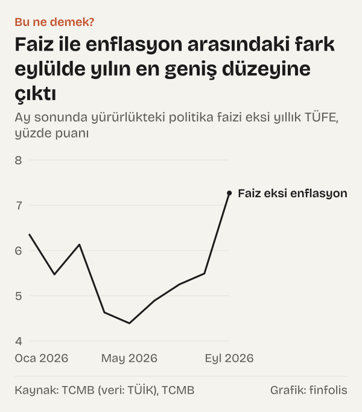
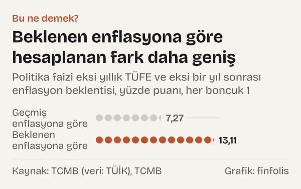

Türkiye Cumhuriyet Merkez Bankası (TCMB) politika faizini 23 Ocak 2026'dan bu yana %37'de tutuyor. Aynı dönemde yıllık enflasyon önce yükseldi, sonra geriledi: Eylül 2026'da yıllık tüketici enflasyonu %29,73 oldu ve politika faizi ile enflasyon arasındaki fark 7,27 puana çıktı. Ocak 2026'da bu fark 6,35 puandı, Mayıs 2026'da 4,39 puana kadar daralmıştı.

Faiz oranı aynı kaldı, ama enflasyona göre düzeyi her ay değişti. Bu yazı o değişimi ay ay ve 2010'dan bu yana yıl sonlarıyla birlikte gösteriyor.

## Politika faizi ne zamandan beri %37?

Para Politikası Kurulu'nun duyurusunda politika faizi, bir hafta vadeli repo ihale faiz oranı olarak geçiyor.

TCMB'nin bir hafta vadeli repo tablosuna göre oran 12 Aralık 2025'ten itibaren %38'di; 23 Ocak 2026'da 1 puan düşürülerek %37'ye çekildi. O tarihten bu yana değişmedi. Para Politikası Kurulu'nun 10 Eylül 2026 tarihli duyurusunda da bir hafta vadeli repo ihale faiz oranı %37'de sabit tutuldu; gecelik vadede borç verme faizi %40'ta, borçlanma faizi %35,5'te bırakıldı.

Kurul aynı duyuruda yaklaşımını şöyle anlattı: “Fiyat istikrarı sağlanana kadar sürdürülecek sıkı para politikası duruşu talep, kur ve beklenti kanalları üzerinden dezenflasyon sürecini güçlendirecektir.”

## Fark nasıl hesaplandı?

Bu yazıda faizin enflasyona göre düzeyi için en sade hesap kullanıldı: politika faizinden yıllık TÜFE (tüketici fiyat endeksindeki yıllık değişim) çıkarılır, sonuç puan olarak okunur.

Aynı çıkarma bir de TCMB'nin Piyasa Katılımcıları Anketi'ndeki bir yıl sonrası enflasyon beklentisiyle yapıldı. Böylece yazıda iki fark yan yana duruyor: Eylül 2026 yıllık TÜFE'sine göre fark ve Ekim 2026 anketindeki beklentiye göre fark.

## 2026'da fark ay ay nasıl değişti?

Politika faizi 23 Ocak 2026'dan bu yana %37'de kaldığı için Şubat 2026'dan itibaren farkı belirleyen tek şey yıllık enflasyon oldu. Ocak 2026 satırında ay sonunda yürürlükteki %37 kullanıldı; oran 23 Ocak 2026'ya kadar %38'di. Yıllık TÜFE Ocak 2026'da %30,65'ti; Mayıs 2026'da %32,61'e yükseldi, ardından dört ay üst üste geriledi ve Eylül 2026'da %29,73'e indi.

| Ay | Politika faizi | Yıllık TÜFE | Fark (puan) |
|---|---|---|---|
| Ocak 2026 | %37 | %30,65 | 6,35 |
| Şubat 2026 | %37 | %31,53 | 5,47 |
| Mart 2026 | %37 | %30,87 | 6,13 |
| Nisan 2026 | %37 | %32,37 | 4,63 |
| Mayıs 2026 | %37 | %32,61 | 4,39 |
| Haziran 2026 | %37 | %32,11 | 4,89 |
| Temmuz 2026 | %37 | %31,75 | 5,25 |
| Ağustos 2026 | %37 | %31,51 | 5,49 |
| Eylül 2026 | %37 | %29,73 | 7,27 |

*Ay sonunda yürürlükteki politika faizi ve yıllık TÜFE yüzde, fark puan. Kaynak: TCMB, TÜİK.*

*Ay sonunda yürürlükteki politika faizi eksi yıllık TÜFE, yüzde puanı. Kaynak: TCMB (veri: TÜİK), TCMB.*

Enflasyonun yükseldiği aylarda fark daraldı, gerilediği aylarda açıldı. Mayıs 2026'dan Eylül 2026'ya yıllık enflasyon 2,88 puan düştü ve fark 4,39 puandan 7,27 puana çıktı. Ocak 2026 ile Eylül 2026 karşılaştırıldığında ise yıllık enflasyondaki düşüş 0,92 puanda kalıyor.

## Bir yıl önceyle karşılaştırınca

Eylül 2025 sonunda politika faizi %40,5, yıllık TÜFE %33,29'du; aradaki fark 7,21 puandı. Eylül 2026'da faiz daha düşük, %37. Ama yıllık enflasyon da Eylül 2025'e göre 3,56 puan gerilediği için fark 7,27 puan oldu.

İki eylülün farkları birbirine yakın olsa da aradaki yol düz değildi: fark Aralık 2025'te 7,11 puan, Mayıs 2026'da 4,39 puan oldu.

## 2010'dan bu yana yıl sonlarında fark

Aynı hesabı her yılın Aralık ayı için, yıl sonunda yürürlükte olan bir hafta vadeli repo oranıyla yapınca uzun bir tablo çıkıyor. Aralık 2010–Aralık 2025 arasındaki on altı yıl sonunun çoğunda fark eksi tarafta ya da sıfıra yakındı.

| Yıl sonu | Politika faizi | Yıllık TÜFE | Fark (puan) |
|---|---|---|---|
| Aralık 2010 | %6,5 | %6,4 | 0,1 |
| Aralık 2011 | %5,75 | %10,45 | -4,7 |
| Aralık 2012 | %5,5 | %6,16 | -0,66 |
| Aralık 2013 | %4,5 | %7,4 | -2,9 |
| Aralık 2014 | %8,25 | %8,17 | 0,08 |
| Aralık 2015 | %7,5 | %8,81 | -1,31 |
| Aralık 2016 | %8 | %8,53 | -0,53 |
| Aralık 2017 | %8 | %11,92 | -3,92 |
| Aralık 2018 | %24 | %20,3 | 3,7 |
| Aralık 2019 | %12 | %11,84 | 0,16 |
| Aralık 2020 | %17 | %14,6 | 2,4 |
| Aralık 2021 | %14 | %36,08 | -22,08 |
| Aralık 2022 | %9 | %64,27 | -55,27 |
| Aralık 2023 | %42,5 | %64,77 | -22,27 |
| Aralık 2024 | %47,5 | %44,38 | 3,12 |
| Aralık 2025 | %38 | %30,89 | 7,11 |

*Yıl sonunda yürürlükteki bir hafta vadeli repo oranı ve Aralık ayı yıllık TÜFE, yüzde; fark puan. Kaynak: TCMB, TÜİK.*

*Yıl sonunda yürürlükteki politika faizi eksi aralık ayı yıllık TÜFE, yüzde puanı; son nokta eylül. Kaynak: TCMB (veri: TÜİK), TCMB.*

Tablodaki en derin eksi değerler Aralık 2021, Aralık 2022 ve Aralık 2023'te: fark sırasıyla -22,08, -55,27 ve -22,27 puan. Aralık 2024'te fark yeniden artıya geçti, 3,12 puan oldu. Aralık 2025'te 7,11 puandı. Eylül 2026'daki 7,27 puan, bu tablodaki on altı yıl sonunun hepsinden yüksek.

## Beklenen enflasyona göre bakınca

TCMB'nin Ekim 2026 Piyasa Katılımcıları Anketi'ne göre katılımcıların bir yıl sonrası için yıllık TÜFE beklentisi %23,89; bir önceki, Eylül 2026 anketinde bu beklenti %23,7'ydi. Aynı ankette yıl sonu TÜFE beklentisi %29,63.

Politika faizini bu bir yıl sonrası beklentisiyle karşılaştırınca fark 13,11 puan çıkıyor. Geçmiş enflasyona göre hesaplanan fark ise Eylül 2026'da 7,27 puan. Aynı faiz, hangi enflasyonla karşılaştırıldığına göre iki ayrı fark veriyor.

*Politika faizi eksi yıllık TÜFE ve eksi bir yıl sonrası enflasyon beklentisi, yüzde puanı. Kaynak: TCMB (veri: TÜİK), TCMB.*

## Bu ne demek?

Rakam olarak politika faizi aylardır aynı. Ama bu oranın yıllık enflasyonun ne kadar üstünde durduğu, enflasyon verisi her açıklandığında yeniden belirleniyor. Enflasyon düştükçe aynı faiz, enflasyonun üstünde daha geniş bir pay bırakıyor; enflasyon yükseldiğinde bu pay daralıyor.

Bu yazıdaki fark yalnız politika faizi ile yıllık TÜFE arasındaki mesafedir. Okurun kendi mevduat getirisini ya da kredi maliyetini ölçmez; onlar için ayrı bir hesap gerekir. Ölçtüğü şey, politika faizinin fiyat artışlarının ne kadar üstünde ya da altında durduğudur.

İki hesap arasındaki ayrım da önemli. Yıllık TÜFE'ye göre fark, açıklanmış enflasyon verisine dayanır. Beklenen enflasyona göre fark ise piyasa katılımcılarının tahminine dayanır ve tahmin değiştikçe o da değişir. Kurul kendi değerlendirmesinde sıkı duruşun talep, kur ve beklenti kanalları üzerinden dezenflasyonu güçlendireceğini söylüyor; bu yazıdaki rakamlar ise yalnız faiz ile enflasyon arasındaki mesafeyi gösteriyor.

## Kaynaklar

- [TCMB: Bir hafta vadeli repo faiz oranları](https://www.tcmb.gov.tr/wps/wcm/connect/TR/TCMB+TR/Main+Menu/Temel+Faaliyetler/Para+Politikasi/Merkez+Bankasi+Faiz+Oranlari/1+Hafta+Repo)
- [TCMB: Faiz oranlarına ilişkin basın duyurusu, 10 Eylül 2026](https://www.tcmb.gov.tr/wps/wcm/connect/TR/TCMB+TR/Main+Menu/Duyurular/Basin/2026/DUY2026-38)
- [TCMB: Tüketici fiyatları (veri: TÜİK)](https://www.tcmb.gov.tr/wps/wcm/connect/TR/TCMB+TR/Main+Menu/Istatistikler/Enflasyon+Verileri/Tuketici+Fiyatlari)
- [TCMB: Piyasa Katılımcıları Anketi, Ekim 2026](https://www.tcmb.gov.tr/wps/wcm/connect/085d78c0-9809-4b33-a6b6-21e0a22a6405/PKA_Rapor.pdf?MOD=AJPERES)
