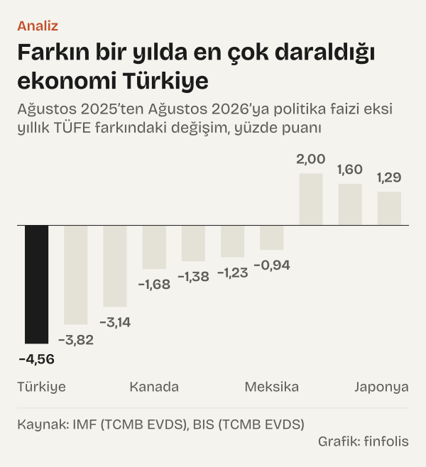
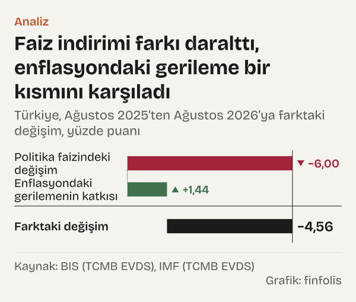
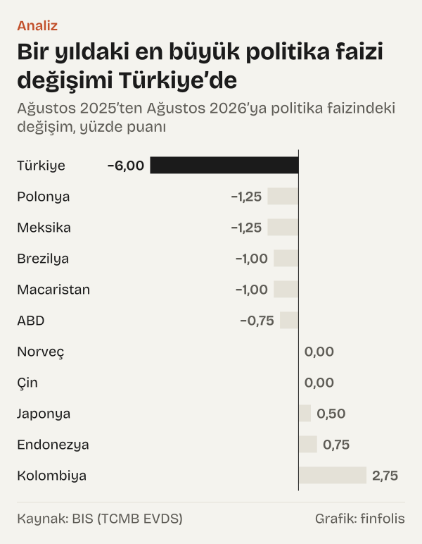

Ağustos 2026 için on dokuz ekonominin politika faizinden yıllık enflasyonunu çıkarıp büyükten küçüğe dizdiğimizde üçüncü satırda Türkiye çıkıyor: politika faizi %37, yıllık tüketici enflasyonu %31,51, aradaki fark 5,49 puan. Üstte Brezilya ve Kolombiya, hemen altta Macaristan var.

Bu farka çoğu zaman "reel politika faizi" denir. Kabaca şunu söyler: merkez bankasının belirlediği faiz, son bir yıldaki fiyat artışının ne kadar üstünde ya da altında. Fark artıdaysa faiz, geçmiş on iki ayın enflasyonunu aşıyor demektir; eksideyse geride kalıyor demektir. Ölçü geçmişe dönüktür, gelecekteki fiyat artışı hakkında bir şey söylemez.

Sitede daha önce Türkiye kendi geçmişiyle karşılaştırılmıştı. Bu yazıda soru başka: aynı ayda, aynı kaynaktan, aynı tanımla bakıldığında Türkiye başka ekonomilerin arasında nerede duruyor? Sıralamanın ilginç bir yanı var. Listede hem en yüksek politika faizi hem en yüksek enflasyon Türkiye'de. İki büyük sayının farkı ise üçüncü sıraya düşüyor. Bir yıl önce aynı hesapta Türkiye birinci sıradaydı.

Okur için anlamı şu: Türkiye'deki faiz düzeyi tek başına bakıldığında başka örneklerin çok üstünde görünür. Enflasyon da o kadar yüksek olduğu için fark, Latin Amerika'daki iki ekonominin gerisinde kalıyor. Yüzde olarak bakıldığında ise tablo bir kez daha değişiyor.

## Listenin üst ve alt ucu

Sıralamadaki on dokuz ekonominin hepsinde iki veri aynı kaynaktan geliyor. Politika faizi Uluslararası Ödemeler Bankası'nın (BIS) aylık serisinden, yıllık enflasyon Uluslararası Para Fonu'nun (IMF) tüketici fiyat endeksi veri setinden alındı. İkisi de Türkiye Cumhuriyet Merkez Bankası'nın (TCMB) Elektronik Veri Dağıtım Sistemi'nde (EVDS) yayımlanıyor.

*Politika faizi eksi yıllık TÜFE, yüzde puanı. Kaynak: IMF (TCMB EVDS), BIS (TCMB EVDS).*

Listenin başında Brezilya açık farkla duruyor: politika faizi %14, yıllık enflasyon %4,22, fark 9,78 puan. Kolombiya'da faiz %12, enflasyon %6,24, fark 5,76 puan. Türkiye'nin 5,49 puanlık farkı Kolombiya'nın 0,27 puan gerisinde. Dördüncü sıradaki Macaristan'da fark 4,22 puan, beşinci sıradaki Meksika'da 3,24 puan.

Alt uçta fark eksiye dönüyor. Japonya'da politika faizi %1, enflasyon %1,96; fark eksi 0,96 puan. Kanada'da fark eksi 0,78 puan, Danimarka'da eksi 0,2 puan. En altta eksi 1,53 puan ile Tayland var. Bu dört ekonomide politika faizi son bir yıldaki fiyat artışının altında kalıyor.

Ortadaki ekonomilerde fark sıfıra yakın. ABD için BIS'in kaydettiği %3,63'lük oran (hedef bandın orta noktası), %3,4'lük enflasyonun yalnız 0,23 puan üstünde. Peru'da fark 0,19 puan, Şili'de 0,37 puan, Polonya'da 0,54 puan.

Gelişmiş ve gelişmekte olan ekonomiler sıralamada belirgin biçimde ayrışıyor. IMF'nin gelişmiş ekonomiler grubundaki sekiz ülkeden (ABD, Japonya, Kanada, İsveç, Norveç, İzlanda, Danimarka, Çekya) hiçbiri ilk altıya girmiyor. Bu sekiz ülke arasında en geniş fark 2,4 puan ile İzlanda'da. Beşinde fark artı ya da eksi bir puanın içinde kalıyor: ABD, Norveç, Danimarka, Kanada ve Japonya. İlk altının tamamı gelişmekte olan ekonomi.

Asya'daki üç ekonomi listenin farklı yerlerine dağılıyor. Endonezya 2,56 puan ile altıncı sırada. Çin'de enflasyon %0,8 ile listenin en düşüklerinden; %3'lük faizle fark 2,2 puan. Tayland ise en altta.

## Aynı fark, çok farklı düzeyler

Türkiye ile Kolombiya'nın farkı birbirine yakın: 5,49 ve 5,76 puan. Bu iki sayının arkasındaki düzeyler ise çok farklı. Kolombiya'da %12'lik faiz %6,24'lük enflasyonla karşılaşıyor. Türkiye'de %37'lik faiz %31,51'lik enflasyonla karşılaşıyor.

*Ağustos 2026 politika faizi eksi yıllık TÜFE ve bir yıllık değişimi, yüzde puanı. Kaynak: IMF (TCMB EVDS), BIS (TCMB EVDS).*

Ayrımın önemi şurada: aynı puan farkı, düşük enflasyonlu bir ekonomide fiyat artışının neredeyse kendisi kadar bir mesafe demektir, yüksek enflasyonlu bir ekonomide ise küçük bir pay. Kolombiya'da politika faizi yıllık enflasyonu %92,26 aşıyor. Türkiye'de bu aşım %17,43. Puan farkı iki ülkeyi yan yana gösterirken yüzde ölçüsü onları birbirinden uzaklaştırıyor.

Enflasyonun düzeyine bakınca Türkiye ile ikinci sıradaki ekonomi arasındaki mesafe de büyük. Türkiye'deki %31,51'lik yıllık enflasyon, listedeki en yüksek ikinci değer olan Kolombiya'nın %6,24'ünden 25,27 puan yüksek. Politika faizinde de durum benzer: Türkiye'nin %37'si, ikinci sıradaki Brezilya'nın %14'ünden 23 puan yüksek.

Dolayısıyla iki ayrı soru var. Birincisi, faiz enflasyonun kaç puan üstünde? Bu soruda Türkiye üst sıralarda. İkincisi, iki sayı mutlak olarak ne kadar büyük? Bu soruda Türkiye listenin başında. Sıralamayı okurken hangisinin sorulduğunu ayırmak gerekiyor.

## Bir yılda sıra nasıl değişti

Ağustos 2025'te aynı hesabı yaptığımızda tablo başkaydı. Türkiye'de politika faizi %43, yıllık enflasyon %32,95'ti; fark 10,05 puan ile on dokuz ekonominin en genişiydi. Brezilya 9,87 puan ile ikinci sıradaydı.

*Ağustos 2025’ten Ağustos 2026’ya politika faizi eksi yıllık TÜFE farkındaki değişim, yüzde puanı. Kaynak: IMF (TCMB EVDS), BIS (TCMB EVDS).*

Bir yıl içinde Brezilya'nın farkı neredeyse yerinde kaldı: 9,87 puandan 9,78 puana, yalnız 0,09 puan geriledi. Türkiye'nin farkı ise 4,56 puan daraldı ve 5,49 puana indi. Bu, listedeki on dokuz ekonominin en büyük daralması. Tayland'da fark 3,82 puan daraldı, Peru'da 3,14 puan daraldı.

Farkın genişlediği ekonomiler de var. Macaristan'da fark 2 puan genişleyip 2,22 puandan 4,22 puana çıktı. Kolombiya'da 1,6 puan, Japonya'da 1,29 puan genişledi. Japonya'da fark hâlâ eksi, ama bir yıl önceki eksi 2,25 puana göre sıfıra daha yakın.

Kolombiya ile Macaristan'daki genişlemeler farklı yollardan geldi. Kolombiya'da politika faizi bir yılda 2,75 puan artarak %9,25'ten %12'ye çıktı; listedeki en büyük artış bu. Macaristan'da faiz 1 puan indi, ama yıllık enflasyon %4,28'den %1,28'e gerilediği için fark yine de açıldı.

Peru örneği de enflasyon tarafının gücünü gösteriyor. Orada politika faizi yalnız 0,25 puan indi. Fark yine de 3,14 puan daraldı; bunun büyük kısmı yıllık enflasyonun %1,18'den %4,06'ya yükselmesinden geliyor.

## Türkiye'deki daralmanın iki parçası

Türkiye'deki 4,56 puanlık daralmayı iki parçaya ayırmak mümkün, çünkü fark iki sayının çıkarılmasından oluşuyor. Bir yanda politika faizi var: Ağustos 2025'teki %43'ten Ağustos 2026'daki %37'ye 6 puan indi. Öbür yanda enflasyon var: %32,95'ten %31,51'e 1,44 puan geriledi.

*Türkiye, Ağustos 2025’ten Ağustos 2026’ya farktaki değişim, yüzde puanı. Kaynak: BIS (TCMB EVDS), IMF (TCMB EVDS).*

Faizdeki indirim farkı 6 puan daraltıyor. Enflasyondaki gerileme ise farkı 1,44 puan genişletiyor, çünkü çıkarılan sayı küçülüyor. İkisi birlikte 4,56 puanlık net daralmayı veriyor. Kısacası farkın daralma yönünü faizdeki değişim belirliyor; enflasyondaki gerileme bu daralmanın bir kısmını karşılıyor.

Aynı ayrıştırma, Türkiye'nin bir yıllık faiz değişimini başka ekonomilerin yanına da koyuyor. Türkiye'deki 6 puanlık indirim, on dokuz ekonominin en büyük faiz değişimi. Brezilya ve Macaristan'da faiz 1 puan, Polonya ve Meksika'da 1,25 puan indi. Kolombiya, Endonezya, Japonya, İzlanda, Çekya ve Danimarka'da faiz arttı; Norveç ve Çin'de değişmedi.

*Ağustos 2025’ten Ağustos 2026’ya politika faizindeki değişim, yüzde puanı. Kaynak: BIS (TCMB EVDS).*

Bu yazı faiz kararlarının gerekçesini ya da etkisini tartışmıyor. Her merkez bankası kararını kendi belgesinde açıklıyor. Burada yalnız iki resmî serinin aynı aydaki farkı ve bu farkın bir yılda nasıl değiştiği var.

## Yüzde ölçüsüyle başka bir sıra

Puan farkı tek ölçü değil. Aynı iki veriyle başka bir soru da sorulabilir: politika faizi yıllık enflasyonu yüzde olarak ne kadar aşıyor? Bu ölçüye göre sıralama baştan aşağı değişiyor.

*Ağustos 2026, politika faizinin yıllık TÜFE’yi aştığı oran, yüzde. Kaynak: IMF (TCMB EVDS), BIS (TCMB EVDS).*

İlk sırada İsveç var. Politika faizi %1,75, enflasyon %0,31; faiz enflasyonu %473,22 aşıyor. Macaristan %328,82 ile ikinci, Çin %274,99 ile üçüncü, Brezilya %231,48 ile dördüncü sırada. Türkiye %17,43 ile on birinci sıraya iniyor ve %16,74'lük Polonya'nın hemen önünde duruyor.

İlk bakışta tuhaf görünen bu sonuç ölçünün kendisinden geliyor. Enflasyon sıfıra yaklaştıkça yüzde aşım çok büyüyor: İsveç'te puan farkı yalnız 1,44 puan iken aşım %473,22'ye çıkıyor. Enflasyon eksiye düşerse ölçü anlamını tamamen yitiriyor. Bu yüzden karşılaştırmalarda genellikle puan farkı kullanılıyor.

Yine de yüzde ölçüsü bir şeyi hatırlatıyor: aynı puan farkı, enflasyonun çok yüksek olduğu bir ekonomide düşük enflasyonlu bir ekonomideki farkla aynı anlamı taşımayabilir. İki ölçü birlikte okunduğunda Türkiye için tablo şöyle: puan farkında üst sıralarda, yüzde aşımda ortada.

## Çıkarmanın gösteremedikleri

Hesabın birkaç sınırı var ve sıralamayı okurken akılda tutmak gerekiyor.

İlki tanımla ilgili. Buradaki fark, politika faizinden son on iki ayın enflasyonunun çıkarılmasıyla bulunuyor. Buna geçmişe dönük reel faiz denir. Faizin gelecek on iki aydaki enflasyona göre nerede olacağını göstermez; bunun için beklenen enflasyon gerekir ve beklenti anketleri ülkeden ülkeye farklı yöntemle yapılıyor. Türkiye için beklentiye göre hesaplanan fark sitedeki önceki yazıda ayrıca ele alındı.

İkincisi basit çıkarmanın kendisi. Enflasyon düşükken faizden enflasyonu çıkarmak iyi bir yaklaşıktır. Enflasyon yüksekken daha doğru hesap, iki oranın birbirine bölünmesiyle yapılır ve yüksek enflasyonlu ekonomide farkı biraz daha küçük gösterir. Türkiye'nin sırasını değiştirecek büyüklükte olup olmadığını bu yazıda hesaplamadık; yalnız yön olarak bilinmesi gerekiyor.

Üçüncüsü veri derlemesiyle ilgili. IMF'nin tüketici fiyat endeksi veri seti, ülkelerin kendi istatistik kurumlarının endekslerini topluyor. Türkiye için IMF serisinden hesaplanan Ağustos 2026 yıllık enflasyonu %31,51; Türkiye İstatistik Kurumu'nun (TÜİK) kendi genel endeksinden aynı yolla hesaplanan oran %31,5. İki oran arasındaki 0,01 puanlık fark sıralamayı etkilemiyor.

Dördüncüsü hangi ayın alındığı. Ağustos 2026, iki serinin de aynı kaynakta en çok ülke için bulunduğu en son ay. Euro Bölgesi, Birleşik Krallık, İsviçre, Güney Kore, Hindistan ve Güney Afrika bu yüzden listede yok: bu ekonomilerin ya politika faizi ya da enflasyonu Ağustos 2026 için aynı kaynakta henüz bulunmuyordu. Bir ekonomiyi başka bir ayın verisiyle listeye eklemek, karşılaştırmayı bozardı.

Son olarak politika faizinin ne olduğu ülkeden ülkeye değişiyor. Kimi merkez bankası tek bir oran açıklıyor, kimi bir bant. ABD için BIS bandın orta noktasını kaydediyor. Türkiye'de oran TCMB'nin bir hafta vadeli repo ihale faizi. Piyasada fiilen oluşan faizler politika faizinden farklı olabilir; bu yazı yalnız BIS'in kaydettiği politika faizine bakıyor.

## Nasıl hesapladık

Politika faizini BIS'in aylık merkez bankası politika faizi serisinden, yıllık enflasyonu IMF'nin tüketici fiyat endeksi serisinden aldık. İki seri de TCMB'nin EVDS sisteminde yayımlanıyor ve her rakam EVDS'den makine sorgusuyla çekildi. Yıllık enflasyon, EVDS'nin yıllık yüzde değişim formülüyle aynı ayın bir önceki yıla göre endeks değişimidir. Her ekonomi için Ağustos 2025 ve Ağustos 2026'da politika faizinden yıllık enflasyonu çıkardık ve sonucu yüzde puanı olarak yazdık. Bir yıllık değişim, iki ayın farkları arasındaki farktır. Yüzde aşım ölçüsünde politika faizinin yıllık enflasyondan yüzde kaç yüksek olduğunu hesapladık. Listeye yalnız iki serinin de iki ay için aynı kaynakta bulunduğu ekonomileri aldık. Türkiye için IMF serisini TÜİK'in kendi endeksinden hesaplanan oranla karşılaştırdık; sıralamada IMF serisini kullandık ki bütün ülkeler aynı kaynaktan gelsin.

## Kaynaklar

- [BIS (TCMB EVDS): Türkiye merkez bankası politika faiz oranı, aylık](https://evds3.tcmb.gov.tr/igmevdsms-dis/series=TP.BISPOLFAIZ.TUR)
- [BIS (TCMB EVDS): Brezilya merkez bankası politika faiz oranı, aylık](https://evds3.tcmb.gov.tr/igmevdsms-dis/series=TP.BISPOLFAIZ.BRA)
- [BIS (TCMB EVDS): Kolombiya merkez bankası politika faiz oranı, aylık](https://evds3.tcmb.gov.tr/igmevdsms-dis/series=TP.BISPOLFAIZ.COL)
- [BIS (TCMB EVDS): ABD merkez bankası politika faiz oranı, aylık](https://evds3.tcmb.gov.tr/igmevdsms-dis/series=TP.BISPOLFAIZ.USA)
- [IMF (TCMB EVDS): Türkiye tüketici fiyat endeksi](https://evds3.tcmb.gov.tr/igmevdsms-dis/series=TP.IMFCPIND.TUR)
- [IMF (TCMB EVDS): Brezilya tüketici fiyat endeksi](https://evds3.tcmb.gov.tr/igmevdsms-dis/series=TP.IMFCPIND.BRA)
- [IMF (TCMB EVDS): Kolombiya tüketici fiyat endeksi](https://evds3.tcmb.gov.tr/igmevdsms-dis/series=TP.IMFCPIND.COL)
- [IMF (TCMB EVDS): İsveç tüketici fiyat endeksi](https://evds3.tcmb.gov.tr/igmevdsms-dis/series=TP.IMFCPIND.SWE)
- [TÜİK (TCMB EVDS): Tüketici fiyat endeksi, genel](https://evds3.tcmb.gov.tr/igmevdsms-dis/series=TP.TUKFIY2025.GENEL)
- Diğer on beş ekonominin serileri aynı biçimdeki EVDS kodlarıyla (TP.BISPOLFAIZ ve TP.IMFCPIND ile ülke kodu) kanıt dosyasında.
