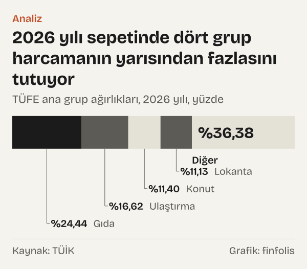
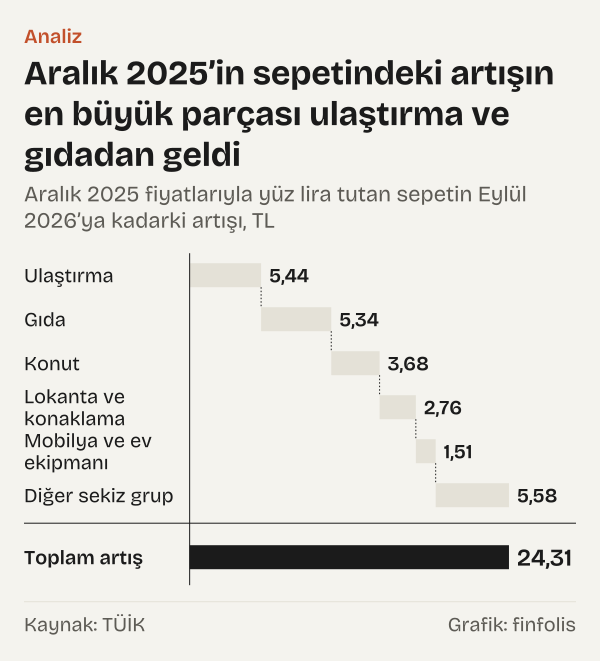

24,44. Türkiye İstatistik Kurumu'nun (TÜİK) tüketici fiyat endeksinde (TÜFE) gıda ve alkolsüz içecekler grubunun 2026 yılı ağırlığı bu. Ağırlık, bir grubun toplam tüketim harcaması içindeki payıdır ve bütün gruplar toplandığında yüz eder. Bu yüzden onu basit bir dille okumak mümkün: ülke genelinde harcanan her 100 liranın 24,44 lirası gıdaya gidiyor.

Rakamdan yola çıkarak üç soru sorduk. Birincisi: 2026'nın 100 liralık temsilî sepetinde geri kalan para nereye gidiyor? İkincisi: bu sepet, Aralık 2025'ten Eylül 2026'ya kadar ne kadar pahalandı ve pahalanmanın hangi kısmı hangi gruptan geldi? Üçüncüsü: sepetin bileşimi geçmişten bugüne nasıl değişti?

Cevaplar kısaca şöyle. Gıdadan sonra en büyük pay 16,62 lira ile ulaştırmada, 11,40 lira ile konutta ve 11,13 lira ile lokanta ve konaklamada. Aralık 2025'te 100 lira tutan sepet Eylül 2026'da 124,31 liraya çıktı. Uzun dönemde ise gıdanın payı küçülürken ulaştırmanın ve lokantaların payı büyüdü.

Okur için anlamı şu: TÜFE, ülke genelindeki toplam tüketim harcamasının dağılımına göre ağırlıklandırılır. Ağırlıkları bilmek, genel endeksin hangi harcama gruplarından oluştuğunu ve hangi grubun genel rakamı ne ölçüde taşıdığını görmeyi sağlar.

*TÜFE ana grup ağırlıkları, 2026 yılı, yüzde. Kaynak: TÜİK.*

## 2026'nın yüz lirası

TÜİK 2026'dan itibaren TÜFE'yi on üç ana harcama grubuyla yayımlıyor. Ağırlıklarına göre sıraladığımızda ilk dört grup sepetin yarısından fazlasını tutuyor: gıda ve alkolsüz içecekler 24,44 lira, ulaştırma 16,62 lira, konut (kira, su, elektrik, gaz ve diğer yakıtlar) 11,40 lira, lokantalar ve konaklama hizmetleri 11,13 lira. Bu dört grubun dışında kalan dokuz grup birlikte 36,38 lira ediyor.

Dokuz grubun içinde ağırlığı en yüksek olanlar mobilya ve ev ekipmanı (7,92 lira) ile giyim ve ayakkabı (7,90 lira). Eğlence, dinlence, spor ve kültür grubu 4,34 lira, kişisel bakım ve çeşitli mal ve hizmetler 4,49 lira tutuyor. En küçük paylar sigorta ve finansal hizmetlerde (1,07 lira), eğitim hizmetlerinde (2,02 lira), alkollü içecekler ve tütünde (2,75 lira) ve sağlıkta (2,79 lira).

Sağlık ve eğitim hizmetleri birlikte 4,81 lira tutuyor; bu, tek başına giyim ve ayakkabı grubunun 7,90 liralık ağırlığından az. Bu iki grubun sepetteki yeri, fiyat değişimlerinin genel endekse etkisinin de görece küçük kalacağı anlamına geliyor; aşağıdaki hesap bunu gösteriyor.

## Sepet dokuz ayda ne kadar pahalandı

TÜİK'in yöntem belgesine göre bir yılın ağırlık yapısı bir önceki yılın aralık ayında oluşturuluyor ve yıl içinde değişmiyor. Belgenin ifadesiyle ağırlık yapısı “2026 yılı boyunca sabit tutulmaktadır.” Bu, bir hesabı mümkün kılıyor: Aralık 2025 fiyatlarıyla 100 lira tutan sepeti, her grubun kendi fiyat endeksiyle Eylül 2026'ya taşıyabiliriz.

Hesabı yaptık. Genel endeksle taşındığında sepet Eylül 2026'da 124,31 lira tutuyor. Yani dokuz ayda aynı sepet için 24,31 lira fazla ödemek gerekiyor. Grupları tek tek taşıyıp topladığımızda sepet 124,28 lira tutuyor. Aradaki küçük fark yuvarlamadan geliyor: yayımlanan grup ağırlıklarının toplamı tam yüz değil, 99,97 lira. Grupların kendi artışlarını topladığımızda ise toplam artış yine 24,31 lira çıkıyor.

Artışın gruplara dağılımı şöyle. En büyük pay 5,44 lira ile ulaştırmadan geliyor. Gıda 5,34 lira, konut 3,68 lira, lokantalar ve konaklama 2,76 lira, mobilya ve ev ekipmanı 1,51 lira ekliyor. Geri kalan sekiz grubun toplam katkısı 5,58 lira.

*Aralık 2025 fiyatlarıyla yüz lira tutan sepetin Eylül 2026’ya kadarki artışı, TL. Kaynak: TÜİK.*

## Ağırlık büyük, artış küçük olabilir

Burada sepetin işleyişine dair önemli bir nokta saklı. Bir grubun artıştaki payı, yalnız ağırlığına değil, fiyatının ne kadar arttığına da bağlı.

Konut bunu iyi gösteriyor. 2026 yılı ağırlığı 11,40 lira, yani gıdanın yarısından az. Ama Aralık 2025'ten Eylül 2026'ya konut endeksi 115,00'ten 152,10'a yükseldi. Bu yüzden konutun 11,40 liralık payı Eylül 2026'da 15,08 liraya çıktı ve 3,68 liralık artış getirdi. Gıdanın 24,44 liralık payı ise 29,78 liraya çıktı; ağırlığı iki katından fazla olduğu halde artışa katkısı 5,34 lirada kaldı.

Giyim ise tersini gösteriyor. 7,90 liralık ağırlığıyla sepetin önemli bir kalemi, ama endeksi Aralık 2025'teki 108,73'ten Eylül 2026'da 112,06'ya çıktı. Bu yüzden giyimin payı yalnız 8,14 liraya yükseldi; artışa katkısı 0,24 lira. Eğitimde durum farklı: ağırlığı yalnız 2,02 lira, ama endeksi 118,79'dan 175,66'ya çıktığı için payı 2,99 liraya ulaştı ve artışa 0,97 lira ekledi.

Yani en büyük grubun sepeti en çok pahalandıracağı beklentisi her zaman tutmuyor. Sepette küçük yer tutan ama fiyatı hızlı artan bir grup, büyük ama yavaş artan bir grubun katkısına yaklaşabiliyor.

## Uzun iz: 2006–2025

Şimdi geçmişe dönelim. TÜİK'in eski sınıflamasındaki on iki grubun ağırlıklarını, ulaşabildiğimiz en eski aralık bülteni olan Aralık 2006 bülteninden ve Aralık 2025 bülteninden aldık. İki yıl da aynı sınıflamayla ölçüldüğü için karşılaştırılabilir.

En belirgin değişim gıdada ve ulaştırmada. 2006 yılında her 100 liranın 27,68 lirası gıda ve alkolsüz içeceklere gidiyordu; 2025'te bu pay 24,97 liraya indi, 2,71 liralık bir azalış. Ulaştırmanın payı aynı dönemde 10,48 liradan 15,34 liraya çıktı; 4,86 liralık bir artış. Bu iki hareket, sepetteki en büyük yer değiştirme.

Diğer gruplarda da yön belli. Ev eşyası 6,89 liradan 7,67 liraya, 0,78 lira yükseldi. Eğlence ve kültür 3,63 liradan 3,36 liraya, eğitim 2,41 liradan 2,31 liraya, çeşitli mal ve hizmetler 4,89 liradan 4,43 liraya indi; bu üç grubun değişimi yarım liranın altında kaldı. Lokanta ve oteller 6,74 liradan 8,32 liraya, sağlık 2,54 liradan 4,09 liraya yükseldi. Alkollü içecekler ve tütün 5,62 liradan 3,52 liraya, giyim 8,28 liradan 7,16 liraya, konut 16,29 liradan 15,22 liraya, haberleşme 4,55 liradan 3,62 liraya indi.

Değişimlerin nedenini ağırlık tablosu tek başına söylemiyor. Bir grubun payı, o gruptaki fiyatlar diğerlerinden hızlı arttığı için de, haneler o gruptan daha çok aldığı için de büyüyebilir. Ağırlıklar fiyatların ve miktarların birlikte değişmesinden çıkıyor; hangisinin ne kadar etkili olduğu bu tabloda görünmüyor.

*TÜFE ana grup ağırlığı, yüz liralık harcamanın lira karşılığı. Kaynak: TÜİK.*

## Son on yıl, yeni sınıflamayla

2026'da sınıflama değişti. TÜİK'in ağırlık tablosundaki nota göre “geriye dönük tüm hesaplamalar (ağırlıklar da dahil olmak üzere)” yeni sınıflamaya göre yeniden yapıldı. Bu sayede 2016 yılını ve 2026 yılını aynı gruplarla karşılaştırmak mümkün.

On yılda en çok büyüyen grup lokantalar ve konaklama hizmetleri oldu: ağırlığı 7,47 liradan 11,13 liraya, 3,66 lira arttı. Eğlence, dinlence, spor ve kültür 2,25 liradan 4,34 liraya, ulaştırma 14,62 liradan 16,62 liraya yükseldi. En çok küçülen grup konut oldu: 15,97 liradan 11,40 liraya, 4,57 liralık bir düşüş. Bilgi ve iletişim 5,77 liradan 3,10 liraya, alkollü içecekler ve tütün 4,98 liradan 2,75 liraya indi.

Bu değişimlerin büyük bir kısmı tek bir yılda, 2025 yılından 2026 yılına geçerken oldu. Konutun ağırlığı 2025'te 15,26 liraydı; 2026'da 3,86 lira azaldı. Lokanta ve konaklama 2,81 lira, eğlence ve kültür 2,21 lira arttı. Sigorta ve finansal hizmetler 0,26 liradan 1,07 liraya çıktı.

Lokanta ve konaklamanın ağırlığı bu on yılda düz bir çizgi izlemedi. 2017 yılında 8,05, 2020 yılında 8,67 liraydı. 2021 yılında 5,91 liraya indi, 2025 yılında 8,32 liraya döndü ve 2026 yılında 11,13 liraya çıktı. Seri, tek bir yönde ilerleyen bir eğilimden çok, yıldan yıla iniş çıkışlar gösteriyor.

*Yeni sınıflamada ağırlık, yüz liralık harcamanın lira karşılığı. Kaynak: TÜİK.*

## Temsilî sepeti okumak

Temsilî sepet ifadesini doğru okumak gerekiyor: bu sepet ülke genelindeki toplam tüketim harcamasının dağılımıdır, tek bir hanenin harcama listesi değildir.

İlk olarak, ağırlık bir ortalamanın parçasıdır. Lokanta ve konaklamanın 11,13 liralık payı, her hanenin harcamasının bu kadarını dışarıda yemeğe ayırdığı anlamına gelmez.

İkinci nokta kirayla ilgili. Konutun 11,40 liralık payı kira, fatura ve yakıtı birlikte kapsıyor. Kirada oturan bir hane için bu pay çok daha büyük, kendi evinde oturan biri için daha küçük olabilir. Ortalama, iki haneyi de tam anlatmaz.

Aynı mantık ulaştırma için de geçerli. Ulaştırmanın 16,62 liralık payı araç satın almayı, akaryakıtı ve toplu taşımayı birlikte içeriyor. Bir yıl içinde araç alan bir hane için bu grup bütçenin çok büyük bir kısmını tutabilir; aracı olmayan ve toplu taşıma kullanan bir hane içinse çok daha küçük kalır. Sepetteki her grup, böyle farklı hanelerin harcamalarının toplamından oluşuyor.

Üçüncü nokta, sepetin yıl içinde sabit olmasından geliyor. Ağırlıklar 2026 yılı boyunca değişmiyor; haneler pahalanan bir kalemden daha az alsa bile endeks aynı miktarları fiyatlamayı sürdürüyor. Bizim 124,31 liralık hesabımız da aynı varsayıma dayanıyor: Aralık 2025'in sepeti, Eylül 2026'da aynen satın alınsaydı ne tutardı?

## Sepeti ölçerken karşılaşılan sınırlar

Birincisi sınıflama. Eski on iki gruplu sınıflama ile yeni on üç gruplu sınıflama birebir örtüşmüyor; örneğin eski haberleşme grubu ile yeni bilgi ve iletişim grubu aynı kapsamda değil. Bu yüzden 2006–2025 karşılaştırmasını eski sınıflamayla, 2016–2026 karşılaştırmasını yeni sınıflamayla ayrı yaptık ve ikisini birbirine bağlamadık.

İkincisi yeniden hesaplama. 2016–2025 ağırlıkları TÜİK tarafından yeni sınıflamaya göre yeniden hesaplandı. Bu yeniden hesaplamanın ayrıntısını incelemedik; 2025 yılı ile 2026 yılı arasındaki ağırlık farklarını yalnız rakam olarak veriyoruz, nedenleri hakkında bir şey söylemiyoruz.

Üçüncüsü yuvarlama. Grupları tek tek taşıyarak bulduğumuz toplam ile genel endeksle bulduğumuz toplam arasında küçük bir fark var: 124,28 ve 124,31 lira. Fark, yayımlanan grup ağırlıklarının toplamının 99,97 lira olmasından, yani yuvarlamadan geliyor.

Dördüncüsü liraya çevirme. Ağırlıklar TÜİK'in tablolarında para birimiyle değil, toplamı yüze eşit yüzde paylar olarak yayımlanıyor. Onları yüz liralık bir sepetin liraları gibi okumak bizim anlatım tercihimiz; rakamların kendisi değişmiyor.

## Nasıl hesapladık

2016 yılı, 2025 yılı ve 2026 yılı ana grup ağırlıklarını ve 2025 yılı temelli TÜFE endekslerini Türkiye Cumhuriyet Merkez Bankası (TCMB) Elektronik Veri Dağıtım Sistemi'nden (EVDS) çektik. Eski sınıflamadaki 2006 yılı ve 2025 yılı ağırlıklarını TÜİK'in Aralık 2006 ve Aralık 2025 haber bültenlerinin tablolarından aldık. Ağırlıkları, toplamı yüz olduğu için 100 liralık harcamanın lira karşılığı olarak okuduk. Sepeti fiyatlamak için her grubun 2026 yılı ağırlığını, o grubun Eylül 2026 endeksinin Aralık 2025 endeksine oranıyla çarptık; artış bu tutar ile ağırlık arasındaki farktır. Bu yöntem, TÜİK'in yöntem belgesinde anlatılan aralık ayına güncellenmiş ve yıl boyunca sabit ağırlık yapısına dayanıyor.

## Kaynaklar

- [TÜİK: Tüketici Fiyatları Endeksi, Aralık 2006 haber bülteni, ana harcama grubu ağırlıkları](https://veriportali.tuik.gov.tr/tr/press/420)
- [TÜİK: Tüketici Fiyat Endeksi, Aralık 2025 haber bülteni, ana grup ağırlıkları tablosu](https://veriportali.tuik.gov.tr/tr/press/58294)
- [TÜİK: Tüketici Fiyat Endeksi, Ocak 2026 haber bülteni ve TÜFE metodoloji dokümanı](https://veriportali.tuik.gov.tr/tr/press/58293)
- [TCMB EVDS: TÜFE ana grup ağırlıkları (2025 yılı temelli), veri grubu bie_tukfiyagrlk, 2016–2026](https://evds3.tcmb.gov.tr/igmevdsms-dis/series=TP.TUKFIYAGRLK.GENEL)
- [TCMB EVDS: TÜFE genel endeks (2025 yılı temelli), Aralık 2025 ve Eylül 2026](https://evds3.tcmb.gov.tr/igmevdsms-dis/series=TP.TUKFIY2025.GENEL)
- [TCMB EVDS: TÜFE ana harcama grubu endeksleri (2025 yılı temelli), veri grubu bie_tukfiy2025](https://evds3.tcmb.gov.tr/igmevdsms-dis/series=TP.TUKFIY2025.07)
