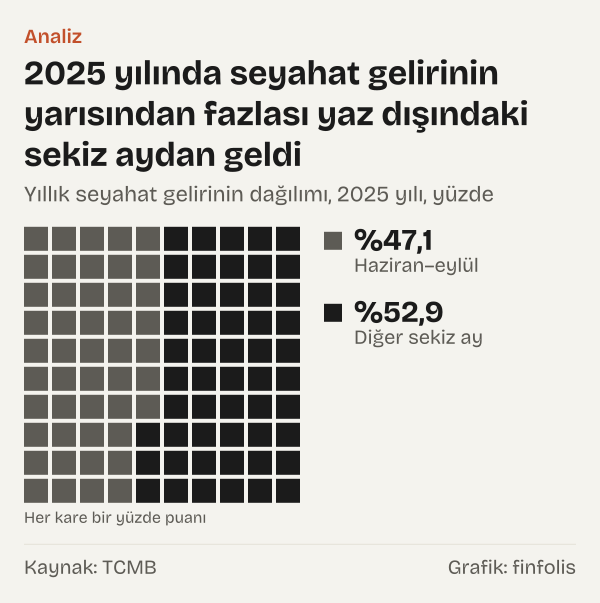
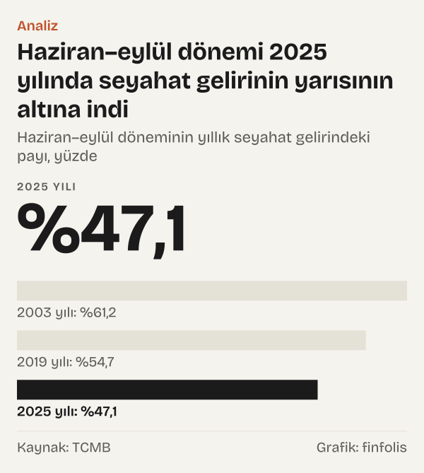

Tatil planı yapan herkes yaz ile kış arasındaki farkı bilir: ağustosta yer bulmak için aylar önce davranmak gerekir, şubatta aynı yerlerde boş oda sorun değildir. Bu gündelik deneyimin ödemeler dengesinde de bir karşılığı var. Türkiye Cumhuriyet Merkez Bankası (TCMB), ülkeye gelen ziyaretçilerin harcamalarını her ay "seyahat geliri" olarak kaydediyor. Bu kaydı ay ay açtığımızda, yaz ile kışın farkının yirmi iki yılda belirgin biçimde daraldığı görülüyor.

2003 yılında haziran, temmuz, ağustos ve eylül ayları yıllık seyahat gelirinin %61,2'sini oluşturuyordu. 2025 yılında bu dört ayın payı %47,1'e indi. Yani 2025 yılında seyahat gelirinin yarısından fazlası, %52,9'u, yaz dışındaki sekiz aydan geldi. En kalabalık ay hâlâ ağustos, ama ağustosun yıllık gelirdeki payı %21,8'den %13,9'a geriledi.

Okur için anlamı şu: turizmin ekonomideki ağırlığı yalnız yıllık toplamla ölçülmüyor. Gelirin hangi aylara düştüğü, otelden lokantaya, ulaşımdan küçük esnafa kadar bu harcamaya bağlı işlerin yılın kaç ayında çalıştığını da belirliyor. Bu yazıda seyahat gelirini ve ülkeden çıkış yapan ziyaretçi sayısını dört yıl üzerinden izledik: 2003 yılı, 2010 yılı, 2019 yılı ve 2025 yılı.

## Seyahat geliri neyi sayar

Ödemeler dengesinde seyahat geliri, Türkiye'de yerleşik olmayan kişilerin ülkede yaptığı harcamaların toplamıdır: konaklama, yeme içme, yurt içi ulaşım, alışveriş. Ziyaretçi sayısı Türkiye İstatistik Kurumu'nun (TÜİK) turizm istatistiklerinden gelir ve ülkeden çıkış anında sayılır. Seyahat geliri de çıkış yapan ziyaretçilere dayanarak ölçüldüğü için, ağustosta gelip eylülde dönen bir ziyaretçinin harcaması büyük ölçüde eylül ayının rakamına girer.

Rakamlar ABD doları cinsinden ve cari fiyatlarla. Yıllık seyahat geliri 2003 yılında 13.298 milyon dolardı, 2025 yılında 59.995 milyon dolara ulaştı; artış %351,2. Ziyaretçi sayısı aynı dönemde 16.302.053 kişiden 63.917.056 kişiye çıktı. Bu büyümenin içinde mevsim dağılımının nasıl değiştiğine bakmak için her ayın gelirini o yılın toplamına böldük.

![Küçük çoklu grafik: Ağustosun tepesi 2003 yılından 2025 yılına alçaldı, kış ayları yükseldi: 2003 yılı: Oca: %2,85, Şub: %3,15, Mar: %3,07, Nis: %3,35, May: %5,86, Haz: %7,92, Tem: %13,72, Ağu: %21,80, Eyl: %17,72, Eki: %11,04, Kas: %5,82, Ara: %3,71; 2010 yılı: Oca: %3,44, Şub: %3,37, Mar: %4,48, Nis: %5,00, May: %7,80, Haz: %9,35, Tem: %13,15, Ağu: %15,30, Eyl: %12,63, Eki: %13,19, Kas: %7,26, Ara: %5,03; 2019 yılı: Oca: %3,89, Şub: %3,32, Mar: %4,09, Nis: %5,45, May: %7,19, Haz: %9,14, Tem: %14,17, Ağu: %17,17, Eyl: %14,23, Eki: %11,17, Kas: %5,78, Ara: %4,43; 2025 yılı: Oca: %5,42, Şub: %4,49, Mar: %4,74, Nis: %6,53, May: %8,52, Haz: %9,92, Tem: %11,68, Ağu: %13,94, Eyl: %11,60, Eki: %11,25, Kas: %6,68, Ara: %5,24.](./graf-1.svg)
*Her ayın yıllık seyahat gelirindeki payı, yüzde. Kaynak: TCMB.*

## 2003 yılı: dört ayın taşıdığı yıl

Yolculuğa 2003 yılından başlıyoruz. O yıl ağustos ayının seyahat geliri 2.899 milyon dolardı, şubatın 419 milyon dolar. Ağustos, şubatın 6,9 katı gelir getirdi. Ağustos tek başına yıllık gelirin %21,8'ini, eylül %17,7'sini, temmuz %13,7'sini oluşturuyordu. Ocak ayının payı %2,9, şubatın %3,2'ydi.

Ziyaretçi sayısında mevsimsellik biraz daha hafifti. Haziran–eylül dönemi 2003 yılında ziyaretçilerin %55,3'ünü, gelirin ise %61,2'sini kapsıyordu. Ağustosta 3.063.383 ziyaretçi çıkış yaptı, şubatta 574.047; oran 5,3. Gelirin ziyaretçi sayısından daha mevsimsel olması, yaz aylarında gelen ziyaretçilerin kişi başına daha fazla harcama bıraktığıyla uyumlu. TCMB'nin verisinde 2003 yılında kişi başı ortalama harcama şubatta 731 dolar, ağustosta 946 dolardı.

## 2010 yılı: yazın payı yarıya indi

2010 yılında yıllık seyahat geliri 22.585 milyon dolara, ziyaretçi sayısı 33.027.945 kişiye ulaşmıştı. Toplam büyürken dağılım da değişti: haziran–eylül dönemi yıllık seyahat gelirinin %50,4'üne inmişti. Ağustos ayının payı %15,3'tü. Ağustosun şubata oranı 4,5'e düştü. Ziyaretçi tarafında yaz dört ayının payı %52,7 oldu, ağustosun şubata oranı 4,7.

O yıl gelir ziyaretçiden daha az mevsimsel göründü: dört yaz ayının gelirdeki payı, ziyaretçi sayısındaki payının altına indi. Yani yaz dışında gelen ziyaretçiler, sayılarına göre gelirde daha büyük bir pay bırakır hâle gelmişti.

## 2019 yılı: geri dönüş mü

Tablo düz bir çizgi değil. 2019 yılında yıllık seyahat geliri 38.753 milyon dolar, ziyaretçi sayısı 51.860.042 kişiydi. O yıl haziran–eylül payı yeniden %54,7'ye çıktı. Ağustosun yıllık gelirdeki payı %17,2'ye yükseldi, ağustosun şubata oranı 5,2 oldu. Ziyaretçi tarafında ise yaz dört ayının payı %51,8 ile 2010 yılında ölçülen %52,7'nin biraz altındaydı; ağustosun şubata oranı 4,2'ye geriledi.

Yani 2019 yılında ziyaretçilerin takvimi yayılmaya devam ederken gelirin takvimi yeniden yaza kaydı. 2003–2025 karşılaştırmasının iki ucuna bakıp "mevsimsellik sürekli azaldı" demek, aradaki bu dönüşü saklar. Elimizdeki dört yıl bir eğilim gösteriyor ama her yılın aynı yönde ilerlediğini göstermiyor.

*Aylık seyahat geliri, 2025 yılı, dolar. Kaynak: TCMB.*

## 2025 yılı: yılın geri kalanı ağırlık kazandı

2025 yılında tablo en dağınık hâline ulaştı. Haziran–eylül dönemi gelirin %47,1'ini, ziyaretçilerin %47,2'sini oluşturdu. İki oran neredeyse eşitlendi; 2003 yılında aralarında belirgin bir fark vardı, gelirin payı ziyaretçinin payından yüksekti. 2025 yılında yaz ziyaretçisi ile kış ziyaretçisi, sayılarıyla orantılı bir gelir bırakıyor. Ağustos ayının seyahat geliri 8.362 milyon dolar, şubatın 2.695 milyon dolardı; oran 3,1. Ziyaretçi sayısında ağustosta 8.912.005, şubatta 2.782.758 kişi çıkış yaptı; oran 3,2.

Yılın en dikkate değer ayrıntısı geçiş ayları. Ekim ayı yıllık gelirin %11,2'sini oluşturdu; eylülün %11,6'lık payıyla neredeyse aynı. 2003 yılında ekimin payı %11 idi, ama o yıl eylül %17,7 ile çok öndeydi. Ocak ayının payı %2,9'dan %5,4'e çıktı.

*Yıllık toplam içindeki pay, yüzde. Kaynak: TCMB, TÜİK (TCMB EVDS).*

Kişi başı harcama tarafında da mevsim farkı yok denecek kadar azaldı. 2025 yılında kişi başı ortalama harcama şubatta 968 dolar, ağustosta 938 dolardı. Bu iki rakama göre gelirdeki mevsimselliği, kişi başı harcamadan çok ziyaretçi sayısının mevsimselliği taşıyor.

2003 yılında durum farklıydı: ağustosta kişi başı harcama şubattakinden yüksekti, 946 dolara karşılık 731 dolar. Yani yirmi iki yıl önce yaz ziyaretçisi hem daha kalabalıktı hem de kişi başına daha fazla harcıyordu; 2025 yılında yalnız daha kalabalık. Bu değişim, ağustosun şubata oranının gelirde 6,9'dan 3,1'e, ziyaretçi sayısında 5,3'ten 3,2'ye inmesinin gelirde daha sert olmasıyla da uyumlu: gelirdeki mevsim farkının bir katmanı, kişi başı harcamadaki mevsim farkıydı ve o katman 2025 yılında neredeyse kalmadı.

*Yıllık seyahat gelirinin dağılımı, 2025 yılı, yüzde. Kaynak: TCMB.*

## Ay ay neler değişti

Payları tek tek aylara indirdiğimizde değişimin nereden geldiği daha açık görülüyor. 2003 yılı ile 2025 yılı arasında temmuz, ağustos ve eylül aylarının payı düştü; geri kalan dokuz ayın hepsinin payı yükseldi.

En büyük düşüş ağustosta: payı %21,8'den %13,9'a indi. Eylülün payı %17,7'den %11,6'ya, temmuzun payı %13,7'den %11,7'ye geriledi. Yükselişin en büyüğü baharda. Nisan ayının payı %3,3'ten %6,5'e, mayısın payı %5,9'dan %8,5'e çıktı. Haziran %7,9'dan %9,9'a yükseldi. Kış aylarında da artış var: aralığın payı %3,7'den %5,2'ye, şubatın %3,2'den %4,5'e, martın %3,1'den %4,7'ye çıktı.

Bu tablo, yaz sezonunun bir bütün olarak zayıfladığını değil, sezonun iki ucunun uzadığını düşündürüyor. Nisan, mayıs ve haziranın birlikte payı 2003 yılında yılın beşte birinin altındaydı; 2025 yılında dörtte birine yaklaştı. Ekim ise iki yılda da yaklaşık aynı payı korudu.

Ziyaretçi sayısında da benzer bir kayma var. 2003 yılında ağustos ayı yılın ziyaretçilerinin %18,8'ini, 2025 yılında %13,9'unu topladı. Nisanın ziyaretçi payı %3,9'dan %6,6'ya, mayısın %6,7'den %8,8'e çıktı. Gelirdeki kaymanın büyük bölümü, ziyaretçilerin kendisinin yıl içine daha geniş yayılmasıyla aynı yönde.

## Takvimi değiştirebilecek başka okumalar

Verinin başka türlü okunabileceği birkaç yer var. Birincisi, payların değişmesi yaz gelirinin azaldığı anlamına gelmiyor. Haziran–eylül döneminin geliri 2003 yılında 8.133 milyon dolardı, 2025 yılında 28.285 milyon dolar oldu. Yaz büyüdü; yılın geri kalanı daha hızlı büyüdü. Yaz dışındaki sekiz ayın geliri 2003 yılında 5.165 milyon dolardı, 2025 yılında 31.710 milyon dolar oldu: 6,1 kat. Haziran–eylül döneminin geliri ise aynı sürede 3,5 katına çıktı.

İkincisi, dört yılı seçerken uç yılları kullandık. 2020 yılı bu seride ayrı bir yıldır: pandemi döneminde Nisan 2020'de aylık seyahat geliri 0 milyon dolar olarak kaydedildi ve ay payları olağan bir yılın takvimini göstermez. Bu yüzden karşılaştırmaya almadık. Başka yıllar seçilseydi ara noktalar farklı görünebilirdi; 2010 yılı ile 2019 yılı arasındaki dönüş bunun bir örneği.

Üçüncüsü, ziyaretçi sayısı bir kişinin kaç gece kaldığını göstermez. Kışın gelen bir ziyaretçi kısa bir şehir gezisine, yazın gelen biri uzun bir tatile gelmiş olabilir. Gece sayısı ve konaklama süresi bu yazının verisinde yok. Bu yüzden kışın gelen ziyaretçi sayısının artması, kışın konaklanan gece sayısının da aynı ölçüde arttığı anlamına gelmeyebilir; bu sorunun yanıtı için konaklama istatistiklerine bakmak gerekir. Ayrıca seyahat geliri yalnız turistik tatili değil, iş seyahatini, eğitim ve sağlık amaçlı harcamaları da kapsar; bu amaçların yıl içindeki dağılımı tatil turizminden farklı olabilir.

## Ölçümün takvime etkisi

Ölçüm biçimi de takvimi etkiliyor. Harcama büyük ölçüde ziyaretçinin ülkeden çıktığı aya yazılıyor. Ay sonunda gelip bir sonraki ayda dönen ziyaretçiler, harcamayı geldikleri değil döndükleri aya taşıyor. Tarihi yıldan yıla kayan tatil dönemleri de bu yüzden aylar arasındaki payları oynatabilir.

Rakamların ABD doları cinsinden olması da bir sınır. Doların kendi değeri 2003–2025 arasında değişti; %351,2'lik nominal artışın bir kısmı fiyat artışıdır. Ama bu yazıdaki asıl ölçü, aynı yılın içindeki aylar arasındaki pay olduğu için bu etki paylara yansımıyor: bir yılın bütün ayları aynı dolarla ölçülüyor.

Son olarak en yeni veri Haziran 2026 ayına kadar uzanıyor. Ocak–Haziran 2026 döneminde seyahat geliri 24.037 milyon dolar oldu; Ocak–Haziran 2025 dönemindeki 23.767 milyon dolara göre %1,1 fazla. Aylara bakıldığında tablo karışık: Nisan 2026'da gelir 3.884 milyon dolar ile Nisan 2025'teki 3.917 milyon doların biraz altında, Mayıs 2026'da 5.129 milyon dolar ile Mayıs 2025'teki 5.109 milyon doların biraz üstünde kaldı. Haziran 2026'da 5.799 milyon dolar, Haziran 2025'teki 5.953 milyon doların altında. Bu farklar küçük ve tek bir yönü göstermiyor; tarihi yıldan yıla kayan tatil dönemleri gibi takvim etkileri aylık karşılaştırmayı tek başına oynatabilir. Temmuz 2026 ve sonrasının verisi açıklanmadan bu yılın takvimi hakkında bir şey söylemek mümkün değil.

*Haziran–eylül döneminin yıllık seyahat gelirindeki payı, yüzde. Kaynak: TCMB.*

## Nasıl hesapladık

TCMB'nin Elektronik Veri Dağıtım Sistemi'nden (EVDS) seyahat gelirleri ve giderleri veri grubundaki üç seriyi aldık: toplam seyahat geliri, toplam çıkış yapan ziyaretçi sayısı ve kişi başına ortalama harcama. 2003 yılı, 2010 yılı, 2019 yılı ve 2025 yılı için on iki ayın değerlerini çektik ve yıllık toplamları kendimiz topladık. Her ayın payını o ayın değerini yıllık toplama bölerek, haziran–eylül payını bu dört ayın toplamını yıllık toplama bölerek hesapladık. Mevsimselliğin ikinci ölçüsü olarak ağustos ayının değerini şubat ayının değerine böldük. Ocak–Haziran 2026 karşılaştırmasında bu altı ayın toplamını bir önceki yılın aynı aylarıyla karşılaştırdık. Payları yüzde olarak bir ondalıkla yazdık; aylık payların toplamı yuvarlama nedeniyle yüze tam eşit görünmeyebilir. Yıllar arasındaki karşılaştırmada dolar cinsinden düzeyleri değil, her yılın kendi içindeki payları esas aldık.

## Kaynaklar

- [TCMB EVDS: Toplam seyahat geliri, aylık, 2003–2026](https://evds3.tcmb.gov.tr/igmevdsms-dis/series=TP.SGEGI.K1)
- [TCMB EVDS: Toplam çıkış yapan ziyaretçi sayısı, aylık, 2003–2025](https://evds3.tcmb.gov.tr/igmevdsms-dis/series=TP.SGEGI.K3)
- [TCMB EVDS: Kişi başına ortalama harcama, aylık](https://evds3.tcmb.gov.tr/igmevdsms-dis/series=TP.SGEGI.K4)
