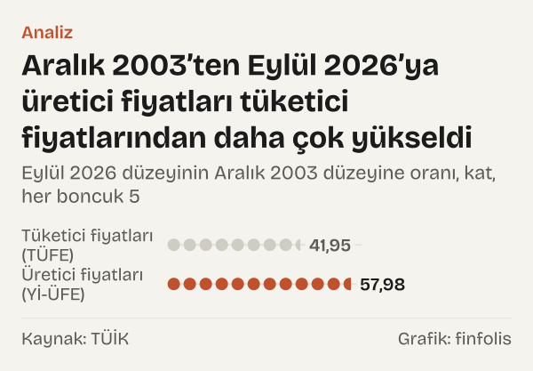

%157,69 ve %85,51. Ekim 2022'de Türkiye'de iki fiyat endeksinin bir yıl öncesine göre artışı bunlardı. İlki, Türkiye İstatistik Kurumu'nun (TÜİK) yurt içi üretici fiyat endeksi (Yİ-ÜFE): madenlerin, fabrikaların, elektrik santrallerinin ve su kuruluşlarının ürettikleri malları satarken aldıkları fiyatlar. İkincisi tüketici fiyat endeksi (TÜFE): hanelerin markette, kasada, faturada ödediği fiyatlar. İki rakam arasında 72,17 puan vardı.

Böyle bir fark, iki serinin uzun tarihinde istisnadır. Aralık 2003'ten Aralık 2016'ya kadar iki endeks birbirine yakın yürüdü. Sonra iki dalga halinde ayrıştılar: önce 2017–2019 arasında küçük, sonra 2020–2023 arasında büyük bir dalga. Temmuz 2023'ten Eylül 2026'ya kadar ise yön tersine döndü; bu dönemde tüketici fiyatlarının yıllık artışı her ay üretici fiyatlarınınkinden yüksek kaldı.

Okur için anlamı şu: aynı ekonomide iki taraf aynı enflasyonu yaşamaz. Bir dönem üretenin sattığı malın fiyatı hızla yükselirken tüketicinin ödediği fiyat daha yavaş gelebilir; başka bir dönem tersi olur. Aşağıda iki endeksi aynı ölçekte yan yana koyup ne zaman ayrıştıklarını, aradaki farkın nasıl daraldığını ve hangi üretici sektörünün öne çıktığını inceliyoruz.

![Küçük çoklu grafik: İki endeksin yıllık artışı on üç yıl yakın yürüdü, sonra iki dalgada ayrıştı: Tüketici fiyatları (TÜFE): 2004 yılında %9,35, 2005 yılında %7,72, 2006 yılında %9,65, 2007 yılında %8,39, 2008 yılında %10,06, 2009 yılında %6,53, 2010 yılında %6,40, 2011 yılında %10,45, 2012 yılında %6,16, 2013 yılında %7,40, 2014 yılında %8,17, 2015 yılında %8,81, 2016 yılında %8,53, 2017 yılında %11,92, 2018 yılında %20,30, 2019 yılında %11,84, 2020 yılında %14,60, 2021 yılında %36,08, 2022 yılında %64,27, 2023 yılında %64,77, 2024 yılında %44,38, 2025 yılında %30,89, Eyl 2026: %29,73; Yurt içi üretici fiyatları (Yİ-ÜFE): 2004 yılında %13,84, 2005 yılında %4,54, 2006 yılında %11,58, 2007 yılında %5,94, 2008 yılında %8,11, 2009 yılında %5,93, 2010 yılında %8,87, 2011 yılında %13,33, 2012 yılında %2,45, 2013 yılında %6,97, 2014 yılında %6,36, 2015 yılında %5,71, 2016 yılında %9,94, 2017 yılında %15,47, 2018 yılında %33,64, 2019 yılında %7,36, 2020 yılında %25,15, 2021 yılında %79,89, 2022 yılında %97,72, 2023 yılında %44,22, 2024 yılında %28,52, 2025 yılında %27,67, Eyl 2026: %27,38.](./graf-1.svg)
*Aralık aylarında bir önceki yılın aynı ayına göre değişim, yüzde; son nokta Eylül 2026. Kaynak: TÜİK.*

## İki endeks neyi ölçüyor

Karşılaştırmanın adil olması için önce iki terazinin neyi tarttığını ayırmak gerekiyor.

Yİ-ÜFE dört sektörün fiyatlarından oluşuyor: madencilik ve taş ocakçılığı; imalat; elektrik, gaz, buhar ve iklimlendirme; su temini ve atık yönetimi. Hepsi mal ya da şebeke hizmeti üreten sektörler. Lokanta, eğitim, kira ya da sağlık hizmeti gibi kalemler bu endeksin içinde yok.

TÜFE ise hanelerin satın aldığı malları ve hizmetleri birlikte izliyor. Kira, okul ücreti, yemek dışarıda yemek, telefon faturası TÜFE'nin içinde. Üstelik TÜFE'deki fiyat, raftaki fiyattır; üretici fiyatının üstüne taşıma, dağıtım ve satış aşamaları eklenmiştir.

Dolayısıyla iki endeksin birebir aynı hızda artmasını beklemek için bir neden yok. Yine de ikisi de 2003'ün ortalamasını yüz kabul eden ölçekte yayımlanıyor. Bu ortak başlangıç, uzun dönemde hangisinin daha çok yol aldığını doğrudan karşılaştırmayı mümkün kılıyor. Biz de Yİ-ÜFE düzeyini aynı aydaki TÜFE düzeyine böldük. Oran birse iki endeks 2003'ün ortalamasından bu yana aynı ölçüde yükselmiş demektir; birin üstündeyse üretici fiyatları daha hızlı yükselmiştir.

## Uzun bir birliktelik: 2004–2016

İlk on üç yılda iki seri arasında belirgin bir açıklık yok. Aralık 2003'te oran 0,978'di. Aralık 2004'te 1,018'e çıktı, Aralık 2015'te 0,925'e indi. Bu bantta oran bir yukarı bir aşağı gidip geldi; hiçbir aralık ayında birin çok uzağına düşmedi.

Yıllık değişimlere bakınca da aynı resim çıkıyor. Bazı yıllar üretici fiyatları önde: Aralık 2011'de Yİ-ÜFE'nin yıllık artışı TÜFE'ninkini 2,88 puan aştı. Bazı yıllar tüketici fiyatları önde: Aralık 2012'de TÜFE 3,71 puan öndeydi. Bu yıllarda fark iki yöne de birkaç puanı geçmedi.

Dönemin sonunda, Aralık 2016'da oran 0,937'deydi. Yani on üç yıl sonra üretici fiyatları, 2003'ün ortalamasına göre tüketici fiyatlarından biraz daha az yükselmişti.

## Ayrışmanın ilk dalgası: 2017–2019

Yön Aralık 2016'da değişti. Kasım 2016'da Yİ-ÜFE'nin yıllık artışı TÜFE'ninkinin 0,59 puan altındaydı; Aralık 2016'da 1,41 puan üstüne çıktı. Aylık verilere göre bu üstünlük Temmuz 2019'a kadar her ay sürdü.

Dalganın tepesine yakın Aralık 2018'de fark 13,34 puandı. O ay yıllık artış Yİ-ÜFE'de %33,64, TÜFE'de %20,30'du. Oran Aralık 2017'deki 0,967'den Aralık 2018'de 1,074'e yükseldi. Bu, ilk kez iki endeksin düzeyleri arasında kalıcı görünen bir açıklık demekti.

2019 yılında dalga söndü. Temmuz 2019'da Yİ-ÜFE hâlâ 5,01 puan öndeydi; Ağustos 2019'da TÜFE 1,56 puan öne geçti. Aralık 2019'da fark TÜFE lehine 4,47 puana açıldı ve oran 1,031'e geriledi. Açıklığın bir kısmı kapanmıştı, ama oran birin altına dönmedi.

## İkinci ve büyük dalga: 2020–2023

İkinci dalga Eylül 2020'de başladı. Ağustos 2020'de TÜFE 0,24 puan öndeydi; Eylül 2020'de Yİ-ÜFE 2,59 puan öne geçti. Bu üstünlük Haziran 2023'e kadar her ay sürdü.

Bu dalganın büyüklüğü öncekiyle kıyaslanamaz. İlk dalgada fark aralık aylarında en çok 13,34 puana çıkmıştı; ikinci dalgada aralık ayı farkı bu düzeyi kat kat aştı. Önce Aralık 2020'de fark 10,55 puana çıktı ve oran 1,126'ya yükseldi. Aralık 2021'de Yİ-ÜFE yıllık %79,89, TÜFE %36,08 arttı; fark 43,81 puandı ve oran 1,488'e ulaştı. Bir yıl içinde oran, ilk dalganın bütün kazancından daha fazla yükseldi. Ekim 2022'de iki endeksin yıllık artışı da, Aralık 2003'ten bu yana en yüksek düzeyine aynı ayda ulaştı ve fark 72,17 puana çıktı. Düzeylerin oranı da aynı ayda 1,855'e yükseldi.

Dalganın sonu da aylık veride net. Haziran 2023'te Yİ-ÜFE 2,20 puan öndeydi. Temmuz 2023'te TÜFE 3,33 puan öne geçti. O aydan Eylül 2026'ya kadar tüketici fiyatlarının yıllık artışı her ay üretici fiyatlarınınkinden yüksek kaldı.

![Çizgi grafik: Üretici fiyat düzeyinin tüketici fiyat düzeyine oranı Aralık 2022’de zirveye yakındı, sonra geriledi: Yİ-ÜFE / TÜFE: 2003 yılında 0,978, 2004 yılında 1,018, 2005 yılında 0,988, 2006 yılında 1,005, 2007 yılında 0,982, 2008 yılında 0,965, 2009 yılında 0,959, 2010 yılında 0,982, 2011 yılında 1,007, 2012 yılında 0,972, 2013 yılında 0,968, 2014 yılında 0,952, 2015 yılında 0,925, 2016 yılında 0,937, 2017 yılında 0,967, 2018 yılında 1,074, 2019 yılında 1,031, 2020 yılında 1,126, 2021 yılında 1,488, 2022 yılında 1,791, 2023 yılında 1,568, 2024 yılında 1,396, 2025 yılında 1,361, Eyl 2026: 1,351.](./graf-2.svg)
*Yİ-ÜFE düzeyinin TÜFE düzeyine oranı, aralık ayları, son nokta Eylül 2026; ikisi de 2003 yılı ortalaması yüz. Kaynak: TÜİK.*

## Fark nasıl kapandı, ne kadarı kaldı

Ayrışmanın kapanması, tüketici fiyatlarının bir süre üretici fiyatlarından hızlı artmasıyla oldu. Aralık 2023'te TÜFE'nin yıllık artışı Yİ-ÜFE'ninkini 20,55 puan, Aralık 2024'te 15,85 puan aştı. Aralık 2025'te bu fark 3,23 puana, Eylül 2026'da 2,35 puana daraldı.

Aynı süreçte düzeylerin oranı adım adım indi: Aralık 2022'de 1,791, Aralık 2023'te 1,568, Aralık 2024'te 1,396, Aralık 2025'te 1,361. Eylül 2026'da oran 1,351'di.

İki dalganın süresi birbirine yakın: ilki Aralık 2016'dan Temmuz 2019'a, ikincisi Eylül 2020'den Haziran 2023'e uzandı. Aradaki asıl fark derinlikte. İlk dalga oranı birin biraz üstüne taşıdı; ikinci dalga oranı bir buçuk katın da üstüne çıkardı ve bu yükseklik, dalga bittikten sonra da tümüyle geri alınmadı.

Hesabı tamamlayalım. Ekim 2022'deki tepeyle Eylül 2026 arasında oran 0,504 geriledi. Tepedeki oranın birin üstünde kalan kısmının yarısından biraz fazlası böylece kapandı; geri kalanı hâlâ duruyor.

Uzun yolun toplamı da bu kalan farkı gösteriyor. Aralık 2003'ten Eylül 2026'ya Yİ-ÜFE 57,98 kat, TÜFE 41,95 kat yükseldi.

*Eylül 2026 düzeyinin Aralık 2003 düzeyine oranı, kat. Kaynak: TÜİK.*

## Üretici tarafında hangi sektör öne çıktı

Yİ-ÜFE'nin dört sektörü de aynı yolu izlemedi. Aralık 2003'ten Eylül 2026'ya madencilik ve taş ocakçılığı 93,37 kat, imalat 56,00 kat yükseldi. Elektrik ve gaz 44,39 kat, su ve atık yönetimi 43,93 kat yükseldi. Uzun dönemde TÜFE'nin belirgin biçimde üstünde kalan sektörler madencilik ve imalat oldu; elektrik ve gaz ile su, uzun yolun sonunda TÜFE'ye yakın kaldı.

Ekim 2022'de ise başka bir sektör öne çıktı. O ay elektrik ve gaz sektörünün üretici fiyatları yıllık %554,56 arttı. Madencilik %162,06, imalat %122,97, su %109,45 arttı. Yani büyük dalganın tepesinde en büyük hareket enerjide görüldü. Ama aynı sektörün yıllık artışı Eylül 2026'da %8,67'ye indi; bu oran, aynı ay genel Yİ-ÜFE'nin yıllık artışının çok altında kaldı. Bu yüzden Ekim 2022'deki büyük artış, uzun dönem toplamında madencilik ve imalatın gerisinde kaldı.

Eylül 2026'daki tablo da sektörler arasında dengesiz. Madencilikte yıllık artış %34,15, imalatta %29,09, su ve atık yönetiminde %29,70 iken elektrik ve gazda %8,67'de kaldı. Genel Yİ-ÜFE'nin yıllık artışı %27,38'di. Yani son on iki ayda en hızlı artış madencilikte, en yavaşı elektrik ve gazdaydı. Ekim 2022'de ise elektrik ve gaz sıralamanın en başındaydı. Aynı sektör, dört yıl arayla iki ucun ikisinde de durmuş oldu; bu da tek bir aydaki yıllık rakamın uzun dönem hakkında ne kadar az şey söyleyebildiğini gösteriyor.

*Yİ-ÜFE sektör endekslerinin yıllık değişimi, yüzde. Kaynak: TÜİK.*

## Aynı ayrışmanın iki ölçüsü

Ayrışmayı iki farklı ölçüyle izledik ve bu iki ölçü aynı dönem için farklı şeyler söyleyebiliyor. Bunu açıkça tartmak gerekiyor.

Birinci ölçü yıllık değişim farkı. Bu ölçüye göre büyük dalga Temmuz 2023'te bitti: o ay TÜFE'nin yıllık artışı Yİ-ÜFE'ninkini 3,33 puan geçti ve Eylül 2026'ya kadar her ay önde kaldı. Bu ölçüyle bakan biri, ayrışmanın üç yılı aşkın süredir tersine işlediğini söyler.

İkinci ölçü düzeylerin oranı. Bu ölçüye göre ayrışma bitmedi, yalnız küçüldü. Temmuz 2023'ten sonra oran her aralık ayında geriledi, ama Eylül 2026'da 1,351'de, yani 2004–2016 döneminin bütün aralık değerlerinin üstünde duruyor. Bu ölçüyle bakan biri, üretici fiyatlarının 2003'ün ortalamasına göre tüketici fiyatlarından hâlâ belirgin biçimde daha çok yükselmiş olduğunu söyler.

İki ölçü birbirini çürütmüyor; farklı soruları yanıtlıyor. Yıllık fark son on iki ayda hangi tarafın daha hızlı arttığını, düzey oranı ise uzun yolda hangi tarafın daha çok yol aldığını gösteriyor. Ekim 2022'deki 72,17 puanlık yıllık fark ile Eylül 2026'daki 1,351'lik oran aynı tarihin iki ayrı fotoğrafı.

Bu iki ölçünün hiçbiri ayrışmanın nedenini söylemiyor. Üretici ve tüketici fiyatları arasındaki ilişki için TCMB'nin ya da başka bir kurumun değerlendirmesine bu yazıda yer vermedik; yalnız iki serinin aynı dönemde ne yaptığını yazıyoruz. İki endeks farklı sepetleri, farklı aşamalardaki fiyatları tartıyor; ayrışmanın büyüklüğü tek başına üreticinin ya da tüketicinin daha kötü durumda olduğunu söylemez.

## İki endeksi yan yana koymanın sınırları

Birincisi ağırlıklar. Her iki endeks de kendi ağırlıklarıyla toplanıyor ve bu ağırlıklar zaman içinde değişiyor. Oranın 1,351 olması, aynı sepetin iki fiyatı arasındaki fark değildir; iki ayrı birikimli fiyat değişiminin oranıdır.

İkincisi başlangıç noktası. Oranı bir kabul eden nokta 2003'ün ortalaması. Başlangıç olarak başka bir yıl seçilseydi oranların düzeyi değişirdi, ama dalgaların zamanı değişmezdi. Bu yüzden yazıda tarih ve yön üzerinde, oranın tam düzeyinden daha çok duruyoruz.

Üçüncüsü baz değişikliği. TÜİK, Ocak 2026'dan itibaren TÜFE'yi 2025'in ortalamasını temel alan yeni bir seriyle yayımlıyor. Bu yazıda 2003'ün ortalamasını temel alan genel TÜFE serisini kullandık; TCMB'nin veri sistemi bu seriyi Eylül 2026'ya kadar yayımlamaya devam ediyor. Yİ-ÜFE de aynı dönemde 2003 yılı temelli. İki farklı temel yılı birbirine bağlayan kendi hesabımızı yapmadık.

Dördüncüsü aylık oynaklık. Yıllık değişim farkının işaretinin değiştiği aylar, kısa süreli fiyat hareketlerine duyarlıdır. Örneğin Ağustos 2020'de fark yalnız 0,24 puandı. Dalgaların başlangıç ve bitiş aylarını bu yüzden bir aylık hassasiyetle değil, dönemin yönü olarak okumak daha doğru.

## Nasıl hesapladık

Türkiye Cumhuriyet Merkez Bankası (TCMB) Elektronik Veri Dağıtım Sistemi'nden (EVDS) TÜİK'in iki serisini çektik: 2003 yılı temelli genel TÜFE ve 2003 yılı temelli Yİ-ÜFE. Her aralık ayı ile Ekim 2022 ve Eylül 2026 için iki endeksin düzeyini aldık ve Yİ-ÜFE'yi TÜFE'ye böldük. Yıllık değişimler EVDS'nin kendi yıllık yüzde değişim formülüyle alındı; iki yıllık değişimin farkını puan olarak hesapladık. Dalgaların başlangıç ve bitiş aylarını aylık yıllık değişim serisinde farkın işaretinin değiştiği aylar olarak belirledik. Uzun dönem artışını, Eylül 2026 düzeyini Aralık 2003 düzeyine bölerek kat olarak verdik. Sektörler için Yİ-ÜFE'nin dört ana sektör endeksini aynı biçimde kullandık.

## Kaynaklar

- [TCMB EVDS: TÜFE genel endeks (2003 yılı temelli), seri TP.GENENDEKS.T1, Aralık 2003–Eylül 2026](https://evds3.tcmb.gov.tr/igmevdsms-dis/series=TP.GENENDEKS.T1)
- [TCMB EVDS: Yİ-ÜFE genel endeks (2003 yılı temelli), seri TP.TUFE1YI.T1, Aralık 2003–Eylül 2026](https://evds3.tcmb.gov.tr/igmevdsms-dis/series=TP.TUFE1YI.T1)
- [TCMB EVDS: Yİ-ÜFE madencilik ve taş ocakçılığı, seri TP.TUFE1YI.T2](https://evds3.tcmb.gov.tr/igmevdsms-dis/series=TP.TUFE1YI.T2)
- [TCMB EVDS: Yİ-ÜFE imalat, seri TP.TUFE1YI.T15](https://evds3.tcmb.gov.tr/igmevdsms-dis/series=TP.TUFE1YI.T15)
- [TCMB EVDS: Yİ-ÜFE elektrik, gaz, buhar ve iklimlendirme, seri TP.TUFE1YI.T118](https://evds3.tcmb.gov.tr/igmevdsms-dis/series=TP.TUFE1YI.T118)
- [TCMB EVDS: Yİ-ÜFE su temini, kanalizasyon ve atık yönetimi, seri TP.TUFE1YI.T123](https://evds3.tcmb.gov.tr/igmevdsms-dis/series=TP.TUFE1YI.T123)
