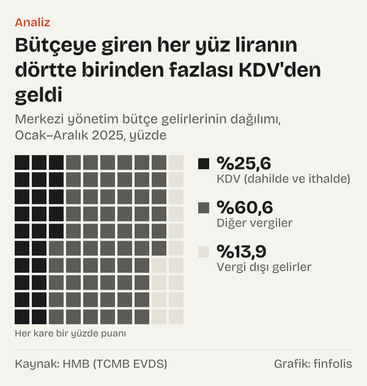
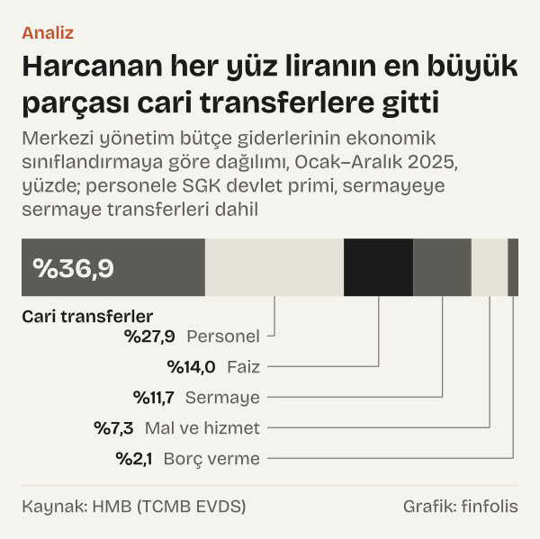
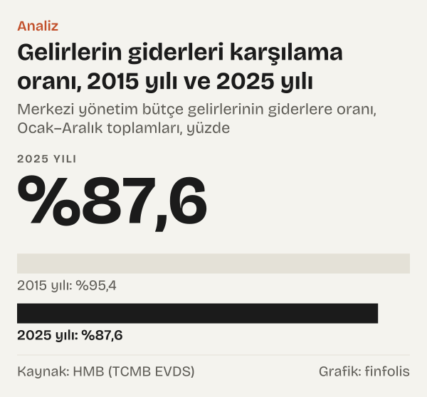

Bir markette alışveriş yapıp fişe baktığınızda en altta KDV satırını görürsünüz. Ay sonunda bordroda gelir vergisi kesintisi vardır; benzin, sigara ya da otomobil fiyatının içinde özel tüketim vergisi (ÖTV) durur. Bu kalemlerin her biri aynı yere, merkezi yönetim bütçesine akar. Peki bütçeye giren paranın ne kadarı hangi vergiden geliyor ve bu para nereye harcanıyor?

Hazine ve Maliye Bakanlığı'nın (HMB) aylık bütçe gerçekleşmelerini 2025 yılı için on iki ay boyunca topladığımızda tablo şöyle: merkezi yönetim bütçe gelirleri 12,83 trilyon TL, giderleri 14,64 trilyon TL. Gelirin %25,6'sı KDV'den geldi; yani bütçeye giren her yüz liranın dörtte birinden fazlası alışverişte ödenen bu vergiden. Gider tarafında en büyük parça %36,9 ile cari transferler, ardından %27,9 ile personel ve sosyal güvenlik primi geliyor. Faiz giderleri harcamanın %14'ünü tuttu.

İki tarafı yan yana koyduğumuzda bir fark daha görünüyor: gelirler giderlerin %87,6'sını karşıladı. Kalan kısım borçlanmayla finanse edilen bütçe açığı. Yazının geri kalanı yüz liralık bir birimi önce gelir tarafında, sonra gider tarafında izliyor ve aynı hesabı 2015 yılı için tekrarlıyor.

## Yüz liranın geldiği yerler

Merkezi yönetim bütçesi üç parçadan oluşur: genel bütçeli idareler, özel bütçeli idareler ve düzenleyici ve denetleyici kurumlar. EVDS'deki seride bu üçünün toplamı merkezi yönetim bütçe gelirleri adıyla geçiyor ve 2025 yılında 12,83 trilyon TL'ye ulaştı. Bunun 11,05 trilyon TL'si vergi gelirlerinden geldi.

Gelirleri üç kümeye ayırdık. Dahilde ve ithalde alınan KDV birlikte %25,6 pay aldı. KDV dışındaki bütün vergiler (gelir, kurumlar, ÖTV, damga, harçlar, gümrük ve diğerleri) %60,6'yı oluşturdu. Geriye kalan %13,85, vergi dışı gelirler: teşebbüs ve mülkiyet gelirleri, faizler, paylar ve cezalar, sermaye gelirleri ile özel bütçeli idarelerin ve düzenleyici kurumların kendi gelirleri.

*Merkezi yönetim bütçe gelirlerinin dağılımı, Ocak–Aralık 2025, yüzde. Kaynak: HMB (TCMB EVDS).*

Üç kümenin ilk ikisi toplandığında vergilerin bütçe gelirindeki payı %86,15 ediyor. Yüz liralık gelirin yaklaşık seksen altı lirası vergiden geliyor demek bu.

Vergi dışı gelirlerin içinde en büyük kalem faizler, paylar ve cezalar başlığı: gelirlerin %8,42'si. Bu başlık; vergi gecikme faizlerini, kurumlardan alınan devlet paylarını ve idari ya da vergi cezalarını bir arada tutuyor. Teşebbüs ve mülkiyet gelirleri, yani mal ve hizmet satış gelirleri, kurum kârları ve kira gelirleri ise gelirlerin %1,56'sında kaldı. Vergi dışı gelirler sayıca çok satırdan oluşuyor ama toplamda vergilerin yanında küçük bir kalem.

## Vergilerin sırası: tüketim mi, kazanç mı?

Vergileri tek tek sıraladığımızda ilk sırada KDV var. Ancak bu birleşik bir rakam: dahilde alınan KDV gelirlerin %12,13'ünü, ithalatta alınan KDV ise %13,44'ünü tuttu. İkinci sırada %21,9 ile gelir vergisi geliyor. Bu kalem ücretlerden yapılan tevkifatı, beyana dayanan gelir vergisini ve geçici vergiyi birlikte kapsıyor.

Üçüncü sırada %15,8 ile ÖTV, dördüncü sırada %9,5 ile kurumlar vergisi duruyor. Banka ve sigorta muameleleri vergisi (BSMV) %4,3 pay aldı. Harçlar %2,63, gümrük vergileri %2,48, damga vergisi %1,76 ile listenin sonunda.

*Vergi türlerinin merkezi yönetim bütçe gelirleri içindeki payı, Ocak–Aralık 2025, yüzde. Kaynak: HMB (TCMB EVDS).*

Bu sıralama iki ayrı vergi ailesini yan yana koyuyor. KDV, ÖTV ve BSMV bir mal ya da hizmet alınırken fiyatın içinde ödenir. Gelir vergisi ve kurumlar vergisi ise elde edilen kazanç üzerinden alınır. Bütçe sınıflandırmasında da bu ayrım var: dahilde alınan mal ve hizmet vergileri ile gelir ve kazanç üzerinden alınan vergiler iki ayrı başlık. Buradaki hesap yalnız 2025 yılında hangi kalemden ne kadar gelir toplandığını gösteriyor.

## Aynı yüz lira on yıl önce

Karşılaştırma için 2015 yılını seçtik. Aynı seriler, aynı tanım ve aynı Ocak–Aralık toplamı. O yıl merkezi yönetim bütçe gelirleri nominal olarak çok daha düşüktü; 2025 yılı geliri 2015 yılı gelirinin 26,6 katı. Bu yüzden tutarları değil payları karşılaştırıyoruz.

KDV'nin payı neredeyse yerinde saydı: 2015 yılında %25,1, 2025 yılında %25,6. İçeride ise bir kayma var. Dahilde alınan KDV'nin payı %9,62'den %12,13'e çıktı, ithalde alınan KDV'nin payı %15,46'dan %13,44'e indi.

Daha belirgin değişim ÖTV ile gelir vergisi arasında. ÖTV 2015 yılında gelirlerin %21,9'unu tutuyordu ve gelir vergisinin önündeydi. 2025 yılında payı %15,8'e indi. Gelir vergisinin payı aynı dönemde %17,8'den %21,9'a, kurumlar vergisininki %6,9'dan %9,5'e yükseldi. BSMV'nin payı %1,9'dan %4,3'e çıktı.

*Merkezi yönetim bütçe giderlerinin ekonomik sınıflandırmaya göre dağılımı, Ocak–Aralık 2025, yüzde; personele SGK devlet primi, sermayeye sermaye transferleri dahil. Kaynak: HMB (TCMB EVDS).*

Vergilerin toplam payı da biraz arttı: 2015 yılında %84,47 olan oran 2025 yılında %86,15 oldu. Vergi dışı gelirlerin payı buna karşılık %15,53'ten %13,85'e geriledi.

Bütçe gerçekleşme tablosu bu kaymaların nedenlerini ayırmaz; tablodan yalnız sonuç okunur. Bu yazı da neden üzerine bir şey söylemiyor, yalnız iki yılın paylarını aynı ölçüyle yan yana koyuyor.

## Yüz liranın gittiği yerler

Merkezi yönetim bütçesi 2025 yılında 14,64 trilyon TL harcadı. Ekonomik sınıflandırmaya göre en büyük kalem %36,9 ile cari transferler. Bu başlık, bütçenin karşılığında doğrudan mal ya da hizmet almadan başka kurumlara, idarelere ya da hanelere aktardığı parayı kapsıyor.

Cari transferlerin içindeki iki büyük kalem şunlar. Hazine yardımları giderlerin %15,82'sini tuttu; sınıflandırmada sosyal güvenlik kuruluşlarına yapılan aktarımlar ile sağlık, emeklilik ve sosyal yardım giderleri bu başlığın altında. Gelirden ayrılan paylar ise %11,33 pay aldı. Bu başlığın %76,66'sı mahalli idare payları, yani vergi gelirlerinden belediyelere ve il özel idarelerine ayrılan paylar; kalan kısım fon payları ve diğer paylar. Yüz liralık harcamanın on bir lirası kadarı, bir başka deyişle, merkezi yönetimin kendi harcaması olmaktan çok başka idarelere aktarılan para.

İkinci büyük parça personel. Personel giderleri tek başına harcamanın %24,82'si; sosyal güvenlik kurumlarına ödenen devlet primi eklendiğinde pay %27,9'a çıkıyor. Faiz giderleri %14 ile üçüncü sırada. Sermaye giderleri ve sermaye transferleri birlikte %11,65, mal ve hizmet alımları %7,3, borç verme %2,1 tuttu.

*Vergi türlerinin merkezi yönetim bütçe gelirleri içindeki payı, Ocak–Aralık toplamları, yüzde. Kaynak: HMB (TCMB EVDS).*

On yıl önceki tabloyla yan yana koyduğumuzda gider tarafı gelir tarafındakinden daha durağan görünüyor. Cari transferlerin payı %36,1'den %36,9'a, personel ve primin payı %28,9'dan %27,9'a değişti. Sermaye kalemlerinin payı %13,4'ten %11,65'e, mal ve hizmet alımlarınınki %9'dan %7,3'e indi.

## Faiz kalemi ve gelirle karşılanmayan kısım

Gider tarafında payı en çok değişen kalem faiz. 2015 yılında harcamaların %10,5'i faiz giderleriydi; 2025 yılında bu oran %14'e çıktı. Tutar olarak 2025 yılı faiz gideri 2,05 trilyon TL ve 2015 yılı tutarının 38,8 katı. Aynı dönemde toplam gider 28,9 kat, personel giderleri 29,1 kat büyüdü.

Faiz kaleminin kendi içi de bölünebiliyor. 2025 yılında faiz giderlerinin %77,35'i iç borç faiz ödemelerinden, %11,81'i dış borç faiz ödemelerinden oluştu. Geri kalanı bütçe tablosunda ayrı satırlarda izlenen iskonto ve kısa vadeli nakit işlemleri, türev ürün giderleri ve kira sertifikası giderleri. İç borç faizinin faiz giderleri içindeki payı 2015 yılında %73,92'ydi. Kur değişimlerinin bu dağılıma etkisini tablo ayrıca göstermediği için bu yazı o konuda bir yorum yapmıyor.

Faizi gelir tarafıyla da karşılaştırdık. 2025 yılında faiz giderleri vergi gelirlerinin %18,6'sına eşitti; 2015 yılında bu oran %13'tü.

Bütçenin iki tarafını birleştiren oran gelirin gideri karşılama oranı. 2025 yılında gelirler giderlerin %87,6'sını karşıladı. Başka bir deyişle harcanan yüz liranın yaklaşık on iki buçuk lirası o yılın gelirinden değil, açıktan finanse edildi: açık 1,81 trilyon TL ve giderlerin %12,4'ü. 2015 yılında gelirler giderlerin %95,35'ini karşılıyordu, açık giderlerin %4,65'iydi.

*Merkezi yönetim bütçe gelirlerinin giderlere oranı, Ocak–Aralık toplamları, yüzde. Kaynak: HMB (TCMB EVDS).*

İki yıllık karşılaştırma bir eğilim iddiası taşımıyor. Arada kalan yıllara bakmadık ve iki uç yıl, aradaki inişli çıkışlı yolu göstermez. Yalnız iki yılın aynı ölçüyle yan yana konmuş hâlidir.

## Payların küçülmesi kalemin küçülmesi değil

Aynı tabloyu okumanın bir başka yolu payları değil büyüklükleri izlemek. O zaman tablo farklı bir şey söylüyor. ÖTV'nin payı on yılda düştü, ama ÖTV geliri 2025 yılında 2015'tekinin 19,1 katıydı. Gelir vergisi 32,8 kat, kurumlar vergisi 36,7 kat büyüdü. Pay düşüşü, ÖTV'nin küçüldüğünü değil, ötekilerden daha yavaş büyüdüğünü gösteriyor.

Sınıflandırma da sıralamayı etkiliyor. KDV'yi tek kalem saydığımızda gelirin en büyük kaynağı o oluyor. Dahilde ve ithalde alınan KDV'yi bütçe tablosundaki gibi ayrı tuttuğumuzda ise ilk sırada %21,9 ile gelir vergisi, ikinci sırada %15,8 ile ÖTV yer alıyor; ithalde KDV %13,44 ile üçüncü, dahilde KDV %12,13 ile dördüncü sıraya düşüyor. Hangi vergi "en büyük" sorusunun cevabı, kalemlerin nasıl gruplandığına bağlı.

Harcama tarafında da benzer bir durum var. Personel giderine devlet primini eklemek, sermaye giderine sermaye transferlerini eklemek bizim tercihimiz. Bakanlığın tablosunda bunlar ayrı satırlarda duruyor ve okur kendi gruplamasıyla farklı paylara ulaşabilir.

## Tablonun sınırları

Yazıdaki bütün 2025 yılı rakamları HMB'nin aylık bütçe gerçekleşmelerinin Ocak–Aralık toplamıdır. Kesin hesap belgesi kullanılmadı; aylık gerçekleşme verisi ile kesin hesap ayrı belgelerdir. 2026 yılı için veri Eylül 2026'ya kadar yayımlandığından yıl tamamlanmadı ve hesaba alınmadı.

Kapsam merkezi yönetimle sınırlı. Belediyelerin ve sosyal güvenlik kurumlarının kendi gelir ve giderleri bu tabloda yok; onlara yapılan aktarımlar ise gider olarak görünüyor. Genel yönetimin bütününe bakan bir hesap farklı paylar verir.

Rakamlar nominal TL'dir; enflasyondan arındırılmadı ve milli gelire oranlanmadı. Bu yüzden 2015–2025 arasındaki kat sayıları reel büyüklük değişimi olarak okunmamalı. Paylar ise aynı yılın içinden hesaplandığı için fiyat düzeyinden etkilenmez.

Son olarak, bütçe sınıflandırması zaman içinde yeni satırlar ekliyor; örneğin bazı yeni vergi kalemleri 2015 yılında tabloda yoktu. Bu kalemler "diğer vergiler" içinde kaldığı için karşılaştırmayı bozmuyor, ama tek tek kalem izlemede dikkat gerektiriyor.

## Nasıl hesapladık

TCMB'nin Elektronik Veri Dağıtım Sistemi'nde (EVDS) yayımlanan, kaynağı HMB olan merkezi yönetim bütçe gelirleri ve harcamaları aylık veri gruplarını kullandık. Her serinin Aralık gözlemini EVDS'nin hareketli toplam formülüyle çektik; bu, Ocak–Aralık toplamını verir ve 2025 yılı toplam geliri için aylık değerlerin tek tek toplanmasıyla aynı sonucu verdiğini ayrıca kontrol ettik. Payları, kalem tutarını toplam gelire ya da toplam gidere bölerek hesapladık. KDV için dahilde ve ithalde alınan KDV'yi topladık. Kat sayıları, 2025 yılı tutarının 2015 yılı tutarına bölümüdür. Bütün hesaplar kanıt dosyasında tek tek kayıtlıdır.

## Kaynaklar

- [HMB (TCMB EVDS): Merkezi Yönetim Bütçe Gelirleri, TP.KB.GEL001, 2015–2025](https://evds3.tcmb.gov.tr/igmevdsms-dis/series=TP.KB.GEL001)
- [HMB (TCMB EVDS): Vergi Gelirleri, TP.KB.GEL003](https://evds3.tcmb.gov.tr/igmevdsms-dis/series=TP.KB.GEL003)
- [HMB (TCMB EVDS): Gelir Vergisi, TP.KB.GEL005](https://evds3.tcmb.gov.tr/igmevdsms-dis/series=TP.KB.GEL005)
- [HMB (TCMB EVDS): Kurumlar Vergisi, TP.KB.GEL010](https://evds3.tcmb.gov.tr/igmevdsms-dis/series=TP.KB.GEL010)
- [HMB (TCMB EVDS): Dahilde Alınan KDV, TP.KB.GEL018](https://evds3.tcmb.gov.tr/igmevdsms-dis/series=TP.KB.GEL018)
- [HMB (TCMB EVDS): İthalde Alınan KDV, TP.KB.GEL033](https://evds3.tcmb.gov.tr/igmevdsms-dis/series=TP.KB.GEL033)
- [HMB (TCMB EVDS): Özel Tüketim Vergisi, TP.KB.GEL021](https://evds3.tcmb.gov.tr/igmevdsms-dis/series=TP.KB.GEL021)
- [HMB (TCMB EVDS): Merkezi Yönetim Bütçe Giderleri, TP.KB.GID001](https://evds3.tcmb.gov.tr/igmevdsms-dis/series=TP.KB.GID001)
- [HMB (TCMB EVDS): Cari Transferler, TP.KB.GID026](https://evds3.tcmb.gov.tr/igmevdsms-dis/series=TP.KB.GID026)
- [HMB (TCMB EVDS): Personel Giderleri, TP.KB.GID003](https://evds3.tcmb.gov.tr/igmevdsms-dis/series=TP.KB.GID003)
- [HMB (TCMB EVDS): Faiz Giderleri, TP.KB.GID152](https://evds3.tcmb.gov.tr/igmevdsms-dis/series=TP.KB.GID152)
